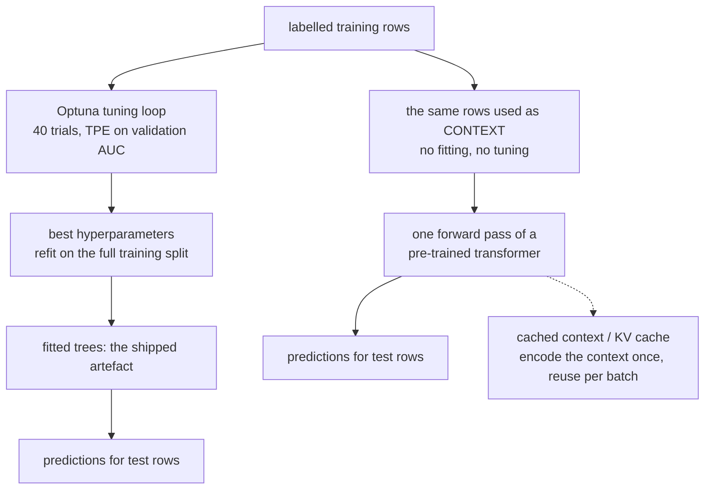
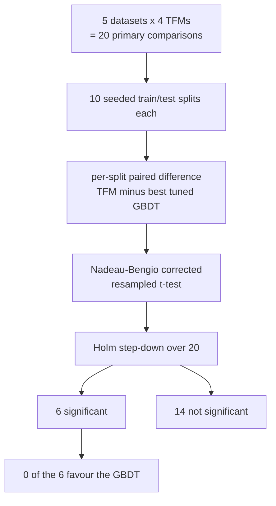
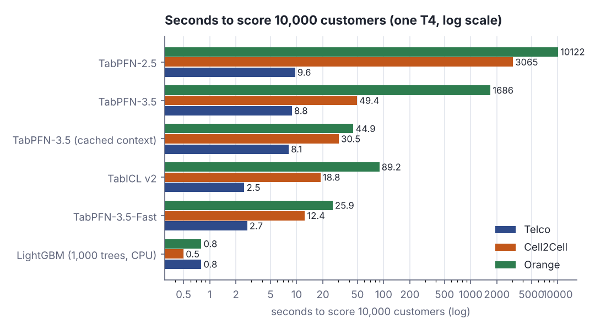
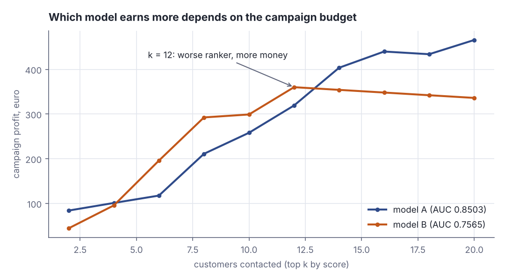
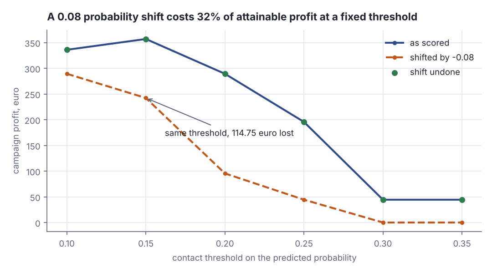

# Tuned boosting holds: foundation models win 6 of 20 churn comparisons

> Fresh · AI / ML foundations · Intermediate · ~25 min · from today's feeds

## Why this matters
Your next core rung is decision trees and ensembles, and this preprint is the sharpest current argument for why that rung still earns its place: it re-runs a benchmark that declared tabular foundation models the winner, but this time the gradient-boosting baselines are actually tuned.
It is also a clean exercise in reading evidence — a single-author, un-peer-reviewed arXiv preprint with self-reported numbers, whose entire contribution is noticing that someone compared a tuned thing against an untuned thing.
And the decision it lands on is one you already make as a Product Owner: pick the metric that matches the decision being taken, not the one that is cheapest to compute.

## Primer
You know logistic regression and gradient descent; you have not met trees yet, so here is the minimum to follow what follows.

**A decision tree** predicts by asking yes/no questions about one feature at a time — `tenure < 12?`, `support_calls >= 3?` — and walking down to a leaf that holds a prediction. Each split is **axis-aligned**: it cuts on a single feature at a single value, never on a combination, so the model carves the feature space into boxes. The split chosen at each node is the one that most reduces an **impurity** measure of the labels on each side (Gini impurity or entropy for classification; squared error for regression). A single deep tree memorises; a single shallow tree underfits.

**Gradient boosting** turns shallow trees into a strong model by stacking them. Start with a constant prediction. Compute, for every training row, the gradient of the loss with respect to the current prediction — for squared loss that is exactly the residual `y − ŷ`. Fit a new shallow tree to those gradients, multiply its output by a small **learning rate** η, and add it to the running sum. Repeat for hundreds or thousands of trees. It is gradient descent, but each step is a function added to an ensemble instead of a number subtracted from a weight vector.

**The dials** are therefore: the learning rate, the number of trees, how big each tree may get (max depth, or max leaves), how many rows a leaf must contain, how much of the rows and columns each tree sees (subsampling), and an L2 penalty on the leaf values. Tuning them is what this lesson's paper says the earlier benchmark skipped.

**AUC** (area under the ROC curve) is a *ranking* metric: it is the probability that a randomly chosen positive is scored above a randomly chosen negative. It ignores the actual values — any strictly increasing transform of the scores leaves AUC unchanged — and it treats every customer as equally important.

This previews two core rungs: **"Decision trees and ensembles: what Kaggle actually wins with"** and **"Evaluation metrics: choosing what good means"**.

## The idea

### What was published, and how much to trust it

On 6 November 2026 Ismail Hossain Polas posted *Tabular Foundation Models vs Tuned Gradient Boosting for Telecom Churn: A Profit- and Calibration-Aware Evaluation* to arXiv (https://arxiv.org/abs/2611.12942). It is a **single-author preprint, not peer reviewed, with self-reported numbers and no independent replication** — read it for its method: separate the ranking question from the money question from the probability question, then correct for multiple testing.

### What a tabular foundation model is

> "Tabular foundation models (TFMs) predict from a labelled context in a single forward pass."
> — Ismail Hossain Polas, *Tabular Foundation Models vs Tuned Gradient Boosting for Telecom Churn: A Profit- and Calibration-Aware Evaluation*, 2026-11-06, https://arxiv.org/abs/2611.12942

That inverts how a tabular model is produced. A GBDT is *fitted* to your dataset: a tuning loop proposes hyperparameters, each trial trains an ensemble, the winner is refit on the full training split, and those trees are the artefact you ship. A TFM has no per-dataset training loop. You hand the pre-trained transformer your labelled training rows as **context** — as input, the way you hand an LLM a prompt — and it predicts the test rows in one pass. Here the context is the whole training split: 30,000 rows for Orange (Polas, 2026-11-06, §3).



*Figure 1: the two production paths. Gradient boosting is fitted per dataset; a tabular foundation model reads the training rows as context and predicts in one pass. Source: drawn for this lesson from Polas, 2026-11-06, https://arxiv.org/abs/2611.12942*

Because the context is re-encoded on every scoring call, the paper also measures **cached-context** (TabPFN-3.5) and **KV-cache** (TabICL v2) variants — the LLM KV-cache trick, encoding the training set once and reusing it per batch (Polas, 2026-11-06, §4.6).

### AUC, by counting pairs

Be concrete about what AUC counts: every (churner, stayer) pair, scored by whether the churner ranks higher.

```scala
// file: Auc5.scala
@main def auc5(): Unit =
  val rows = Vector((0.90, 1), (0.70, 0), (0.60, 1), (0.40, 1), (0.20, 0))
  val pos = rows.filter(_._2 == 1)
  val neg = rows.filter(_._2 == 0)
  val n = pos.size * neg.size
  var conc = 0.0
  for (a <- pos; b <- neg) do
    val add = if a._1 > b._1 then 1.0 else if a._1 == b._1 then 0.5 else 0.0
    println(f"churner ${a._1}%.2f vs stayer ${b._1}%.2f -> $add%.1f")
    conc += add
  println(f"concordant $conc%.1f of $n%d pairs, AUC ${conc / n}%.3f")
```

```text
churner 0.90 vs stayer 0.70 -> 1.0
churner 0.90 vs stayer 0.20 -> 1.0
churner 0.60 vs stayer 0.70 -> 0.0
churner 0.60 vs stayer 0.20 -> 1.0
churner 0.40 vs stayer 0.70 -> 0.0
churner 0.40 vs stayer 0.20 -> 1.0
concordant 4.0 of 6 pairs, AUC 0.667
```

Three churners × two stayers = six pairs, four ordered correctly, AUC = 4/6 = 0.667. Note what never entered the arithmetic: how much each customer is worth, and how many of them you can afford to call.

### The headline, with the correction applied

The paper tunes LightGBM 4.6.0, XGBoost 3.4.1 and CatBoost 1.2.10 with Optuna 5.0.0 (TPE on validation AUC, 40/40/25 trials, up to 3,000 trees, early stopping after 100 rounds) and compares them with four TFMs on five telecom churn datasets over ten seeded splits (Polas, 2026-11-06, §3).

> "In total, 6 of the 20 primary comparisons are significant after correction, and none favours the GBDT."
> — Ismail Hossain Polas, *Tabular Foundation Models vs Tuned Gradient Boosting for Telecom Churn: A Profit- and Calibration-Aware Evaluation*, 2026-11-06, https://arxiv.org/abs/2611.12942

Twenty comparisons = four TFMs × five datasets. **Nadeau–Bengio's corrected resampled t-test** is a paired t-test with an inflated variance term, because resampled splits of one dataset share most of their rows and the per-split differences are therefore not independent. **Holm step-down correction** then controls the family-wise error rate: sort the p-values ascending, require the smallest to beat α/20, the next α/19, and so on, stopping at the first failure.



*Figure 2: the evaluation design that turns 20 raw comparisons into 6 surviving ones. Adapted from Polas, Tabular Foundation Models vs Tuned Gradient Boosting for Telecom Churn, 2026-11-06, https://arxiv.org/abs/2611.12942*

For TabPFN-3.5 against the *best* tuned GBDT, in profit units per customer: Cell2Cell +0.175 (+1.9%), 95% CI [+0.133, +0.216], significant after Holm correction; Iranian +0.597 (+7.6%), CI [+0.382, +0.813], significant; Orange +0.082 (+14.3%), CI [+0.024, +0.140], ahead in 10/10 splits yet **not** significant after correction at adjusted p = 0.155; Telco +0.104 and Maven +0.135, both +1.0%, neither significant (Polas, 2026-11-06, §4.1). TabICL v2 is +7.4% on Iranian and −4.5% on Orange (Polas, 2026-11-06, §4.1). Tuning the baselines removed roughly one third of the apparent TFM lead on the E-Commerce replication (Polas, 2026-11-06, §4.5). The honest summary is not "foundation models win" but **model version matters more than model class**.

### Profit is a different question from ranking

**EMP** — expected maximum profit for customer churn — replaces AUC. A campaign contacts a prefix of the ranked list; each contact costs money, each retained churner saves that customer's margin, and only some accept the offer. EMP integrates profit over the uncertainty in that acceptance rate and reports the best attainable profit per customer, using the population-level cost parameters of Verbraken et al. (Polas, 2026-11-06, §3.3). Two models with the same hit rate can earn very differently:

```scala
// file: Flip.scala
@main def flip(): Unit =
  val cs = Vector(("a",1,20.0), ("b",0,150.0), ("c",1,140.0), ("d",0,10.0), ("e",1,30.0))
  val pickA = Vector("a", "b", "e")
  val pickB = Vector("c", "d", "a")
  def gain(n: String) =
    val (_, y, v) = cs.find(_._1 == n).get
    if y == 1 then 0.45 * v - 3.0 else -3.0
  for p <- Vector(pickA, pickB) do
    val parts = p.map(n => f"$n%s ${gain(n)}%+.2f").mkString(", ")
    println(f"contact $parts%s = ${p.map(gain).sum}%+.2f")
```

```text
contact a +6.00, b -3.00, e +10.50 = +13.50
contact c +60.00, d -3.00, a +6.00 = +63.00
```

Both lists contact three customers and both catch two churners out of three — identical to any count-based metric — yet the second earns 4.7× as much, because it caught the churner worth 140 instead of those worth 20 and 30. AUC cannot see that column.

**Kendall τ** measures how far two orderings agree: +1 for every pair of models the AUC and EMP orderings rank the same way, −1 for every pair they rank oppositely, averaged; τ = 1 is identical rankings. Per dataset: Cell2Cell 0.88, Orange 0.83, Iranian 0.79, Maven 0.67, Telco 0.52 (Polas, 2026-11-06, §4.2). Splits out of ten where the *top* model changes when you switch from AUC to EMP: Cell2Cell 0, Orange 1, Iranian 6, Telco 7, Maven 7 (Polas, 2026-11-06, §4.2).

### And probabilities are a third question

A fixed budget uses only the order. A fixed rule — contact everyone above 25% risk — uses the values. **Brier score**: mean squared error between predicted probability and the 0/1 outcome, lower is better. **ECE** (expected calibration error): bucket the predictions, average |mean predicted − observed rate| weighted by bin size. **Calibration-in-the-large**: mean predicted probability minus the observed base rate. Raw TabPFN-3.5 has the lowest Brier score on 5 of 5 datasets and the lowest ECE on 3 of 5 (Polas, 2026-11-06, §4.3). Raw TabICL v2 on Orange underpredicts churn by 2.1 percentage points on a 7.3% base rate, costing 15.7% of attainable campaign profit at a fixed threshold — 7.5% with isotonic recalibration, 6.3% with Platt scaling (Polas, 2026-11-06, §4.3).

### What it costs to run

Table 10, seconds to score 10,000 customers on one NVIDIA T4, LightGBM on CPU, warm-up call excluded (Polas, 2026-11-06, §4.6):

| Model | Telco | Cell2Cell | Orange |
|---|---|---|---|
| LightGBM (1,000 trees) | 0.8 | 0.5 | 0.8 |
| TabICL v2 | 2.5 | 18.8 | 89.2 |
| TabICL v2 (KV cache) | – | – | 16.7 |
| TabPFN-3.5 | 8.8 | 49.4 | 1,686 |
| TabPFN-3.5 (cached context) | 8.1 | 30.5 | 44.9 |
| TabPFN-3.5-Fast | 2.7 | 12.4 | 25.9 |
| TabPFN-2.5 | 9.6 | 3,065 | 10,122 |



*Figure 3: the same table on a log x-axis — four orders of magnitude between LightGBM and an uncached TabPFN-2.5. Rendered with `python3 dojo/engine/chart.py dojo/lessons/assets/2026-11-14-2-chart-1.json`. Numbers from Polas, 2026-11-06, https://arxiv.org/abs/2611.12942*

At roughly 45 seconds per 10,000 customers, a one-million-customer monthly run with cached-context TabPFN-3.5 is about 1.25 T4-hours (Polas, 2026-11-06, §4.6). The paper's stated blocker for shipping is licensing, not compute.

### What the study does not show

> "The splits resample the same datasets, so these results do not stand for independent operators."
> — Ismail Hossain Polas, *Tabular Foundation Models vs Tuned Gradient Boosting for Telecom Churn: A Profit- and Calibration-Aware Evaluation*, 2026-11-06, https://arxiv.org/abs/2611.12942

Ten splits of one dataset measure within-dataset stability, not generalisation across operators, and only three of the five datasets come from real operators — Telco and Maven are fictional and separate no model at all (Polas, 2026-11-06, §4.1, §5). Other stated gaps: the GBDTs were tuned on AUC rather than the EMP used for the primary comparison, no feature engineering was done, the selected hyperparameters were not recorded, one GPU type and default inference settings were used, and the API-only TabPFN-3.5-Plus and -Thinking variants were not evaluated (Polas, 2026-11-06, §5). Correcting twenty comparisons jointly leaves little power — which is why the Orange gain, consistent in 10/10 splits, dies at adjusted p = 0.155.

## Lab

**The question this lab answers:** can a model that is clearly the better *ranker* still be the worse choice for a retention campaign — and what does a shifted probability cost you at a fixed threshold?

Everything is Scala 3, standard library only, no downloads. The paper's ecosystem is Python (LightGBM, Optuna, TabPFN); the finding is arithmetic, so we rebuild it here from scratch.

### Step 1 — the dataset and the two scorers

Forty customers, drawn once from `scala.util.Random(7)` so the run is reproducible. Each has a tenure in months, a count of support calls, a monthly margin, and a churn label drawn from a logistic truth function of tenure and calls. The margin is *not* in the truth function — it is pure business value, exactly the column AUC ignores.

Two scorers, same logistic shape, different weights:

- **model A** leans on support calls: `sigmoid(−1.0 + 1.6·(calls/4) − 0.6·(tenure/24))`
- **model B** leans on tenure: `sigmoid(−1.0 + 0.4·(calls/4) − 2.2·(tenure/24))`

Neither is fitted; they stand in for two candidate models you are choosing between. The campaign contacts the top k by score, each contact costs €3, and a contacted churner is actually retained with probability 0.45, so contacting a churner is worth `0.45 × margin − 3` and contacting a stayer is worth `−3`.

### Step 2 — the program

```scala
// file: Lab.scala
import scala.util.Random

case class Cust(id: Int, tenure: Int, calls: Int, value: Double, churn: Int)

@main def lab(): Unit =
  def sig(z: Double) = 1.0 / (1.0 + math.exp(-z))
  val cost = 3.0        // euro cost of one retention contact
  val gamma = 0.45      // probability a contacted churner is actually retained

  // ---- Step 1: one deterministic churn table ----------------------------------------
  val rng = new Random(7)
  val rows = (1 to 40).map { i =>
    val tenure = 1 + rng.nextInt(48)
    val calls = rng.nextInt(9)
    val value = 10.0 + rng.nextInt(141)
    val truth = sig(-0.5 + 0.95 * (calls / 4.0) - 1.4 * (tenure / 24.0))
    Cust(i, tenure, calls, value, if rng.nextDouble() < truth then 1 else 0)
  }.toVector

  // Two scorers. A leans on support calls, B leans on tenure. Same shape, different weights.
  def pA(c: Cust) = sig(-1.0 + 1.6 * (c.calls / 4.0) - 0.6 * (c.tenure / 24.0))
  def pB(c: Cust) = sig(-1.0 + 0.4 * (c.calls / 4.0) - 2.2 * (c.tenure / 24.0))

  println("-- Step 1: the table (first 12 of 40 rows) --")
  println("id ten calls value churn     pA     pB")
  rows.take(12).foreach { c =>
    println(f"${c.id}%2d ${c.tenure}%3d ${c.calls}%5d ${c.value}%5.0f ${c.churn}%5d  ${pA(c)}%.3f  ${pB(c)}%.3f")
  }
  val nPos = rows.count(_.churn == 1)
  val nNeg = rows.size - nPos
  println(f"churners $nPos%d of ${rows.size}%d (${100.0 * nPos / rows.size}%.1f%%), margin at risk ${rows.filter(_.churn == 1).map(_.value).sum}%.0f")

  // ---- Step 2: AUC by counting concordant pairs --------------------------------------
  def auc(p: Cust => Double): Double =
    val pos = rows.filter(_.churn == 1)
    val neg = rows.filter(_.churn == 0)
    var conc = 0.0
    for (a <- pos; b <- neg) conc += (if p(a) > p(b) then 1.0 else if p(a) == p(b) then 0.5 else 0.0)
    conc / (pos.size * neg.size)

  println("-- Step 2: AUC = share of churner/stayer pairs ordered correctly --")
  println(f"pairs compared: $nPos%d x $nNeg%d = ${nPos * nNeg}%d")
  println(f"AUC model A = ${auc(pA)}%.4f   (concordant pairs ${auc(pA) * nPos * nNeg}%.1f)")
  println(f"AUC model B = ${auc(pB)}%.4f   (concordant pairs ${auc(pB) * nPos * nNeg}%.1f)")

  // ---- Step 3: campaign profit of contacting the top 12 ------------------------------
  def profit(p: Cust => Double, k: Int, verbose: Boolean): Double =
    var tot = 0.0
    rows.sortBy(c => -p(c)).take(k).foreach { c =>
      val g = if c.churn == 1 then gamma * c.value - cost else -cost
      tot += g
      if verbose then
        println(f"  id ${c.id}%2d p=${p(c)}%.3f churn=${c.churn}%d value=${c.value}%5.0f gain ${g}%+7.2f  running ${tot}%+8.2f")
    }
    tot

  println(f"-- Step 3: contact the top 12 by score. cost $cost%.2f per contact, retention succeeds with p=$gamma%.2f --")
  println("model A:")
  val prA = profit(pA, 12, true)
  println("model B:")
  val prB = profit(pB, 12, true)
  println(f"profit model A = ${prA}%.2f  (${prA / rows.size}%.3f per customer)")
  println(f"profit model B = ${prB}%.2f  (${prB / rows.size}%.3f per customer)")
  println(f"AUC winner: ${if auc(pA) > auc(pB) then "A" else "B"}%s   profit winner: ${if prA > prB then "A" else "B"}%s")

  println("-- Step 3b: profit as the campaign budget k grows --")
  println(" k   profit A   profit B   leader")
  for k <- Vector(2, 4, 6, 8, 10, 12, 14, 16, 18, 20) do
    val (a, b) = (profit(pA, k, false), profit(pB, k, false))
    println(f"$k%2d   ${a}%8.2f   ${b}%8.2f   ${if a > b then "A" else "B"}%s")

  // ---- Step 4: a fixed threshold on miscalibrated probabilities -----------------------
  val shift = -0.08
  def rawB(c: Cust) = math.max(0.0, pB(c) + shift)        // systematic underprediction
  def recB(c: Cust) = math.min(1.0, rawB(c) - shift)      // crude recalibration: add it back
  def atThreshold(p: Cust => Double, t: Double): (Int, Double) =
    val picked = rows.filter(c => p(c) >= t)
    (picked.size, picked.map(c => if c.churn == 1 then gamma * c.value - cost else -cost).sum)

  def brier(p: Cust => Double) = rows.map(c => math.pow(p(c) - c.churn, 2)).sum / rows.size
  def meanP(p: Cust => Double) = rows.map(p).sum / rows.size
  val base = nPos.toDouble / rows.size
  println("-- Step 4: are the numbers probabilities? --")
  println(f"observed churn rate              ${base}%.3f")
  println(f"model A mean prediction ${meanP(pA)}%.3f  calibration-in-the-large ${meanP(pA) - base}%+.3f  Brier ${brier(pA)}%.4f")
  println(f"model B mean prediction ${meanP(pB)}%.3f  calibration-in-the-large ${meanP(pB) - base}%+.3f  Brier ${brier(pB)}%.4f")

  println("-- Step 5: a fixed threshold on shifted probabilities (model B, shift -0.08) --")
  println("  t    as scored n/profit     shifted n/profit     shift undone n/profit")
  val grid = Vector(0.10, 0.15, 0.20, 0.25, 0.30, 0.35)
  grid.foreach { t =>
    val (nc, pc) = atThreshold(pB, t)
    val (nr, pr) = atThreshold(rawB, t)
    val (nf, pf) = atThreshold(recB, t)
    println(f"$t%.2f    n=$nc%2d  ${pc}%7.2f        n=$nr%2d  ${pr}%7.2f        n=$nf%2d  ${pf}%7.2f")
  }
  val bestT = grid.maxBy(t => atThreshold(pB, t)._2)
  val (_, bestP) = atThreshold(pB, bestT)
  val (_, rawP) = atThreshold(rawB, bestT)
  println(f"best threshold for the as-scored model: $bestT%.2f, profit ${bestP}%.2f; the shifted model at the same threshold earns ${rawP}%.2f")
  println(f"the shift costs ${100.0 * (bestP - rawP) / bestP}%.1f%% of attainable profit; undoing it recovers ${100.0 * (atThreshold(recB, bestT)._2 - rawP) / bestP}%.1f%%")
```

Run it with `python3 dojo/engine/run_lab.py 2026-11-14-2`.

### Reading the output

**Block 1 — the table and the ranking metric.** Columns: `ten` months of tenure, `calls` support calls, `value` monthly margin in euro, `churn` the true label, `pA`/`pB` the two scores. Higher `pA`/`pB` means "more likely to churn".

```text
-- Step 1: the table (first 12 of 40 rows) --
id ten calls value churn     pA     pB
 1  29     2    37     1  0.284  0.031
 2  47     1    54     0  0.145  0.005
 3   1     6    22     1  0.798  0.380
 4  47     6   133     0  0.556  0.009
 5  35     2   103     0  0.254  0.018
 6  21     6   110     1  0.706  0.089
 7  28     0   125     0  0.154  0.027
 8  45     7   130     0  0.663  0.012
 9   6     5    91     1  0.701  0.259
10  44     7    19     0  0.668  0.013
11  37     3    13     0  0.326  0.016
12   5     6    76     1  0.782  0.298
churners 16 of 40 (40.0%), margin at risk 1416
-- Step 2: AUC = share of churner/stayer pairs ordered correctly --
pairs compared: 16 x 24 = 384
AUC model A = 0.8503   (concordant pairs 326.5)
AUC model B = 0.7565   (concordant pairs 290.5)
```

AUC is a share of pairs, and higher is better. There are 16 churners and 24 stayers, so 16 × 24 = 384 pairs. Model A gets 326.5 of them in the right order: 326.5 / 384 = 0.8503. Model B gets 290.5 / 384 = 0.7565. The halves come from exact ties, each scored 0.5.

**Verdict:** by the metric the earlier benchmark used, model A is the better model by nearly ten points of AUC. No ambiguity.

**Block 2 — the same two models spending a campaign budget.** Each line is one contacted customer in score order, with the euro gain from contacting them and the running total. A churner contributes `0.45 × value − 3`; a stayer contributes `−3`. Higher total is better.

```text
-- Step 3: contact the top 12 by score. cost 3.00 per contact, retention succeeds with p=0.45 --
model A:
  id 34 p=0.891 churn=1 value=   90 gain  +37.50  running   +37.50
  id 14 p=0.875 churn=1 value=  110 gain  +46.50  running   +84.00
  id 35 p=0.839 churn=1 value=   51 gain  +19.95  running  +103.95
  id 31 p=0.825 churn=0 value=   62 gain   -3.00  running  +100.95
  id 40 p=0.810 churn=1 value=   28 gain   +9.60  running  +110.55
  id  3 p=0.798 churn=1 value=   22 gain   +6.90  running  +117.45
  id 12 p=0.782 churn=1 value=   76 gain  +31.20  running  +148.65
  id 20 p=0.777 churn=1 value=  145 gain  +62.25  running  +210.90
  id 27 p=0.764 churn=1 value=  118 gain  +50.10  running  +261.00
  id 16 p=0.746 churn=0 value=   11 gain   -3.00  running  +258.00
  id 32 p=0.746 churn=1 value=  149 gain  +64.05  running  +322.05
  id 17 p=0.726 churn=0 value=  121 gain   -3.00  running  +319.05
model B:
  id  3 p=0.380 churn=1 value=   22 gain   +6.90  running    +6.90
  id 34 p=0.362 churn=1 value=   90 gain  +37.50  running   +44.40
  id 35 p=0.299 churn=1 value=   51 gain  +19.95  running   +64.35
  id 12 p=0.298 churn=1 value=   76 gain  +31.20  running   +95.55
  id 20 p=0.279 churn=1 value=  145 gain  +62.25  running  +157.80
  id  9 p=0.259 churn=1 value=   91 gain  +37.95  running  +195.75
  id 14 p=0.247 churn=1 value=  110 gain  +46.50  running  +242.25
  id 27 p=0.227 churn=1 value=  118 gain  +50.10  running  +292.35
  id 25 p=0.203 churn=0 value=   88 gain   -3.00  running  +289.35
  id 40 p=0.170 churn=1 value=   28 gain   +9.60  running  +298.95
  id 16 p=0.169 churn=0 value=   11 gain   -3.00  running  +295.95
  id 32 p=0.169 churn=1 value=  149 gain  +64.05  running  +360.00
profit model A = 319.05  (7.976 per customer)
profit model B = 360.00  (9.000 per customer)
AUC winner: A   profit winner: B
```

Trace one line with digits: customer 32 is a churner with a €149 margin, so contacting them is worth `0.45 × 149 − 3 = 67.05 − 3 = 64.05`. Model A ranks them 11th and model B ranks them 12th, so both just fit them inside a budget of 12 — but model A spent three of its twelve contacts on stayers 31, 16 and 17 (−3 each, and customer 17 carried a €121 margin that was never at risk), while model B spent only two, on 25 and 16. Model B also caught customer 9 (churner, €91, worth `0.45 × 91 − 3 = 37.95`), whom model A ranked outside the top twelve entirely.

**Verdict:** the worse ranker earns more. Model A: €319.05. Model B: €360.00 — 12.8% more money from the model that is 9.4 AUC points worse.

**Block 3 — and the winner depends on the budget.**

```text
-- Step 3b: profit as the campaign budget k grows --
 k   profit A   profit B   leader
 2      84.00      44.40   A
 4     100.95      95.55   A
 6     117.45     195.75   B
 8     210.90     292.35   B
10     258.00     298.95   B
12     319.05     360.00   B
14     403.50     354.00   A
16     439.80     348.00   A
18     433.80     342.00   A
20     465.60     336.00   A
```



*Figure 4: the leader changes three times as the budget grows. Generated from the lab output above with `python3 dojo/engine/chart.py dojo/lessons/assets/2026-11-14-2-chart-2.json`.*

**Verdict:** there is no single answer to "which model is better". At k = 2 or 4 model A wins, from k = 6 to k = 12 model B wins, from k = 14 onward model A wins again. The question "which model ranks better" has one answer; the question "which model makes my campaign more money" has a different answer for every budget. This is the lab-scale version of the paper's finding that the top model changes between the AUC ordering and the EMP ordering in 6, 7 and 7 of 10 splits on Iranian, Telco and Maven (Polas, 2026-11-06, §4.2).

**Block 4 — are these numbers probabilities at all?** `calibration-in-the-large` is mean predicted probability minus the observed churn rate; zero is perfect, positive means the model overstates risk across the board. `Brier` is the mean squared error between the predicted probability and the 0/1 outcome; lower is better.

```text
-- Step 4: are the numbers probabilities? --
observed churn rate              0.400
model A mean prediction 0.522  calibration-in-the-large +0.122  Brier 0.1795
model B mean prediction 0.115  calibration-in-the-large -0.285  Brier 0.2787
```

**Verdict:** model A wins AUC (0.8503) *and* Brier (0.1795), and still loses the campaign at k = 12. Three metrics, two different winners. Model B's probabilities are badly low in the large (−0.285 against a 0.400 base rate), which is irrelevant to a top-k campaign and fatal to a fixed-threshold one — which is Block 5.

**Block 5 — a fixed threshold meets a shifted probability.** Model B's probabilities are shifted down by 0.08 (`max(0, p − 0.08)`), imitating the underprediction the paper measures for raw TabICL v2 on Orange — 2.1 percentage points against a 7.3% base rate (Polas, 2026-11-06, §4.3). The policy is "contact everyone at or above threshold t"; `n` is how many customers that selects.

```text
-- Step 5: a fixed threshold on shifted probabilities (model B, shift -0.08) --
  t    as scored n/profit     shifted n/profit     shift undone n/profit
0.10    n=20   336.00        n= 9   289.35        n=20   336.00
0.15    n=13   357.00        n= 7   242.25        n=13   357.00
0.20    n= 9   289.35        n= 4    95.55        n= 9   289.35
0.25    n= 6   195.75        n= 2    44.40        n= 6   195.75
0.30    n= 2    44.40        n= 0     0.00        n= 2    44.40
0.35    n= 2    44.40        n= 0     0.00        n= 2    44.40
best threshold for the as-scored model: 0.15, profit 357.00; the shifted model at the same threshold earns 242.25
the shift costs 32.1% of attainable profit; undoing it recovers 32.1%
```



*Figure 5: the dashed line is the shifted model; the green points sit exactly on the solid line, so undoing the shift restores every euro. Generated from the lab output above with `python3 dojo/engine/chart.py dojo/lessons/assets/2026-11-14-2-chart-3.json`.*

The best threshold for the as-scored model is 0.15, which selects 13 customers and earns €357.00. At the *same* threshold the shifted model selects only 7 and earns €242.25. The loss is `357.00 − 242.25 = 114.75`, and `114.75 / 357.00 = 0.3214`, so 32.1% of attainable profit — a bigger hit than the 15.7% the paper measures on Orange, because our shift is larger relative to a smaller dataset. Adding the 0.08 back reproduces the as-scored column exactly.

**Verdict:** the ranking never changed — a constant shift is monotone, so AUC is identical for all three columns. Only the probabilities moved, and a third of the money went with them.

### Cause → mechanism → consequence → practice

1. **Cause.** AUC counts ordered pairs. Every customer contributes equally, and the margin column is not an input to it.
2. **Mechanism.** A campaign does not pay per correctly ordered pair; it pays €3 per contact and collects `0.45 × margin` per retained churner. The objective is therefore a value-weighted sum over a *prefix* of the ranking, so rearrangements deep in the list are free and rearrangements at the top are expensive or lucrative. Two models with nearly the same AUC can put very different money at the top of the list.
3. **Consequence.** Selecting the model on AUC selects for the wrong thing. In the lab, model A wins AUC by 0.094 and loses €40.95 at a budget of 12; in the paper, the top model changes between the AUC ordering and the EMP ordering in up to 7 of 10 splits (Polas, 2026-11-06, §4.2). Separately, a probability shift that leaves AUC untouched destroys a fixed-threshold policy: 32.1% of profit in the lab, 15.7% on Orange in the paper (Polas, 2026-11-06, §4.3).
4. **What it means in practice.** When a model-selection claim reaches you — vendor benchmark, internal A/B, a preprint like this one — ask three questions before accepting the winner. What decision does this model drive (a budgeted list, or a threshold rule)? Is the metric the same shape as that decision, with the cost and value parameters written down? And were the baselines tuned with the same effort as the challenger, because roughly a third of this paper's headline gap was simply the baselines not having been tuned (Polas, 2026-11-06, §4.5)?

## Self-check
1. Model A has a higher AUC than model B but earns less from a top-12 retention campaign. Give the mechanism in one sentence, and say which column of the data makes it possible. <details><summary>Answer</summary>AUC counts correctly ordered (churner, stayer) pairs with every customer weighted equally, while campaign profit is a value-weighted sum over only the top k of the ranking — so a model that puts high-margin churners at the very top can earn more while ordering the long tail worse. The margin (`value`) column makes it possible: it never enters AUC at all. In the lab, model A scores AUC 0.8503 against model B's 0.7565 and still earns €319.05 against €360.00 at k = 12.</details>
2. A vendor reports that their model beats your LightGBM baseline on AUC across five datasets, with p < 0.05 on each. Name two things you would check before believing it, drawing on how this paper handles the same situation. <details><summary>Answer</summary>(a) Whether the baseline was tuned at all — this paper's whole premise is that the earlier benchmark used untuned GBDTs, and tuning removed about a third of the apparent lead on the E-Commerce replication (Polas, 2026-11-06, §4.5). (b) Whether the p-values were corrected for multiple testing and for resampling the same rows: the paper uses Nadeau–Bengio's corrected resampled t-test, which inflates the variance because resampled splits share rows, followed by Holm step-down over all 20 comparisons, after which only 6 of 20 survive (Polas, 2026-11-06, §4.1). A third check: whether AUC is the metric that matches the decision being taken.</details>
3. Your retention team switches from "call the top 5,000" to "call everyone above 20% churn risk". Which model property suddenly starts to matter that did not before, and what is the cheapest way to fix it? <details><summary>Answer</summary>Calibration — the actual values of the probabilities, not just their order. A top-k policy only uses the ranking, so any monotone shift of the scores is harmless; a threshold policy reads the numbers, so systematic under- or over-prediction changes how many customers get called. In the lab a −0.08 shift left AUC unchanged and cost 32.1% of attainable profit; on Orange, raw TabICL v2 underpredicting by 2.1 points on a 7.3% base rate cost 15.7% (Polas, 2026-11-06, §4.3). The cheap fix is post-hoc recalibration fitted on a held-out calibration portion — isotonic regression brought that 15.7% down to 7.5%, Platt scaling to 6.3% (Polas, 2026-11-06, §4.3).</details>

## Sources
- [Tabular Foundation Models vs Tuned Gradient Boosting for Telecom Churn: A Profit- and Calibration-Aware Evaluation](https://arxiv.org/abs/2611.12942) — Ismail Hossain Polas, arXiv preprint, submitted 2026-11-06 — the abstract page: title, single authorship, submission date, and the claim that tuned GBDT baselines plus profit metrics change the earlier verdict. Un-peer-reviewed, self-reported numbers (accessed 2026-11-14)
- [Full text, arXiv HTML v1](https://arxiv.org/html/2611.12942v1) — Ismail Hossain Polas, 2026-11-06 — every number quoted in this lesson: the EMP gains and confidence intervals per dataset (§4.1), the Kendall τ values and top-model-change counts (§4.2), the calibration results (§4.3), the tuning protocol and search spaces (§3), the scoring-latency table (§4.6) and the stated limitations (§5). The three verbatim quotes are copied from this page (accessed 2026-11-14)

## Next on this track
Fresh lessons sit outside the ladder; next on AI / ML foundations: **Decision trees and ensembles: what Kaggle actually wins with** (rung 10 of 38, Beginner).
