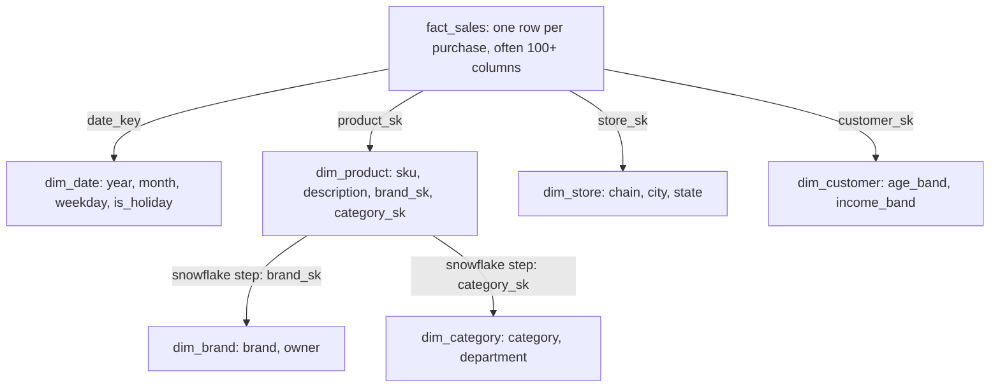
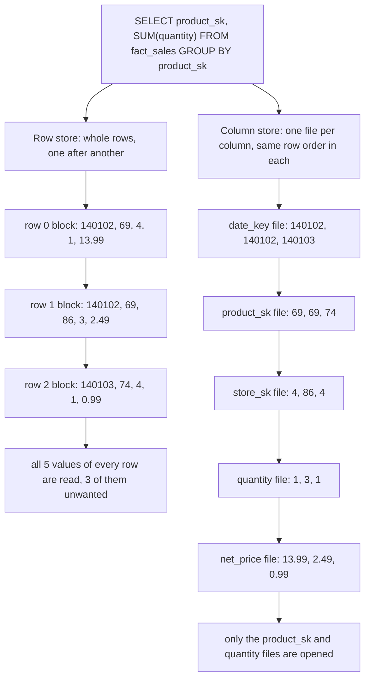
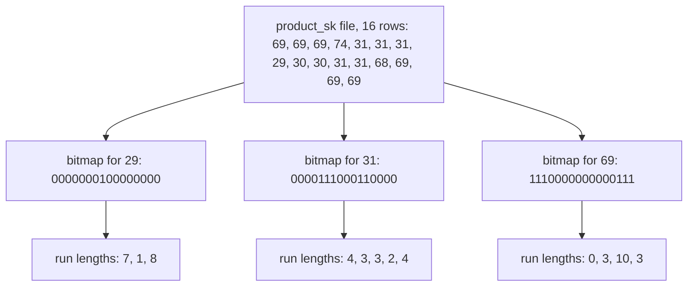
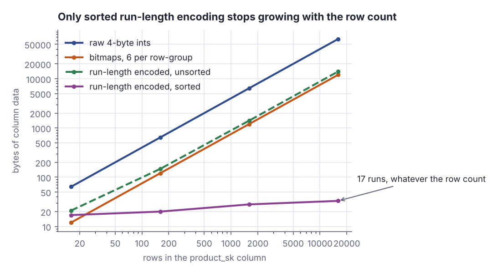
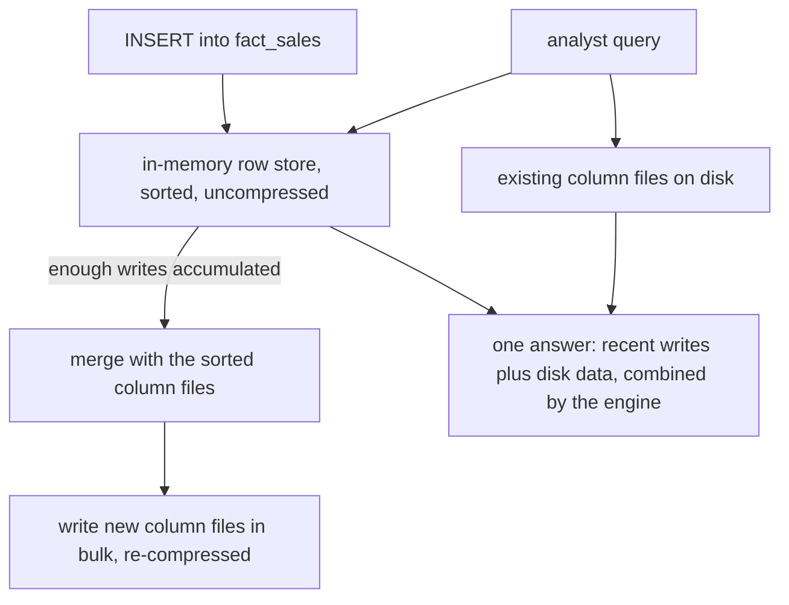

# OLTP vs OLAP, data warehouses and column storage

> Designing Data-Intensive Applications · Intermediate · ~25 min · rung 6 of 26 · needs: B-trees, and how they compare with LSM-trees (ddia-05)

## Why this matters
You live on the OLTP side: Akka services doing small keyed reads and writes against Postgres, where the whole game is the index lookup and the tail latency behind it.
The moment someone asks for last quarter's revenue by category, a machine with a completely different storage layout answers — and knowing why is what stops anyone pointing an analytics query at the database that serves customers.
This rung is where chapter 3 turns from indexes built for point lookups to storage built for scanning billions of rows, the ground under every Parquet file and warehouse you will be asked to reason about.

## The idea

> Chapter map: Designing Data-Intensive Applications (Kleppmann, 1st ed.), ch. 3 Storage and Retrieval, second half — § Transaction Processing or Analytics?, § Data Warehousing, § Stars and Snowflakes, § Column-Oriented Storage, § Column Compression, § Sort Order in Column Storage, § Writing to Column-Oriented Storage, § Aggregation: Data Cubes and Materialized Views. The book does not number these sections; §3.1–§3.8 are this lesson's numbering. https://dataintensive.net/

### §3.1 Transaction Processing or Analytics?
"Transaction" here promises no ACID guarantee; it is one logical group of reads and writes, a name left from recording commercial transactions (Kleppmann, DDIA ch. 3, "Transaction Processing or Analytics?"). **OLTP**, online transaction processing, is what you ship: a few records fetched by key through an index, written as the user acts, milliseconds of latency, gigabytes to terabytes. **OLAP**, online analytic processing, scans millions of rows, touches a handful of columns and returns an aggregate — count, sum, average — for an analyst: seconds to minutes, terabytes to petabytes, bulk-loaded, bound by bandwidth not seek latency. One database served both until the early 1990s, when a scan reading half the table proved to wreck the latency of the transactions beside it.

### §3.2 Data Warehousing
A **data warehouse** is a separate database analysts can hammer without touching OLTP: a read-only copy of every OLTP system's data — sales, stock, payroll — **E**xtracted (a dump or a stream of updates), **T**ransformed into an analysis-friendly schema and cleaned, then **L**oaded. That is **ETL** (Kleppmann, DDIA ch. 3, "Data Warehousing"). It can then be optimised for analytics alone, because B-trees and LSM-trees, built to find one key fast, are the wrong tool for a query that reads every row. Hence a separate vendor species (Teradata, Vertica, SAP HANA, ParAccel) and the SQL-on-Hadoop family beside it (Hive, Spark SQL, Impala).

### §3.3 Stars and Snowflakes: Schemas for Analytics
Warehouse schemas vary far less than OLTP ones. Most use **dimensional modelling**, usually a **star schema**: a **fact table** in the middle, one row per event, ringed by **dimension tables** (Kleppmann, DDIA ch. 3, "Stars and Snowflakes: Schemas for Analytics"). The book's fact table is `fact_sales`, one row per customer buying one product at one time, with event attributes (`quantity`, `net_price`, `discount_price`) and foreign keys into the dimensions — `date_key`, `product_sk`, `store_sk`, `promotion_sk`, `customer_sk` — the who, what, where, when, how and why. Facts stay individual events, not rollups, keeping analysis flexible. A **snowflake schema** normalises dimensions into subdimensions (the lower boxes of Figure 1); it is less used, stars being simpler for analysts. Both give fact tables of 100+ columns.


*Figure 1: the star around fact_sales. Adapted from Kleppmann, Designing Data-Intensive Applications, ch. 3, Figure 3-9, https://dataintensive.net/*

### §3.4 Column-Oriented Storage
Hence the tension: the fact table is 100+ columns wide and trillions of rows long, but a typical query touches four or five columns, never `SELECT *` (Kleppmann, DDIA ch. 3, "Column-Oriented Storage"). **Row-oriented storage** keeps each row contiguous, so the engine loads every row whole, parses it and throws away the unwanted columns. **Column-oriented storage** stores each column's values together, one file per column, so a query reads only the files it names — provided every file holds the rows **in the same order**, row *k* being the *k*th entry in each.

```scala
val rows = 1000000
val cols = 100
val picked = 3
val rowStore = rows.toLong * cols * 4
val colStore = rows.toLong * picked * 4
println(f"    row store, all $cols%d columns    ${rowStore / 1000000}%6d MB")
println(f"    column store, $picked%d columns      ${colStore / 1000000}%6d MB")
```

```text
    row store, all 100 columns       400 MB
    column store, 3 columns          12 MB
```

A three-column aggregate over a million-row, hundred-column table reads 12 MB, not 400 MB, before any compression.


*Figure 2: fact_sales row by row and column by column. Source: DDIA ch. 3, "Column-Oriented Storage".*

### §3.5 Column Compression
Column data compresses well because a column's distinct values are few next to its rows — billions of sales, perhaps 100,000 products (Kleppmann, DDIA ch. 3, "Column Compression"). **Bitmap encoding** turns a column with *n* distinct values into *n* **bitmaps**: one per value, one bit per row, 1 where that row holds the value. Small *n*: store the bits. Large *n*: the bitmaps are mostly zeros — **sparse** — so **run-length encode** them, writing each run of identical bits as its length, starting with the zeros.

```scala
for v <- vals do
  val r = rle(bitmapOf(productSk, v))
  val bs = r.map(varintBytes).sum
  val reading = r.zipWithIndex.map((n, i) => s"$n x ${i % 2}").mkString(", ")
  println(f"    $v%5d  ${r.mkString(", ")}%-22s ${r.size}%2d  $bs%5d  $reading")
```

```text
       29  7, 1, 8                 3      3  7 x 0, 1 x 1, 8 x 0
       30  8, 2, 6                 3      3  8 x 0, 2 x 1, 6 x 0
       31  4, 3, 3, 2, 4           5      5  4 x 0, 3 x 1, 3 x 0, 2 x 1, 4 x 0
       68  12, 1, 3                3      3  12 x 0, 1 x 1, 3 x 0
       69  0, 3, 10, 3             4      4  0 x 0, 3 x 1, 10 x 0, 3 x 1
       74  3, 1, 12                3      3  3 x 0, 1 x 1, 12 x 0
```

Value 69 occupies rows 0–2 and 13–15, so `1110000000000111` becomes `0, 3, 10, 3`: no leading zeros, three ones, ten zeros, three ones, summing back to 16.


*Figure 3: one bitmap per distinct value, run-length encoded. Adapted from Kleppmann, Designing Data-Intensive Applications, ch. 3, Figure 3-11.*

Bitmaps answer warehouse predicates directly: `WHERE product_sk IN (30, 68, 69)` is a bitwise OR of three bitmaps, `WHERE product_sk = 31 AND store_sk = 3` a bitwise AND across two column files — valid only because both share a row order.

*Memory bandwidth and vectorized processing*, the second half, says why that is fast: the bottleneck is bandwidth into the CPU cache, plus branch mispredictions and pipeline bubbles. A column store takes a chunk of compressed data that fits in L1, loops over it with no function call per value, and runs operators such as that bitwise AND **directly on the compressed data** — **vectorized processing**.

### §3.6 Sort Order in Column Storage
Rows can sit in insertion order, or an administrator picks a **sort key**, applied to every column file at once so positions still line up (Kleppmann, DDIA ch. 3, "Sort Order in Column Storage"). Sort by `date_key` and a last-month query skips the rest; `product_sk` as a second sort key breaks ties within a day. The second payoff is compression: a low-cardinality first sort column collapses into long runs, so run-length encoding squeezes billions of rows into a few kilobytes. The effect fades on later keys.

```scala
def row(k: Int): String =
  val col = Vector.fill(k)(productSk).flatten
  val s = col.sorted
  f"    $k%5d ${col.size}%7d ${col.size * 4}%8d ${bitmapBytes(col, vals)}%8d" +
    f" ${rleBytes(col, vals)}%13d ${rleRuns(col, vals)}%6d" +
    f" ${rleBytes(s, vals)}%11d ${rleRuns(s, vals)}%6d"
for k <- List(1, 10, 100, 1000) do println(row(k))
```

```text
        1      16       64       12            21     21          17     17
       10     160      640      120           147    147          20     17
      100    1600     6400     1200          1407   1407          28     17
     1000   16000    64000    12000         14007  14007          33     17
```

Per row count: raw bytes, bitmap bytes, then unsorted and sorted run-length bytes with run counts. Unsorted, the runs track the data — 21 at 16 rows, 14,007 at 16,000 — while sorted it is 17 runs at any size, so that column grows 17 → 33 bytes where raw grows 64 → 64,000.



*Figure 4: Part E, plotted. Generated with `python3 dojo/engine/chart.py dojo/lessons/assets/2026-11-15-1-chart-1.json`.*

The section closes by spending redundancy you already pay for: replicas exist anyway, so C-Store and Vertica store each one **sorted differently** and answer each query from the copy that suits it.

### §3.7 Writing to Column-Oriented Storage
Writes are the price. An in-place update like a B-tree's is impossible on sorted, compressed columns: a row is identified by its position, so inserting one in the middle would rewrite every column file (Kleppmann, DDIA ch. 3, "Writing to Column-Oriented Storage"). The fix is the previous rung's **LSM-tree**: writes land in an in-memory sorted store and, once enough accumulate, are merged with the column files and rewritten in bulk, as Vertica does. Queries read both, and the engine hides the seam.


*Figure 5: the write path. Source: DDIA ch. 3, "Writing to Column-Oriented Storage".*

### §3.8 Aggregation: Data Cubes and Materialized Views
Columnar storage is markedly faster for ad-hoc queries than the row-oriented massively parallel databases that came first, such as Teradata (Kleppmann, DDIA ch. 3, "Aggregation: Data Cubes and Materialized Views"). Those queries lean on `COUNT`, `SUM`, `AVG`, `MIN` and `MAX`, so the next move is to cache the aggregates. A **materialized view** is an actual copy of a query's results on disk, unlike a *virtual* view, a shortcut expanded at query time; it is refreshed when the data changes, making writes dearer — fine in a warehouse, rarely worth it in OLTP. A **data cube** is the special case: a grid of aggregates over several dimensions, say date × product with `SUM(net_price)` per cell, so a total for any day or product is a sum along one axis. Precomputed answers are very fast; the cost is flexibility, since with price as a measure and not a dimension nobody can ask what share of sales came from items over $100. So warehouses keep the raw data and use cubes only for known queries.

### Beyond the book: what Parquet actually does
Parquet is not a file per column but one file with a hierarchy:

> "Hierarchically, a file consists of one or more row groups." "A row group contains exactly one column chunk per column." "Column chunks contain one or more pages."
>
> — Apache Parquet, *Concepts*, last modified November 7, 2026, https://parquet.apache.org/docs/concepts/

A **row group** is a horizontal slice of the rows, the unit one Spark task picks up. Inside it, each column's data is one **column chunk** — §3.4's unit of I/O — and chunks "live in a particular row group and are guaranteed to be contiguous in the file" (Apache Parquet, *Concepts*), which is why reading three of a hundred columns is a few long sequential reads. Chunks divide into **pages**, "conceptually an indivisible unit (in terms of compression and encoding)", where §3.5's encodings live.

## Lab

**The question:** for the book's 16-value `product_sk` column, how many bytes do raw integers, bitmaps and run-length-encoded bitmaps actually take — and what has to change before run-length encoding wins?

About 8 minutes, Scala 3.3 and the standard library only.

### Step 1 — save the program

One file. It builds one bitmap per distinct value, run-length encodes each one, prints every intermediate structure, then repeats the column 10, 100 and 1000 times to see which encodings grow with the row count and which do not. Run lengths are counted as **varints**: 7 payload bits per byte, so a run under 128 costs one byte. Save it as `Lab.scala`.

```scala
// file: Lab.scala

// Column compression in a column store (ddia-06), following DDIA ch. 3 "Column Compression".
// Scala 3.3, standard library only. One column of fact_sales, three encodings, real byte counts.

type Bits = Vector[Int]

// One bitmap per distinct value: bit i is 1 when row i holds that value.
def bitmapOf(col: Vector[Int], v: Int): Bits =
  col.map(x => if x == v then 1 else 0)

// DDIA's run-length encoding: first number = how many zeros, then alternating run lengths.
def rle(bits: Bits): Vector[Int] =
  val runs = scala.collection.mutable.ArrayBuffer.empty[Int]
  var expect = 0
  var i = 0
  while i < bits.length do
    var n = 0
    while i < bits.length && bits(i) == expect do
      n += 1
      i += 1
    runs += n
    expect = 1 - expect
  runs.toVector

// A run length is stored as a variable-length integer: 7 payload bits per byte.
def varintBytes(n: Int): Int =
  var bytes = 1
  var v = n >> 7
  while v > 0 do
    bytes += 1
    v >>= 7
  bytes

def bitmapBytes(col: Vector[Int], vals: Vector[Int]): Int =
  (vals.size * col.size + 7) / 8

def rleBytes(col: Vector[Int], vals: Vector[Int]): Int =
  vals.map(v => rle(bitmapOf(col, v)).map(varintBytes).sum).sum

def rleRuns(col: Vector[Int], vals: Vector[Int]): Int =
  vals.map(v => rle(bitmapOf(col, v)).size).sum

def show(bits: Bits): String = bits.mkString

@main def lab(): Unit =
  val productSk = Vector(69, 69, 69, 74, 31, 31, 31, 29, 30, 30, 31, 31, 68, 69, 69, 69)
  val vals = productSk.distinct.sorted

  println("Part A - the column as it sits in its own file (fact_sales.product_sk)")
  println("    row  : " + productSk.indices.map(i => f"$i%3d").mkString(" "))
  println("    value: " + productSk.map(v => f"$v%3d").mkString(" "))
  println(s"    rows = ${productSk.size}, distinct values = ${vals.size} -> ${vals.mkString(", ")}")

  println()
  println("Part B - one bitmap per distinct value")
  println(f"    ${"value"}%5s  ${"bitmap (16 bits, row 0 on the left)"}%-34s ${"set"}%3s")
  for v <- vals do
    val b = bitmapOf(productSk, v)
    println(f"    $v%5d  ${show(b)}%-34s ${b.sum}%3d")

  println()
  println("Part C - each bitmap run-length encoded (first number = count of zeros)")
  println(f"    ${"value"}%5s  ${"runs"}%-22s ${"n"}%2s  ${"bytes"}%5s  reading")
  for v <- vals do
    val r = rle(bitmapOf(productSk, v))
    val bs = r.map(varintBytes).sum
    val reading = r.zipWithIndex.map((n, i) => s"$n x ${i % 2}").mkString(", ")
    println(f"    $v%5d  ${r.mkString(", ")}%-22s ${r.size}%2d  $bs%5d  $reading")

  println()
  println("Part D - bytes for 16 rows, three encodings (bitmap payload only)")
  val raw1 = productSk.size * 4
  val bmp1 = bitmapBytes(productSk, vals)
  val rle1 = rleBytes(productSk, vals)
  println(f"    raw 4-byte ints      $raw1%6d bytes  = 16 rows x 4")
  println(f"    bitmaps              $bmp1%6d bytes  = 6 values x 16 bits / 8")
  val runs1 = rleRuns(productSk, vals)
  println(f"    run-length encoded   $rle1%6d bytes  = $runs1%d runs x 1 varint byte")
  println(f"    value dictionary     ${vals.size * 4}%6d bytes  = 6 values x 4 (excluded above)")

  println()
  println("Part E - the same column repeated k times, unsorted vs sorted")
  def row(k: Int): String =
    val col = Vector.fill(k)(productSk).flatten
    val s = col.sorted
    f"    $k%5d ${col.size}%7d ${col.size * 4}%8d ${bitmapBytes(col, vals)}%8d" +
      f" ${rleBytes(col, vals)}%13d ${rleRuns(col, vals)}%6d" +
      f" ${rleBytes(s, vals)}%11d ${rleRuns(s, vals)}%6d"
  println(f"    ${"k"}%5s ${"rows"}%7s ${"raw"}%8s ${"bitmaps"}%8s" +
          f" ${"RLE unsorted"}%13s ${"runs"}%6s ${"RLE sorted"}%11s ${"runs"}%6s")
  for k <- List(1, 10, 100, 1000) do println(row(k))

  println()
  println("Part F - what a query has to read: row store vs column store")
  val rows = 1000000
  val cols = 100
  val picked = 3
  val rowStore = rows.toLong * cols * 4
  val colStore = rows.toLong * picked * 4
  println(f"    fact_sales: $rows%d rows, $cols%d columns, 4 bytes each")
  println(f"    row store, all $cols%d columns    ${rowStore / 1000000}%6d MB")
  println(f"    column store, $picked%d columns      ${colStore / 1000000}%6d MB")
  val ratio = cols.toDouble / picked
  println(f"    ratio $cols%d / $picked%d                 $ratio%6.1fx less data scanned")
```

### Step 2 — run it

```bash
scala Lab.scala
```

```text
Part A - the column as it sits in its own file (fact_sales.product_sk)
    row  :   0   1   2   3   4   5   6   7   8   9  10  11  12  13  14  15
    value:  69  69  69  74  31  31  31  29  30  30  31  31  68  69  69  69
    rows = 16, distinct values = 6 -> 29, 30, 31, 68, 69, 74

Part B - one bitmap per distinct value
    value  bitmap (16 bits, row 0 on the left) set
       29  0000000100000000                     1
       30  0000000011000000                     2
       31  0000111000110000                     5
       68  0000000000001000                     1
       69  1110000000000111                     6
       74  0001000000000000                     1

Part C - each bitmap run-length encoded (first number = count of zeros)
    value  runs                    n  bytes  reading
       29  7, 1, 8                 3      3  7 x 0, 1 x 1, 8 x 0
       30  8, 2, 6                 3      3  8 x 0, 2 x 1, 6 x 0
       31  4, 3, 3, 2, 4           5      5  4 x 0, 3 x 1, 3 x 0, 2 x 1, 4 x 0
       68  12, 1, 3                3      3  12 x 0, 1 x 1, 3 x 0
       69  0, 3, 10, 3             4      4  0 x 0, 3 x 1, 10 x 0, 3 x 1
       74  3, 1, 12                3      3  3 x 0, 1 x 1, 12 x 0

Part D - bytes for 16 rows, three encodings (bitmap payload only)
    raw 4-byte ints          64 bytes  = 16 rows x 4
    bitmaps                  12 bytes  = 6 values x 16 bits / 8
    run-length encoded       21 bytes  = 21 runs x 1 varint byte
    value dictionary         24 bytes  = 6 values x 4 (excluded above)

Part E - the same column repeated k times, unsorted vs sorted
        k    rows      raw  bitmaps  RLE unsorted   runs  RLE sorted   runs
        1      16       64       12            21     21          17     17
       10     160      640      120           147    147          20     17
      100    1600     6400     1200          1407   1407          28     17
     1000   16000    64000    12000         14007  14007          33     17

Part F - what a query has to read: row store vs column store
    fact_sales: 1000000 rows, 100 columns, 4 bytes each
    row store, all 100 columns       400 MB
    column store, 3 columns          12 MB
    ratio 100 / 3                   33.3x less data scanned
```

### Reading the output

**Parts A–C — the structures.** Part A prints the column with its row numbers, because position *is* the row identity in a column store: row 3 is the fourth entry of every column file. Part B's `bitmap` column is 16 characters, row 0 on the left, a 1 where that row holds that value; `set` is how many bits are 1, and the six `set` values must add up to 16 (1 + 2 + 5 + 1 + 6 + 1 = 16). Part C's `runs` are the run lengths starting with the count of zeros, `n` is how many run lengths there are, `bytes` is their varint cost, and `reading` spells each run out. Fewer runs is better — that is the whole value of the encoding.

| value | bitmap | set bits | run lengths | runs | bytes |
|---|---|---|---|---|---|
| 29 | `0000000100000000` | 1 | 7, 1, 8 | 3 | 3 |
| 30 | `0000000011000000` | 2 | 8, 2, 6 | 3 | 3 |
| 31 | `0000111000110000` | 5 | 4, 3, 3, 2, 4 | 5 | 5 |
| 68 | `0000000000001000` | 1 | 12, 1, 3 | 3 | 3 |
| 69 | `1110000000000111` | 6 | 0, 3, 10, 3 | 4 | 4 |
| 74 | `0001000000000000` | 1 | 3, 1, 12 | 3 | 3 |

Trace value 31, digit by digit. It sits in rows 4, 5, 6, 10, 11, so the bitmap is `0000 1110 0011 0000`. Walking from the left: 4 zeros (rows 0–3), then 3 ones (rows 4–6), then 3 zeros (rows 7–9), then 2 ones (rows 10–11), then 4 zeros (rows 12–15) — `4, 3, 3, 2, 4`, and 4 + 3 + 3 + 2 + 4 = 16, the row count, as it must. The 5 set bits of the `set` column are the 3 + 2 ones in the middle.

**Verdict:** the encoding is lossless and self-checking — run lengths always sum to the row count, and the ones in them always sum to that value's `set` count.

**Parts D–E — the bytes.** `raw` is 4 bytes per row; `bitmaps` is one bit per row per distinct value; `RLE unsorted` is the varint cost of the runs in the column as it arrives; `RLE sorted` is the same column sorted first, as a column store sorts by its sort key. `runs` next to each is the number of run lengths behind that byte count. Lower bytes is better everywhere.

| rows | raw ints | bitmaps | RLE unsorted (runs) | RLE sorted (runs) |
|---|---|---|---|---|
| 16 | 64 | 12 | 21 (21) | 17 (17) |
| 160 | 640 | 120 | 147 (147) | 20 (17) |
| 1,600 | 6,400 | 1,200 | 1,407 (1,407) | 28 (17) |
| 16,000 | 64,000 | 12,000 | 14,007 (14,007) | 33 (17) |

At 16 rows run-length encoding *loses*: 21 bytes against the plain bitmap's 12. The arithmetic is plain — the plain bitmaps cost 6 values × 16 bits = 96 bits = 96 / 8 = 12 bytes, while the runs cost 3 + 3 + 5 + 3 + 4 + 3 = 21 run lengths, one varint byte each because every run is under 128, so 21 bytes. With only 16 rows the bitmaps are not sparse enough for runs to pay for themselves.

Sort the column and the picture inverts. Sorted, each value occupies one contiguous block, so every bitmap collapses to at most three runs (zeros before, ones, zeros after) and the total is fixed at 17 runs no matter how many rows there are. Only the *lengths* grow, and a varint absorbs that almost for free: 17 bytes at 16 rows, 33 bytes at 16,000 rows, while raw ints went 64 → 64,000 and plain bitmaps 12 → 12,000. That is 64,000 / 33 ≈ 1,939× smaller than the raw column.

**Verdict:** run-length encoding is not a win by itself — it is a win *because of the sort order*. Unsorted, its cost tracks the raw column (14,007 bytes against 64,000); sorted, it stops growing. This is exactly the book's claim that the first sort key compresses billions of rows down to a few kilobytes.

**Part F — why the layout matters before any compression.** A million-row, hundred-column fact table at 4 bytes a value is 400 MB; a query over three columns reads 12 MB of it. The division is 100 columns / 3 columns = 33.3, so a column store scans 33.3× less data for this query — and that is pure layout, with bitmaps and run-length encoding still to come on top.

**Verdict:** the layout change buys an order of magnitude, and the encodings buy another two or three; neither helps a point lookup by primary key, which is why OLTP keeps its B-tree.

### Cause → consequence

1. **Cause.** Analytic queries read a few columns of a very wide fact table across almost all rows, while OLTP reads a few rows whole.
2. **Mechanism.** Storing each column in its own file, in one shared row order, lets a query read only the files it names (12 MB instead of 400 MB in Part F), and makes neighbouring values in a file similar, so a bitmap per distinct value plus run-length encoding shrinks them further. Sorting by a low-cardinality key turns each value's bitmap into one contiguous run, so the encoded size stops tracking the row count.
3. **Consequence.** Measured above: 33.3× less data touched from layout alone, and a sorted, run-length-encoded column that costs 33 bytes where the raw column costs 64,000. The price is writes — you cannot update a compressed, position-addressed column in place, so writes buffer in memory and are merged into new column files in bulk.
4. **In practice.** When you specify an analytics feature as a product owner, the two questions that decide its cost are *which column is the sort key* and *how many columns does the query touch*. Choose the sort key as the low-cardinality column most filters use (a date, a site, a tenant), accept that late-arriving updates land in a memory buffer rather than in place, and expect ad-hoc flexibility to be lost the moment someone proposes precomputed cubes instead of raw facts.

## Self-check
1. Your warehouse team proposes a nightly `UPDATE fact_sales SET discount_price = … WHERE sale_id = …` to fix individual rows. Why is that a far worse idea against a column store than against Postgres? <details><summary>Answer</summary>In a column store a row has no self-contained home: it is identified by its *position*, and that position is the same offset in every column file. The files are also sorted and compressed, so changing one value in the middle means decoding, re-encoding and rewriting data in each affected column file — and inserting a row in the middle would shift the position of every row after it, in all hundred-plus files (Kleppmann, DDIA ch. 3, "Writing to Column-Oriented Storage"). Postgres updates one 8 KB page in place through its B-tree. The column-store answer is the LSM approach: write the correction into an in-memory sorted store and let the background merge rewrite whole column files in bulk, with queries reading memory and disk together.</details>
2. A column has 16 rows and 6 distinct values. The lab shows run-length encoding costing 21 bytes against the plain bitmaps' 12. Does that disprove the book's claim that run-length encoding compresses well? <details><summary>Answer</summary>No — it shows the precondition. Run-length encoding pays off when a bitmap is *sparse* or *run-rich*, which needs many rows per distinct value, and it pays off most when the column is sorted by that key. With 16 rows and 6 values each bitmap has 3 to 5 runs out of 16 bits, so the runs cost more than the bits. Sort the same column and the runs drop to 17 in total and stay there: 17 bytes at 16 rows, 33 bytes at 16,000 rows, against 64,000 bytes raw. The book's "a few kilobytes for billions of rows" is a claim about the first sort key of a low-cardinality column, not about run-length encoding in isolation (Kleppmann, DDIA ch. 3, "Column Compression" and "Sort Order in Column Storage").</details>
3. The analytics lead wants a precomputed cube over date × product × store holding `SUM(net_price)`, and proposes dropping the raw fact rows to save money. What do you say, in the book's terms? <details><summary>Answer</summary>Keep the raw facts. A data cube makes the queries it anticipates very fast because the aggregate is already computed, but it fixes the dimensions in advance: with price as a measure rather than a dimension, nobody can ever ask what share of revenue came from items over $100 without going back to the raw rows (Kleppmann, DDIA ch. 3, "Aggregation: Data Cubes and Materialized Views"). The same trade-off applies to materialized views, which are real copies of query results on disk, unlike virtual views, and which make every write more expensive to keep current. Most warehouses keep as much raw data as possible and use cubes and materialized views only as a speed-up for specific, known queries.</details>

## Sources
- [Designing Data-Intensive Applications (Kleppmann, 1st ed.)](https://dataintensive.net/) — Martin Kleppmann, O'Reilly, 2017 — ch. 3 "Storage and Retrieval", second half: "Transaction Processing or Analytics?" (the OLTP/OLAP contrast and the access-pattern table), "Data Warehousing" (ETL, the separate read-only copy, the vendor split), "Stars and Snowflakes: Schemas for Analytics" (the `fact_sales` running example, dimension tables, snowflake normalisation, 100+ column fact tables), "Column-Oriented Storage" (one file per column, shared row order), "Column Compression" (bitmap encoding, run-length encoding, bitwise AND/OR, memory bandwidth and vectorized processing), "Sort Order in Column Storage" (sort keys, compression on the first sort key, differently sorted replicas), "Writing to Column-Oriented Storage" (the in-memory store merged into column files) and "Aggregation: Data Cubes and Materialized Views" (materialized vs virtual views, cubes and their loss of flexibility). Figures 3-9 and 3-11 are replicated as Figures 1 and 3 here rather than reproduced, since the book's artwork is not openly licensed. Accessed 2026-11-15.
- [Apache Parquet documentation — Concepts](https://parquet.apache.org/docs/concepts/) — the Apache Parquet project, page last modified November 7, 2026 — the verbatim definitions of row group, column chunk and page, the file hierarchy quoted in "Beyond the book", and the units-of-parallelisation list that maps those three levels onto MapReduce tasks, I/O and compression. Accessed 2026-11-15.

## Next on this track
Next on Designing Data-Intensive Applications: **Encoding formats and schema evolution** (rung 7 of 26, Intermediate).
