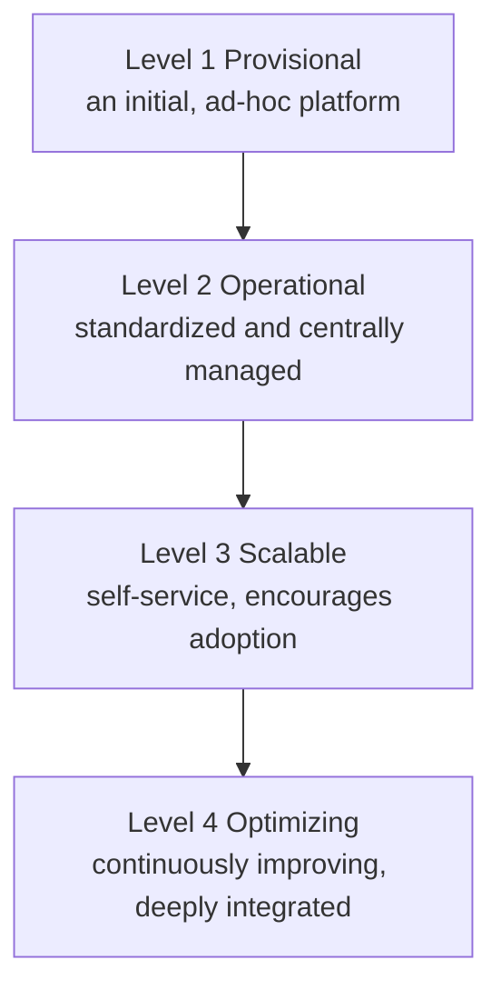
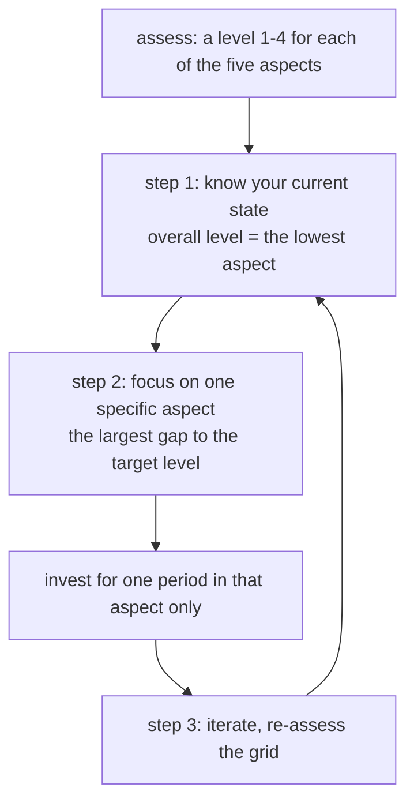
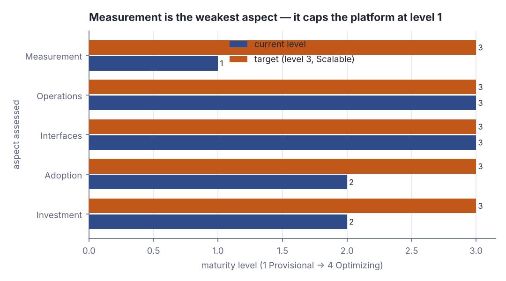

# Data product platforms: the four maturity levels

> Fresh · Software architecture & design · Intermediate · ~20 min · from today's feeds

## Why this matters
Today's other lesson is the storage side of analytics — moving data out of OLTP systems into a warehouse, star and snowflake schemas, column-oriented files. This one is the other half of the same problem: who owns that data, how it is served to other teams as a product rather than dumped into a central pile, and how you tell whether the platform underneath is ready for either.
Tom De Wolf — architect and innovation lead at ACA Group, PhD in multi-agent systems, member of the bitol Technical Steering Committee behind the Open Data Contract Standard and the Open Data Product Standard — published *The Data Product Platform Navigator* on martinfowler.com on 5 November 2026, out of a talk at Data Mesh Live 2026.
It is 20 minutes well spent for a Product Owner specifically: it turns "is our platform any good" into a grid you can fill in, and it says where the next quarter of platform budget should go.

## Primer
Five terms, each needed below.

**Data mesh** is an organisational pattern: instead of one central data team owning every pipeline and every table, each domain team owns its own analytical data and publishes it for others. The article's premise is that this only works if those teams have somewhere to publish *to*.

**A data product** is the unit they publish. Not a file and not a table — a dataset plus the things that make it usable by a stranger: an owner, a published schema, documented semantics, service levels (freshness, availability), and a discoverable entry in a catalogue. De Wolf states the reason for the unit directly:

> "Data products act as the unit of reusability for productized data"
> — Tom De Wolf, *The Data Product Platform Navigator*, 5 November 2026, https://martinfowler.com/articles/data-product-platform-nav.html

**A data contract** is the machine-readable part of that: a versioned document stating the schema, the semantics, the quality expectations and the SLOs a producer commits to, which consumers can test against — the analytics equivalent of the Avro or protobuf schema you already version between services. De Wolf sits on the standards body for one such format, and the article treats contracts as a first-class platform concern:

> "A well-designed platform should incorporate key data mesh concepts like data contracts and data products."
> — Tom De Wolf, *The Data Product Platform Navigator*, 5 November 2026, https://martinfowler.com/articles/data-product-platform-nav.html

**A self-service platform** (the same idea as an internal developer platform) is the paved road: the templates, APIs, CLIs and portals through which a domain team creates, publishes and operates a data product without filing a ticket with a central team.

**A maturity model** describes where you are, in named stages, so you can see which stage comes next. It is not a scorecard to maximise. Level 4 everywhere is not the goal; knowing which single thing to do next is.

The lesson relies on exactly those five ideas plus one piece of arithmetic: a grid of levels per aspect, and what you do with the minimum of it.

## The idea

### The platform gap

The article opens on a situation you can recognise from any platform rollout. A company decides on data mesh, domain teams are told to own their data — and then:

> "They may be tasked with building a self-service platform for data products and data mesh from scratch"
> — Tom De Wolf, *The Data Product Platform Navigator*, 5 November 2026, https://martinfowler.com/articles/data-product-platform-nav.html

The gap is not technical. The storage layer is specified and solved: Apache Parquet, the columnar format most of these platforms sit on, defines a column chunk as "A chunk of the data for a particular column." (Apache Parquet, *Concepts*, https://parquet.apache.org/docs/concepts/), and you can read the whole specification in an afternoon. What nobody can read off is whether the platform your team is building is any good yet, or what to build next. That is the gap the Navigator fills.

### Platform engineering to the rescue

De Wolf's move is to not invent anything. Platform engineering already solved the "how mature is our platform" question for application platforms:

> "The platform engineering community, through the Cloud Native Computing Foundation (CNCF), has published the Platform Engineering Maturity Model."
> — Tom De Wolf, *The Data Product Platform Navigator*, 5 November 2026, https://martinfowler.com/articles/data-product-platform-nav.html

The article repurposes that model for data product platforms. Four levels, each a statement about the platform's *relationship with its users*, not its feature count.



*Figure 1: The four maturity levels, each label shortened from the article's own one-line description of that level. Adapted from Figure 4 of Tom De Wolf, The Data Product Platform Navigator, 5 November 2026, https://martinfowler.com/articles/data-product-platform-nav.html*

The article's one-liners, verbatim: Provisional — "An initial, ad-hoc platform."; Operational — "A more standardized and centrally managed platform."; Scalable — "A self-service platform that encourages adoption."; Optimizing — "A platform that is continuously improving and deeply integrated into the development workflow." (De Wolf, *The Data Product Platform Navigator*, 5 November 2026). Its own figure caption confirms the ordering: "Figure 4: The CNCF Platform Engineering Maturity Model, showing the four levels Provisional, Operational" — truncated by my quoting limit, but the sequence is the one drawn above.

Concretely, for a team like yours:

- **Provisional** — one domain team wires a Spark job and an S3 bucket by hand, a second team copies the scripts. Nothing is named "platform" yet.
- **Operational** — a central data team now owns the pipeline templates and the warehouse. It works, and every new data product goes through that team's backlog. This is where most organisations sit and stall.
- **Scalable** — a domain team can create, publish and operate a data product on its own, because the paved road exists and is attractive enough that people choose it over rolling their own.
- **Optimizing** — the platform measures its own usage, feeds that back into its roadmap, and is wired into the development workflow rather than sitting beside it.

### Five aspects, not one score

A level is not assessed on the platform as a whole. The article assesses it per aspect:

> "The aspects of the platform that are assessed at each level include:"
> — Tom De Wolf, *The Data Product Platform Navigator*, 5 November 2026, https://martinfowler.com/articles/data-product-platform-nav.html

The five are Investment, Adoption, Interfaces, Operations and Measurement. The article spells one of them out — "Investment: How staffing and funds are allocated to the platform." (De Wolf, *The Data Product Platform Navigator*, 5 November 2026). The other four are named but not glossed in what I could read; my reading of them for a data-product platform is: **Adoption** — who uses it and how willingly; **Interfaces** — what a domain team actually touches (templates, API, CLI, portal); **Operations** — who runs the thing and how much of it is automated; **Measurement** — whether the platform knows anything about its own use and health.

That gives a grid: five aspects, each at a level from 1 to 4. The number that matters is the lowest one.

```scala
// file: Weakest.scala
@main def weakest(): Unit =
  val names = Vector("Provisional", "Operational", "Scalable", "Optimizing")
  val grid = Vector("Investment" -> 2, "Adoption" -> 2, "Interfaces" -> 3,
                    "Operations" -> 3, "Measurement" -> 1)
  for (a, l) <- grid do println(f"$a%-12s level $l  ${names(l - 1)}")
  val overall = grid.map(_._2).min
  val mean = grid.map(_._2).sum.toDouble / grid.size
  println(f"overall      level $overall  ${names(overall - 1)}  (the mean would say ${mean}%.1f)")
```

```text
Investment   level 2  Operational
Adoption     level 2  Operational
Interfaces   level 3  Scalable
Operations   level 3  Scalable
Measurement  level 1  Provisional
overall      level 1  Provisional  (the mean would say 2.2)
```

An example assessment of my own invention, not the article's: four aspects are respectable and the platform is still Provisional, because a domain team that cannot see whether its data product is being used is back to asking a human. Averaging gives 2.2 and reads as Operational — a full level of comfort you have not earned.

### How the Navigator is used

The article is explicit that this is a procedure, not a report:

> "Using the maturity model is a straightforward process:"
> — Tom De Wolf, *The Data Product Platform Navigator*, 5 November 2026, https://martinfowler.com/articles/data-product-platform-nav.html

Three steps: know your current state, focus on a specific aspect, iterate.



*Figure 2: The three-step loop. Source: drawn for this lesson from the process and aspects described in Tom De Wolf, The Data Product Platform Navigator, 5 November 2026, https://martinfowler.com/articles/data-product-platform-nav.html*

### The level data mesh actually needs

The article gives this its own section, *Minimal Maturity Level for Data Mesh Success*. Reading it off the level definitions — this inference is mine, the level wording is the article's — the threshold is level 3. Data mesh is domain teams publishing their own data products; levels 1 and 2 both leave a central team in the path of every one of them, and only level 3 is described as "A self-service platform that encourages adoption." (De Wolf, *The Data Product Platform Navigator*, 5 November 2026). A mesh on a level 2 platform is a central data team with extra meetings.

### The adoption curve and the two traps

Adoption is not a switch, which is why it is an aspect of its own and why the article follows the levels with sections on the adoption curve and on targeted investment. Two failure modes are stated outright. The first is building ahead of demand:

> "There is also the risk of building capabilities nobody needs"
> — Tom De Wolf, *The Data Product Platform Navigator*, 5 November 2026, https://martinfowler.com/articles/data-product-platform-nav.html

The second is the shape that failure usually takes:

> "A common trap is where teams push into technology only"
> — Tom De Wolf, *The Data Product Platform Navigator*, 5 November 2026, https://martinfowler.com/articles/data-product-platform-nav.html

That is exactly the grid above: Interfaces and Operations at 3, Adoption and Measurement behind. Engineers build the paved road and automate the pipelines because that work is legible and enjoyable; nobody enables the domain teams or counts who turned up. The remedy is blunt about priority:

> "Organizational enablement and feedback gathering need to get priority urgently."
> — Tom De Wolf, *The Data Product Platform Navigator*, 5 November 2026, https://martinfowler.com/articles/data-product-platform-nav.html

### A targeted investment strategy

So the investment decision is mechanical once the grid exists: subtract each aspect's level from the level you need, and spend on the largest gap.

```scala
// file: Gap.scala
@main def gap(): Unit =
  val target = 3
  val grid = Vector("Investment" -> 2, "Adoption" -> 2, "Interfaces" -> 3,
                    "Operations" -> 3, "Measurement" -> 1)
  val gaps = grid.map((a, l) => (a, target - l)).sortBy(-_._2)
  for (a, g) <- gaps do println(f"$a%-12s gap $g  ${"#" * (g max 0)}")
  println(s"next investment: ${gaps.head._1} (largest gap ${gaps.head._2})")
```

```text
Measurement  gap 2  ##
Investment   gap 1  #
Adoption     gap 1  #
Interfaces   gap 0  
Operations   gap 0  
next investment: Measurement (largest gap 2)
```

Interfaces and Operations have a gap of zero: more work there buys nothing until the rest catches up. Measurement is two levels short and is the only aspect whose improvement moves the overall level at all. If you want the talk rather than the article, De Wolf notes "Watch the presentation on YouTube (20 minutes)." (De Wolf, *The Data Product Platform Navigator*, 5 November 2026).

## Lab

**The question this lab answers:** given one team's assessment across the five aspects, where should the next four quarters of platform work go — and what does it cost to spend them on technology instead?

Everything below is Scala 3, standard library only. The maturity grid is the data; the arithmetic is the argument.

### Step 1 — the grid as data

The five aspects are the article's. The levels per aspect are an example assessment of a platform team in a company that has decided on data mesh: a paved road and automated pipelines exist (Interfaces, Operations at 3), the platform is funded as a side project and used by two domain teams out of nine (Investment, Adoption at 2), and nothing measures its use (Measurement at 1). The target is level 3 across the board.

### Step 2 — the program

```scala
// file: Lab.scala
val levelNames = Vector("Provisional", "Operational", "Scalable", "Optimizing")
val aspects = Vector("Investment", "Adoption", "Interfaces", "Operations", "Measurement")

// One team's self-assessment: a level 1..4 per aspect. Example data, not from the article.
val assessed: Map[String, Int] = Map(
  "Investment"  -> 2,
  "Adoption"    -> 2,
  "Interfaces"  -> 3,
  "Operations"  -> 3,
  "Measurement" -> 1
)
val target = 3                        // the level a data mesh needs: self-service, adopted
val cap = 4                           // Optimizing is the top of the model

def overall(m: Map[String, Int]): Int = aspects.map(m).min
def name(l: Int): String = levelNames(l - 1)
def mean(m: Map[String, Int]): Double = aspects.map(m).sum.toDouble / aspects.size

def bar(n: Int): String = "#" * n

@main def lab(): Unit =
  println("== Step 1: the grid as data ==")
  println("  aspect       | level | level name   | bar")
  for a <- aspects do
    val l = assessed(a)
    println(f"  $a%-12s |   $l   | ${name(l)}%-12s | ${bar(l)}")
  println(f"  target for every aspect = $target (${name(target)})")
  println()

  println("== Step 2: the platform's level is the MINIMUM across aspects ==")
  println(f"  min  across aspects = ${overall(assessed)}  -> ${name(overall(assessed))}")
  println(f"  mean across aspects = ${mean(assessed)}%.1f  -> would read as ${name(mean(assessed).round.toInt)}")
  println("  what happens if ONE aspect is lifted to level 4 and the rest stay:")
  for a <- aspects do
    val lifted = assessed.updated(a, cap)
    println(f"    lift $a%-12s to 4 -> overall ${overall(lifted)} (${name(overall(lifted))})")
  println()

  println("== Step 3: gap to target, per aspect ==")
  println("  aspect       | level | target | gap | gap bar")
  val gaps = aspects.map(a => (a, target - assessed(a))).sortBy((a, g) => (-g, aspects.indexOf(a)))
  for (a, g) <- gaps do
    println(f"  $a%-12s |   ${assessed(a)}   |    $target   |  $g  | ${bar(g max 0)}")
  println(s"  largest gap -> next investment: ${gaps.head._1} (gap ${gaps.head._2})")
  println(f"  total gap across aspects = ${gaps.map((_, g) => g max 0).sum} level-steps")
  println()

  println("== Step 4: two ways to spend four quarters of platform work ==")
  val tech = Vector("Interfaces", "Operations")

  def weakestFirst(m: Map[String, Int]): Option[String] =
    aspects.filter(a => m(a) < cap).sortBy(a => (m(a), aspects.indexOf(a))).headOption

  def technologyFirst(m: Map[String, Int]): Option[String] =
    tech.filter(a => m(a) < cap).sortBy(a => (m(a), tech.indexOf(a))).headOption

  def run(label: String, pick: Map[String, Int] => Option[String]): Unit =
    println(s"  strategy: $label")
    println("    quarter | spend on     | from -> to | overall after | level name")
    var m = assessed
    for q <- 1 to 4 do
      pick(m) match
        case Some(a) =>
          val from = m(a)
          m = m.updated(a, from + 1)
          println(f"       Q$q    | $a%-12s |  $from -> ${from + 1}     |       ${overall(m)}       | ${name(overall(m))}")
        case None =>
          println(f"       Q$q    | (nothing left)|  -  -> -     |       ${overall(m)}       | ${name(overall(m))}")
    val left = aspects.map(a => (target - m(a)) max 0).sum
    println(f"    after 4 quarters: overall ${overall(m)} (${name(overall(m))}), $left level-steps still short of target $target")
    println(s"    final grid: ${aspects.map(a => s"$a=${m(a)}").mkString(", ")}")

  run("weakest aspect first", weakestFirst)
  println()
  run("technology only (Interfaces, Operations)", technologyFirst)
```

### Step 3 — run it

```bash
scala Lab.scala
```

### Reading the output

Every number below is the program's real output.

#### Step 1 — the assessment

```text
== Step 1: the grid as data ==
  aspect       | level | level name   | bar
  Investment   |   2   | Operational  | ##
  Adoption     |   2   | Operational  | ##
  Interfaces   |   3   | Scalable     | ###
  Operations   |   3   | Scalable     | ###
  Measurement  |   1   | Provisional  | #
  target for every aspect = 3 (Scalable)
```

| column | meaning | which direction is better |
|---|---|---|
| `aspect` | one of the five things the model assesses | — |
| `level` | 1 Provisional, 2 Operational, 3 Scalable, 4 Optimizing | higher, but only up to what you need |
| `level name` | the CNCF name for that level | — |
| `bar` | the level drawn, so the shape of the grid is visible at a glance | — |



*Figure 3: The same five numbers as bars against the target. Measurement is two levels short; Interfaces and Operations are already at target, so further work there buys nothing. Generated from this lab's Step 1 and Step 3 output, rendered from `assets/2026-11-15-2-chart-1.json` with `dojo/engine/chart.py`.*

**Verdict:** the grid is lopsided in the article's predicted direction — the technology aspects lead, the organisational ones lag.

#### Step 2 — why the minimum is the right aggregate

```text
== Step 2: the platform's level is the MINIMUM across aspects ==
  min  across aspects = 1  -> Provisional
  mean across aspects = 2.2  -> would read as Operational
  what happens if ONE aspect is lifted to level 4 and the rest stay:
    lift Investment   to 4 -> overall 1 (Provisional)
    lift Adoption     to 4 -> overall 1 (Provisional)
    lift Interfaces   to 4 -> overall 1 (Provisional)
    lift Operations   to 4 -> overall 1 (Provisional)
    lift Measurement  to 4 -> overall 2 (Operational)
```

Trace the arithmetic. The five levels are 2, 2, 3, 3, 1. Their minimum is 1, so the platform is Provisional. Their sum is 2 + 2 + 3 + 3 + 1 = 11, and 11 / 5 = 2.2, which rounds to 2 and reads as Operational — one whole level of flattery. The lift table is the same minimum applied five times: taking Investment from 2 to 4 gives the multiset 4, 2, 3, 3, 1, whose minimum is still 1. Only lifting Measurement changes the multiset's minimum, from 1 to min(2, 2, 3, 3, 4) = 2.

**Verdict:** four of the five possible "big investments" leave the platform exactly where it was. A platform is as mature as its weakest aspect, and the mean hides precisely that.

#### Step 3 — the gap

```text
== Step 3: gap to target, per aspect ==
  aspect       | level | target | gap | gap bar
  Measurement  |   1   |    3   |  2  | ##
  Investment   |   2   |    3   |  1  | #
  Adoption     |   2   |    3   |  1  | #
  Interfaces   |   3   |    3   |  0  | 
  Operations   |   3   |    3   |  0  | 
  largest gap -> next investment: Measurement (gap 2)
  total gap across aspects = 4 level-steps
```

`gap = target − level`, so lower is better and zero means done. `total gap = 4 level-steps` is the whole remaining distance to a level 3 platform: 2 + 1 + 1 + 0 + 0. That is the budget conversation in one number — four increments of work, not an open-ended platform programme.

**Verdict:** Measurement is the single largest gap and the only aspect that currently caps the overall level. It is the next investment.

#### Step 4 — two spending strategies

```text
== Step 4: two ways to spend four quarters of platform work ==
  strategy: weakest aspect first
    quarter | spend on     | from -> to | overall after | level name
       Q1    | Measurement  |  1 -> 2     |       2       | Operational
       Q2    | Investment   |  2 -> 3     |       2       | Operational
       Q3    | Adoption     |  2 -> 3     |       2       | Operational
       Q4    | Measurement  |  2 -> 3     |       3       | Scalable
    after 4 quarters: overall 3 (Scalable), 0 level-steps still short of target 3
    final grid: Investment=3, Adoption=3, Interfaces=3, Operations=3, Measurement=3

  strategy: technology only (Interfaces, Operations)
    quarter | spend on     | from -> to | overall after | level name
       Q1    | Interfaces   |  3 -> 4     |       1       | Provisional
       Q2    | Operations   |  3 -> 4     |       1       | Provisional
       Q3    | (nothing left)|  -  -> -     |       1       | Provisional
       Q4    | (nothing left)|  -  -> -     |       1       | Provisional
    after 4 quarters: overall 1 (Provisional), 4 level-steps still short of target 3
    final grid: Investment=2, Adoption=2, Interfaces=4, Operations=4, Measurement=1
```

Each quarter is one level-step of work in one aspect. `overall after` is the minimum of the grid at the end of that quarter; `level-steps still short` is the remaining total gap to target.

Trace the weakest-first run. Q1 picks the lowest aspect, Measurement at 1, and takes it to 2 — the grid becomes 2, 2, 3, 3, 2 and the minimum rises from 1 to 2. Q2 and Q3 face a three-way tie at level 2 and take Investment then Adoption to 3; the minimum stays at 2 both times, because Measurement is still 2. Q4 takes Measurement from 2 to 3, the grid becomes 3, 3, 3, 3, 3, and the minimum finally reaches the target. Note Q2 and Q3 produced no visible movement in the headline number — that is normal, and worth saying out loud to a steering committee before it happens.

The technology-only run spends two quarters pushing Interfaces and Operations from 3 to 4 (Optimizing, the top of the model) and then has nothing left to buy, because those two aspects are capped and the strategy will not look at the others. Overall stays at 1 for all four quarters, and the remaining gap to target is still 4 level-steps — the strategy spent two quarters and closed none of it.

**Verdict:** identical effort, four quarters either way. Weakest-first reaches Scalable and closes the whole gap; technology-only ends where it started, with two best-in-class capabilities nobody is using.

### Cause → mechanism → consequence → what it means in practice

1. **Cause.** A platform is assessed per aspect, and its maturity is the lowest aspect, not the average. In the example grid that is Measurement at level 1 against four aspects at 2 or 3.
2. **Mechanism.** The level describes the platform's relationship with its users. A platform that cannot see who uses its data products, or how they are doing, cannot run a feedback loop — so domain teams go back to asking a human, which is the definition of not being self-service, no matter how good the templates are. The lab shows this directly: lifting any of the other four aspects to the top of the model leaves the overall level at 1.
3. **Consequence.** Investment aimed at the aspects that are already strong returns nothing measurable. Four quarters of technology work left the example platform at Provisional with its gap unchanged, and produced capabilities at level 4 against adoption at level 2 — "There is also the risk of building capabilities nobody needs" (De Wolf, *The Data Product Platform Navigator*, 5 November 2026).
4. **What it means in practice.** As the Product Owner, run the assessment before the roadmap: one level per aspect, five numbers, half a session with the platform team. Report the minimum, not the average, and expect pushback — the average is always the flattering number. Then fund the largest gap for one period only and re-assess, which is the article's own loop: know your current state, focus on one aspect, iterate. Two warnings to carry into that meeting: your engineers will want to work on Interfaces and Operations because that work is legible and enjoyable, and De Wolf's answer is that "Organizational enablement and feedback gathering need to get priority urgently." (De Wolf, *The Data Product Platform Navigator*, 5 November 2026). And if the company has committed to data mesh, level 3 is the floor, not the ambition — below it there is still a central team in the path of every data product.

## Self-check
1. Your platform team reports "we're at level 2.6 on average across the five aspects, up from 2.2". What is wrong with that sentence, and what should the report say instead? <details><summary>Answer</summary>The average is not the platform's level — the minimum is, because the model's levels describe the platform's relationship with its users and the weakest aspect is the one that breaks that relationship. In the lab's grid the mean is 2.2 (11 / 5) and reads as Operational, while the minimum is 1, Provisional. Worse, an average can rise while the binding aspect does not move at all: lifting Investment, Adoption, Interfaces or Operations to level 4 raises the mean every time and leaves the overall level at 1. The report should give a level per aspect, name the lowest, and give the gap to the target level.</details>
2. A platform team has Interfaces and Operations at level 3 and Adoption and Measurement at level 1. They propose spending the next two quarters on a nicer self-service portal. Using the article's language, what are you looking at, and what do you fund instead? <details><summary>Answer</summary>This is the trap the article names: "A common trap is where teams push into technology only" (De Wolf, *The Data Product Platform Navigator*, 5 November 2026) — automating operations and building self-service interfaces while adoption and measurement lag. A nicer portal raises an aspect that is already at target and leaves the overall level at 1; in the lab the technology-only strategy spent four quarters and closed none of the 4-level-step gap. Fund the largest gap instead — here, enablement for the domain teams and instrumentation of data-product usage — because De Wolf states that "Organizational enablement and feedback gathering need to get priority urgently."</details>
3. Why does the article argue that a platform must reach level 3, Scalable, before data mesh can work — and what exactly is missing at level 2? <details><summary>Answer</summary>Data mesh means domain teams own and publish their own analytical data as data products. Level 2, Operational, is "A more standardized and centrally managed platform." (De Wolf, *The Data Product Platform Navigator*, 5 November 2026): the templates and the warehouse exist, but a central team still owns them, so every new data product goes through that team's backlog. Level 3 is "A self-service platform that encourages adoption." — the point at which a domain team can create, publish and operate a data product without the platform team in the loop. What is missing at level 2 is not a feature; it is the removal of the central bottleneck, which is the whole premise of the mesh. (The level wording is the article's; reading the threshold off it is my inference from its *Minimal Maturity Level for Data Mesh Success* section.)</details>

## Sources
- [The Data Product Platform Navigator](https://martinfowler.com/articles/data-product-platform-nav.html) — Tom De Wolf, martinfowler.com, 5 November 2026 — the whole lesson: the platform gap, the repurposing of the CNCF Platform Engineering Maturity Model, the four level names and their one-line descriptions, the five assessed aspects and the Investment gloss, the three-step usage process, and the two traps (building capabilities nobody needs; pushing into technology only). Every quoted passage attributed to De Wolf above is from this page; the article's own Figures 7–11 are marked © Tom De Wolf and are not reproduced here — Figure 1 is a replication of its Figure 4. Accessed 2026-11-15.
- [Apache Parquet: Concepts](https://parquet.apache.org/docs/concepts/) — Apache Software Foundation, page last modified 7 November 2026 — the definition of a column chunk, used to make the point that the storage layer under a data product platform is specified and solved while the platform question is not. Accessed 2026-11-15.

## Next on this track
Fresh lessons sit outside the ladder; next on Software architecture & design: **Composition over inheritance, and information hiding** (rung 5 of 20, Beginner).
