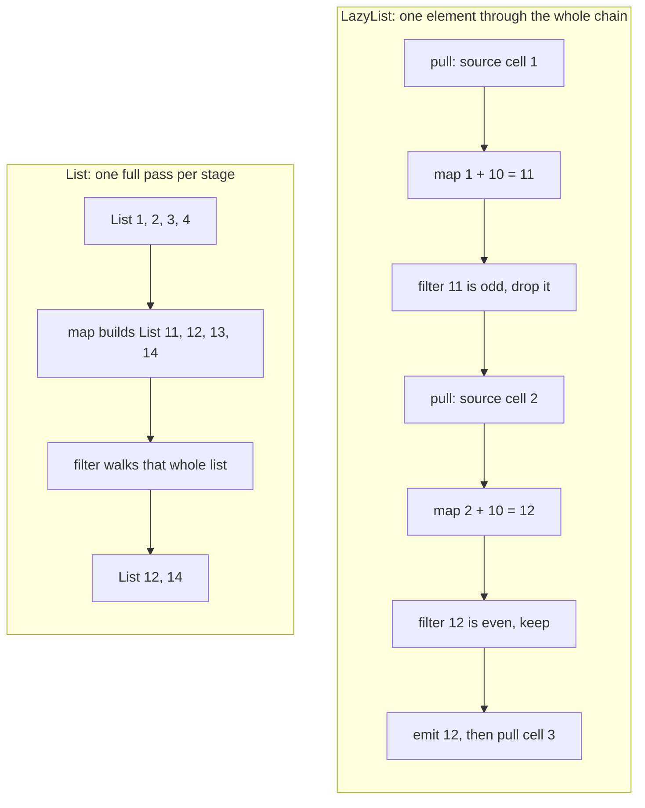
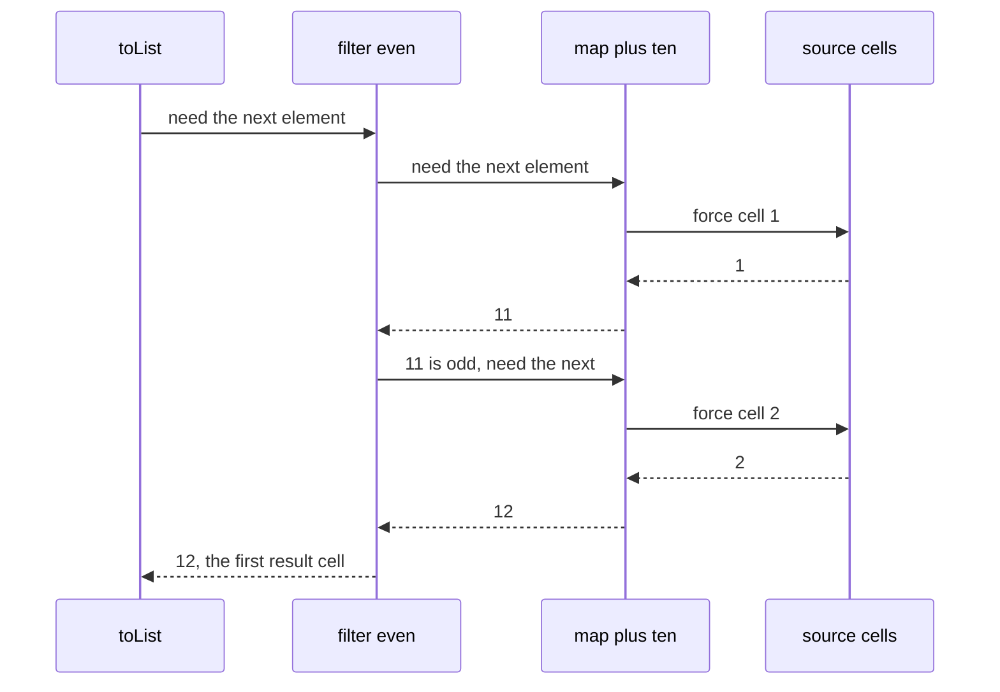
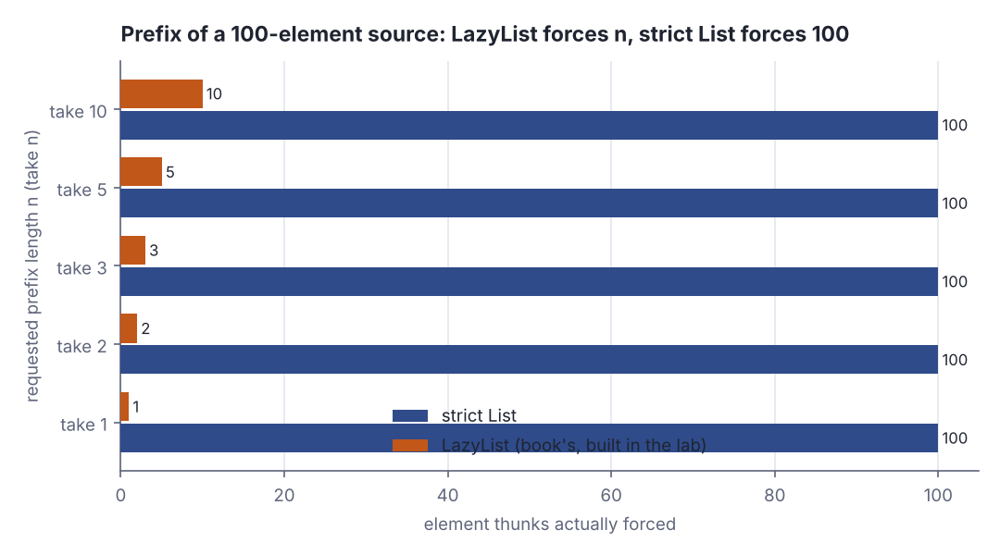

# Strictness and laziness: non-strict functions and LazyList

> Functional Programming in Scala (red book) · Beginner · ~20 min · rung 6 of 26 · needs: Handling errors without exceptions: Option and Either (fp-scala-05)

## Why this matters
Laziness is the one language feature that lets you write a pipeline as a chain of independent transformations and still get a single fused loop with early exit at runtime — the thing you otherwise hand-write as an ugly `while` with four flags, or buy from Akka Streams.
It sits at this rung because the `LazyList` you build here, cell by cell, is the same machine underneath `Iterator`, `Source` and every pull-based stream you already run in production: a cell is a value plus a thunk for the rest, and backpressure is just the consumer deciding when to force that thunk.
It also fixes a cost model you can reason about on a hot path: `map` then `filter` on a strict `List` allocates a whole intermediate list and walks the data twice, and the same chain on a `LazyList` allocates none and stops as soon as the consumer stops asking.

## The idea

> Chapter map: Functional Programming in Scala, 2nd ed., ch. 5 Strictness and laziness — §5.1 Strict and non-strict functions, §5.2 An extended example: lazy lists, §5.2.1 Memoizing lazy lists and avoiding recomputation, §5.2.2 Helper functions for inspecting lazy lists, §5.3 Separating program description from evaluation. (§5.4, infinite lazy lists and corecursion, is the next rung.)

A naming note first, because the two editions differ: what the 2nd edition calls `LazyList` the 1st edition called `Stream`, and the Scala standard library made the same move in 2.13 — `Stream` was lazy in its tail only, `LazyList` is lazy in head and tail (Chiusano, Bjarnason & Pilquist, FP in Scala 2nd ed., ch. 5, §5.2). Everything below says `LazyList`.

### §5.1 Strict and non-strict functions

A **strict** function evaluates its arguments before its body runs; that is the default in Scala, and every function you have written so far is one. A **non-strict** function may choose not to evaluate one or more of its arguments at all (FP in Scala 2nd ed., ch. 5, §5.1). You already use three non-strict forms every day without calling them that: `&&`, `||` and `if`. `false && expensive()` never runs `expensive()`; `if` evaluates exactly one of its two branches. They are not magic, they are just built-in functions that are non-strict in some arguments.

The book's way of making that explicit is a **thunk**: an unevaluated expression wrapped as a zero-argument function, `() => A`. A value of type `() => A` is not an `A` — you force it by applying it, `t()`. The chapter's `if2` is `if` written as an ordinary function this way. Scala has sugar for it: declare a parameter as `i: => Int` (a **by-name** parameter) and callers pass a plain expression while the compiler wraps it in a thunk for you. The catch is that a by-name parameter is re-evaluated at **every** use site, which is what `maybeTwice` shows; caching it in a `lazy val` — evaluated at most once, on first reference — is `maybeTwice2`.

```scala
def if2[A](c: Boolean, t: () => A, f: () => A): A = if c then t() else f()
def maybeTwice(b: Boolean, i: => Int): Int = if b then i + i else 0
def maybeTwice2(b: Boolean, i: => Int): Int =
  lazy val j = i
  if b then j + j else 0
println(if2(false, () => "took the true branch", () => "took the false branch"))
println(maybeTwice(true, { println("  argument evaluated"); 1 + 41 }))
println(maybeTwice2(true, { println("  argument evaluated"); 1 + 41 }))
```

```text
took the false branch
  argument evaluated
  argument evaluated
84
  argument evaluated
84
```

`if2` never evaluated the true branch. `maybeTwice` printed twice for one argument — `i + i` forced the same thunk twice — and `maybeTwice2` printed once for the same expression, because the `lazy val` memoised it. Same answer, 84, with half the work.

### §5.2 An extended example: lazy lists

Now apply the thunk to a data structure. A `LazyList` cell holds two thunks, one for the head and one for the tail, so neither exists until somebody asks:

```scala
enum LazyList[+A]:
  case Empty
  case Cons(h: () => A, t: () => LazyList[A])

  def headOption: Option[A] = this match
    case Empty      => None
    case Cons(h, _) => Some(h())
```

`headOption` is the whole point in miniature: it pattern matches on the cell, which costs nothing, and then forces only `h()` — the tail thunk is never applied, so the rest of the list is never computed (FP in Scala 2nd ed., ch. 5, §5.2).

### §5.2.1 Memoizing lazy lists and avoiding recomputation

Constructing `Cons` directly has a trap: `Cons(() => expensive(x), tl)` re-runs `expensive(x)` on every forcing of the head. The book's fix is a pair of **smart constructors** — functions named like the data constructors but in lower case — that take their arguments by name and cache them:

```scala
object LazyList:
  def cons[A](hd: => A, tl: => LazyList[A]): LazyList[A] =
    lazy val head = hd
    lazy val tail = tl
    Cons(() => head, () => tail)
  def empty[A]: LazyList[A] = Empty
```

`cons` wraps the by-name arguments in `lazy val`s, so the thunks it stores read a cache: evaluated at most once, on first force. `empty` exists for type inference — it returns `LazyList[A]` rather than the more specific `Empty`, which keeps inference out of trouble in the methods below. The standard library behaves the same way:

```scala
val xs = LazyList(1, 2, 3).map(i => { println(s"  force $i"); i })
println(s"built: $xs")
println(s"headOption = ${xs.headOption}")
println(s"headOption = ${xs.headOption}")
println(s"toList     = ${xs.toList}")
```

```text
built: LazyList(<not computed>)
  force 1
headOption = Some(1)
headOption = Some(1)
  force 2
  force 3
toList     = List(1, 2, 3)
```

Building and mapping forced nothing — the list prints itself as `<not computed>`. The first `headOption` forced element 1; the second forced nothing, which is the memoisation. Only `toList` reached elements 2 and 3.

### §5.2.2 Helper functions for inspecting lazy lists

The exercises build `toList` (5.1), `take` and `drop` (5.2), `takeWhile` (5.3), then the one that reorganises everything, `foldRight` with a by-name accumulator:

```scala
def foldRight[B](z: => B)(f: (A, => B) => B): B = this match
  case Cons(h, t) => f(h(), t().foldRight(z)(f))
  case Empty      => z

def exists(p: A => Boolean): Boolean =
  foldRight(false)((a, acc) => p(a) || acc)
```

Look at the type of `f`: its second parameter is `=> B`, so the recursive fold over the tail is passed as a thunk. If `f` never touches it, the recursion stops right there. `exists` gets early termination for free from `||`, which is already non-strict in its right operand; `forAll` (Exercise 5.4) gets it from `&&`; `takeWhile` via `foldRight` (Exercise 5.5) gets it by returning `empty` instead of consing when the predicate fails. On a strict `List` this is impossible — `foldRight` there must evaluate the whole tail fold before `f` is even called.

### §5.3 Separating program description from evaluation

This is the chapter's thesis: laziness lets you separate the **description** of a computation from its **evaluation**, so you can describe a large expression and evaluate only the part you need. `map` and `filter` written with the lazy `foldRight` do not transform a list, they build a description that transforms elements on demand. The consequence is the trace the section is built around:

```scala
def m(i: Int): Int = { println(s"  map    $i -> ${i + 10}"); i + 10 }
def p(j: Int): Boolean = { println(s"  filter $j"); j % 2 == 0 }
println("LazyList(1, 2, 3, 4).map(_ + 10).filter(_ % 2 == 0).toList")
println(LazyList(1, 2, 3, 4).map(m).filter(p).toList)
println("List(1, 2, 3, 4).map(_ + 10).filter(_ % 2 == 0)")
println(List(1, 2, 3, 4).map(m).filter(p))
```

```text
LazyList(1, 2, 3, 4).map(_ + 10).filter(_ % 2 == 0).toList
  map    1 -> 11
  filter 11
  map    2 -> 12
  filter 12
  map    3 -> 13
  filter 13
  map    4 -> 14
  filter 14
List(12, 14)
List(1, 2, 3, 4).map(_ + 10).filter(_ % 2 == 0)
  map    1 -> 11
  map    2 -> 12
  map    3 -> 13
  map    4 -> 14
  filter 11
  filter 12
  filter 13
  filter 14
List(12, 14)
```

Same result, different interleaving. The lazy chain alternates map, filter, map, filter — each element is pulled all the way through the pipeline before the next one is touched, and no intermediate list of `11, 12, 13, 14` is ever built. The strict chain does all four maps first, materialising that intermediate list, and only then filters it.



*Figure 1: The same two-stage pipeline in both panels. The `List` panel runs one full pass per stage; the `LazyList` panel pulls one element through map and filter before touching the next, and never allocates the intermediate `List(11, 12, 13, 14)`. Source: the Step 3 trace of this lesson's lab.*

Because nothing downstream has to finish before the consumer gets its first element, the book calls this writing a **first-class loop**: `map`, `filter`, `takeWhile` and friends compose into what a hand-written loop with early exit would do, while each stage stays a separate, testable function. Add `headOption` on the end and the whole chain stops after the first surviving element.



*Figure 2: The book's incremental trace redrawn as pulls. Demand travels right, one element at a time, and nothing is computed until `toList` asks. Adapted from Chiusano, Bjarnason & Pilquist, Functional Programming in Scala, 2nd ed., ch. 5 §5.3, https://www.manning.com/books/functional-programming-in-scala-second-edition*

**Beyond the book:** the memoisation of §5.2.1 has a cost the chapter does not dwell on. A `LazyList` caches every cell it has computed, so holding a reference to the head of a long or infinite one retains everything behind it — the classic JVM leak that `Iterator` and `View` (which do not memoise) avoid, at the price of not being re-traversable.

## Lab

How much work does a lazy chain actually do — which element thunks get forced, in what order, and how does that compare with the strict `List` that returns the same answer?

The program below builds the book's `LazyList` from scratch: `Empty` and `Cons` of two thunks, the smart constructors `cons` and `empty` with `lazy val` memoisation, then Exercise 5.2 (`take`, `drop`), Exercise 5.5 (`takeWhileViaFoldRight`), plus `exists`, `forAll`, `map` and `filter` on top of the lazy `foldRight`. Every element thunk in the test sources prints when it is forced, so the output is a direct trace of evaluation rather than a summary of it.

### Step 1 — a cell is two thunks, and the smart constructor memoises

A five-element source whose elements announce themselves, inspected with `headOption` and `toList`; then the same head built twice, once with a raw `Cons` and once through `cons`.

### Step 2 — Exercises 5.2 and 5.5

`take(2)`, `drop(3)` and `takeWhileViaFoldRight(_ < 3)` on the noisy source, plus `exists` and `forAll`, counting the force lines each one produces.

### Step 3 — the §5.3 trace

`map(_ + 10).filter(_ % 2 == 0)` over `1, 2, 3, 4`, with a print in each stage, lazy against strict.

### Step 4 — the prefix cost

A 100-element source, strict and lazy, asked for prefixes of 1, 2, 3, 5 and 10 elements, counting how many element thunks each one forces.

```scala
// file: Lab.scala
enum MyLazyList[+A]:
  case Empty
  case Cons(h: () => A, t: () => MyLazyList[A])

  def headOption: Option[A] = this match
    case Empty      => None
    case Cons(h, _) => Some(h())

  def toList: List[A] = this match
    case Empty      => Nil
    case Cons(h, t) => h() :: t().toList

  def foldRight[B](z: => B)(f: (A, => B) => B): B = this match
    case Cons(h, t) => f(h(), t().foldRight(z)(f))
    case Empty      => z

  def exists(p: A => Boolean): Boolean =
    foldRight(false)((a, acc) => p(a) || acc)

  def forAll(p: A => Boolean): Boolean =
    foldRight(true)((a, acc) => p(a) && acc)

  def take(n: Int): MyLazyList[A] = this match
    case Cons(h, t) if n > 1  => MyLazyList.cons(h(), t().take(n - 1))
    case Cons(h, _) if n == 1 => MyLazyList.cons(h(), MyLazyList.empty)
    case _                    => MyLazyList.empty

  def drop(n: Int): MyLazyList[A] = this match
    case Cons(_, t) if n > 0 => t().drop(n - 1)
    case _                   => this

  def takeWhile(p: A => Boolean): MyLazyList[A] = this match
    case Cons(h, t) if p(h()) => MyLazyList.cons(h(), t().takeWhile(p))
    case _                    => MyLazyList.empty

  def takeWhileViaFoldRight(p: A => Boolean): MyLazyList[A] =
    foldRight(MyLazyList.empty[A]): (a, acc) =>
      if p(a) then MyLazyList.cons(a, acc) else MyLazyList.empty

  def map[B](f: A => B): MyLazyList[B] =
    foldRight(MyLazyList.empty[B])((a, acc) => MyLazyList.cons(f(a), acc))

  def filter(p: A => Boolean): MyLazyList[A] =
    foldRight(MyLazyList.empty[A])((a, acc) => if p(a) then MyLazyList.cons(a, acc) else acc)

object MyLazyList:
  def cons[A](hd: => A, tl: => MyLazyList[A]): MyLazyList[A] =
    lazy val head = hd
    lazy val tail = tl
    Cons(() => head, () => tail)

  def empty[A]: MyLazyList[A] = Empty

  def apply[A](as: A*): MyLazyList[A] =
    if as.isEmpty then empty else cons(as.head, apply(as.tail*))

import MyLazyList.{cons, empty}

// counters: one tick every time an element thunk is actually evaluated
var lazyForced   = 0
var strictForced = 0

/** 1..n as a LazyList whose element thunks announce themselves when forced. */
def noisy(n: Int): MyLazyList[Int] =
  def go(i: Int): MyLazyList[Int] =
    if i > n then empty
    else cons({ println(s"    force element $i"); i }, go(i + 1))
  go(1)

/** 1..n as a LazyList that only counts forcings (no printing). */
def counted(n: Int): MyLazyList[Int] =
  def go(i: Int): MyLazyList[Int] =
    if i > n then empty
    else cons({ lazyForced += 1; i }, go(i + 1))
  go(1)

/** 1..n as a strict List: every element is computed to build the list at all. */
def countedList(n: Int): List[Int] =
  (1 to n).toList.map { i => strictForced += 1; i }

@main def lab(): Unit =
  println("== Step 1a: a cell is two thunks; headOption forces only the head ==")
  val xs = noisy(5)
  println(s"  built the LazyList, nothing forced yet")
  println(s"  xs.headOption = ${xs.headOption}")
  println(s"  xs.headOption again = ${xs.headOption}")
  println(s"  xs.toList = ${xs.toList}")
  println(s"  xs.toList again = ${xs.toList}")

  println()
  println("== Step 1b: section 5.2.1, smart constructor memoises, raw Cons does not ==")
  val raw: MyLazyList[Int] =
    MyLazyList.Cons(() => { println("    raw head evaluated"); 42 }, () => empty)
  println(s"  raw.headOption  = ${raw.headOption}")
  println(s"  raw.headOption  = ${raw.headOption}")
  val smart = cons({ println("    smart head evaluated"); 42 }, empty)
  println(s"  smart.headOption = ${smart.headOption}")
  println(s"  smart.headOption = ${smart.headOption}")

  println()
  println("== Step 2a: Exercise 5.2, take and drop are descriptions, not work ==")
  val ys = noisy(5)
  val t2 = ys.take(2)
  println("  ys.take(2) built - no force line above it, so no element was touched")
  println(s"  ys.take(2).toList = ${t2.toList}")
  val zs = noisy(5)
  val d3 = zs.drop(3)
  println("  zs.drop(3) built - still nothing forced")
  println(s"  zs.drop(3).toList = ${d3.toList}")

  println()
  println("== Step 2b: Exercise 5.5, takeWhile via foldRight, and exists/forAll ==")
  val ws = noisy(5)
  println(s"  ws.takeWhileViaFoldRight(_ < 3).toList = ${ws.takeWhileViaFoldRight(_ < 3).toList}")
  val es = noisy(5)
  println(s"  es.exists(_ == 2) = ${es.exists(_ == 2)}")
  val fs = noisy(5)
  println(s"  fs.forAll(_ < 3) = ${fs.forAll(_ < 3)}")
  val gs = noisy(5)
  println(s"  gs.forAll(_ < 99) = ${gs.forAll(_ < 99)}")

  println()
  println("== Step 3: section 5.3 trace, map(_ + 10).filter(_ % 2 == 0) ==")
  def mTrace(i: Int): Int = { println(s"    map    $i -> ${i + 10}"); i + 10 }
  def fTrace(j: Int): Boolean = { println(s"    filter $j"); j % 2 == 0 }
  println("  LazyList(1, 2, 3, 4).map(_ + 10).filter(_ % 2 == 0).toList")
  val lazyOut = MyLazyList(1, 2, 3, 4).map(mTrace).filter(fTrace).toList
  println(s"  => $lazyOut")
  println("  List(1, 2, 3, 4).map(_ + 10).filter(_ % 2 == 0)")
  val strictOut = List(1, 2, 3, 4).map(mTrace).filter(fTrace)
  println(s"  => $strictOut")

  println()
  println("== Step 4: element thunks forced for a prefix of a 100-element source ==")
  println(f"${"take n"}%7s${"strict List forced"}%20s${"LazyList forced"}%18s${"result head"}%14s")
  var lazyTotal = 0
  var strictTotal = 0
  for n <- List(1, 2, 3, 5, 10) do
    strictForced = 0
    val sl = countedList(100).take(n)
    lazyForced = 0
    val ll = counted(100).take(n).toList
    lazyTotal += lazyForced
    strictTotal += strictForced
    println(f"$n%7d$strictForced%20d$lazyForced%18d${sl.head.toString}%14s")
  println(f"  totals over the five requests: strict $strictTotal%d, lazy $lazyTotal%d")
```

```text
== Step 1a: a cell is two thunks; headOption forces only the head ==
  built the LazyList, nothing forced yet
    force element 1
  xs.headOption = Some(1)
  xs.headOption again = Some(1)
    force element 2
    force element 3
    force element 4
    force element 5
  xs.toList = List(1, 2, 3, 4, 5)
  xs.toList again = List(1, 2, 3, 4, 5)

== Step 1b: section 5.2.1, smart constructor memoises, raw Cons does not ==
    raw head evaluated
  raw.headOption  = Some(42)
    raw head evaluated
  raw.headOption  = Some(42)
    smart head evaluated
  smart.headOption = Some(42)
  smart.headOption = Some(42)

== Step 2a: Exercise 5.2, take and drop are descriptions, not work ==
  ys.take(2) built - no force line above it, so no element was touched
    force element 1
    force element 2
  ys.take(2).toList = List(1, 2)
  zs.drop(3) built - still nothing forced
    force element 4
    force element 5
  zs.drop(3).toList = List(4, 5)

== Step 2b: Exercise 5.5, takeWhile via foldRight, and exists/forAll ==
    force element 1
    force element 2
    force element 3
  ws.takeWhileViaFoldRight(_ < 3).toList = List(1, 2)
    force element 1
    force element 2
  es.exists(_ == 2) = true
    force element 1
    force element 2
    force element 3
  fs.forAll(_ < 3) = false
    force element 1
    force element 2
    force element 3
    force element 4
    force element 5
  gs.forAll(_ < 99) = true

== Step 3: section 5.3 trace, map(_ + 10).filter(_ % 2 == 0) ==
  LazyList(1, 2, 3, 4).map(_ + 10).filter(_ % 2 == 0).toList
    map    1 -> 11
    filter 11
    map    2 -> 12
    filter 12
    map    3 -> 13
    filter 13
    map    4 -> 14
    filter 14
  => List(12, 14)
  List(1, 2, 3, 4).map(_ + 10).filter(_ % 2 == 0)
    map    1 -> 11
    map    2 -> 12
    map    3 -> 13
    map    4 -> 14
    filter 11
    filter 12
    filter 13
    filter 14
  => List(12, 14)

== Step 4: element thunks forced for a prefix of a 100-element source ==
 take n  strict List forced   LazyList forced   result head
      1                 100                 1             1
      2                 100                 2             1
      3                 100                 3             1
      5                 100                 5             1
     10                 100                10             1
  totals over the five requests: strict 500, lazy 21
```

### Reading the output

Run it with `python3 dojo/engine/run_lab.py 2026-11-16-1`. Every line beginning `force element n` means one element thunk was evaluated; fewer is better, and the result column must stay identical between the lazy and strict versions or the comparison means nothing.

**Step 1.** Four inspections of a five-element source, counted by force lines:

| expression | force lines | what it means |
|---|---|---|
| building `noisy(5)` | 0 | the cells exist, the elements do not |
| `xs.headOption` | 1 (element 1) | only the head thunk is applied |
| `xs.headOption` again | 0 | the `lazy val` in `cons` memoised it |
| `xs.toList` | 4 (elements 2–5) | element 1 is still cached |
| `xs.toList` again | 0 | the whole list is now memoised |
| `raw.headOption` twice | 2 | a bare `Cons` recomputes its head |
| `smart.headOption` twice | 1 | `cons` caches it |

**Verdict:** the memoisation of §5.2.1 lives entirely in the smart constructor — the data type itself has no idea. Build cells with `Cons` directly and every traversal pays for every element again.

**Step 2.** `take(2)` and `drop(3)` are descriptions: both printed their "built" line with no force line above it. Forcing happens when `toList` asks.

| call | elements forced | note |
|---|---|---|
| `ys.take(2).toList` | 1, 2 | the other three are never computed |
| `zs.drop(3).toList` | 4, 5 | `drop` walks tail thunks, never heads 1–3 |
| `ws.takeWhileViaFoldRight(_ < 3).toList` | 1, 2, 3 | emits `List(1, 2)` |
| `es.exists(_ == 2)` | 1, 2 | stops at the match |
| `fs.forAll(_ < 3)` | 1, 2, 3 | stops at the first failure |
| `gs.forAll(_ < 99)` | 1, 2, 3, 4, 5 | no failure, so the whole list |

Traced with digits: `takeWhileViaFoldRight(_ < 3)` returns two elements but forces three. `foldRight` calls `f(1, <thunk>)`, the predicate `1 < 3` holds, so it conses 1 onto the by-name accumulator; the same for 2; forcing the accumulator calls `f(3, <thunk>)`, and only by evaluating element 3 can the predicate `3 < 3` be tested. It fails, `empty` is returned, and the thunk for elements 4 and 5 is dropped untouched — 3 forced, 2 emitted, 2 skipped. `drop(3)` is the mirror image: 2 forced out of 5, and the three skipped elements were skipped without being computed at all, because `drop` only ever applies tail thunks.

**Verdict:** early termination is not an optimisation bolted onto `exists` and `takeWhile`; it falls out of `foldRight` taking its second argument by name. The one-element overshoot in `takeWhile` is inherent — a predicate cannot be tested on a value nobody has computed.

**Step 3.** The lazy chain printed `map 1`, `filter 11`, `map 2`, `filter 12`, … and the strict chain printed all four maps, then all four filters. Both returned `List(12, 14)`.

| chain | evaluation order | intermediate list |
|---|---|---|
| `LazyList(1,2,3,4).map(_ + 10).filter(_ % 2 == 0)` | map/filter interleaved per element | none |
| `List(1,2,3,4).map(_ + 10).filter(_ % 2 == 0)` | 4 maps, then 4 filters | `List(11, 12, 13, 14)` |

**Verdict:** the same two-line expression is a fused loop in one case and two passes plus a throwaway list in the other. The difference is entirely in the data type, not in the code you wrote.

**Step 4.** How many of 100 elements each version computes when only a prefix is wanted.

| take n | strict List forced | LazyList forced | result head |
|---|---|---|---|
| 1 | 100 | 1 | 1 |
| 2 | 100 | 2 | 1 |
| 3 | 100 | 3 | 1 |
| 5 | 100 | 5 | 1 |
| 10 | 100 | 10 | 1 |
| totals | 500 | 21 | — |

Traced with digits for `take 5`: the strict version has to finish `(1 to 100).toList.map(...)` before `take` can run at all, so it computes 100 elements and then throws 95 of them away — 95 / 100 = 95 % waste. The lazy version forces the head of cell 1, then cells 2, 3, 4, 5 as `toList` walks them, and stops: 5 forced, 95 never touched. Over the five requests the totals are 100 × 5 = 500 against 1 + 2 + 3 + 5 + 10 = 21, a factor of 500 / 21 ≈ 23.8.



*Figure 3: The Step 4 numbers, bottom row first. A strict `List` computes all 100 elements before `take n` can run; the `LazyList` built in this lab forces exactly n — 1, 2, 3, 5, 10. Source: Step 4 of this lesson's lab, run with `python3 dojo/engine/run_lab.py 2026-11-16-1`.*

**Verdict:** the gap is not a constant factor, it is a function of how much of the source the consumer actually wants. At `take 1` of 100 it is 100× ; on an infinite source the strict version does not terminate at all, which is the next rung.

### Cause → mechanism → consequence → practice

1. **Cause:** Scala evaluates arguments strictly by default, so `xs.map(f).filter(p)` must finish `map` over every element — and allocate its result list — before `filter` sees anything.
2. **Mechanism:** wrap each element and each tail in a thunk (`() => A`, or a `=> A` parameter), cache them with `lazy val` inside the smart constructor `cons`, and define `foldRight` so its second argument arrives by name. The description of the computation is then a graph of unevaluated cells, and evaluation is driven by whoever forces the outermost one.
3. **Consequence:** chained stages interleave into one pull-driven loop with no intermediate collections, and any consumer that stops early — `exists`, `forAll`, `takeWhile`, `take(n)`, `headOption` — bounds the work done upstream. In Step 4 that was 21 element computations instead of 500 for the same five answers.
4. **In practice:** on a JVM service this is the difference between a request handler that allocates three intermediate `List`s per call and one that allocates none — fewer young-gen allocations, less GC pressure, and a shorter path to the first byte. It is also the mental model for the Akka Streams you already run: a `Source` is a description, `runWith` is the force, and backpressure is the consumer choosing when to pull — which is why a stage that calls `.toList` or `grouped(Int.MaxValue)` in the middle of a graph quietly destroys both the fusion and the bound. And when you do keep a `LazyList` in a field, remember the memoisation: it retains every element it has produced, so for a long or unbounded source reach for `Iterator` or `View` instead, which recompute rather than retain.

## Self-check
1. `maybeTwice(true, { println("hi"); 1 + 41 })` printed `hi` twice while `maybeTwice2` printed it once. Explain the mechanism, and say what `i: => Int` compiles to. <details><summary>Answer</summary>A by-name parameter `i: => Int` is sugar for a thunk: the compiler wraps the argument expression in a zero-argument function and inserts a call to it at every use site inside the body. `maybeTwice` uses `i` twice in `i + i`, so the thunk is applied twice and the side effect runs twice. `maybeTwice2` binds it once to `lazy val j = i`; a `lazy val` evaluates its right-hand side on first reference and caches the result, so `j + j` forces the thunk once and reads the cache the second time (FP in Scala 2nd ed., ch. 5, §5.1). Same answer, 84, half the work.</details>
2. Why can `exists` on a `LazyList` stop at the first match when it is written with `foldRight`, while the same definition on a strict `List` cannot? <details><summary>Answer</summary>Because of the type of the combining function: `foldRight[B](z: => B)(f: (A, => B) => B)` passes the fold over the tail as a by-name argument, so `f` receives a description of the rest rather than its value. `exists` is `foldRight(false)((a, acc) => p(a) || acc)`, and `||` is non-strict in its right operand — when `p(a)` is true, `acc` is never forced, so the recursion over the tail never runs. In the lab, `exists(_ == 2)` on a five-element source forced elements 1 and 2 only. A strict `List.foldRight` must evaluate the recursive fold over the whole tail to produce the value it then passes to `f`, so the work is already done before `f` can decide anything.</details>
3. You hold `val feed: LazyList[Event]` as a field of a long-lived Akka actor and consume it with `feed.map(parse).filter(interesting).take(10).toList` once a minute. Name two things that will go wrong and what you would use instead. <details><summary>Answer</summary>First, memoisation: the smart constructor caches every cell it computes, so the `LazyList` retains every event it has ever produced — a steadily growing retained set in the actor's heap, the classic hold-onto-the-head leak. Second, re-running the chain on the same `feed` re-reads the same memoised prefix instead of new events, so the actor keeps processing the first ten elements it ever saw; the lazy chain itself is fine, it is the shared, retained source that is wrong. Use an `Iterator` or a `View` (same fusion and early exit, no memoisation, single traversal) or, for anything with a real producer, an Akka Streams `Source` whose demand signalling is the same pull mechanism with backpressure and lifecycle attached.</details>

## Sources
- [Functional Programming in Scala, 2nd ed. (Chiusano, Bjarnason, Pilquist)](https://www.manning.com/books/functional-programming-in-scala-second-edition) — Manning; ch. 5 Strictness and laziness: §5.1 (strict vs non-strict functions, `&&` and `if` as built-in non-strict forms, `if2`, thunks `() => A`, by-name `=> A`, `maybeTwice`/`maybeTwice2` and the `lazy val` cache), §5.2 (the `LazyList` enum with `Empty` and `Cons` of two thunks, `headOption`), §5.2.1 (the smart constructors `cons` and `empty`, memoisation with `lazy val`), §5.2.2 and Exercises 5.1–5.6 (`toList`, `take`, `drop`, `takeWhile`, `foldRight` with a by-name accumulator, `exists`, `forAll`), §5.3 (separating description from evaluation, the `map(_ + 10).filter(_ % 2 == 0)` trace, lazy lists as first-class loops) — the source of every definition, exercise number, running example and conclusion restated above. Link carried over from the curriculum, not accessed 2026-11-16 (web fetching was blocked in this run), so the chapter is cited by section and nothing is quoted.
- [fpinscala companion repository](https://github.com/fpinscala/fpinscala) — fpinscala contributors; the laziness chapter folder, `LazyList.scala` in the 2nd-edition sources and `Stream.scala` in the 1st-edition branch, whose exercise stubs and method shapes the lab's hand-built `MyLazyList` follows. Link carried over from the curriculum, not accessed 2026-11-16 (web fetching was blocked in this run).
- [Scala collections: Concrete Immutable Collection Classes](https://docs.scala-lang.org/overviews/collections-2.13/concrete-immutable-collection-classes.html) — scala-lang.org, section on `LazyList`: the standard-library counterpart used for the two stdlib examples in The idea, and the 2.13 rename from `Stream` (lazy tail only) to `LazyList` (lazy head and tail). Link carried over from the curriculum, not accessed 2026-11-16 (web fetching was blocked in this run).
- Related in your knowledge base: `02-functional-programming/Functional-Programming-Foundations.md` and `01-scala-language/AdvancedFunctions.md` — where this lesson is filed; both are restated in full above rather than referred to.

## Next on this track
Next on Functional Programming in Scala (red book): **Infinite lazy lists and corecursion: unfold** (rung 7 of 26, Beginner).
