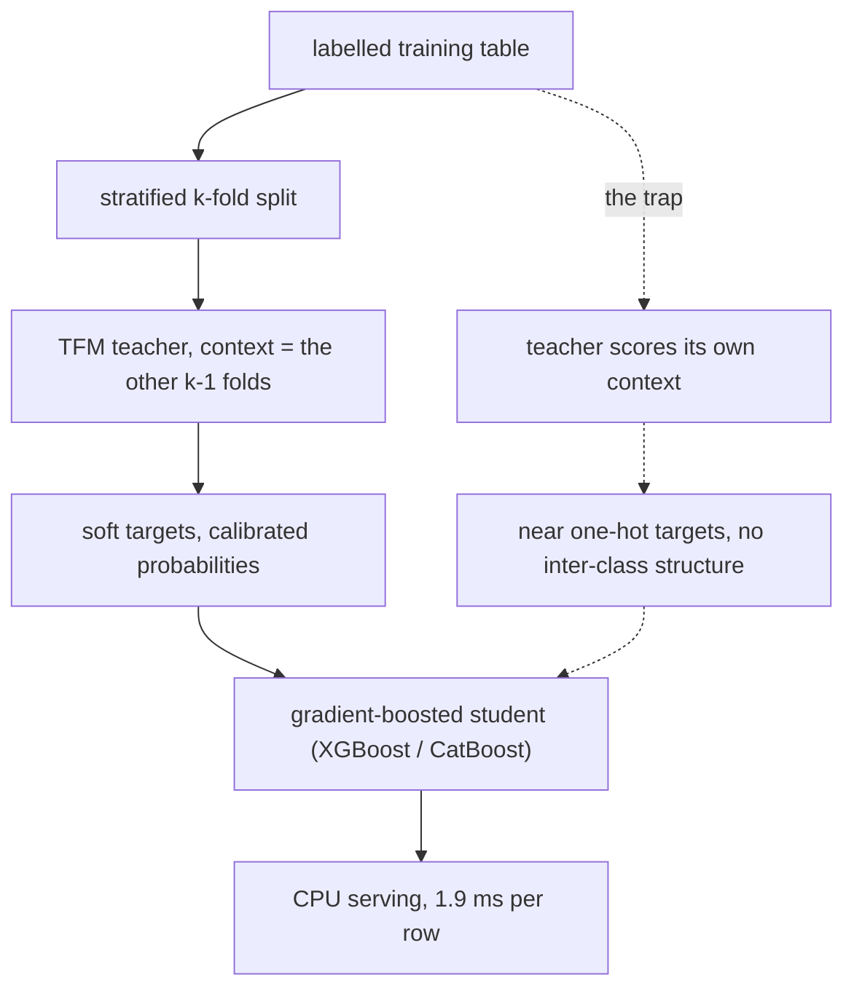
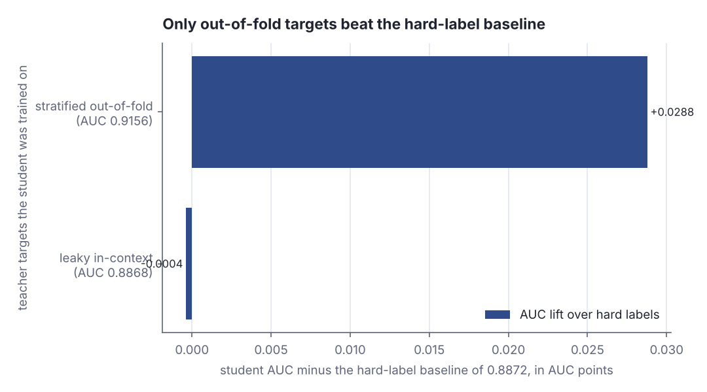
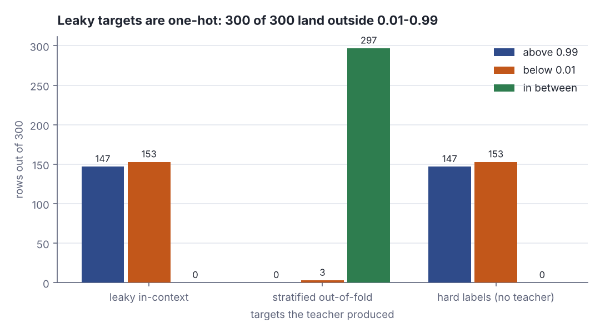

# Distilling a tabular foundation model into a 1.9 ms CPU tree

> Fresh · AI / ML foundations · Intermediate · ~25 min · from today's feeds

## Why this matters
Your next core rung is decision trees and ensembles, and this preprint is the most practical argument for why that rung survived the arrival of foundation models: it keeps the big model's knowledge and ships a tree.
The mechanism it turns on is a defect you could write in an afternoon and not notice for a quarter — a teacher that leaks labels when it scores its own training rows — and the broken version looks *more* confident than the correct one, which is exactly the failure mode that gets waved through a review.
The trade it proposes is a Product Owner's trade: a one-off offline compute bill in exchange for a serving latency you can put in an SLA.
One disclosure: web fetching was unavailable in this run, so today's fresh slot uses the one source that could be read — an arXiv preprint from the same feed, older than the usual 30-day window — and the mechanism it describes is not time-sensitive.

## Primer
You have just done logistic regression, so start there. A logistic model turns a score `z` into a probability `p = 1 / (1 + e^-z)` and is fitted by minimising cross-entropy, `-(t·log q + (1-t)·log(1-q))`, where `t` is the target and `q` the model's current answer. Nothing in that formula requires `t` to be 0 or 1. If `t` is itself a probability — 0.73 rather than 1 — the same loss still works, and the gradient on the score is still `q - t`. That single observation is all of knowledge distillation: train a small model on a big model's **probabilities** (the *soft targets*) instead of the dataset's 0/1 **hard labels**. The soft target carries information a label cannot: *how close this row was to the boundary*. Some implementations sharpen or flatten soft targets with a *temperature* divisor on the logits before the softmax; the paper here needs no temperature, because a well-calibrated teacher already produces spread-out probabilities.

The student in this lesson is a **gradient-boosted tree ensemble** — the subject of your next core rung, ai-ml-10. A decision tree predicts by asking yes/no questions about one feature at a time (`x1 <= 0.4?`) and walking to a leaf that holds a number. A single tree is weak. **Boosting** builds many in sequence: tree 1 predicts the target, tree 2 is fitted to tree 1's *residuals* (target minus prediction), tree 3 to what remains, each added with a small learning rate. The sum is the model. XGBoost and CatBoost are production implementations of exactly this.

A **tabular foundation model (TFM)** is the other shape: a pre-trained transformer that is never fitted to your dataset. You hand it your labelled rows as *context* — the way you hand an LLM a prompt — and it predicts new rows in one forward pass. That is **in-context learning (ICL)**, and it is the source of the trap below. Everything is scored with **AUC**, the probability that a random positive outranks a random negative; 0.5 is a coin flip, 1.0 is perfect ranking. AUC is rung ai-ml-11's subject and it appears in every number here.

## The idea

### A latency budget you cannot negotiate with

The paper is *Pocket Foundation Models: Distilling TFMs into CPU-Ready Gradient-Boosted Trees* by Aditya Tanna, Nassim Bouarour, Mohamed Bouadi, Vinay kumar Sankarapu and Pratinav Seth of Lexsi Labs, arXiv preprint 2605.18654, May 2026 (the fetched page showed no exact submission day). It is **un-peer-reviewed, with self-reported numbers, and only its abstract page was read in this run** — read it for the mechanism, not as a settled result.

The setup is a fraud scorer that must answer in under 2 ms, while the strongest tabular foundation models need 151–1,275 ms on a GPU (Tanna et al., arXiv:2605.18654, abstract). That gap is not a tuning problem. A TFM re-encodes a context of training rows on every call, and no amount of batching turns a 150 ms forward pass into a 2 ms one on a CPU box. So the authors keep the TFM, but move it off the request path entirely:

> "distilling the TFM offline into an XGBoost or CatBoost student that runs natively on CPU"
> — Tanna, Bouarour, Bouadi, Sankarapu and Seth (Lexsi Labs), *Pocket Foundation Models: Distilling TFMs into CPU-Ready Gradient-Boosted Trees*, arXiv:2605.18654, May 2026, https://arxiv.org/abs/2605.18654

Offline, the teacher scores your training table once. Those scores become the training targets of a gradient-boosted tree. At serving time only the tree runs.

### What the soft target is actually carrying

Distillation is worth doing only if the teacher's probabilities say something the labels do not. Watch what a student is told about one row by three different targets, when it currently believes `q = 0.7311`:

```scala
// file: Signal.scala
@main def signal(): Unit =
  def xent(t: Double, q: Double) = -(t * math.log(q) + (1 - t) * math.log(1 - q))
  val q = 0.7311 // what the student currently believes for this row
  val targets = Vector(("hard label", 1.0), ("leaky teacher", 0.9987), ("oof teacher", 0.7311))
  for (nm, t) <- targets do
    println(f"$nm%-14s target $t%.4f   loss ${xent(t, q)}%.4f   dL/dz = q - t ${q - t}%+.4f")
  println(f"leaky minus hard: target ${0.9987 - 1.0}%+.4f, gradient ${1.0 - 0.9987}%+.4f")
```

```text
hard label     target 1.0000   loss 0.3132   dL/dz = q - t -0.2689
leaky teacher  target 0.9987   loss 0.3145   dL/dz = q - t -0.2676
oof teacher    target 0.7311   loss 0.5822   dL/dz = q - t +0.0000
```

The honest soft target says *stop, you are already right*: gradient `+0.0000`. The near-one-hot target says *keep pushing towards 1*, with a gradient of −0.2676 — which is the hard label's −0.2689 to within 0.0013. A target that sits 0.0013 from the label is a label with extra decimal places. The whole value of distillation lives in the 0.7311 case, and a near-one-hot teacher destroys it.

### The trap: an ICL teacher scoring its own context

Why would a teacher emit 0.9987? Because of how a TFM is asked. Its "training set" is its context, and if you ask it to score the same rows you put in that context, the answer to *is this row positive?* is sitting in the prompt:

> "leak labels when scoring their own training set"
> — Tanna, Bouarour, Bouadi, Sankarapu and Seth (Lexsi Labs), *Pocket Foundation Models: Distilling TFMs into CPU-Ready Gradient-Boosted Trees*, arXiv:2605.18654, May 2026, https://arxiv.org/abs/2605.18654

The same row, scored both ways:

```scala
// file: Score.scala
@main def score(): Unit =
  def sig(z: Double) = 1.0 / (1.0 + math.exp(-z))
  val (y, pTrue, noise) = (1, 0.8228, -0.6763)
  val z = math.log(pTrue / (1 - pTrue))
  val oof = sig(0.85 * z + 0.45 * noise)
  val inContext = 0.995 * y + 0.005 * oof
  println(f"row 2: y = $y%d, true p $pTrue%.4f, teacher logit ${0.85 * z}%+.4f")
  println(f"  scored out of fold, its label hidden: ${oof}%.4f")
  println(f"  scored inside its own context:        ${inContext}%.4f")
  println(f"  in-context score sits ${math.abs(y - inContext)}%.4f away from the hard label")
```

```text
row 2: y = 1, true p 0.8228, teacher logit +1.3051
  scored out of fold, its label hidden: 0.7312
  scored inside its own context:        0.9987
  in-context score sits 0.0013 away from the hard label
```

One row, one teacher, two numbers 0.27 apart. (The snippet starts from the lab's rounded printout, so it lands on 0.7312 where the lab prints 0.7311.) Nothing crashes, no metric goes red; the distillation set simply turns into a copy of the labels wearing four decimal places.

### The fix is a fold assignment

> "Stratified out-of-fold (OOF) teacher labeling prevents this."
> — Tanna, Bouarour, Bouadi, Sankarapu and Seth (Lexsi Labs), *Pocket Foundation Models: Distilling TFMs into CPU-Ready Gradient-Boosted Trees*, arXiv:2605.18654, May 2026, https://arxiv.org/abs/2605.18654

Split the training table into k folds, keeping the class balance in each (*stratified*). To score fold 3, give the teacher folds 1, 2, 4 and 5 as context. No row is ever scored by a context containing its own label, so every target is the teacher's genuine belief about an unseen row. You pay for it in teacher passes: k context encodings instead of one.



*Figure 1: the distillation pipeline, with the leakage path dotted. Adapted from Tanna et al., arXiv:2605.18654, https://arxiv.org/abs/2605.18654*

### What they report, and what it costs

Over 153 classification datasets drawn from TALENT, OpenML-CC18, TabZilla and TabArena, distilling TabICLv2 into XGBoost reaches 0.882 macro-mean AUC — 96.5% of the teacher's AUC — at 1.9 ms on CPU, a 38x–860x speedup across teacher–student pairs, and it beats a tuned CatBoost baseline at Wilcoxon p = 0.0008 with a 51% win rate (Tanna et al., arXiv:2605.18654, abstract). Read that last pair carefully: p = 0.0008 says the edge is unlikely to be chance across 153 datasets; the 51% win rate says that on *your* dataset it is close to a coin flip. Significance is about the population of datasets, not about yours.

Four results qualify the headline further (Tanna et al., arXiv:2605.18654, abstract). Teacher rank carries over to student rank, so picking the teacher *is* picking the student — no distillation trick rescues a weak teacher. Gains concentrate on datasets with 21 or fewer features. Multi-teacher averaging helps MLP students but adds under 0.001 AUC for tree students, so the obvious ensemble upgrade is not worth its bill. And where the teacher already trails CatBoost on high-dimensional data, distilling makes it *worse* — you inherit the teacher's failures along with its skill, which is the honest cost of copying a model's beliefs rather than fitting the data yourself.

The pipeline is not vapour:

> "The full pipeline is open-sourced as part of the TabTune library."
> — Tanna, Bouarour, Bouadi, Sankarapu and Seth (Lexsi Labs), *Pocket Foundation Models: Distilling TFMs into CPU-Ready Gradient-Boosted Trees*, arXiv:2605.18654, May 2026, https://arxiv.org/abs/2605.18654

Put the ledger plainly. You buy: single-digit-millisecond CPU scoring, no GPU in the serving path, an artefact your ops team already knows how to deploy. You pay: an offline teacher pass multiplied by k folds, a retraining pipeline that now has two models in it, and a ceiling set by the teacher. Day 30's fresh lesson asked whether foundation models beat tuned boosting at all; this paper takes the opposite move — assume the foundation model knows something, then refuse to run it in production.

## Lab
**Question:** does a teacher that scores its own training rows produce a better student than a teacher scored out of fold — and how would you see the difference if you only looked at confidence?

Everything is built from scratch with a fixed seed: synthetic tabular data with a known logistic ground truth, a simulated ICL teacher, stratified out-of-fold scoring, and a tiny gradient-boosted stump ensemble as the student. Run it with `python3 dojo/engine/run_lab.py 2026-11-16-2`.

### Step 1 — a table with a known truth, and two ways to ask the teacher

400 rows, four standard-normal features, truth `p = sigmoid(-0.25 + 1.7·x1 - 1.2·x2 + 0.9·x3 + 0·x4)`; labels drawn from that `p`. The first 300 rows are the distillation set, the last 100 are held out and never seen by teacher or student. The teacher is deliberately simple: outside its context it returns `sigmoid(0.85·z + 0.45·noise)` — good, calibrated, imperfect; inside its context it has already seen the label and returns `0.995·y + 0.005·calibrated`.

### Step 2 — how much structure survives in each target set

Count how many targets land above 0.99 or below 0.01, and the mean entropy of each target set. Then trace one row's cross-entropy and gradient under all three target choices.

### Step 3 — one student per target set, scored on held-out truth

Three identical students (60 boosting rounds, learning rate 0.25, depth-1 stumps over four features), differing only in what they were trained on: leaky targets, out-of-fold targets, hard labels. AUC is measured on the 100 held-out rows against their real labels.

```scala
// file: Lab.scala
import scala.util.Random

final case class Row(id: Int, x: Array[Double], pTrue: Double, y: Int, noise: Double)

@main def lab(): Unit =
  def sig(z: Double): Double = 1.0 / (1.0 + math.exp(-z))
  def clamp(v: Double): Double = v.max(1e-12).min(1 - 1e-12)
  def xent(t: Double, q: Double): Double =
    val tc = clamp(t)
    val qc = clamp(q)
    -(tc * math.log(qc) + (1 - tc) * math.log(1 - qc))

  val rng = Random(20261116L)
  val w = Array(1.7, -1.2, 0.9, 0.0) // the fourth feature is pure noise
  val b = -0.25
  val rows = (1 to 400).map { i =>
    val x = Array.fill(4)(rng.nextGaussian())
    val z = b + (0 until 4).map(j => w(j) * x(j)).sum
    val p = sig(z)
    Row(i, x, p, if rng.nextDouble() < p then 1 else 0, rng.nextGaussian())
  }.toVector
  val distill = rows.take(300) // the rows the teacher will label
  val test = rows.drop(300)    // held-out: neither teacher nor student ever sees these

  // ---- the teacher: an in-context-learning tabular model --------------------
  // Outside its context it is a good but imperfect, calibrated model.
  def calibrated(r: Row): Double =
    val z = math.log(r.pTrue / (1 - r.pTrue))
    sig(0.85 * z + 0.45 * r.noise)
  // Inside its own context it has seen the row's label and collapses onto it.
  def leaky(r: Row): Double = 0.995 * r.y + 0.005 * calibrated(r)

  println("== Step 1: the same teacher scores the same rows two ways ==")
  println(" id      x1      x2   y   p_true   leaky_in_context   oof_honest")
  for r <- distill.take(8) do
    println(f"${r.id}%3d ${r.x(0)}%+7.3f ${r.x(1)}%+7.3f ${r.y}%3d ${r.pTrue}%8.4f"
      + f" ${leaky(r)}%18.4f ${calibrated(r)}%12.4f")

  val folds = 5
  val foldOf: Map[Int, Int] =
    distill.groupBy(_.y).toVector.flatMap { case (_, g) =>
      g.zipWithIndex.map { case (r, k) => r.id -> (k % folds) }
    }.toMap
  val perFold = (0 until folds).map(f => distill.count(r => foldOf(r.id) == f))
  val perFoldPos = (0 until folds).map(f => distill.count(r => foldOf(r.id) == f && r.y == 1))
  println()
  println(s"stratified folds, rows per fold: ${perFold.mkString(", ")}")
  println(s"                  positives per fold: ${perFoldPos.mkString(", ")}")
  println("fold f is scored by a teacher whose context is the other 4 folds, so no row is")
  println("ever scored by a context that already contains that row's own label.")

  val tLeaky = distill.map(leaky)        // teacher scoring its own context
  val tOof = distill.map(calibrated)     // teacher scoring folds it did not hold
  val tHard = distill.map(_.y.toDouble)  // the baseline: no teacher at all

  println()
  println("== Step 2: how much structure survives in each target set ==")
  def shape(name: String, ts: Vector[Double]): Unit =
    val hi = ts.count(_ > 0.99)
    val lo = ts.count(_ < 0.01)
    val mid = ts.size - hi - lo
    val ent = ts.map(t => xent(t, t)).sum / ts.size
    println(f"$name%-22s  >0.99: $hi%3d   <0.01: $lo%3d   in between: $mid%3d   mean entropy ${ent}%.4f")
  shape("leaky in-context", tLeaky)
  shape("stratified out-of-fold", tOof)
  shape("hard labels", tHard)

  println()
  val r2 = distill(1)
  println(f"row ${r2.id}%d (y=${r2.y}%d, true p ${r2.pTrue}%.4f): what a student sitting at q=0.7311 is told")
  for (nm, t) <- Vector(("leaky", leaky(r2)), ("oof", calibrated(r2)), ("hard", r2.y.toDouble)) do
    println(f"  $nm%-6s target ${t}%.4f  cross-entropy ${xent(t, 0.7311)}%.4f"
      + f"  dL/dz = q - t = ${0.7311 - t}%+.4f  gap to hard label ${math.abs(r2.y - t)}%.4f")

  // ---- the student: a tiny gradient-boosted stump ensemble -------------------
  final case class Stump(j: Int, thr: Double, lo: Double, hi: Double):
    def apply(x: Array[Double]): Double = if x(j) <= thr then lo else hi

  def fitStump(xs: Vector[Array[Double]], res: Vector[Double]): Stump =
    var best = Stump(0, 0.0, 0.0, 0.0)
    var bestSse = Double.MaxValue
    for j <- 0 until 4 do
      val sorted = xs.map(_(j)).sorted
      for q <- 1 until 10 do
        val thr = sorted(q * sorted.size / 10)
        val (l, h) = res.zip(xs).partition { case (_, x) => x(j) <= thr }
        if l.nonEmpty && h.nonEmpty then
          val ml = l.map(_._1).sum / l.size
          val mh = h.map(_._1).sum / h.size
          val sse = l.map(t => (t._1 - ml) * (t._1 - ml)).sum
            + h.map(t => (t._1 - mh) * (t._1 - mh)).sum
          if sse < bestSse then
            bestSse = sse
            best = Stump(j, thr, ml, mh)
    best

  def train(xs: Vector[Array[Double]], t: Vector[Double], rounds: Int, lr: Double): Array[Double] => Double =
    val base = t.sum / t.size
    var pred = Vector.fill(t.size)(base)
    var trees = Vector.empty[Stump]
    for _ <- 1 to rounds do
      val res = t.zip(pred).map { case (a, p) => a - p }
      val s = fitStump(xs, res)
      trees = trees :+ s
      pred = xs.zip(pred).map { case (x, p) => p + lr * s(x) }
    (x: Array[Double]) => base + lr * trees.map(_(x)).sum

  def auc(scores: Vector[Double], labels: Vector[Int]): Double =
    val pos = scores.zip(labels).filter(_._2 == 1).map(_._1)
    val neg = scores.zip(labels).filter(_._2 == 0).map(_._1)
    val c = pos.map(p => neg.map(q => if p > q then 1.0 else if p == q then 0.5 else 0.0).sum).sum
    c / (pos.size * neg.size)

  println()
  println("== Step 3: one student per target set, scored on the held-out 100 rows ==")
  val xs = distill.map(_.x)
  val tx = test.map(_.x)
  val ty = test.map(_.y)
  val students = Vector(("leaky in-context", tLeaky), ("stratified out-of-fold", tOof), ("hard labels", tHard))
    .map { case (nm, t) => (nm, train(xs, t, 60, 0.25)) }
  println("per-row student scores (first 6 held-out rows, raw boosting scores, rank is what counts):")
  println(" id   y   p_true    leaky      oof     hard")
  for r <- test.take(6) do
    val s = students.map(_._2(r.x))
    println(f"${r.id}%3d ${r.y}%3d ${r.pTrue}%8.4f ${s(0)}%8.4f ${s(1)}%8.4f ${s(2)}%8.4f")
  println()
  val aucs = students.map { case (nm, f) => (nm, auc(tx.map(f), ty)) }
  val teacherAuc = auc(test.map(calibrated), ty)
  for (nm, a) <- aucs do println(f"student AUC, $nm%-22s = ${a}%.4f")
  println(f"teacher AUC on the same held-out rows         = ${teacherAuc}%.4f")
  println(f"out-of-fold student keeps ${100 * aucs(1)._2 / teacherAuc}%.1f%% of the teacher's AUC,"
    + f" leaky student ${100 * aucs(0)._2 / teacherAuc}%.1f%%")
  println(f"out-of-fold minus leaky = ${aucs(1)._2 - aucs(0)._2}%+.4f AUC,"
    + f" leaky minus hard labels = ${aucs(0)._2 - aucs(2)._2}%+.4f AUC")
```

```text
== Step 1: the same teacher scores the same rows two ways ==
 id      x1      x2   y   p_true   leaky_in_context   oof_honest
  1  +0.241  +1.240   0   0.1686             0.0010       0.2070
  2  +0.018  -1.216   1   0.8228             0.9987       0.7311
  3  +0.048  -3.106   1   0.9855             0.9997       0.9386
  4  +0.039  -0.759   1   0.7455             0.9987       0.7407
  5  -0.982  -0.529   0   0.2217             0.0024       0.4826
  6  -0.166  -1.438   1   0.8330             0.9991       0.8195
  7  +1.273  +0.136   1   0.9351             0.9996       0.9244
  8  -1.310  +0.268   0   0.0300             0.0001       0.0270

stratified folds, rows per fold: 61, 61, 60, 59, 59
                  positives per fold: 30, 30, 29, 29, 29
fold f is scored by a teacher whose context is the other 4 folds, so no row is
ever scored by a context that already contains that row's own label.

== Step 2: how much structure survives in each target set ==
leaky in-context        >0.99: 147   <0.01: 153   in between:   0   mean entropy 0.0105
stratified out-of-fold  >0.99:   0   <0.01:   3   in between: 297   mean entropy 0.4613
hard labels             >0.99: 147   <0.01: 153   in between:   0   mean entropy 0.0000

row 2 (y=1, true p 0.8228): what a student sitting at q=0.7311 is told
  leaky  target 0.9987  cross-entropy 0.3145  dL/dz = q - t = -0.2676  gap to hard label 0.0013
  oof    target 0.7311  cross-entropy 0.5822  dL/dz = q - t = +0.0000  gap to hard label 0.2689
  hard   target 1.0000  cross-entropy 0.3132  dL/dz = q - t = -0.2689  gap to hard label 0.0000

== Step 3: one student per target set, scored on the held-out 100 rows ==
per-row student scores (first 6 held-out rows, raw boosting scores, rank is what counts):
 id   y   p_true    leaky      oof     hard
301   1   0.5503   0.5606   0.5410   0.5577
302   0   0.2681   0.3804   0.3659   0.3851
303   1   0.6797   0.5590   0.6864   0.5575
304   0   0.1352   0.2003   0.2351   0.1989
305   0   0.0905   0.1230   0.1144   0.1279
306   0   0.0061  -0.1853  -0.1954  -0.1879

student AUC, leaky in-context       = 0.8868
student AUC, stratified out-of-fold = 0.9156
student AUC, hard labels            = 0.8872
teacher AUC on the same held-out rows         = 0.8876
out-of-fold student keeps 103.2% of the teacher's AUC, leaky student 99.9%
out-of-fold minus leaky = +0.0288 AUC, leaky minus hard labels = -0.0004 AUC
```

### Reading the output

**Block 1 — the teacher, scored both ways.** Columns: `x1`, `x2` are two of the four features; `y` is the real 0/1 label; `p_true` is the probability the row was actually drawn from (known only because the data is synthetic); `leaky_in_context` is the teacher's answer when the row sits in its own context; `oof_honest` is the teacher's answer when it does not. Closer to `p_true` is better — that is the signal distillation is supposed to copy.

| id | y | p_true | leaky in-context | oof honest |
| --- | --- | --- | --- | --- |
| 1 | 0 | 0.1686 | 0.0010 | 0.2070 |
| 2 | 1 | 0.8228 | 0.9987 | 0.7311 |
| 3 | 1 | 0.9855 | 0.9997 | 0.9386 |
| 4 | 1 | 0.7455 | 0.9987 | 0.7407 |
| 5 | 0 | 0.2217 | 0.0024 | 0.4826 |
| 6 | 1 | 0.8330 | 0.9991 | 0.8195 |
| 7 | 1 | 0.9351 | 0.9996 | 0.9244 |
| 8 | 0 | 0.0300 | 0.0001 | 0.0270 |

Row 4 is the clean case: true probability 0.7455, honest teacher 0.7407, leaky teacher 0.9987. The leaky column is not a better estimate of anything — it is the `y` column with noise in the fourth decimal. Row 5 shows the honest teacher being honestly wrong (0.4826 against a truth of 0.2217); that is the price of out-of-fold scoring and it is a price worth paying, as block 3 shows.

**Verdict:** the leaky scheme is more confident on every single row and closer to the truth on none of them.

**Block 2 — target shape and the gradient on one row.** `>0.99` and `<0.01` count near-one-hot targets; `in between` counts targets that actually carry a degree of belief; mean entropy measures how much belief is in the set (0 means every target is a certainty). Higher `in between` and higher entropy mean more to distil.

| targets | >0.99 | <0.01 | in between | mean entropy |
| --- | --- | --- | --- | --- |
| leaky in-context | 147 | 153 | 0 | 0.0105 |
| stratified out-of-fold | 0 | 3 | 297 | 0.4613 |
| hard labels | 147 | 153 | 0 | 0.0000 |

The leaky set and the hard-label set have the *same* shape: 147 positives, 153 negatives, nothing in between. The teacher pass produced 300 numbers and 0.0105 nats of information per row.

Trace row 2 with digits. True `p` is 0.8228, the student currently says `q = 0.7311`. Under the out-of-fold target `t = 0.7311` the loss is `-(0.7311·ln 0.7311 + 0.2689·ln 0.2689) = -(0.7311·(-0.3133) + 0.2689·(-1.3137)) = 0.2291 + 0.3532 = 0.5822`, and the gradient on the score is `q - t = 0.7311 - 0.7311 = +0.0000` — the student is told it has arrived. Under the leaky target `t = 0.9987` the gradient is `0.7311 - 0.9987 = -0.2676`, against the hard label's `0.7311 - 1.0000 = -0.2689`. The teacher changed the update by `0.0013`, which is 0.5% of the hard label's own push.

**Verdict:** the leaky teacher contributes 0.0013 of gradient where the honest teacher contributes a full stop. Confidence went up; information went to zero.



*Figure 2: only out-of-fold targets beat training on the raw labels. Bars are this lab's own numbers, from the final two lines of the output above (`out-of-fold minus leaky = +0.0288 AUC, leaky minus hard labels = -0.0004 AUC`).*

**Block 3 — three students, one held-out set.** `p_true` is the row's real probability; the three score columns are raw boosting outputs, so they can sit outside [0, 1] — only their *order* matters, because AUC is a ranking metric. Higher AUC is better; 0.5 is a coin flip.

| student trained on | AUC on 100 held-out rows | vs hard labels |
| --- | --- | --- |
| leaky in-context targets | 0.8868 | −0.0004 |
| stratified out-of-fold targets | 0.9156 | +0.0288 |
| hard labels (no teacher) | 0.8872 | — |
| the teacher itself | 0.8876 | +0.0004 |

Row 303 is the tell: true probability 0.6797, label 1. The out-of-fold student scores it 0.6864; the leaky and hard-label students score it 0.5590 and 0.5575 — nearly identical to each other, and both rank it below row 301 (true `p` 0.5503). The out-of-fold student has learned the shape of the boundary; the other two have learned the labels, including the noise in them.

The out-of-fold student scores 0.9156, which is 103.2% of its own teacher's 0.8876. That is not magic: the teacher's per-row error term is independent noise, and the student, which is too simple to reproduce noise, fits only the systematic part — regression towards the signal. It also means a student beating its teacher is not by itself evidence of anything good.



*Figure 3: the leaky target set is indistinguishable in shape from the raw labels — 300 of 300 rows outside 0.01–0.99. Counts are this lab's own numbers, from the Step 2 block above.*

**Verdict:** the leaky-target student is 0.0004 AUC *worse* than using no teacher at all, and 0.0288 worse than the out-of-fold student. The expensive teacher pass bought nothing, and nothing in the training logs said so.

### Cause → mechanism → consequence → practice

1. **Cause.** A TFM learns in context, so its "training set" is its prompt. Scoring the distillation set with a context that contains that same set means every answer is visible in the input.
2. **Mechanism.** The teacher returns near-one-hot probabilities (147 above 0.99, 153 below 0.01 — identical to the raw labels). Cross-entropy against a target 0.0013 from the label produces a gradient 0.0013 from the hard-label gradient, so the student receives no inter-class structure — and inter-class structure is the only thing distillation transfers.
3. **Consequence.** The student trained on leaky targets scores 0.8868 AUC against 0.8872 for a student trained on no teacher at all and 0.9156 for one trained on out-of-fold targets. You paid for a foundation model and shipped the hard-label baseline.
4. **In practice.** The broken pipeline is the confident one. If someone shows you a distillation run where the teacher's probabilities are all 0.99s and 0.01s, that is the signature of leakage, not of a teacher that understands your data. Two cheap gates, both of which fit in a definition of done: the fraction of teacher targets inside 0.01–0.99 must be reported, and the distilled student must be compared against a student trained on the raw labels on the same held-out split. If the second number is not better, the teacher is decoration — and "the teacher is very sure" is not evidence the distillation worked.

## Self-check
1. A colleague says their distillation is working because the teacher's probabilities on the training set average 0.98 for positives and 0.02 for negatives. What is wrong with that as evidence? <details><summary>Answer</summary>It is the signature of the failure, not of success. Near-one-hot teacher targets are what you get when an in-context learner scores rows that sit in its own context and "leak labels when scoring their own training set" (Tanna et al., arXiv:2605.18654). A target 0.0013 from the hard label gives a gradient 0.0013 from the hard-label gradient, so the student learns nothing the labels did not already say — in the lab, 0.8868 AUC against 0.8872 for a student trained on labels alone.</details>
2. Why must the out-of-fold split be *stratified*, and what does the fix cost you? <details><summary>Answer</summary>Stratification keeps each fold's class balance close to the whole set's (in the lab: 30, 30, 29, 29, 29 positives across five folds of 61, 61, 60, 59, 59 rows). Without it, a fold can end up with few or no positives, so the teacher's context for that fold is unrepresentative and its probabilities are biased rather than merely noisy. The cost is k teacher passes instead of one — with a model that takes 151–1,275 ms per GPU call (Tanna et al., arXiv:2605.18654), that offline bill is the real price of the 1.9 ms serving path.</details>
3. The paper reports a 51% win rate against tuned CatBoost at Wilcoxon p = 0.0008 across 153 datasets (Tanna et al., arXiv:2605.18654). How should that change what you promise a stakeholder? <details><summary>Answer</summary>Promise the latency, not the accuracy. p = 0.0008 is a statement about the population of 153 datasets: the method is better *on average*, unlikely by chance. A 51% win rate is a statement about one dataset: roughly a coin flip whether yours improves. The defensible claim is "we keep about the teacher's ranking quality while serving on CPU in single-digit milliseconds", with the distilled-vs-raw-label comparison run on your own held-out split before anyone commits.</details>

## Sources
- [Pocket Foundation Models: Distilling TFMs into CPU-Ready Gradient-Boosted Trees](https://arxiv.org/abs/2605.18654) — Aditya Tanna, Nassim Bouarour, Mohamed Bouadi, Vinay kumar Sankarapu, Pratinav Seth (Lexsi Labs), arXiv:2605.18654, May 2026; an un-peer-reviewed preprint with self-reported numbers. Only the abstract page was read in this run — the full text (PDF/HTML) was not reachable, and the page returned showed no exact submission date. It contributed every quoted fragment and every paper number in this lesson: the 151–1,275 ms teacher latency, the 1.9 ms CPU student, 0.882 macro-mean AUC at 96.5% of the teacher, the 38x–860x speedups, Wilcoxon p = 0.0008 at a 51% win rate over 153 datasets, the 21-feature threshold, the under-0.001 multi-teacher gain, and the TabTune release. Accessed 2026-11-16.

## Next on this track
Fresh lessons sit outside the ladder; next on AI / ML foundations: **Decision trees and ensembles: what Kaggle actually wins with** (rung 10 of 38, Beginner).
