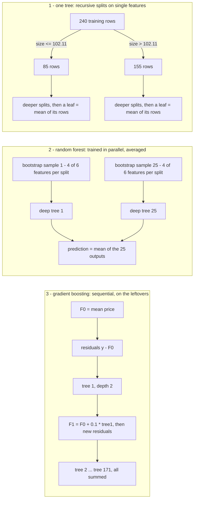
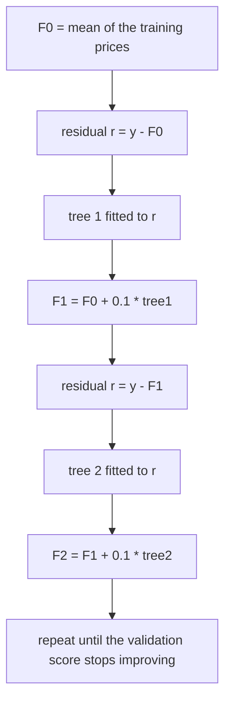
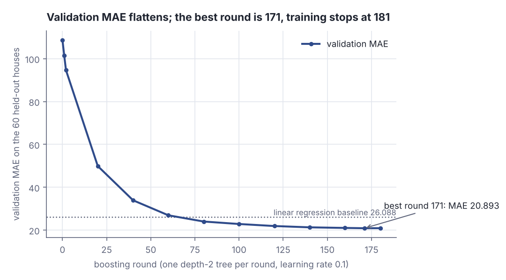
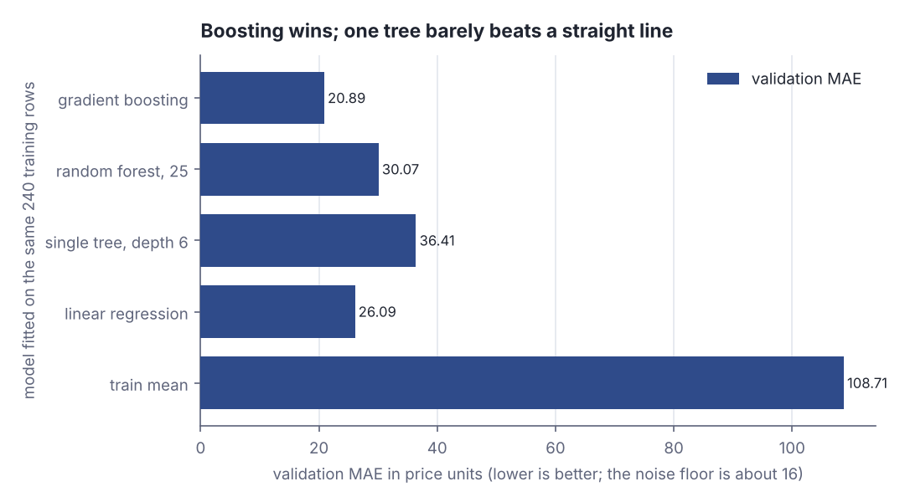

# Decision trees and ensembles: what Kaggle actually wins with

> AI / ML foundations · Beginner · ~30 min · rung 10 of 38 · needs: Validation, overfitting and data leakage (ai-ml-03)

## Why this matters
Almost every dataset you own at work is a table — orders, users, requests, a few dozen columns each — and for that shape of data the default winning model is still a pile of small decision trees, not a neural network.
Both Kaggle courses you are working through steer you there: Lesson 6 of *Intro to Machine Learning* is "Random Forests", Lesson 6 of *Intermediate Machine Learning* is "XGBoost".
After this rung "let's throw XGBoost at it" stops being a reflex and becomes a decision you can defend, size and debug.

## The idea

### A tree is an if/else program fitted from data

A regression tree is a nested `if/else` over feature values. Each internal node asks one question — `size <= 102.11` — and each leaf stores one number, the mean target of the training rows that land in it. Predicting walks root to leaf; fitting chooses the questions.

The rule is **impurity reduction**. For regression, impurity is the **variance**: `sum over rows of (y - mean)^2`. For classification it is **Gini impurity** `1 - sum p_k^2` or **entropy** `- sum p_k * log2 p_k`, with `p_k` the share of class `k` in the node; both are 0 when the node is pure. The mechanics are identical: try every feature, try thresholds between its sorted values, score each by `impurity(parent) - impurity(left) - impurity(right)`, keep the winner, recurse.

```scala
// file: Split.scala
@main def split(): Unit =
  val rows = Vector((50.0, 170.0), (60.0, 195.0), (70.0, 215.0), (80.0, 240.0),
                    (150.0, 600.0), (160.0, 620.0), (170.0, 650.0), (180.0, 680.0))
  def sse(ys: Seq[Double]) = { val m = ys.sum / ys.size; ys.map(y => (y - m) * (y - m)).sum }
  val all = sse(rows.map(_._2))
  println(f"squared error of the 8 prices before any split: $all%9.1f")
  for t <- Vector(65.0, 115.0, 165.0) do
    val (l, r) = rows.partition(_._1 <= t)
    val drop = all - sse(l.map(_._2)) - sse(r.map(_._2))
    println(f"size <= $t%5.1f  left ${l.size}  right ${r.size}  variance drop $drop%9.1f")
```

```text
squared error of the 8 prices before any split:  380437.5
size <=  65.0  left 2  right 6  variance drop  152004.2
size <= 115.0  left 4  right 4  variance drop  374112.5
size <= 165.0  left 6  right 2  variance drop  158437.5
```

Eight houses, four small and four large. The cut at 115.0 separates them and removes 374112.5 of the 380437.5 total squared error; the lopsided cuts leave most of the variance inside a child. Nobody told the tree that 115 matters — it scored every midpoint and kept the best. That scan is the whole learning algorithm.



*Figure 1: the three models of this rung — one tree splitting recursively, a forest of independent trees averaged, a boosted sequence fitted to the leftovers. Source: this lesson's lab output.*

### Depth is the capacity dial, and one tree always overfits

A tree of depth `d` carves the space into up to `2^d` boxes, so left unlimited it ends with one row per leaf and reproduces the training table exactly, noise included. The lab below (240 training houses, 60 held out) shows it: at `maxDepth=20` training MAE is **0.000** and validation MAE **38.210**, while a depth-6 tree that cannot memorise scores **36.414**. Training error falls monotonically with depth; validation error is U-shaped. Depth, minimum rows per leaf and minimum rows to split are the brakes.

### Bagging and random forests: average mistakes that are not the same mistake

A single tree is a high-variance estimator: move a few rows and the root split jumps to another feature. **Bagging** (bootstrap aggregating) exploits that. Draw a *bootstrap sample* — n rows drawn with replacement from the n training rows, so about 63% of rows appear at least once — fit a tree on it, repeat, average.

> "In averaging methods, the driving principle is to build several estimators independently and then to average their predictions. On average, the combined estimator is usually better than any of the single base estimator because its variance is reduced."
>
> — scikit-learn developers, *1.11. Ensemble methods*, scikit-learn user guide, https://scikit-learn.org/1.1/modules/ensemble.html

A **random forest** is bagged trees — one bootstrap sample per tree (scikit-learn user guide, 1.11.2.1 "Random Forests") — plus a second source of randomness:

> "Furthermore, when splitting each node during the construction of a tree, the best split is found either from all input features or a random subset of size max_features."
>
> — scikit-learn developers, *1.11.2.1. Random Forests*, scikit-learn user guide, https://scikit-learn.org/1.1/modules/ensemble.html

Why the second source of randomness? Averaging only helps where the members' errors are *independent*. If every tree may see every feature, they all seize on the dominant one and make the same mistake — and averaging one mistake 25 times leaves it intact.

```scala
// file: Average.scala
@main def average(): Unit =
  val g = new scala.util.Random(4)
  def mae(e: Vector[Double]) = e.map(math.abs).sum / e.size
  for c <- Vector(0.0, 0.7) do
    val bias = Vector.fill(200)(g.nextGaussian() * 10)
    val mem = Vector.fill(25)(bias.map(b => c * b + math.sqrt(1 - c * c) * g.nextGaussian() * 10))
    val avg = (0 until 200).map(i => mem.map(_(i)).sum / 25).toVector
    println(f"corr $c%3.1f  one member MAE ${mae(mem.head)}%5.2f  average of 25 ${mae(avg)}%5.2f")
```

```text
corr 0.0  one member MAE  7.28  average of 25  1.61
corr 0.7  one member MAE  7.90  average of 25  5.67
```

Twenty-five members of equal individual quality: independent errors average 4.5x smaller (7.28 to 1.61, near the 1/sqrt(25) you would predict), 70%-shared errors barely improve (7.90 to 5.67) because the shared part survives averaging. In the lab, 25 trees averaging 41.261 individually give an ensemble MAE of **30.070**.

### Gradient boosting: add small trees that fit what is still wrong

Boosting abandons independence: the trees are built in sequence, each fitted to the current ensemble's mistakes.

> "Usually, a single tree is not strong enough to be used in practice. [...] Instead, we use an additive strategy: fix what we have learned, and add one new tree at a time."
>
> — XGBoost developers, *Introduction to Boosted Trees*, XGBoost documentation, https://xgboost.readthedocs.io/en/stable/tutorials/model.html

For squared-error regression: start with `F0` = the mean target, compute each residual `r_i = y_i - F0(x_i)`, fit a small tree to them, set `F1 = F0 + lr * tree1`, recompute the residuals against `F1`, repeat. The residual is not arbitrary: for `L = 0.5 * (y - F)^2` the derivative is `dL/dF = F - y`, so the *negative gradient* is exactly `y - F`. Hence *gradient* boosting; for log-loss classification the trees fit log-loss's negative gradient instead.

`lr`, the **learning rate** (XGBoost calls it `eta`), shrinks each tree's contribution. It trades directly against the **number of trees**.

```scala
// file: Shrink.scala
@main def shrink(): Unit =
  for lr <- Vector(1.0, 0.3, 0.1) do
    var pred = 0.0
    val errs = for round <- 1 to 60 yield
      pred += lr * (100.0 - pred)
      (round, math.abs(100.0 - pred))
    val shown = errs.filter((r, _) => Set(1, 5, 20, 60).contains(r))
    println(f"lr=$lr%4.2f  " + shown.map((r, e) => f"round $r%2d left $e%7.3f").mkString("   "))
```

```text
lr=1.00  round  1 left   0.000   round  5 left   0.000   round 20 left   0.000   round 60 left   0.000
lr=0.30  round  1 left  70.000   round  5 left  16.807   round 20 left   0.080   round 60 left   0.000
lr=0.10  round  1 left  90.000   round  5 left  59.049   round 20 left  12.158   round 60 left   0.180
```

With an idealised learner the error left after `k` rounds is `(1 - lr)^k`: `lr = 1.0` lands in one jump, `lr = 0.1` needs about 60 rounds. On noisy data the big jump is the problem — a full-size step fits the noise as eagerly as the signal — so small steps and many trees is the standard setting.



*Figure 2: additive training — fix what has been learned, add one tree fitted to the leftovers, scale it by the learning rate. Adapted from XGBoost developers, "Introduction to Boosted Trees", https://xgboost.readthedocs.io/en/stable/tutorials/model.html*

### Early stopping decides the number of trees for you

Every round lowers the *training* loss, so the number of trees cannot be tuned on training data. XGBoost and LightGBM settle it with early stopping on a held-out set:

> "If you have a validation set, you can use early stopping to find the optimal number of boosting rounds. Early stopping requires at least one set in evals. Validation error needs to decrease at least every early_stopping_rounds to continue training."
>
> — XGBoost developers, *Python Package Introduction*, XGBoost documentation, https://xgboost.readthedocs.io/en/latest/python/python_intro.html

In the lab, validation MAE bottoms out at round 171 (20.893) and the run halts at round 181, ten rounds later.



*Figure 3: the boosting run's validation MAE at the rounds the lab prints; the curve flattens long before it stops improving, which is why patience is counted in rounds. Generated with `python3 dojo/engine/chart.py dojo/lessons/assets/2026-11-17-1-chart-2.json`.*

### Everything the model needs must be fitted inside the pipeline

Trees cannot read a missing value or the string `"Podil"`, so two steps come first: **imputation** (fill missing numbers with, say, the median) and **encoding** (one-hot makes one 0/1 column per level; ordinal maps levels to integers). The Kaggle course puts both inside a scikit-learn `Pipeline` (Kaggle Learn, *Intermediate Machine Learning*, Lessons 2 "Missing Values", 3 "Categorical Variables" and 4 "Pipelines"), and the reason is leakage: a median taken over all 300 rows puts held-out information into the fit and makes your score optimistic. The pipeline guarantees every `fit` sees training rows only.



*Figure 4: the lab's headline result — boosting (20.893) beats the forest (30.070), which beats the best single tree (36.414); the noise floor is about 16. Generated from the lab output with `python3 dojo/engine/chart.py dojo/lessons/assets/2026-11-17-1-chart-1.json`.*

One caveat is visible there: a seven-weight linear regression scores 26.088 and beats both unboosted tree models, because this price rule is close to linear. Boosted trees are the strongest *default* when you do not know the shape of the function — not a guarantee of winning every table.

## Lab

**The question:** on the same 240 training houses and 60 held-out houses, how much validation error does each step up the ladder actually buy — mean, linear regression, one tree, a forest of 25, and boosting with early stopping?

The sources for this rung (Kaggle Learn, scikit-learn, XGBoost) are all Python. Everything below is Scala 3 with the standard library only: the tree, the forest, the boosting loop, the imputer, the one-hot encoder and the linear solver are all written by hand, which is the point — none of these algorithms is big.

### Step 1 — 300 synthetic houses, split before anything else

The generator is deliberately *not* a straight line: the price per square metre flattens above 140 m² and each suburb multiplies the whole price, so size and suburb interact. Eight per cent of rows have `rooms` missing.

```scala
val eff   = if size <= 140.0 then size else 140.0 + 0.4 * (size - 140.0)
val price = mult(sub) * (3.0 * eff + 20.0 * rooms) + gen.nextGaussian() * 20.0
Raw(size, if gen.nextDouble() < 0.08 then None else Some(rooms), sub, price)
```

The Gaussian noise with standard deviation 20 is irreducible: no model can learn it, and it puts a floor of roughly `0.8 * 20 = 16` on the MAE any model can reach. The shuffle and the 240/60 split happen before a single statistic is computed.

### Step 2 — the imputer and the encoder are fitted on training rows only

```scala
val known    = trainR.flatMap(_.rooms).sorted
val medRooms = known(known.size / 2).toDouble
val levels   = trainR.map(_.suburb).distinct.sorted
```

`medRooms` and `levels` are derived from `trainR`, never from `valR`. `encode` then applies them to both. That is a scikit-learn `Pipeline` written out by hand.

### Step 3 — the three models, printing what they decide

The tree prints the feature, the threshold and the variance drop at every node of its top three levels; the forest prints each member's own root split and its own validation MAE; the boosting loop prints train and validation MAE every twenty rounds plus the round where it stops.

```scala
val resid = train.zip(pTrain).map { case ((x, y), q) => (x, y - q) }
val t = fit(resid, 0, 2, names.size, bg, names)
pTrain = train.zip(pTrain).map { case ((x, _), q) => q + lr * predict(t, x) }
pValid = valid.zip(pValid).map { case ((x, _), q) => q + lr * predict(t, x) }
if v < best - 1e-9 then { best = v; bestRound = round; since = 0 }
else
  since += 1
  if since >= patience then stop = true
```

That is XGBoost's `early_stopping_rounds` by hand: fit a depth-2 tree to the residuals, add a tenth of it to both prediction vectors, and count the rounds since the validation score last improved.

### Step 4 — run it

Save the program as `Lab.scala` and run `scala Lab.scala` (Scala 3.3, no dependencies), or from this repo `python3 dojo/engine/run_lab.py 2026-11-17-1`. It takes a few seconds.

```scala
// file: Lab.scala
import scala.util.Random

final case class Raw(size: Double, rooms: Option[Int], suburb: String, price: Double)

enum Tree:
  case Leaf(v: Double)
  case Branch(f: Int, thr: Double, l: Tree, r: Tree)

type Ds = Vector[(Vector[Double], Double)]

def predict(t: Tree, x: Vector[Double]): Double = t match
  case Tree.Leaf(v)              => v
  case Tree.Branch(f, thr, l, r) => if x(f) <= thr then predict(l, x) else predict(r, x)

def sse(ys: Vector[Double]): Double =
  if ys.isEmpty then 0.0
  else { val m = ys.sum / ys.size; ys.map(y => (y - m) * (y - m)).sum }

def bestSplit(rows: Ds, feats: Seq[Int], minLeaf: Int): Option[(Int, Double, Double)] =
  val base = sse(rows.map(_._2))
  var best: Option[(Int, Double, Double)] = None
  for f <- feats do
    val vals = rows.map(_._1(f)).distinct.sorted
    if vals.size > 1 then
      val mids = vals.sliding(2).map(p => (p(0) + p(1)) / 2.0).toVector
      val step = math.max(1, mids.size / 16)            // at most 16 candidate thresholds
      val cand = mids.indices.by(step).map(mids).toVector
      for t <- cand do
        val (l, r) = rows.partition(_._1(f) <= t)
        if l.size >= minLeaf && r.size >= minLeaf then
          val gain = base - sse(l.map(_._2)) - sse(r.map(_._2))
          if best.isEmpty || gain > best.get._3 then best = Some((f, t, gain))
  best

def fit(rows: Ds, depth: Int, maxDepth: Int, mtry: Int, g: Random, names: Vector[String],
        minSplit: Int = 10, minLeaf: Int = 5, log: Boolean = false, path: String = "root"): Tree =
  val m = rows.map(_._2).sum / rows.size
  if depth >= maxDepth || rows.size < minSplit then Tree.Leaf(m)
  else
    val all = names.indices.toVector
    val feats = if mtry >= all.size then all else g.shuffle(all).take(mtry)
    bestSplit(rows, feats, minLeaf) match
      case None => Tree.Leaf(m)
      case Some((f, t, gain)) =>
        if log then
          println(f"  $path%-5s n=${rows.size}%3d  split ${names(f)}%-11s <= $t%7.2f" +
                  f"  variance drop ${gain}%11.0f")
        val (l, r) = rows.partition(_._1(f) <= t)
        Tree.Branch(f, t,
          fit(l, depth + 1, maxDepth, mtry, g, names, minSplit, minLeaf, log, path + "-L"),
          fit(r, depth + 1, maxDepth, mtry, g, names, minSplit, minLeaf, log, path + "-R"))

def solve(a0: Array[Array[Double]], b0: Array[Double]): Array[Double] =
  val n = b0.length
  val a = a0.map(_.clone); val b = b0.clone
  for c <- 0 until n do
    val p = (c until n).maxBy(r => math.abs(a(r)(c)))
    val tmp = a(c); a(c) = a(p); a(p) = tmp
    val tb = b(c); b(c) = b(p); b(p) = tb
    for r <- 0 until n if r != c do
      val k = a(r)(c) / a(c)(c)
      for j <- c until n do a(r)(j) -= k * a(c)(j)
      b(r) -= k * b(c)
  Array.tabulate(n)(i => b(i) / a(i)(i))

@main def lab(): Unit =
  // ---- Step 1: 300 synthetic houses, one seed -----------------------------
  val gen  = new Random(42)
  val subs = Vector("Podil", "Pechersk", "Troiesh", "Lukian")
  val mult = Map("Podil" -> 1.30, "Pechersk" -> 1.15, "Troiesh" -> 0.85, "Lukian" -> 1.00)
  val houses = Vector.fill(300) {
    val size  = 40.0 + gen.nextDouble() * 160.0
    val rooms = 1 + gen.nextInt(6)
    val sub   = subs(gen.nextInt(4))
    val eff   = if size <= 140.0 then size else 140.0 + 0.4 * (size - 140.0)
    val price = mult(sub) * (3.0 * eff + 20.0 * rooms) + gen.nextGaussian() * 20.0
    Raw(size, if gen.nextDouble() < 0.08 then None else Some(rooms), sub, price)
  }
  println("first 3 houses (rooms = None means the field is missing):")
  houses.take(3).foreach(h =>
    println(f"  size=${h.size}%6.2f  rooms=${h.rooms}  suburb=${h.suburb}%-8s  price=${h.price}%7.2f"))
  println(s"rows with rooms missing: ${houses.count(_.rooms.isEmpty)} of ${houses.size}")

  // ---- Step 2: shuffle and split 80/20 BEFORE fitting anything ------------
  val shuffled       = new Random(7).shuffle(houses)
  val (trainR, valR) = shuffled.splitAt(240)
  println(f"%ntrain=${trainR.size} rows   validation=${valR.size} rows")

  // ---- Step 3: the pipeline, fitted on TRAIN rows only --------------------
  val known      = trainR.flatMap(_.rooms).sorted
  val medRooms   = known(known.size / 2).toDouble
  val levels     = trainR.map(_.suburb).distinct.sorted
  val names      = Vector("size", "rooms") ++ levels.map("is_" + _)
  println(f"imputer:  median rooms on TRAIN rows = $medRooms%.1f  (validation rows never consulted)")
  println(s"encoder:  one-hot levels learnt on TRAIN = ${levels.mkString(", ")}")
  def encode(h: Raw): (Vector[Double], Double) =
    val oh = levels.map(l => if h.suburb == l then 1.0 else 0.0)
    (Vector(h.size, h.rooms.map(_.toDouble).getOrElse(medRooms)) ++ oh, h.price)
  val train = trainR.map(encode)
  val valid = valR.map(encode)
  println(s"features: ${names.mkString(", ")}")

  def mae(pred: Vector[Double], rows: Ds): Double =
    pred.zip(rows.map(_._2)).map((p, y) => math.abs(p - y)).sum / rows.size
  def treeMae(t: Tree, rows: Ds): Double = mae(rows.map((x, _) => predict(t, x)), rows)

  // ---- Step 4: two baselines ---------------------------------------------
  val ybar = train.map(_._2).sum / train.size
  val maeMean = mae(Vector.fill(valid.size)(ybar), valid)
  val p = names.size + 1
  val xtx = Array.ofDim[Double](p, p); val xty = Array.ofDim[Double](p)
  for (x, y) <- train do
    val row = (1.0 +: x).toArray
    for i <- 0 until p do
      xty(i) += row(i) * y
      for j <- 0 until p do xtx(i)(j) += row(i) * row(j)
  for i <- 0 until p do xtx(i)(i) += 1e-6     // one-hot + intercept is collinear; nudge the diagonal
  val w = solve(xtx, xty)
  def linPred(x: Vector[Double]) = (1.0 +: x).zip(w).map(_ * _).sum
  val maeLin = mae(valid.map((x, _) => linPred(x)), valid)
  println(f"%nbaseline 1  predict the train mean price ${ybar}%.2f    validation MAE ${maeMean}%7.3f")
  println(f"baseline 2  linear regression, ${p} weights            validation MAE ${maeLin}%7.3f")
  val ws = w.zip("intercept" +: names).map((v, n) => f"$n=$v%.2f")
  println("            weights: " + ws.mkString("  "))

  // ---- Step 5: one regression tree, depth by depth ------------------------
  println("\nsingle tree, every feature available at every split:")
  val sweep = for d <- Vector(2, 4, 6, 8, 12, 20) yield
    val t = fit(train, 0, d, names.size, new Random(1), names, minSplit = 2, minLeaf = 1)
    println(f"  maxDepth=$d%2d   train MAE ${treeMae(t, train)}%7.3f" +
            f"   validation MAE ${treeMae(t, valid)}%7.3f")
    (d, treeMae(t, valid))
  val (bestDepth, maeTree) = sweep.minBy(_._2)
  println(f"  best depth on validation: $bestDepth with MAE ${maeTree}%7.3f")

  println("\nthe splits the top three levels chose (L = left child, R = right child):")
  fit(train, 0, 3, names.size, new Random(1), names, minSplit = 2, minLeaf = 1, log = true)
  val Some((rf, rt, rg)) = bestSplit(train, names.indices, 1): @unchecked
  val (lo, hi) = train.partition(_._1(rf) <= rt)
  println(f"  root traced on ${names(rf)} <= $rt%.2f:")
  println(f"    SSE(all 240) ${sse(train.map(_._2))}%12.1f")
  println(f"    SSE(left ${lo.size}%3d)  ${sse(lo.map(_._2))}%12.1f" +
          f"   SSE(right ${hi.size}%3d) ${sse(hi.map(_._2))}%12.1f   drop ${rg}%12.1f")

  // ---- Step 6: random forest, 25 bootstrap trees, 2 features per split ----
  val fg = new Random(11)
  val forest = Vector.tabulate(25) { k =>
    val boot = Vector.fill(train.size)(train(fg.nextInt(train.size)))
    fit(boot, 0, 12, 4, fg, names)
  }
  println("\nforest member trees, each on its own bootstrap sample:")
  forest.take(3).zipWithIndex.foreach { (t, i) =>
    val root = t match
      case Tree.Branch(f, thr, _, _) => f"${names(f)} <= $thr%.2f"
      case _                         => "leaf"
    println(f"  tree ${i + 1}  root split ${root}%-26s own validation MAE ${treeMae(t, valid)}%7.3f")
  }
  val avgMember = forest.map(t => treeMae(t, valid)).sum / forest.size
  def ensemble(fs: Vector[Tree]) =
    mae(valid.map((x, _) => fs.map(t => predict(t, x)).sum / fs.size), valid)
  val maeForest = ensemble(forest)
  println(f"  mean of the 25 members' own MAE ${avgMember}%7.3f   averaged forest MAE ${maeForest}%7.3f")
  val ng = new Random(11)
  val noSub = Vector.tabulate(25) { _ =>
    fit(Vector.fill(train.size)(train(ng.nextInt(train.size))), 0, 12, 6, ng, names)
  }
  println(f"  same 25 bootstraps but ALL 6 features at every split: forest MAE ${ensemble(noSub)}%7.3f")

  // ---- Step 7: gradient boosting, depth-2 trees, lr 0.1, patience 10 ------
  val lr = 0.1; val patience = 10
  var pTrain = Vector.fill(train.size)(ybar)
  var pValid = Vector.fill(valid.size)(ybar)
  var best = mae(pValid, valid); var bestRound = 0; var since = 0; var round = 0
  val bg = new Random(5)
  var curve = Vector((0, best))
  println(f"%ngradient boosting: start from the mean, validation MAE ${best}%7.3f")
  var stop = false
  while !stop && round < 600 do
    round += 1
    val resid = train.zip(pTrain).map { case ((x, y), q) => (x, y - q) }
    val t = fit(resid, 0, 2, names.size, bg, names)
    pTrain = train.zip(pTrain).map { case ((x, _), q) => q + lr * predict(t, x) }
    pValid = valid.zip(pValid).map { case ((x, _), q) => q + lr * predict(t, x) }
    val v = mae(pValid, valid)
    if round == 1 then
      val (x0, y0) = valid.head
      println(f"  round   1 traced on validation row 0: ${ybar}%.2f + $lr%.1f * ${predict(t, x0)}%.2f" +
              f" = ${pValid.head}%.2f   true price ${y0}%.2f")
    if round % 20 == 0 || round <= 2 then
      curve = curve :+ (round, v)
      println(f"  round $round%3d   train MAE ${mae(pTrain, train)}%7.3f" +
              f"   validation MAE $v%7.3f   rounds since best $since%2d")
    if v < best - 1e-9 then { best = v; bestRound = round; since = 0 }
    else
      since += 1
      if since >= patience then
        stop = true
        println(f"  stopped at round $round%3d: validation MAE has not improved for $patience rounds")
        println(f"  best round $bestRound%3d with validation MAE ${best}%7.3f")
  if !curve.exists(_._1 == bestRound) then curve = (curve :+ (bestRound, best)).sortBy(_._1)
  println("  curve points charted: " + curve.map((r, v) => f"$r:$v%.3f").mkString(" "))

  // ---- Step 8: the table --------------------------------------------------
  println("\nmodel                           validation MAE")
  println(f"predict the train mean           ${maeMean}%7.3f")
  println(f"linear regression                ${maeLin}%7.3f")
  println(f"single regression tree, depth $bestDepth%2d  ${maeTree}%7.3f")
  println(f"random forest, 25 trees          ${maeForest}%7.3f")
  println(f"gradient boosting, $bestRound%3d rounds     ${best}%7.3f")
```

```text
first 3 houses (rooms = None means the field is missing):
  size=156.41  rooms=Some(1)  suburb=Podil     price= 578.60
  size=184.54  rooms=Some(1)  suburb=Pechersk  price= 545.32
  size=114.18  rooms=Some(2)  suburb=Lukian    price= 398.60
rows with rooms missing: 14 of 300

train=240 rows   validation=60 rows
imputer:  median rooms on TRAIN rows = 3.0  (validation rows never consulted)
encoder:  one-hot levels learnt on TRAIN = Lukian, Pechersk, Podil, Troiesh
features: size, rooms, is_Lukian, is_Pechersk, is_Podil, is_Troiesh

baseline 1  predict the train mean price 442.38    validation MAE 108.713
baseline 2  linear regression, 7 weights            validation MAE  26.088
            weights: intercept=51.60  size=2.53  rooms=20.94  is_Lukian=-17.30  is_Pechersk=42.39  is_Podil=105.79  is_Troiesh=-79.27

single tree, every feature available at every split:
  maxDepth= 2   train MAE  57.588   validation MAE  68.330
  maxDepth= 4   train MAE  34.877   validation MAE  40.157
  maxDepth= 6   train MAE  19.295   validation MAE  36.414
  maxDepth= 8   train MAE   7.951   validation MAE  37.187
  maxDepth=12   train MAE   0.062   validation MAE  38.198
  maxDepth=20   train MAE   0.000   validation MAE  38.210
  best depth on validation: 6 with MAE  36.414

the splits the top three levels chose (L = left child, R = right child):
  root  n=240  split size        <=  102.11  variance drop     2607583
  root-L n= 85  split size        <=   82.63  variance drop      218007
  root-L-L n= 56  split size        <=   67.30  variance drop       39466
  root-L-R n= 29  split is_Podil    <=    0.50  variance drop       66555
  root-R n=155  split is_Troiesh  <=    0.50  variance drop      449498
  root-R-L n=120  split is_Lukian   <=    0.50  variance drop      238175
  root-R-R n= 35  split size        <=  146.64  variance drop       84017
  root traced on size <= 102.11:
    SSE(all 240)    4494931.3
    SSE(left  85)      533091.6   SSE(right 155)    1354256.6   drop    2607583.0

forest member trees, each on its own bootstrap sample:
  tree 1  root split size <= 109.26             own validation MAE  47.330
  tree 2  root split is_Troiesh <= 0.50         own validation MAE  40.616
  tree 3  root split size <= 107.03             own validation MAE  43.105
  mean of the 25 members' own MAE  41.261   averaged forest MAE  30.070
  same 25 bootstraps but ALL 6 features at every split: forest MAE  30.673

gradient boosting: start from the mean, validation MAE 108.713
  round   1 traced on validation row 0: 442.38 + 0.1 * 106.27 = 453.00   true price 569.58
  round   1   train MAE 107.039   validation MAE 101.417   rounds since best  0
  round   2   train MAE  99.190   validation MAE  94.624   rounds since best  0
  round  20   train MAE  43.768   validation MAE  49.887   rounds since best  0
  round  40   train MAE  25.878   validation MAE  33.920   rounds since best  0
  round  60   train MAE  19.841   validation MAE  26.913   rounds since best  0
  round  80   train MAE  17.688   validation MAE  24.012   rounds since best  0
  round 100   train MAE  16.832   validation MAE  22.863   rounds since best  0
  round 120   train MAE  16.088   validation MAE  21.915   rounds since best  0
  round 140   train MAE  15.528   validation MAE  21.306   rounds since best  0
  round 160   train MAE  15.086   validation MAE  21.030   rounds since best  0
  round 180   train MAE  14.872   validation MAE  20.919   rounds since best  8
  stopped at round 181: validation MAE has not improved for 10 rounds
  best round 171 with validation MAE  20.893
  curve points charted: 0:108.713 1:101.417 2:94.624 20:49.887 40:33.920 60:26.913 80:24.012 100:22.863 120:21.915 140:21.306 160:21.030 171:20.893 180:20.919

model                           validation MAE
predict the train mean           108.713
linear regression                 26.088
single regression tree, depth  6   36.414
random forest, 25 trees           30.070
gradient boosting, 171 rounds      20.893
```

### Reading the output

Every number is **MAE** — mean absolute error, the average of `|predicted price - true price|` — measured on the 60 validation houses that no model was fitted on. **Lower is better**, and the floor is about 16, because the generator adds Gaussian noise with standard deviation 20 and the mean absolute value of such noise is about `0.8 * 20`.

**Depth is capacity.** The sweep, with the train column next to it:

| maxDepth | train MAE | validation MAE |
|---|---|---|
| 2 | 57.588 | 68.330 |
| 4 | 34.877 | 40.157 |
| 6 | 19.295 | **36.414** |
| 8 | 7.951 | 37.187 |
| 12 | 0.062 | 38.198 |
| 20 | 0.000 | 38.210 |

Training error falls to exactly zero — every leaf ends up holding one house, so the tree reproduces the training table including its noise — while validation error turns around after depth 6. The arithmetic behind the root split, traced from the printed numbers: the 240 training prices have total squared error 4494931.3; splitting at `size <= 102.11` leaves 533091.6 inside the 85 left rows and 1354256.6 inside the 155 right rows, so the variance drop is `4494931.3 - 533091.6 - 1354256.6 = 2607583.1`, matching the printed `2607583.0` to the rounding of the three displayed terms. That single question removes 58% of the squared error in the data; every later split competes for what is left, which is why the drops shrink by an order of magnitude as you go down (218007, then 39466).

**Verdict:** a tree with no depth limit is a lookup table for the training set. Capacity control is not an optimisation of a tree — it is the only thing standing between you and memorisation.

**Averaging decorrelated trees.** The forest's own members are *worse* than the tuned single tree: their individual validation MAEs average 41.261 against 36.414, because each is fitted on a bootstrap sample (about 63% distinct rows) and is only allowed 4 of the 6 features at each split. Averaged, the 25 of them score 30.070. Repeating the identical 25 bootstraps but allowing all 6 features at every split gives 30.673 — worse, even though every member is individually stronger.

**Verdict:** the forest's gain comes from the members' mistakes being *different*, not from the members being good. Deliberately weakening each tree improves the ensemble, which is why `max_features` is a real knob and not a performance hack.

**Boosting and early stopping.** The loop starts from the mean (108.713) and adds one depth-2 tree per round:

| round | train MAE | validation MAE |
|---|---|---|
| 1 | 107.039 | 101.417 |
| 20 | 43.768 | 49.887 |
| 60 | 19.841 | 26.913 |
| 100 | 16.832 | 22.863 |
| 140 | 15.528 | 21.306 |
| 171 | — | **20.893** (best) |
| 180 | 14.872 | 20.919 |
| 181 | — | stopped: 10 rounds without improvement |

The update traced on validation row 0: the model starts at the training mean 442.38, round 1's tree predicts 106.27 for that row, and the learning rate scales it, so the new prediction is `442.38 + 0.1 * 106.27 = 442.38 + 10.627 = 453.007`, printed as 453.00. The true price is 569.58, so that row's error went from `569.58 - 442.38 = 127.20` to `569.58 - 453.00 = 116.58` — a tenth of the gap closed, exactly as `lr = 0.1` promises. Repeat 171 times and the ensemble reaches 20.893, below the linear baseline of 26.088 and well below the forest.

**Verdict:** boosting converts a learning rate of 0.1 and a lot of patience into the best model here, and the validation curve — not the training curve, which was still falling at round 180 — is what tells you when to stop.

**The table.**

| model | validation MAE |
|---|---|
| predict the train mean | 108.713 |
| linear regression, 7 weights | 26.088 |
| single regression tree, depth 6 | 36.414 |
| random forest, 25 trees | 30.070 |
| gradient boosting, 171 rounds | **20.893** |

**Verdict:** the ladder mean → tree → forest → boosting is real and monotone, but the linear model slotting in at 26.088 is the reminder that "gradient-boosted trees are the strongest default" is a statement about defaults, not about this or any particular table. Always keep a cheap baseline in the comparison.

### Cause → consequence

1. **Cause.** A tree is fitted greedily, one impurity-reducing split at a time, with no limit other than the ones you set.
2. **Mechanism.** Left unlimited it keeps splitting until each leaf holds a single training row, so it fits the noise as faithfully as the signal (train MAE 0.000 at depth 20) and its predictions swing wildly with small changes in the data — high variance.
3. **Consequence.** Two different cures work. Averaging many high-variance trees whose errors have been deliberately decorrelated cancels part of that variance (41.261 individually → 30.070 averaged). Adding many deliberately *small* trees, each fitted to what is still wrong and shrunk by a learning rate, attacks the bias instead and goes further (20.893).
4. **What it means in practice.** For tabular work, start with gradient boosting, a validation split and early stopping, and keep the number of trees out of your hyperparameter search — the validation curve sets it. Put imputation and encoding in the same fitted pipeline so your validation number stays honest. And keep a linear or mean baseline in the table: it is how you learn that the problem was easy, which is information you want before you ship a 171-tree model into a service you are on call for.

## Self-check
1. The depth-20 tree scores a perfect 0.000 training MAE and 38.210 on validation, while the depth-6 tree scores 19.295 and 36.414. What in the fitting procedure produces this, and why does the training number carry no information here? <details><summary>Answer</summary>Fitting is greedy impurity reduction with no stopping rule except depth and minimum node size. With those limits loose, the recursion continues until each leaf contains one training row, and a leaf predicts the mean of its rows — so it predicts that single row's price exactly, noise included. Training MAE therefore has to reach 0.000; it measures memorisation capacity, not fit quality. Only the held-out number moves in both directions, and it says the depth-6 tree generalises better (36.414 against 38.210).</details>
2. Each forest tree already gets its own bootstrap sample. Why also restrict each split to a random subset of the features, when that makes every individual tree worse (members average 41.261 versus the single tree's 36.414)? <details><summary>Answer</summary>Averaging removes only the part of the error that differs between members. The small example shows it: 25 members with independent errors average from 7.28 down to 1.61, but with 70% shared error they only get from 7.90 to 5.67. If every tree may use every feature, they all split on the dominant feature in the same place and share most of their error, so averaging cannot help. Restricting each split to 4 of the 6 features forces different trees to find different structure. The lab measures the effect directly: the same 25 bootstrap samples give 30.070 with the feature subset and 30.673 without it.</details>
3. Boosting stopped at round 181 with the best validation MAE at round 171, while the training MAE was still falling (14.872 at round 180). Why must the number of rounds be chosen on the validation set, and what does a patience of 10 cost you? <details><summary>Answer</summary>Every boosting round fits a tree to the current training residuals, so the training loss decreases essentially monotonically; it can never tell you to stop and would always say "add more trees". The validation curve is the only one that turns around when the extra trees start fitting noise, as it does here between 20.893 at round 171 and 20.919 at round 180. Patience costs 10 extra rounds of compute and — if you keep the final model rather than the one from the best round — a slightly worse model (20.919 instead of 20.893). The reason patience exists at all is that the curve is noisy and flat near the bottom, so the first non-improving round is a bad stopping signal.</details>

## Sources
- [Kaggle Learn — Intro to Machine Learning](https://www.kaggle.com/learn/intro-to-machine-learning) — Kaggle — Lesson 6 "Random Forests": the course's framing of a forest as many trees averaged, and the reason it is offered as the first model you should trust over a single tree (accessed 2026-11-17).
- [Kaggle Learn — Intermediate Machine Learning](https://www.kaggle.com/learn/intermediate-machine-learning) — Kaggle — Lesson 2 "Missing Values", Lesson 3 "Categorical Variables", Lesson 4 "Pipelines" and Lesson 6 "XGBoost": the practical pipeline order — impute, encode, then boost with early stopping on a validation set — that this lesson rebuilds in Scala (accessed 2026-11-17).
- [XGBoost — Introduction to Boosted Trees](https://xgboost.readthedocs.io/en/stable/tutorials/model.html) — XGBoost developers — the quoted statement of additive training ("fix what we have learned, and add one new tree at a time") and the source of Figure 2 (accessed 2026-11-17).
- [XGBoost — Python Package Introduction](https://xgboost.readthedocs.io/en/latest/python/python_intro.html) — XGBoost developers — the quoted definition of early stopping: it needs a set in `evals` and the validation error must improve at least every `early_stopping_rounds` for training to continue (accessed 2026-11-17).
- [scikit-learn user guide, 1.11 Ensemble methods](https://scikit-learn.org/1.1/modules/ensemble.html) — scikit-learn developers — the quoted definitions of averaging methods and of random forests' two sources of randomness (bootstrap sample per tree, `max_features` random subset per split) (accessed 2026-11-17).
- [StatQuest video index](https://statquest.org/video-index/) — Josh Starmer — "Decision and Classification Trees, Clearly Explained!!!" for the impurity-reduction split scan and "Gradient Boost Part 1 (of 4): Regression Main Ideas" for the start-from-the-mean, fit-the-residual loop; both are worth 15 minutes each if the maths above felt thin (accessed 2026-11-17).

## Next on this track
Next on AI / ML foundations: **Evaluation metrics: choosing what good means** (rung 11 of 38, Beginner).
