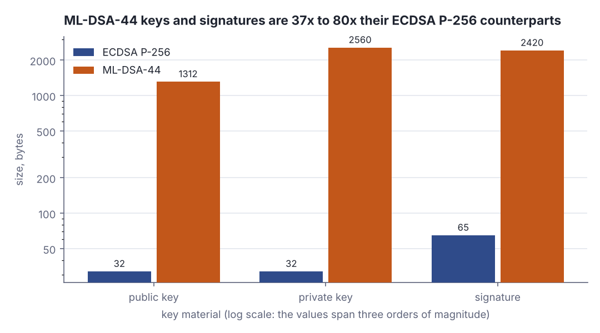
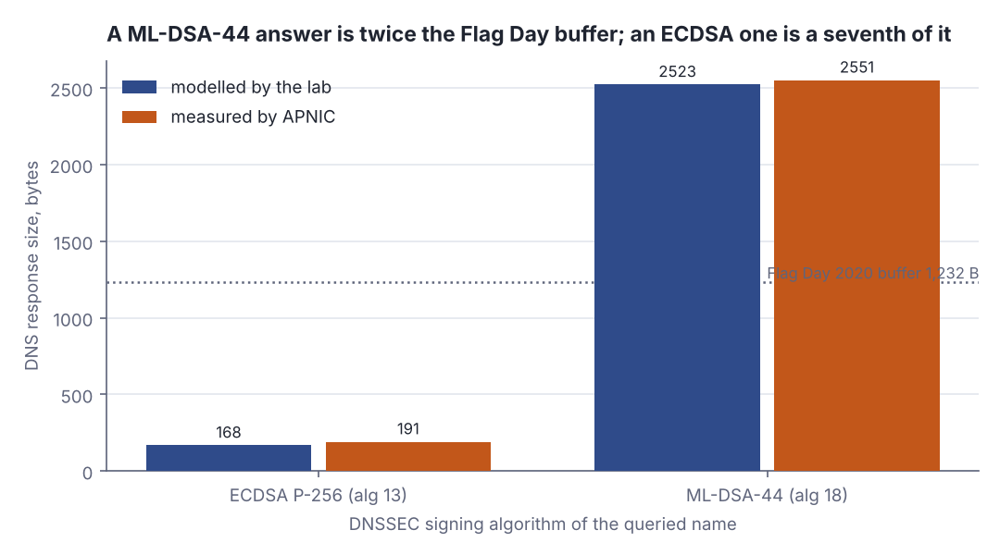
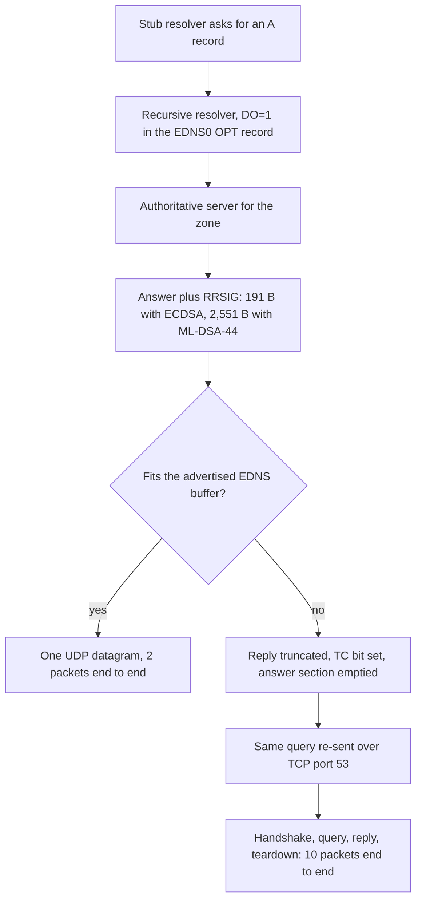
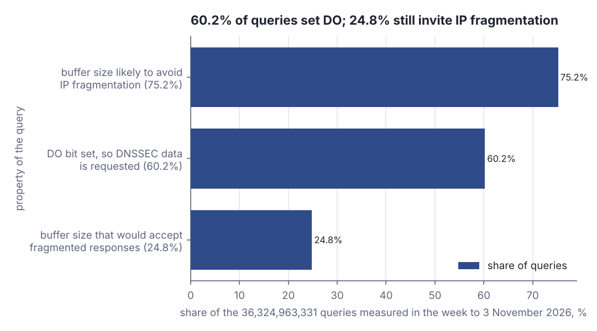
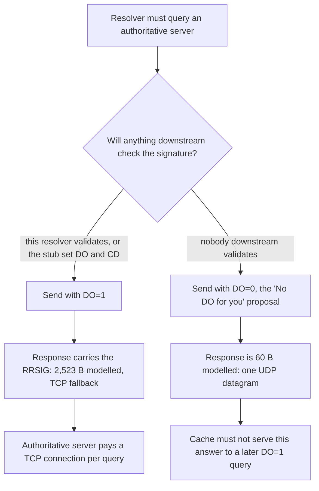

# Post-quantum DNSSEC: when a 2,420-byte signature pushes DNS onto TCP

> Fresh · Networking, modern · Intermediate · ~25 min · from today's feeds

## Why this matters
Geoff Huston published *The DOs and don'ts of post-quantum DNSSEC* on the APNIC Blog on 9 November 2026 (a 22-minute read in the "Tech matters" category), and it is the clearest measured account yet of what post-quantum cryptography does to the protocol every one of your services calls before it calls anything else.
It is worth 25 minutes today because the mechanism is pure transport arithmetic — a signature grows from 65 bytes to 2,420 bytes, the answer stops fitting in one UDP datagram, and a two-packet exchange becomes a ten-packet one — which is exactly the kind of change that silently moves a latency budget and a connection budget at the same time.
You have just done UDP and when to choose it; this is the canonical case of a protocol being forced off that choice, and the fight over who pays for it is happening in the IETF right now.

## Primer
DNS resolution has three parties. A **stub resolver** is the thin client inside your process or OS (`getaddrinfo`, a JVM's `InetAddress`) that asks one question and trusts the answer. A **recursive resolver** is the server your network points you at (your ISP's, or 1.1.1.1) that walks the name hierarchy — root, then `.com`, then `example.com` — and **caches** what it learns for the record's TTL. An **authoritative server** holds the zone's actual data and answers only for its own names. DNS runs over UDP port 53 by default, which is why it was on your UDP rung: one datagram out, one datagram back, no handshake, no connection state.

**DNSSEC** adds origin authentication: the zone owner signs each record set offline with a private key, and publishes the signature as an **RRSIG** record alongside the data and the public key as a **DNSKEY** record. A validating resolver checks the RRSIG against the DNSKEY, and the DNSKEY against a signature in the parent zone, up to the root. Nothing is encrypted; the point is that an answer cannot be forged.

Two size limits matter. Classic DNS over UDP was capped at 512 bytes (RFC 1035 §4.2.1); a bigger answer is **truncated** — the server sets the **TC bit** in the header, empties the answer section, and the client retries the whole query over TCP. **EDNS(0)** (RFC 6891) lifts that cap: the querier appends a pseudo-record called the **OPT record** whose CLASS field carries the UDP payload size it is willing to receive, and whose TTL field carries extra flag bits. RFC 6891 §6.2.5 suggested 4,096 octets as a starting point. The DNS header itself is 12 bytes (Huston, APNIC Blog, 9 November 2026).

## The idea

### The DO bit asks for signatures, and almost everyone sends it

One of the OPT record's flag bits is **DO**, "DNSSEC OK" (RFC 3225; RFC 4035 §3.2.1). `DO=1` asks the server to include the RRSIG records; cleared, it asks for the data alone, and a resolver answering a client that did not set DO strips the DNSSEC records out first.

Two neighbouring header bits finish the picture, in the second 16-bit word of the 12-byte header, numbered left to right as RFC 1035 §4.1.1 numbers them: **CD** is bit 11, "checking disabled", set by a client that will validate for itself (RFC 4035 §3.2.2); **AD** is bit 10, "authentic data", set by a resolver in a response to mean "I verified these records" (RFC 4035 §3.2.3). **TC**, truncation, is bit 6.

```scala
// file: Flags.scala
@main def flags(): Unit =
  def bit(n: Int) = 1 << (15 - n)   // RFC 1035 numbers the 16 flag bits left to right
  val tc = bit(6); val ad = bit(10); val cd = bit(11)
  def show(label: String, w: Int) =
    val bits = w.toBinaryString.reverse.padTo(16, '0').reverse
    println(f"$label%-30s 0x$w%04x  $bits")
  show("query, RD only", 0x0100)
  show("response, TC set (bit 6)", 0x8180 | tc)
  show("response, AD set (bit 10)", 0x8180 | ad)
  show("query, CD set (bit 11)", 0x0100 | cd)
```

```text
query, RD only                 0x0100  0000000100000000
response, TC set (bit 6)       0x8380  1000001110000000
response, AD set (bit 10)      0x81a0  1000000110100000
query, CD set (bit 11)         0x0110  0000000100010000
```

Truncation costs one bit — `0x0200` — and once it is set the exchange restarts on TCP. AD at `0x0020` is the other half of the story: most stubs never validate anything themselves, they read AD and believe it.

### Post-quantum signatures are two orders of magnitude bigger

The threat is a cryptographically relevant quantum computer (CRQC) running Shor's 1994 factoring algorithm against the problems RSA and elliptic-curve signatures rest on; an optimistic date of 2030 is mentioned (Huston, APNIC Blog, 9 November 2026). Signatures have no "Harvest Now, Decrypt Later" window, but a key pair stays exposed as long as it is in use, and compromising it lets an attacker impersonate the signer. The cheap short-term answer is faster rotation of the two keys a signed zone uses — the **ZSK** (zone signing key) over ordinary records, and the **KSK** (key signing key) that signs only the DNSKEY set and is what the parent zone vouches for. ICANN's OCTO-035 study "Observing DNSSEC Key Lifecycles" (Ed Lewis, 18 July 2022) found KSKs in use a year or more and ZSKs a month or more, against suggested rotation of monthly and yearly (Huston, APNIC Blog, 9 November 2026, citing OCTO-035).

The real answer is **ML-DSA-44**, the NIST lattice-based scheme proposed as DNSSEC algorithm 18 in draft-westerbaan-dnssec-mldsa-01. Table 1 of the article puts it beside ECDSA P-256 (algorithm 13): 32-byte public key, 32-byte private key and 65-byte signature, against 1,312, 2,560 and 2,420 bytes (Huston, APNIC Blog, 9 November 2026, Table 1).


*Figure 1: ML-DSA-44 key and signature sizes against ECDSA P-256, log scale. Source: Huston, Table 1, https://blog.apnic.net/2026/11/09/the-dos-and-donts-of-post-quantum-dnssec/.*

### A 2,420-byte signature does not fit in a datagram

Add one RRSIG to an answer for a single A record and the arithmetic settles it — 12-byte header, question, A record, RRSIG, OPT record:

```scala
// file: Dobit.scala
@main def dobit(): Unit =
  val header = 12; val question = 21; val aRecord = 16; val opt = 11
  def rrsig(sig: Int) = 43 + sig          // record header 12 + fixed 18 + signer name 13
  val noDo = header + question + aRecord + opt
  println(s"DO=0, RRSIG stripped     : $noDo bytes")
  println(s"DO=1, ECDSA P-256 (65 B) : ${noDo + rrsig(65)} bytes")
  println(s"DO=1, ML-DSA-44 (2420 B) : ${noDo + rrsig(2420)} bytes")
  println(s"cost of the DO bit under ML-DSA-44: ${rrsig(2420)} bytes")
```

```text
DO=0, RRSIG stripped     : 60 bytes
DO=1, ECDSA P-256 (65 B) : 168 bytes
DO=1, ML-DSA-44 (2420 B) : 2523 bytes
cost of the DO bit under ML-DSA-44: 2463 bytes
```

The DO bit is worth 2,463 bytes here: a 60-byte answer becomes a 2,523-byte one. The article measured the same thing on the real protocol, against an ECDSA P-256 answer of 191 bytes:

> "When we repeat this query for a name signed with the PQ ML-DSA-44 algorithm, the response is 2,551 bytes."
> — Geoff Huston, *The DOs and don'ts of post-quantum DNSSEC*, 2026-11-09, https://blog.apnic.net/2026/11/09/the-dos-and-donts-of-post-quantum-dnssec/


*Figure 2: modelled and measured response sizes against the 1,232-byte Flag Day buffer. Source: Huston, APNIC Blog, 9 November 2026, plus this lesson's lab.*

That 2,551-byte response was truncated over UDP, the stub retried over TCP, and the exchange took ten packets instead of two (Huston, APNIC Blog, 9 November 2026).


*Figure 3: the query path and where post-quantum DNSSEC leaves it. Source: Huston, APNIC Blog, 9 November 2026; TC bit from RFC 1035 §4.1.1.*

### Fragmentation is not the escape hatch

The maximum IP packet size is 65,536 bytes, so IP would happily fragment a 2.5 KB response (Huston, APNIC Blog, 9 November 2026). DNS walked away from that: fragments are dropped by middleboxes and are spoofable, because only the first one carries the UDP ports an attacker would otherwise have to guess. The accepted control is the EDNS buffer size, and DNS Flag Day 2020 recommends 1,232 bytes against RFC 6891 §6.2.5's pre-2019 starting point of 4,096 octets. Operators largely complied:

> "75.2% of queries are using a buffer size value that is likely to avoid IP fragmentation in DNS over UDP responses."
> — Geoff Huston, *The DOs and don'ts of post-quantum DNSSEC*, 2026-11-09, https://blog.apnic.net/2026/11/09/the-dos-and-donts-of-post-quantum-dnssec/

That is APNIC Labs data over seven days ending 3 November 2026 — 36 billion queries, 245 million end users, most common buffer size 1,410 bytes — leaving 24.8% that would accept fragmented responses above 1,500 bytes (Huston, APNIC Blog, 9 November 2026, Figure 1). Compliance is the problem here, not the cure: a 1,232-byte buffer guarantees that a 2,551-byte answer is truncated.

### How much of real DNS traffic this touches

Table 2 counts the DO bit over the week to 3 November 2026: of 36,324,963,331 queries, 21,859,397,198 set DO (60.2%); of 18,129,250,428 A-record queries, 10,909,410,674 (60.2%); of 2,371,625,460 non-duplicate queries, 1,443,544,917 (60.9%) (Huston, APNIC Blog, 9 November 2026, Table 2).


*Figure 4: shares of the same 36,324,963,331-query sample. Adapted from Geoff Huston, The DOs and don'ts of post-quantum DNSSEC, https://blog.apnic.net/2026/11/09/the-dos-and-donts-of-post-quantum-dnssec/.*

> "These `DO` queries will result in a TCP transaction for PQC signatures in DNSSEC."
> — Geoff Huston, *The DOs and don'ts of post-quantum DNSSEC*, 2026-11-09, https://blog.apnic.net/2026/11/09/the-dos-and-donts-of-post-quantum-dnssec/

Most of those queries feed no validator: 40% of users sit behind validating resolvers and 8.5% more validate but fall back on SERVFAIL — 48% together — against roughly 60% sending DO, so some 12% ask for signatures nobody checks (Huston, APNIC Blog, 9 November 2026). Resolvers set DO anyway for a cache reason:

> "The reason for this resolver behaviour is to avoid inadvertent DNSSEC stripping."
> — Geoff Huston, *The DOs and don'ts of post-quantum DNSSEC*, 2026-11-09, https://blog.apnic.net/2026/11/09/the-dos-and-donts-of-post-quantum-dnssec/

An answer fetched with DO cleared carries no RRSIG; cached, it would be served to the next client that *does* set DO, which then could not validate it.

### The two ways out


*Figure 5: the choice draft-wagope-dnsop-do-bit puts to resolver operators. Source: Huston, APNIC Blog, 9 November 2026, plus this lesson's lab.*

Option one is the IETF draft Huston co-authors, draft-wagope-dnsop-do-bit, "No DO for you": a resolver that will not validate clears DO and never pulls the big signature across the network. It lowers TCP load at authoritative servers, at the cost of resolver state, a cache split on whether DNSSEC data is present, and extra queries when a DO-setting client turns up later. Option two is to accept the TCP — and since you end up there anyway, sending DO queries straight to TCP would at least save the wasted UDP round trip, though that is hypothetical today. Caching absorbs most repeat traffic and only about 2% of queried names are signed at all on Cloudflare's 1.1.1.1 (Huston, APNIC Blog, 9 November 2026), so the real bill is smaller than the arithmetic — but stubs that validate for themselves need DO and CD, and neither option optimises them away.

## Lab
**The question: at which EDNS buffer size does a post-quantum-signed DNS answer stop fitting in one UDP packet, and how many packets does the fallback cost?**

### Step 1 — Model one DNS response from its parts

The program builds a response for a single A record out of real wire-format sizes, then tests it against four buffer sizes, counts packets, and scales the result to the article's traffic sample. Run it with `python3 dojo/engine/run_lab.py 2026-11-17-2`.

```scala
// file: Lab.scala
@main def lab(): Unit =
  // wire sizes in bytes of the parts of a DNS response carrying one A record
  val header     = 12    // ID 2 + flags 2 + QD/AN/NS/AR counts 2 each
  val question   = 21    // wire name "www.example.com" 17 + QTYPE 2 + QCLASS 2
  val aRecord    = 16    // NAME pointer 2 + TYPE 2 + CLASS 2 + TTL 4 + RDLENGTH 2 + IPv4 4
  val opt        = 11    // EDNS0 OPT: NAME 1 + TYPE 2 + CLASS 2 + TTL 4 + RDLENGTH 2
  val rrsigFixed = 43    // RRSIG record header 12 + RRSIG fixed fields 18 + signer name 13
  val mtuPayload = 1472  // 1500 Ethernet MTU - 20 IPv4 header - 8 UDP header

  final case class Alg(name: String, no: Int, pub: Int, priv: Int, sig: Int, measured: Int)
  val algs = Vector(
    Alg("ECDSA P-256", 13, 32, 32, 65, 191),
    Alg("ML-DSA-44", 18, 1312, 2560, 2420, 2551)
  )
  val buffers = Vector(512, 1232, 1410, 4096)

  def rrsig(sig: Int) = rrsigFixed + sig
  def responseSize(sig: Int) = header + question + aRecord + rrsig(sig) + opt
  val noDo = header + question + aRecord + opt

  println("=== Step 1: response size, part by part ===")
  println(f"${"case"}%-24s ${"hdr"}%4s ${"qn"}%4s ${"A"}%4s ${"RRSIG"}%6s ${"OPT"}%4s ${"total"}%6s ${"APNIC"}%6s")
  println(f"${"DO=0 (no RRSIG)"}%-24s $header%4d $question%4d $aRecord%4d ${0}%6d $opt%4d $noDo%6d ${"-"}%6s")
  for a <- algs do
    val total = responseSize(a.sig)
    println(f"${s"DO=1 ${a.name} (alg ${a.no})"}%-24s $header%4d $question%4d $aRecord%4d ${rrsig(a.sig)}%6d $opt%4d $total%6d ${a.measured}%6d")
  for a <- algs do
    val d = a.measured - responseSize(a.sig)
    println(f"model vs APNIC measurement, ${a.name}%-12s: ${responseSize(a.sig)}%5d vs ${a.measured}%5d bytes (delta $d%+d)")

  println()
  println("=== Step 2: does it fit the advertised EDNS buffer? ===")
  println(f"${"algorithm"}%-14s ${"size"}%6s ${"buffer"}%7s ${"headroom"}%9s  outcome")
  final case class Row(alg: String, size: Int, buffer: Int, outcome: String, packets: Int)
  val rows =
    for a <- algs; b <- buffers yield
      val size = responseSize(a.sig)
      val (outcome, packets) =
        if size > b then ("truncated: TC bit set, stub retries over TCP", 10)
        else if size > mtuPayload then ("fits buffer but exceeds path MTU: IP fragmentation", 3)
        else ("fits one UDP datagram", 2)
      println(f"${a.name}%-14s $size%6d $b%7d ${b - size}%9d  $outcome")
      Row(a.name, size, b, outcome, packets)

  println()
  println("=== Step 3: packets on the wire, per outcome ===")
  println(f"${"algorithm"}%-14s ${"buffer"}%7s ${"packets"}%8s  breakdown")
  for r <- rows do
    val breakdown = r.packets match
      case 2  => "UDP query + UDP response"
      case 3  => "UDP query + UDP response split into 2 IP fragments"
      case _  => "UDP query + truncated reply + SYN,SYN-ACK,ACK + query + reply + FIN,FIN-ACK,ACK"
    println(f"${r.alg}%-14s ${r.buffer}%7d ${r.packets}%8d  $breakdown")
  val best = 2
  val worst = rows.map(_.packets).max
  println(f"UDP-only path: $best%d packets.  UDP-truncation-then-TCP path: $worst%d packets.  Ratio ${worst.toDouble / best}%.1fx")

  println()
  println("=== Step 4: how much of real DNS traffic this touches ===")
  val allQ = 36324963331L;  val allDo = 21859397198L
  val aQ   = 18129250428L;  val aDo   = 10909410674L
  val uniqQ = 2371625460L;  val uniqDo = 1443544917L
  def pct(part: Long, whole: Long) = part * 100.0 / whole
  println(f"all queries        ${allQ}%,14d  DO=1 ${allDo}%,14d  ${pct(allDo, allQ)}%5.1f%%")
  println(f"A-record queries   ${aQ}%,14d  DO=1 ${aDo}%,14d  ${pct(aDo, aQ)}%5.1f%%")
  println(f"non-duplicate      ${uniqQ}%,14d  DO=1 ${uniqDo}%,14d  ${pct(uniqDo, uniqQ)}%5.1f%%")
  val fragSafe = 75.2
  println(f"EDNS buffer likely to avoid IP fragmentation: $fragSafe%.1f%% of queries; the rest ${100 - fragSafe}%.1f%%")
  println(f"queries that would become TCP transactions at the measured DO rate: ${allDo / 1e9}%.1f billion of ${allQ / 1e9}%.1f billion")
```

Its first block of output:

```text
=== Step 1: response size, part by part ===
case                      hdr   qn    A  RRSIG  OPT  total  APNIC
DO=0 (no RRSIG)            12   21   16      0   11     60      -
DO=1 ECDSA P-256 (alg 13)   12   21   16    108   11    168    191
DO=1 ML-DSA-44 (alg 18)    12   21   16   2463   11   2523   2551
model vs APNIC measurement, ECDSA P-256 :   168 vs   191 bytes (delta +23)
model vs APNIC measurement, ML-DSA-44   :  2523 vs  2551 bytes (delta +28)
```

**Verdict:** the model lands 23 and 28 bytes under the article's measured 191 and 2,551 bytes (Huston, APNIC Blog, 9 November 2026) — the gap is the article's actual test names, which are longer than `www.example.com`. The ratio is what matters and it survives: the signature, not the data, is 97% of the post-quantum answer.

### Step 2 — Test it against four EDNS buffer sizes

```text
=== Step 2: does it fit the advertised EDNS buffer? ===
algorithm        size  buffer  headroom  outcome
ECDSA P-256       168     512       344  fits one UDP datagram
ECDSA P-256       168    1232      1064  fits one UDP datagram
ECDSA P-256       168    1410      1242  fits one UDP datagram
ECDSA P-256       168    4096      3928  fits one UDP datagram
ML-DSA-44        2523     512     -2011  truncated: TC bit set, stub retries over TCP
ML-DSA-44        2523    1232     -1291  truncated: TC bit set, stub retries over TCP
ML-DSA-44        2523    1410     -1113  truncated: TC bit set, stub retries over TCP
ML-DSA-44        2523    4096      1573  fits buffer but exceeds path MTU: IP fragmentation
```

**Verdict:** there is no buffer size that saves you. Below 2,523 bytes the answer is truncated; above it, the answer exceeds the 1,472-byte UDP payload a 1,500-byte Ethernet MTU allows, so it only "fits" by fragmenting — which is the outcome DNS Flag Day 2020 told operators to stop inviting.

### Step 3 — Count the packets

```text
=== Step 3: packets on the wire, per outcome ===
algorithm       buffer  packets  breakdown
ECDSA P-256        512        2  UDP query + UDP response
ECDSA P-256       1232        2  UDP query + UDP response
ECDSA P-256       1410        2  UDP query + UDP response
ECDSA P-256       4096        2  UDP query + UDP response
ML-DSA-44          512       10  UDP query + truncated reply + SYN,SYN-ACK,ACK + query + reply + FIN,FIN-ACK,ACK
ML-DSA-44         1232       10  UDP query + truncated reply + SYN,SYN-ACK,ACK + query + reply + FIN,FIN-ACK,ACK
ML-DSA-44         1410       10  UDP query + truncated reply + SYN,SYN-ACK,ACK + query + reply + FIN,FIN-ACK,ACK
ML-DSA-44         4096        3  UDP query + UDP response split into 2 IP fragments
```

**Verdict:** ten packets against two, a 5.0× packet multiplier, which reproduces the article's measured "ten packets instead of two" (Huston, APNIC Blog, 9 November 2026). The latency cost is worse than the packet cost, because three of those ten are a TCP handshake: one extra round trip before the query is even re-sent.

### Step 4 — Scale it to real traffic

```text
=== Step 4: how much of real DNS traffic this touches ===
all queries        36,324,963,331  DO=1 21,859,397,198   60.2%
A-record queries   18,129,250,428  DO=1 10,909,410,674   60.2%
non-duplicate       2,371,625,460  DO=1  1,443,544,917   60.9%
EDNS buffer likely to avoid IP fragmentation: 75.2% of queries; the rest 24.8%
queries that would become TCP transactions at the measured DO rate: 21.9 billion of 36.3 billion
```

**Verdict:** 21.9 billion of 36.3 billion queries in one week carried DO (Huston, APNIC Blog, 9 November 2026, Table 2). If every signed zone moved to ML-DSA-44 tomorrow, that is the share of queries whose answers would need a TCP transaction — which is the article's point and the reason for the draft.

### Reading the output

| Column | What it means | Which direction is better |
| --- | --- | --- |
| `size` | modelled response size in bytes | smaller |
| `buffer` | EDNS(0) UDP payload size the querier advertised in the OPT record's CLASS field | large enough to hold the answer, small enough to avoid fragmenting — 1,232 B per DNS Flag Day 2020 |
| `headroom` | `buffer - size`; negative means the server must truncate | positive, and above zero by at least a signature's worth |
| `outcome` | fits / truncated with the TC bit set / fits-but-fragments | "fits one UDP datagram" |
| `packets` | packets on the wire for one resolution | 2 |

Trace the ML-DSA-44 row with digits. The RRSIG record is its 12-byte record header plus 18 bytes of fixed RRSIG fields (type covered, algorithm, labels, original TTL, expiration, inception, key tag) plus the 13-byte signer name `example.com.` plus the signature: 12 + 18 + 13 + 2,420 = 2,463 bytes. The whole response is 12 (header) + 21 (question) + 16 (A record) + 2,463 (RRSIG) + 11 (OPT) = 2,523 bytes. Against the Flag Day buffer: 1,232 − 2,523 = −1,291, so the server cannot send it. It sets the TC bit (`0x0200`), returns a near-empty reply, and the querier re-sends over TCP. The same arithmetic with ECDSA: 12 + 18 + 13 + 65 = 108, and 12 + 21 + 16 + 108 + 11 = 168 bytes, leaving 1,232 − 168 = 1,064 bytes of headroom.

### Cause → consequence

1. **Cause.** ML-DSA-44 signatures are 2,420 bytes against ECDSA P-256's 65 (Huston, APNIC Blog, 9 November 2026, Table 1), and DNSSEC attaches one to every signed answer.
2. **Mechanism.** The response exceeds the advertised EDNS buffer — 1,232 bytes recommended by DNS Flag Day 2020, 1,410 bytes most commonly seen — so the authoritative server sets the TC bit and the querier repeats the query over TCP (RFC 1035 §4.1.1).
3. **Consequence.** Two packets become ten, one round trip becomes three, and the authoritative server holds connection state per query instead of none; 60.2% of queries carry DO today (Huston, APNIC Blog, 9 November 2026, Table 2).
4. **What it means for your work.** Service discovery that resolves names on the request path gains a DNS round trip it did not budget for, so resolver timeouts tuned for a single UDP exchange — typically one second — start firing on the retry rather than the query, and the failure looks like a resolver outage rather than a size problem. If you run authoritative DNS for your own zones, your capacity planning changes units: from datagrams per second to concurrent TCP connections, file descriptors and TIME_WAIT sockets. And the lever that costs nothing is the one the draft proposes — stop asking for signatures you are not going to check, and watch that your caches stay keyed on whether DNSSEC data is present so a later validating client is not served a stripped answer.

## Self-check
1. A recursive resolver sends a query with `DO=1` to an authoritative server whose zone is signed with ML-DSA-44, and the OPT record advertises a 1,410-byte buffer. What comes back, and how many packets does the full resolution take? <details><summary>Answer</summary>Nothing useful comes back on the first try: the modelled response is 2,523 bytes against a 1,410-byte buffer, 1,113 bytes short, so the server returns a reply with the TC bit set (`0x0200`) and an emptied answer section. The resolver repeats the same query over TCP port 53, which costs a three-packet handshake, the query, the response and a three-packet teardown — ten packets in all against the two a UDP-only exchange would have used, matching the article's measurement of ten packets instead of two (Huston, APNIC Blog, 9 November 2026).</details>
2. Resolvers mostly set the DO bit even when they are not going to validate anything. Why is that not simply a bug, and what does the "No DO for you" draft have to do to make clearing it safe? <details><summary>Answer</summary>Because of the cache: Huston gives the reason as avoiding inadvertent DNSSEC stripping. An answer fetched with DO cleared has no RRSIG, and if it is cached, the next client that does set DO gets an unsigned answer from cache and cannot validate it. draft-wagope-dnsop-do-bit therefore has to pair clearing the bit with cache bookkeeping — the cache must know whether an entry holds DNSSEC data, and re-query with DO=1 when a client needs signatures the cached entry does not have. The price is resolver complexity and extra queries; the gain is far less TCP at authoritative servers.</details>
3. If IP allows packets up to 65,536 bytes, why not just let the 2,551-byte response fragment and keep DNS on UDP? <details><summary>Answer</summary>Fragmentation is unreliable and spoofable: middleboxes drop fragments, and only the first fragment carries the UDP port numbers, so an attacker forging a later fragment does not have to guess them. The DNS community's answer was to control size with the EDNS buffer instead, and DNS Flag Day 2020 recommends advertising 1,232 bytes. The measurement shows that worked — 75.2% of queries now advertise a buffer likely to avoid fragmentation, against 83% advertising 4,096 bytes back in September 2020 (Huston, APNIC Blog, 9 November 2026) — which is precisely why a post-quantum answer has nowhere to go but TCP.</details>

## Sources
- [The DOs and don'ts of post-quantum DNSSEC](https://blog.apnic.net/2026/11/09/the-dos-and-donts-of-post-quantum-dnssec/) — Geoff Huston, APNIC Blog, 9 November 2026 — the whole argument: Table 1 signature sizes, the 191 vs 2,551-byte responses, ten-packets-instead-of-two, Figure 1 EDNS buffer distribution, Table 2 DO-bit counts, the validation shares and the "No DO for you" proposal; all four quoted passages (accessed 2026-11-17).
- [RFC 6891 — Extension Mechanisms for DNS (EDNS(0))](https://www.rfc-editor.org/rfc/rfc6891.html) — the OPT pseudo-record, the requestor's UDP payload size, and §6.2.5's pre-2019 starting point of 4,096 octets; cited by number and section, link not fetched in this run because outbound fetching was blocked.
- [RFC 4035 — Protocol Modifications for the DNS Security Extensions](https://www.rfc-editor.org/rfc/rfc4035.html) — §3.2.1 the DO bit, §3.2.2 the CD bit, §3.2.3 the AD bit; cited by number and section, link not fetched in this run.
- [RFC 3225 — Indicating Resolver Support of DNSSEC](https://www.rfc-editor.org/rfc/rfc3225.html) — the original definition of the DO flag in the EDNS(0) OPT record; cited by number, link not fetched in this run.
- [RFC 1035 — Domain Names: Implementation and Specification](https://www.rfc-editor.org/rfc/rfc1035.html) — §4.1.1 the 12-byte header and its flag bits including TC, §4.2.1 the 512-byte UDP limit; cited by number and section, link not fetched in this run.
- [draft-westerbaan-dnssec-mldsa-01](https://datatracker.ietf.org/doc/draft-westerbaan-dnssec-mldsa/01/) — ML-DSA-44 as DNSSEC algorithm 18; cited by draft name, link not fetched in this run.
- [draft-wagope-dnsop-do-bit "No DO for you"](https://datatracker.ietf.org/doc/draft-wagope-dnsop-do-bit/) — the proposal, co-authored by Huston, that resolvers clear DO when they will not validate; cited by draft name, link not fetched in this run.
- [ICANN OCTO-035 — Observing DNSSEC Key Lifecycles](https://www.icann.org/en/system/files/files/octo-035-18jul22-en.pdf) — Ed Lewis, 18 July 2022 — the observed KSK and ZSK lifetimes behind the "rotate faster" short-term answer; cited as reported in the APNIC article, link not fetched in this run.
- [DNS Flag Day 2020](https://dnsflagday.net/2020/) — the 1,232-byte EDNS buffer recommendation; cited as reported in the APNIC article, link not fetched in this run.

## Next on this track
Fresh lessons sit outside the ladder; next on Networking, modern: **TLS 1.3 handshake and certificates in practice** (rung 5 of 16, Intermediate).
