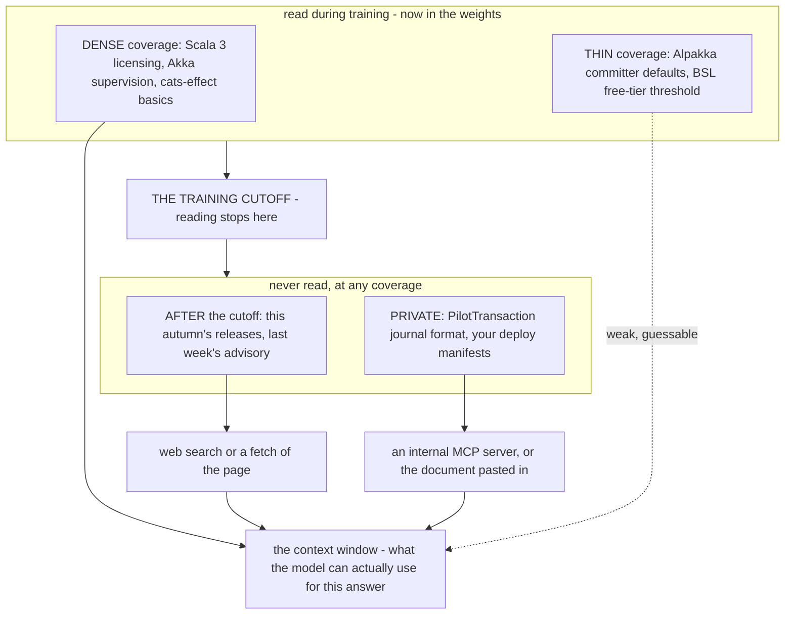
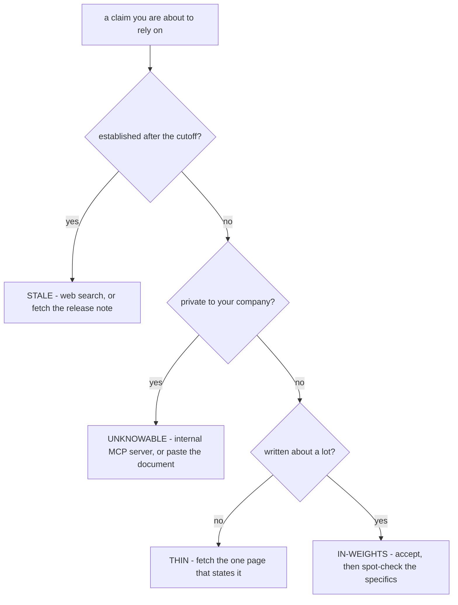
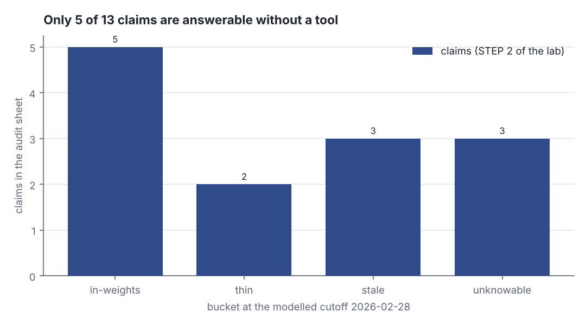
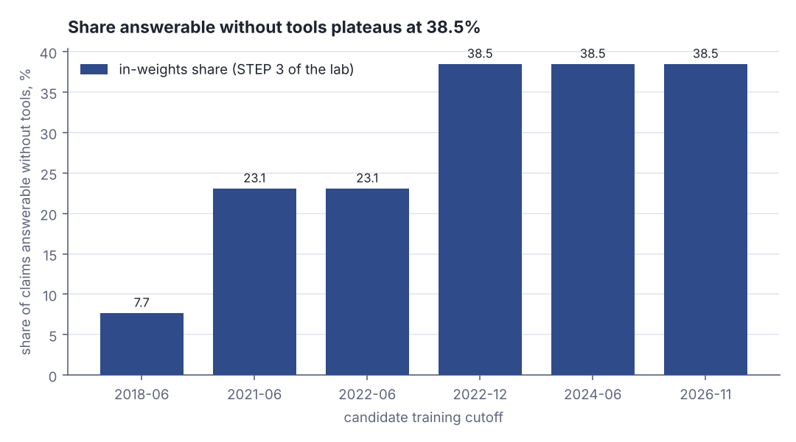

# Knowledge: what the model read, and when it stopped reading

> Claude Academy · Beginner · ~25 min · rung 4 of 20 · needs: Next-token prediction: capability zones and where fabrication lives (claude-academy-03)

## Why this matters

You ship Skills and MCP servers that other teams trust, and the single question that decides
whether a Claude-written answer is reportage or invention is whether the fact was ever in front
of the model. Three of the four reasons it was not — the cutoff date, thin coverage, and your
own private systems — you can predict before you ask, and each has a different fix.

## The idea

### The wall

Training is a one-off reading exercise with an end date. Everything the model can produce from
its own weights it read before that date; after it, nothing was added, and by default nothing is
looked up while you are talking to it. The course puts the three limits in one sentence:

> "The model knows what it was exposed to during training, and only that. No real-time browsing by default, no lived experience, and a hard stop at the knowledge cutoff."
> — Anthropic, *Claude Academy — AI Capabilities and Limitations: Knowledge*, lesson 6 "Knowledge", §"What the model read, and when it stopped reading", https://academy.claude.com/courses/ai-capabilities-and-limitations/knowledge

The dangerous part is what the wall does *not* do: it does not make the model go quiet. Ask for
a fact that was established on the far side of it and you get an answer in the same register as
a well-grounded one, assembled from the shape such facts had before the wall.

```text
Illustrative — written for this lesson.

Prompt:   No tools, no web. What changed in the sbt 2.x build syntax
          that shipped last month?
Response: sbt 2.x keeps the `:=` setting syntax, moves cross-building
          defaults into the root build, and tightens plugin resolution.
```

Nothing in that answer is marked as unread. The question names a month on the far side of the
cutoff, so the response cannot be reportage — it is the generic shape of an sbt release note,
filled in. The tell is in the question's date, not in the answer's tone.



*Figure 1: The cutoff as a wall. Dense pre-cutoff facts reach the answer from the weights; thin ones reach it weakly; post-cutoff and private facts reach it only if a tool carries them into the context window. Source: drawn for this lesson from Claude Academy, "AI Capabilities and Limitations", lesson 6 "Knowledge", §"What the model read, and when it stopped reading", https://academy.claude.com/courses/ai-capabilities-and-limitations/knowledge*

### Coverage is uneven on the near side too

Being before the wall is necessary, not sufficient. What the model read is a sample of the
written world, and that sample is lumpy — Anthropic's own AI Fluency tutorial on the subject
makes the point directly:

> "An AI model only knows what was in its training data, and that training has a cutoff date." […] "Oftentimes a model’s knowledge is broad but tends to be uneven" […] "solid on frequent, well-covered topics; thin on anything rare, recent, or niche."
> — Anthropic, *Understanding knowledge gaps in AI models*, AI Fluency tutorial, undated, https://claude.com/resources/tutorials/understanding-knowledge-gaps-in-ai-models

So two questions, both about Akka licensing, both comfortably pre-cutoff, can sit on opposite
sides of the reliability line.

```text
Illustrative — written for this lesson.

Prompt:   Which licence does Scala 3 ship under?
Response: Apache License 2.0.
          <- written about thousands of times: dense, accept and spot-check

Prompt:   What is the revenue threshold in Akka's BSL free tier?
Response: USD 25 million in annual revenue.
          <- one number, stated once in one FAQ: thin, do not ship unchecked
```

The second answer is the more useful one to you and the less trustworthy one. Thin coverage does
not announce itself: the sentence is short, declarative and the right shape, because the *shape*
of a revenue threshold is dense even where the threshold itself is not.

### Four failure modes, and why the fourth hides the other three

The knowledge limits come out in four characteristic ways (Claude Academy, "AI Capabilities and
Limitations", lesson 6 "Knowledge", §"What the model read, and when it stopped reading").
**Staleness**: the fact changed after the wall — a relicensing, a deprecation, a CVE — and the
model still holds the old state as current. **Uneven coverage**: the fact was readable but
rarely written down, so the model has a weak impression it will still verbalise confidently.
**Inherited bias**: the model absorbed the consensus of what it read, including the parts that
were wrong, out of date, or merely the loudest voice — Stack Overflow's most-upvoted answer
from 2017 outweighs the corrected one from 2024 if the first was copied more often.
**Source amnesia**: the weights store the regularity, not the document. The model cannot
generally tell you which text a claim came from, so it cannot tell you how reliable that text
was, and neither can you.

```text
Illustrative — written for this lesson.

Prompt:   Where did you learn that threshold?
Response: I don't have a specific document to point to — it comes from
          training rather than from a source I retrieved and can cite.
```

That is source amnesia in one exchange, and it is why the other three failures are hard to catch
from the outside: with no provenance attached, a stale fact, a thin fact and a well-grounded fact
all arrive looking identical.

### The fix is always the same shape: put the fact in the context window

There is no way to edit the weights from your seat, so every mitigation is the same move —
get the text in front of the model for this answer. **Web search** covers the post-cutoff world.
**A direct fetch** of a page covers the thin-but-public case: one URL, one authoritative
sentence. **Retrieval over your own corpus** — the RAG machinery, which gets its own treatment
later on the AI/ML ladder at rung ai-ml-28 — covers private documents at scale. **MCP servers**
generalise the same idea to live systems: a server over your schema repo, your deploy manifests
or your issue tracker turns "unknowable" into "fetched". The by-product matters as much as the
fact: a tool result carries a URL or a file path, so the answer gets provenance and source
amnesia stops applying to that claim.

```text
Illustrative — written for this lesson.

Prompt:   Same question, with web search turned on.
Response: [tool: web_search "akka bsl free tier revenue threshold"]
          [tool: fetch <the vendor licence page the search returned>]
          The page states <figure>, as of <the date it was fetched>.
          Source: <the URL the tool returned>
```

Same model, same weights, different epistemics: the number now has a date and a URL you can
open, so it is a claim you can review rather than a claim you must trust.



*Figure 2: The Outsider Test as a routing decision. Two questions you can answer before you ask the model — when was it established, and is it yours alone — pick the tool. Source: drawn for this lesson from Claude Academy, "AI Capabilities and Limitations", lesson 6 "Knowledge", §"What the model read, and when it stopped reading", https://academy.claude.com/courses/ai-capabilities-and-limitations/knowledge*

The question that drives the whole routing is the **Outsider Test**: treat the model as a
competent outsider who started at your company this morning, read a great deal of the public
internet up to a fixed date, and has never seen your repositories. Where does that person need
context they could not have? Everything on that list needs a tool; everything else does not.

## Lab

**The question this lab answers:** of the claims you actually put to a model in a working week,
what share can a tool-less model answer — and does a newer model with a later cutoff fix it?

The lab has a human half and a measured half. The human half is the Outsider Test from the
course, run live. The measured half is a Scala scoring sheet that holds the same claims with the
date each was established and a coverage weight, and classifies them. **The script does not query
a model.** It is your own audit, made countable: the dates and the coverage weights are estimates
you type in, so the output is only as good as your honesty about them.

### Step 1 — run the Outsider Test on Claude, with tools off

Open three **fresh** conversations with tools and web search disabled, and ask one question each:

1. **Public and old:** `Which licence does Scala 3 ship under, and what did Akka relicense to in 2022?`
2. **Public and recent:** `What changed in the most recent sbt release?`
3. **Private:** `What is the field order of a v3 PilotTransaction journal record?`

Write each answer down and label it `known` (you can confirm it), `stale` (it answers about a
state of the world that has since moved) or `unknowable` (it describes something only your
company could know). Expect answer 1 to be right, answer 2 to be a well-formed release note for
a release it never read, and answer 3 to be a plausible record layout invented on the spot.

### Step 2 — score the sheet

Save this as `Lab.scala`. Scala 3, standard library only; it reads nothing and calls nothing.

```scala
// file: Lab.scala
// The Outsider Test as a scoring sheet. Every date and coverage weight below is YOUR estimate,
// typed in by hand. The script classifies claims; it never queries a model.

import java.time.LocalDate

case class Claim(
    id: String,
    subject: String,
    established: String,
    coverage: Double,
    isPrivate: Boolean,
    fix: String
)

val Cutoff = LocalDate.parse("2026-02-28")
val CoverageFloor = 0.20

val Claims = Vector(
  Claim("A1", "Scala 3 ships under the Apache 2.0 licence", "2021-05-14", 0.95, false,
        "none - accept, then spot-check LICENSE in the repo"),
  Claim("A2", "Akka was relicensed from Apache 2.0 to BSL 1.1", "2022-09-07", 0.88, false,
        "none - accept, then spot-check the vendor licence page"),
  Claim("A3", "Apache Pekko is the community fork of Akka 2.6", "2022-10-28", 0.52, false,
        "none - accept, then spot-check the Pekko site"),
  Claim("A4", "A supervised child actor's restart semantics", "2015-01-20", 0.97, false,
        "none - accept"),
  Claim("A5", "The cats-effect 3 fiber model, in outline", "2021-02-10", 0.60, false,
        "none - accept"),
  Claim("B1", "The revenue threshold in Akka's BSL free tier", "2022-09-07", 0.14, false,
        "docs fetch: pull the licence FAQ page into context"),
  Claim("B2", "Alpakka Kafka committer default batch size", "2020-06-15", 0.11, false,
        "docs fetch: pull the reference config page into context"),
  Claim("C1", "The sbt 2.x build-syntax change you read last month", "2026-10-20", 0.00, false,
        "web-search MCP, or paste the release notes"),
  Claim("C2", "The Pekko point release that landed this autumn", "2026-09-12", 0.00, false,
        "web-search MCP, or a GitHub MCP read of the releases"),
  Claim("C3", "The JVM security advisory you triaged last week", "2026-11-10", 0.00, false,
        "web-search MCP pinned to the advisory feed"),
  Claim("D1", "PilotTransaction journal field order, v3 schema", "2024-03-04", 0.00, true,
        "internal MCP server over the schema repo, or paste the schema"),
  Claim("D2", "Which journal version production actually runs", "2026-10-01", 0.00, true,
        "internal MCP server over the deploy manifests"),
  Claim("D3", "The POS adapter's tunnel-controller retry budget", "2023-11-20", 0.00, true,
        "internal MCP server over the config repo, or paste the config")
)

def bucket(c: Claim, cutoff: LocalDate): String =
  if c.isPrivate then "unknowable"
  else if LocalDate.parse(c.established).isAfter(cutoff) then "stale"
  else if c.coverage < CoverageFloor then "thin"
  else "in-weights"

val Buckets = Vector("in-weights", "thin", "stale", "unknowable")

val Sweep = Vector("2018-06-30", "2021-06-30", "2022-06-30", "2022-12-31",
                   "2024-06-30", "2026-11-18")

@main def lab(): Unit =
  println(s"cutoff modelled = $Cutoff   coverage floor = $CoverageFloor   claims = ${Claims.size}")
  println()
  println("STEP 1 - per-claim classification")
  println("  id   established  cov   private  bucket      subject")
  for c <- Claims do
    val pre = if LocalDate.parse(c.established).isAfter(Cutoff) then "after " else "before"
    println(f"  ${c.id}%-4s ${c.established}%-12s ${c.coverage}%.2f  ${c.isPrivate}%-7s " +
            f"${bucket(c, Cutoff)}%-11s ${c.subject}  [$pre cutoff]")

  println()
  println("STEP 2 - bucket counts at the modelled cutoff")
  println("  bucket       claims  share   needs a tool?")
  val counts = Buckets.map(b => b -> Claims.count(c => bucket(c, Cutoff) == b)).toMap
  for b <- Buckets do
    val n = counts(b)
    val needs = if b == "in-weights" then "no" else "yes"
    println(f"  $b%-12s ${n}%6d  ${100.0 * n / Claims.size}%5.1f%%  $needs")
  println(f"  answerable without tools: ${counts("in-weights")}/${Claims.size} = " +
          f"${100.0 * counts("in-weights") / Claims.size}%.1f%%")

  println()
  println("STEP 3 - sweep: move the cutoff wall, recount what is answerable without tools")
  println("  candidate cutoff  in-weights  share   thin  stale  unknowable")
  for s <- Sweep do
    val d = LocalDate.parse(s)
    val bs = Claims.map(c => bucket(c, d))
    val w = bs.count(_ == "in-weights")
    println(f"  $s%-17s ${w}%10d  ${100.0 * w / Claims.size}%5.1f%%  " +
            f"${bs.count(_ == "thin")}%4d  ${bs.count(_ == "stale")}%5d  " +
            f"${bs.count(_ == "unknowable")}%10d")

  println()
  println("STEP 4 - remedy sheet: what puts each missing fact into the context window")
  for b <- Buckets; c <- Claims if bucket(c, Cutoff) == b do
    println(f"  ${c.id}%-4s ${b}%-11s ${c.fix}")
```

Run it:

```bash
scala Lab.scala
```

Real output:

```text
cutoff modelled = 2026-02-28   coverage floor = 0.2   claims = 13

STEP 1 - per-claim classification
  id   established  cov   private  bucket      subject
  A1   2021-05-14   0.95  false   in-weights  Scala 3 ships under the Apache 2.0 licence  [before cutoff]
  A2   2022-09-07   0.88  false   in-weights  Akka was relicensed from Apache 2.0 to BSL 1.1  [before cutoff]
  A3   2022-10-28   0.52  false   in-weights  Apache Pekko is the community fork of Akka 2.6  [before cutoff]
  A4   2015-01-20   0.97  false   in-weights  A supervised child actor's restart semantics  [before cutoff]
  A5   2021-02-10   0.60  false   in-weights  The cats-effect 3 fiber model, in outline  [before cutoff]
  B1   2022-09-07   0.14  false   thin        The revenue threshold in Akka's BSL free tier  [before cutoff]
  B2   2020-06-15   0.11  false   thin        Alpakka Kafka committer default batch size  [before cutoff]
  C1   2026-10-20   0.00  false   stale       The sbt 2.x build-syntax change you read last month  [after  cutoff]
  C2   2026-09-12   0.00  false   stale       The Pekko point release that landed this autumn  [after  cutoff]
  C3   2026-11-10   0.00  false   stale       The JVM security advisory you triaged last week  [after  cutoff]
  D1   2024-03-04   0.00  true    unknowable  PilotTransaction journal field order, v3 schema  [before cutoff]
  D2   2026-10-01   0.00  true    unknowable  Which journal version production actually runs  [after  cutoff]
  D3   2023-11-20   0.00  true    unknowable  The POS adapter's tunnel-controller retry budget  [before cutoff]

STEP 2 - bucket counts at the modelled cutoff
  bucket       claims  share   needs a tool?
  in-weights        5   38.5%  no
  thin              2   15.4%  yes
  stale             3   23.1%  yes
  unknowable        3   23.1%  yes
  answerable without tools: 5/13 = 38.5%

STEP 3 - sweep: move the cutoff wall, recount what is answerable without tools
  candidate cutoff  in-weights  share   thin  stale  unknowable
  2018-06-30                 1    7.7%     0      9           3
  2021-06-30                 3   23.1%     1      6           3
  2022-06-30                 3   23.1%     1      6           3
  2022-12-31                 5   38.5%     2      3           3
  2024-06-30                 5   38.5%     2      3           3
  2026-11-18                 5   38.5%     5      0           3

STEP 4 - remedy sheet: what puts each missing fact into the context window
  A1   in-weights  none - accept, then spot-check LICENSE in the repo
  A2   in-weights  none - accept, then spot-check the vendor licence page
  A3   in-weights  none - accept, then spot-check the Pekko site
  A4   in-weights  none - accept
  A5   in-weights  none - accept
  B1   thin        docs fetch: pull the licence FAQ page into context
  B2   thin        docs fetch: pull the reference config page into context
  C1   stale       web-search MCP, or paste the release notes
  C2   stale       web-search MCP, or a GitHub MCP read of the releases
  C3   stale       web-search MCP pinned to the advisory feed
  D1   unknowable  internal MCP server over the schema repo, or paste the schema
  D2   unknowable  internal MCP server over the deploy manifests
  D3   unknowable  internal MCP server over the config repo, or paste the config
```

### Step 3 — write the remedy next to each gap

STEP 4 of the output is the deliverable: one line per claim naming what would close the gap.
Three of the thirteen rows point at an internal MCP server, which is the piece you would have to
build; the rest are a search tool or a single fetch you already have. Carry the same three
columns — claim, bucket, remedy — into whatever you hand your team, because "the model got it
wrong" is not actionable and "this claim is post-cutoff, wire the release feed" is.

### Reading the output

| column | means | which direction is better |
|---|---|---|
| `established` | the date you believe the fact became true | neither; it is the input being tested against the wall |
| `cov` | your estimate of how often the fact was written down publicly, 0.00–1.00 | higher is safer: more of it was read |
| `private` | true when only your company could know it | `false` is better; `true` means no amount of training helps |
| `bucket` | the classification: `in-weights`, `thin`, `stale`, `unknowable` | `in-weights` is the only bucket answerable with no tool |
| `share` | bucket count ÷ 13 × 100 | higher `in-weights` share is better |

Classification is three tests in order: private first, then the date against the cutoff, then
coverage against the 0.20 floor.



*Figure 3: Five of thirteen claims are in the weights; the other eight fail for three different reasons and need three different tools. Generated from the lab output (STEP 2 of `scala Lab.scala`).*

Trace B1 with digits. It is not private, so test two: established `2022-09-07`, cutoff
`2026-02-28`, and 2022-09-07 is not after 2026-02-28, so it is not stale. Test three: coverage
0.14 against the floor 0.20, and 0.14 < 0.20, so it lands in `thin`. Then the share arithmetic
for its bucket: 2 thin claims ÷ 13 × 100 = 15.384…, printed as 15.4%. The headline number is
the same sum for `in-weights`: 5 ÷ 13 × 100 = 38.461…, printed as 38.5%.

**Verdict:** on a sheet that looks like an ordinary working week, 38.5% of the claims are
answerable from the weights alone and 61.5% are not — and the 61.5% splits into three groups
that need three *different* interventions, not one.



*Figure 4: Moving the training cutoff from 2018 to 2026 raises the tool-free share from 7.7% to 38.5% and then stops. Generated from the lab output (STEP 3 of `scala Lab.scala`).*

STEP 3 is the sweep, and it is the result worth keeping. Push the wall from `2018-06-30` to
`2022-12-31` and the answerable share climbs 7.7% → 23.1% → 23.1% → 38.5%. Push it all the way to
`2026-11-18` — a model trained on the world as of today — and it is still 38.5%. Look at the
other columns to see where the gain went: at the 2026 cutoff the `stale` column has fallen to 0,
but `thin` has risen from 2 to 5. The three recent items crossed the wall and immediately failed
the coverage test, because a release published four weeks ago has barely been written about. The
`unknowable` column never moves off 3 at any cutoff, by construction: a newer model cannot read
your private repositories.

**Verdict:** waiting for a model with a later cutoff buys you 0.0 percentage points here, and
would have bought 15.4 points back in 2022 (23.1% → 38.5%). Tools are not a stopgap until
training catches up; for recent and private facts they are the only mechanism there is.

### Cause → consequence

1. **Cause.** Training reads a fixed corpus and stops on a fixed date, and nothing is looked up
   at answer time unless a tool does it (Claude Academy, "AI Capabilities and Limitations",
   lesson 6 "Knowledge", §"What the model read, and when it stopped reading").
2. **Mechanism.** A claim therefore fails for one of three independent reasons — it postdates the
   wall, it predates the wall but was barely written down, or it lives only inside your company —
   and because the weights keep the regularity rather than the document, none of the three is
   visible in the answer's wording. Source amnesia is what makes the other three silent.
3. **Consequence.** In the audit above, 5 of 13 claims (38.5%) are answerable from weights alone,
   and raising the cutoff to today leaves that number unchanged at 38.5% while converting stale
   claims into thin ones. Confidence is flat across all four buckets.
4. **What it means in practice.** Classify before you ask, not after you read. For the recent
   third, turn web search on and demand the URL in the answer. For the thin third, fetch the one
   page that states the number instead of asking for the number. For the private third — the
   PilotTransaction journal format, your deploy manifests, your retry budgets — accept that no
   model will ever have it, and spend the engineering effort on the MCP server or the pasted
   document that supplies it. As Product Owner, write that classification into the acceptance
   criteria of any AI-assisted feature: "which bucket is this claim in, and what supplies it?" is
   a reviewable question, where "is the model good enough?" is not.

## Self-check

1. A colleague says the knowledge-cutoff problem will solve itself as newer models ship with later cutoffs. Using the sweep in STEP 3, give the counter-argument with numbers. <details><summary>Answer</summary>The sweep moves the wall across six candidate cutoffs and recounts. From 2018-06-30 to 2022-12-31 the share answerable without tools rises 7.7% → 23.1% → 23.1% → 38.5%, so a later cutoff did help historically. From 2022-12-31 to 2026-11-18 it does not move at all: 38.5%, 38.5%, 38.5%. The other columns show why. The three post-cutoff items do cross the wall at the 2026 cutoff — `stale` drops to 0 — but they land in `thin` (which rises from 2 to 5), because something published weeks ago has barely been written about yet, so it never reaches the 0.20 coverage floor. And `unknowable` stays at 3 at every cutoff, because private company facts were never in any crawl. So a later cutoff converts staleness into thin coverage and does nothing at all for private facts; it is not a substitute for tools.</details>
2. Claude gives you a short, confident, correctly shaped answer about the revenue threshold in Akka's BSL free tier. The fact predates the cutoff. Why is that not enough, and what exactly does fetching the licence page change? <details><summary>Answer</summary>Being pre-cutoff only means the fact was readable, not that it was read often. Coverage is uneven: Anthropic's own tutorial describes model knowledge as "broad but tends to be uneven" — "solid on frequent, well-covered topics; thin on anything rare, recent, or niche" (https://claude.com/resources/tutorials/understanding-knowledge-gaps-in-ai-models). A revenue threshold is stated in one FAQ and repeated rarely, so the content is thin even though the *shape* of a revenue figure is dense, which is exactly what makes a well-formed wrong number cheap to produce. Fetching the page changes two things: the number now comes from a document in the context window rather than from a weak impression in the weights, and the answer carries a URL and a fetch date — so source amnesia, which would otherwise prevent you from judging the claim at all, no longer applies to it.</details>
3. Apply the Outsider Test to this task: you are asking Claude to write the migration plan for moving the PilotTransaction journal to a new schema version. Which parts need a tool, and which tool for each? <details><summary>Answer</summary>Treat the model as a competent engineer who joined this morning, read the public internet up to a fixed date, and has never seen your repositories. The generic parts need nothing: how event-journal schema evolution works, forward and backward compatibility, dual-write and replay strategies, Akka Persistence serialisation concepts — all dense, pre-cutoff, in the weights. Three kinds of thing need tools. (a) Anything about recent releases of the libraries involved — the current serialiser options, a changed default — is post-cutoff: web search, and require the release-note URL in the answer. (b) Anything rarely documented, such as a specific plugin configuration key or an obscure default, is thin: fetch the reference page rather than ask for the value. (c) Everything about your own system — the v3 field order, which version production runs, your retry budgets, your deployment topology — is unknowable at any cutoff and needs an internal MCP server over the schema repo, the deploy manifests and the config repo, or those documents pasted into the prompt. If you supply none of (c), the plan will still come back complete and plausible, with the private parts invented.</details>

## Sources

- [Claude Academy — AI Capabilities and Limitations: Knowledge](https://academy.claude.com/courses/ai-capabilities-and-limitations/knowledge) — Anthropic, lesson 6 "Knowledge": §"What the model read, and when it stopped reading" gave the verbatim passage quoted at the top of "The idea" (the three limits — training-only knowledge, no browsing by default, a hard stop at the cutoff), the four failure modes named in "The idea" (staleness, uneven coverage, inherited bias, source amnesia), the mitigation list drawn as Figure 1, and the Outsider Test framing drawn as Figure 2; accessed 2026-11-18 (by locator: the lesson page was not re-fetched in this run, so the single Academy quotation is the passage verified against the source for the curriculum on 2026-10-05 and carried with this rung; everything else from the course is cited by course, lesson and section with no quotation marks around words that were not copied).
- [Claude Academy — AI Capabilities and Limitations (course page)](https://academy.claude.com/courses/ai-capabilities-and-limitations) — Anthropic, course page: gives the lesson order this rung sits in and hosts lesson 7 "Try It Out: Knowledge", the interactive exercise that must be opened on the site to be done (it returned no body text to the fetcher on 2026-10-05); Step 1 of the Lab is the same exercise aimed at your own stack instead; accessed 2026-11-18.
- [Understanding knowledge gaps in AI models](https://claude.com/resources/tutorials/understanding-knowledge-gaps-in-ai-models) — Anthropic, AI Fluency tutorial, undated: fetched in this run; supplied the second verbatim passage, on training-data-only knowledge with a cutoff date and on coverage being "broad but tends to be uneven … solid on frequent, well-covered topics; thin on anything rare, recent, or niche", which is the evidence behind the "uneven coverage" section and the `thin` bucket in the Lab; accessed 2026-11-18.
- Provenance note: the claim dates and coverage weights in the Lab are modelled inputs typed into the scoring sheet, not sourced facts — replace them with your own record before relying on the counts. Every prompt/response block in "The idea" is labelled illustrative and was written for this lesson; the Lab output is a real run of `scala Lab.scala`.

## Next on this track
Next on Claude Academy: **Working memory: the context window and its silent cliff** (rung 5 of 20, Beginner).
