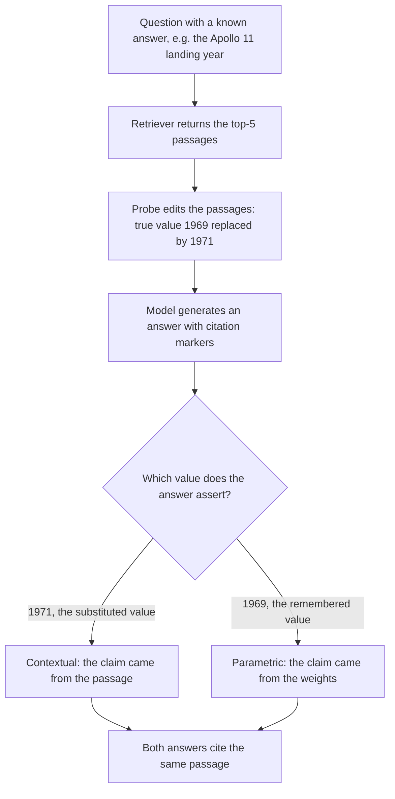
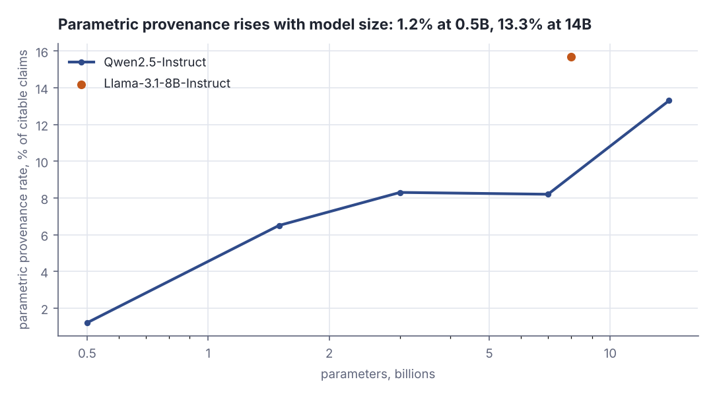
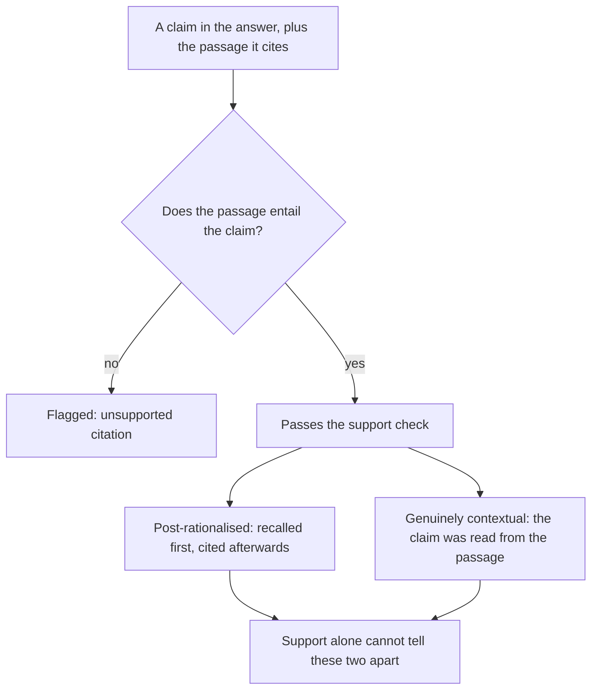
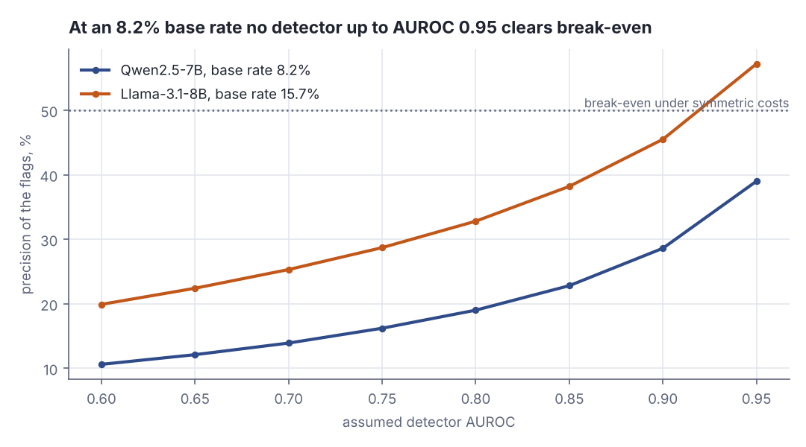

# Cited but unused: when RAG answers come from memory

> Fresh · AI / ML foundations · Intermediate · ~25 min · from today's feeds

## Why this matters
Today's core lesson ended on the fix: a model's knowledge is frozen at its training cutoff, which produces staleness, uneven coverage, inherited bias and source amnesia, and you bolt web search, retrieval or an MCP tool onto it so the answer comes from a document you can point at.
This lesson is the sharp sequel — Tanzeel Abbas and Tehseen Zia (COMSATS University Islamabad) with David Windridge (Middlesex University London) show that even with retrieval bolted on, between 1.2% and 15.7% of citable claims are still produced from the weights while carrying a citation to a retrieved passage (Abbas, Zia and Windridge, arXiv preprint 2611.17161, November 2026).
It is worth 25 minutes because the standard way of checking citations — natural language inference against the cited passage — scores at chance on exactly this failure, so the audit trail you would show a regulator or a customer is, for roughly one claim in twelve, a decoration.

## Primer
**Retrieval-augmented generation (RAG)** is a pipeline, not a model: a question goes to a **retriever** (a lexical index such as BM25, or a vector index over embeddings) which returns the top-*k* passages; those passages are pasted into the prompt as context; the model generates an answer and tags each sentence with markers like `[1]`, `[2]` pointing at the passages it supposedly used. The paper's primary setup is ASQA with GTR top-5 retrieval, with ELI5 (BM25) and QAMPARI as secondary checks (Abbas, Zia and Windridge, arXiv preprint 2611.17161, November 2026). You will meet this pipeline properly at rung 28 of the AI/ML ladder, "RAG done properly"; this lesson previews its hardest evaluation problem.

Two kinds of knowledge feed the answer. **Parametric** knowledge is what the weights already encode from pre-training — the model remembers that Apollo 11 landed in 1969 without being told. **Contextual** knowledge is what the retrieved passages supply at inference time. A citation in a RAG answer is an assertion about *provenance*: "this claim came from passage 1". It is not an assertion that passage 1 merely agrees with the claim — but that weaker property is all most checkers test.

**AUROC** (area under the receiver-operating-characteristic curve) scores a detector that outputs a continuous suspicion score. It equals the probability that a randomly drawn positive case scores above a randomly drawn negative one. 1.0 is perfect ranking, 0.5 is a coin flip, and a detector at 0.5 carries no information at all. Keep that number in mind: it is how the paper grades ten attribution methods.

## The idea

### The probe: replace the fact, then see which value survives

You cannot read provenance off a finished answer, because a sentence that says "1969 [1]" looks identical whether the model read it or remembered it. So the paper manufactures a disagreement. It takes a question whose answer is a known fact, retrieves the passages, and **substitutes a counterfactual value** for that fact inside the retrieved text — the passage now says 1971. If the answer asserts 1971, the model used the context; if it asserts 1969, the model used its weights. Either way the answer still carries a citation to that passage.


*Figure 1: the counterfactual substitution probe that makes provenance observable. Source: the method described in Abbas, Zia and Windridge, arXiv preprint 2611.17161, November 2026, https://arxiv.org/abs/2611.17161.*

The scoring rule is blunt, as the paper's Table 1 caption says: "Parametric provenance rate. An answer counts as contextual whenever it asserts the substituted value" (Abbas, Zia and Windridge, arXiv preprint 2611.17161, November 2026, Table 1 caption). Ten lines of Scala make the labelling concrete:

```scala
val truth = "1969"; val substituted = "1971"
def label(answer: String): String =
  if answer.contains(substituted) then "contextual"
  else if answer.contains(truth) then "parametric"
  else "unscored"
val answers = Seq(
  "Apollo 11 landed on the Moon in 1971 [1].",
  "Apollo 11 landed on the Moon in 1969 [1].",
  "Apollo 11 landed in the late 1960s [1].")
for a <- answers do println(f"${label(a)}%-10s <- $a")
```

```text
contextual <- Apollo 11 landed on the Moon in 1971 [1].
parametric <- Apollo 11 landed on the Moon in 1969 [1].
unscored   <- Apollo 11 landed in the late 1960s [1].
```

All three answers cite `[1]` and differ only in the substituted value; a hedged answer that commits to neither falls out of the measurement entirely. Provenance becomes observable only because the experimenter broke the agreement between weights and context.

### How often it happens, and how it scales

> "1.2% to 15.7% of citable claims derive from parametric memory rather than the retrieved context"
> — Tanzeel Abbas, Tehseen Zia and David Windridge, *Cited but Unused: Parametric Provenance in Retrieval-Augmented Generation*, arXiv preprint 2611.17161, November 2026, https://arxiv.org/abs/2611.17161

Those are the endpoints of Table 1, measured on Qwen2.5-Instruct at five sizes plus Llama-3.1-8B-Instruct as a comparator (Abbas, Zia and Windridge, arXiv preprint 2611.17161, November 2026, Table 1):

| model | parameters | parametric provenance rate | 95% CI |
|---|---|---|---|
| Qwen2.5-0.5B | 0.5B | 1.2% | [0.6, 2.6] |
| Qwen2.5-1.5B | 1.5B | 6.5% | [4.5, 9.3] |
| Qwen2.5-3B | 3B | 8.3% | [6.1, 11.2] |
| Qwen2.5-7B | 7B | 8.2% | [6.0, 11.2] |
| Qwen2.5-14B | 14B | 13.3% | [10.4, 16.9] |
| Llama-3.1-8B | 8B | 15.7% | [12.6, 19.4] |



*Figure 2: the rate climbs with capacity — a bigger model trusts its memory more. Adapted from Abbas, Zia and Windridge, Figure 1 and Table 1, https://arxiv.org/abs/2611.17161.*

Read the direction, not the decimals: the 0.5B model has little to remember and copies the passage, while the 14B model has a confident prior and overrides what it is shown. Scaling makes this worse. The second lever is how wrong the substituted value is: perturbing the counterfactual date further from the truth moves the rate from 4.6% (near) through 8.2% (default) to 16.3% (far) on Qwen2.5-7B, and 8.5% → 13.3% → 17.6% on Qwen2.5-14B (Abbas, Zia and Windridge, arXiv preprint 2611.17161, November 2026, Table 2). The more implausible your retrieved document looks, the more likely the model quietly ignores it — exactly when you most need it not to.

### Why the standard check is blind to it

The industry check for a citation is **natural language inference (NLI) entailment**: take the claim, take the cited passage, and ask a classifier whether the passage *entails* the claim. If yes, the citation is "supported". The paper's conclusion names the hole in one sentence:

> "Support-based checking cannot detect this, because a post-rationalised citation does entail the claim it carries."
> — Tanzeel Abbas, Tehseen Zia and David Windridge, *Cited but Unused: Parametric Provenance in Retrieval-Augmented Generation*, arXiv preprint 2611.17161, November 2026, https://arxiv.org/abs/2611.17161

A post-rationalised citation is one the model attaches *after* producing the claim from memory, to a passage that happens to agree. Entailment holds. Provenance is false. The two failure modes are orthogonal, not nested.


*Figure 3: entailment separates supported from unsupported, never remembered from retrieved. Source: Abbas, Zia and Windridge, arXiv preprint 2611.17161, November 2026, https://arxiv.org/abs/2611.17161.*

Measured against the substitution ground truth, the result is flat:

> "natural language inference verification, the standard approach, gives results indistinguishable from chance across models"
> — Tanzeel Abbas, Tehseen Zia and David Windridge, *Cited but Unused: Parametric Provenance in Retrieval-Augmented Generation*, arXiv preprint 2611.17161, November 2026, https://arxiv.org/abs/2611.17161

"Indistinguishable from chance" is a statement about AUROC, which the paper reports for all ten attribution methods it scores (Abbas, Zia and Windridge, arXiv preprint 2611.17161, November 2026, Table 5). AUROC is a ranking statistic, computable by hand over every positive–negative pair:

```scala
val scored = Seq(0.91 -> "parametric", 0.42 -> "parametric",
                 0.68 -> "contextual", 0.30 -> "contextual")
val pos = scored.filter(_._2 == "parametric").map(_._1)
val neg = scored.filter(_._2 == "contextual").map(_._1)
val pairs = for p <- pos; n <- neg yield
  if p > n then 1.0 else if p == n then 0.5 else 0.0
println(s"concordant pairs: ${pairs.mkString(", ")}")
println(f"AUROC = ${pairs.sum}%.1f / ${pairs.size}%d = ${pairs.sum / pairs.size}%.2f")
```

```text
concordant pairs: 1.0, 1.0, 0.0, 1.0
AUROC = 3.0 / 4 = 0.75
```

Four pairs, three ranked the right way: AUROC 0.75. Shuffle the scores and you converge on 0.5 — a parametric claim ranks above a contextual one exactly as often as the reverse. That is what "indistinguishable from chance" means for the NLI check.

### The signal that works, and the base rate that beats it

Something does separate provenance, and it is not about the text at all:

> "the contrast between the model's distribution with and without context best separates provenance"
> — Tanzeel Abbas, Tehseen Zia and David Windridge, *Cited but Unused: Parametric Provenance in Retrieval-Augmented Generation*, arXiv preprint 2611.17161, November 2026, https://arxiv.org/abs/2611.17161

Run the model twice at the disputed token — once with the retrieved passages in the prompt, once without — and compare the two next-token distributions. If the context barely moved them, the answer was going to come out of memory regardless; the paper measures this at the token level with log-probability and entropy signals (Abbas, Zia and Windridge, arXiv preprint 2611.17161, November 2026, Table 6, captioned "AUROC of the log-probability and entropy signals at the disputed token"). It needs logits and a second forward pass: a white-box signal you cannot run against a text-only vendor API.

And then the paper refuses the happy ending twice:

> "Acting on that signal does not improve provenance honesty at these base rates."
> — Tanzeel Abbas, Tehseen Zia and David Windridge, *Cited but Unused: Parametric Provenance in Retrieval-Augmented Generation*, arXiv preprint 2611.17161, November 2026, https://arxiv.org/abs/2611.17161

> "The resulting detector is hence still not accurate enough to act on"
> — Tanzeel Abbas, Tehseen Zia and David Windridge, *Cited but Unused: Parametric Provenance in Retrieval-Augmented Generation*, arXiv preprint 2611.17161, November 2026, https://arxiv.org/abs/2611.17161

"At these base rates" is the load-bearing phrase: that is an engineering argument, not an ML one. The lab works it out with digits.

Models do sometimes notice the conflict out loud, reporting the retrieved value while stating the value they hold and objecting to the source (Abbas, Zia and Windridge, arXiv preprint 2611.17161, November 2026, Table 3, captioned "Conflict-flagged cases: the model reports the retrieved value, states the value it holds, and objects to the source."). That is a minority of cases, not a control you can rely on.

## Lab
**The question: at the parametric-provenance base rates the paper measured, how accurate would a provenance detector have to be before automatically rewriting the citations it flags is worth doing?**

The lab models the decision the paper's numbers imply. The **base rates are the paper's** — 8.2% for Qwen2.5-7B and 15.7% for Llama-3.1-8B (Abbas, Zia and Windridge, arXiv preprint 2611.17161, November 2026, Table 1). The **detector model and its operating point are this lab's own assumptions**, stated plainly: an equal-variance binormal detector, where AUROC = Φ(d′/√2), with the threshold placed at d′/2 — the symmetric point that maximises TPR − FPR, so that FPR = 1 − TPR. The paper reports AUROC values for its methods; it does not publish this confusion arithmetic, and the AUROC sweep below is a what-if, not a measurement.

### Step 1 — The paper's base rates, turned into counts
Each measured rate becomes a count of parametric and contextual claims out of 1,000 cited claims, so the later arithmetic is in whole citations rather than percentages.

### Step 2 — Turn an AUROC into a true-positive and false-positive rate
A single AUROC number is converted into the separation `d′` between the two score distributions and then into the TPR and FPR you would actually run at.

### Step 3 — One confusion table per model, over 1,000 cited claims
Every model from Table 1 gets its own row of true positives, false negatives, false positives and true negatives at a fixed detector quality of AUROC 0.75, plus precision and false alarms per catch.

### Step 4 — Sweep detector quality and watch precision
The same arithmetic runs across AUROC 0.60 to 0.95 at the two base rates that matter, printing the counts behind each precision so nothing is hidden in a ratio.

### Step 5 — The break-even test under symmetric costs
The sweep is searched for the first detector quality whose flags are more often right than wrong, which is the condition for an automatic rewrite to be worth doing at all.

### The program and its output
Run it with `python3 dojo/engine/run_lab.py 2026-11-18-2`.

```scala
// file: Lab.scala
import scala.math.{sqrt, exp, abs}

// Normal CDF via the complementary error function; probit by bisection on it.
def erfc(x: Double): Double =
  val z = abs(x)
  val t = 1.0 / (1.0 + 0.5 * z)
  val poly = -1.26551223 + t * (1.00002368 + t * (0.37409196 + t * (0.09678418 +
    t * (-0.18628806 + t * (0.27886807 + t * (-1.13520398 + t * (1.48851587 +
    t * (-0.82215223 + t * 0.17087277))))))))
  val ans = t * exp(-z * z + poly)
  if x >= 0 then ans else 2.0 - ans

def phi(z: Double): Double = 0.5 * erfc(-z / sqrt(2.0))

def probit(p: Double): Double =
  var lo = -10.0
  var hi = 10.0
  for _ <- 1 to 200 do
    val mid = (lo + hi) / 2.0
    if phi(mid) < p then lo = mid else hi = mid
  (lo + hi) / 2.0

// Equal-variance binormal detector: AUROC = Phi(d / sqrt 2), threshold at d / 2.
def tprAt(auroc: Double): Double = phi(probit(auroc) / sqrt(2.0))

final case class Model(name: String, params: Double, rate: Double, lo: Double, hi: Double)

@main def lab(): Unit =
  val models = Vector(
    Model("Qwen2.5-0.5B", 0.5, 1.2, 0.6, 2.6),
    Model("Qwen2.5-1.5B", 1.5, 6.5, 4.5, 9.3),
    Model("Qwen2.5-3B", 3.0, 8.3, 6.1, 11.2),
    Model("Qwen2.5-7B", 7.0, 8.2, 6.0, 11.2),
    Model("Qwen2.5-14B", 14.0, 13.3, 10.4, 16.9),
    Model("Llama-3.1-8B", 8.0, 15.7, 12.6, 19.4)
  )
  val n = 1000

  println("=== Step 1: parametric provenance rate, % of citable claims (paper Table 1) ===")
  println(f"${"model"}%-14s ${"params B"}%8s ${"rate %"}%7s ${"95% CI %"}%13s ${"parametric/1000"}%15s ${"contextual/1000"}%15s")
  for m <- models do
    val pos = m.rate / 100.0 * n
    println(f"${m.name}%-14s ${m.params}%8.1f ${m.rate}%7.1f ${s"[${m.lo}, ${m.hi}]"}%13s ${pos}%15.0f ${n - pos}%15.0f")

  println()
  println("=== Step 2: operating point implied by a detector AUROC (this lab's assumption) ===")
  println(f"${"AUROC"}%6s ${"d'"}%7s ${"TPR"}%7s ${"FPR"}%7s")
  val sweep = Vector(0.60, 0.65, 0.70, 0.75, 0.80, 0.85, 0.90, 0.95)
  for a <- sweep do
    val d = sqrt(2.0) * probit(a)
    val t = tprAt(a)
    println(f"$a%6.2f $d%7.3f $t%7.3f ${1.0 - t}%7.3f")

  println()
  println("=== Step 3: confusion table over 1,000 cited claims, detector AUROC 0.75 ===")
  val auroc = 0.75
  val tpr = tprAt(auroc)
  val fpr = 1.0 - tpr
  println(f"assumed operating point: TPR $tpr%.4f, FPR $fpr%.4f")
  println(f"${"model"}%-14s ${"P"}%5s ${"N"}%5s ${"TP"}%7s ${"FN"}%7s ${"FP"}%7s ${"TN"}%7s ${"prec %"}%7s ${"FP/TP"}%7s")
  for m <- models do
    val p = m.rate / 100.0
    val pos = p * n
    val neg = n - pos
    val tp = tpr * pos
    val fn = pos - tp
    val fp = fpr * neg
    val tn = neg - fp
    val prec = 100.0 * tp / (tp + fp)
    println(f"${m.name}%-14s ${pos}%5.0f ${neg}%5.0f $tp%7.1f $fn%7.1f $fp%7.1f $tn%7.1f $prec%7.1f ${fp / tp}%7.2f")

  println()
  println("=== Step 4: precision across detector quality, at the paper's two base rates ===")
  println(f"${"AUROC"}%6s ${"TPR"}%6s | ${"7B TP"}%7s ${"7B FP"}%7s ${"7B prec %"}%10s ${"7B FP/TP"}%9s | ${"8B TP"}%7s ${"8B FP"}%7s ${"8B prec %"}%10s ${"8B FP/TP"}%9s")
  for a <- sweep do
    val t = tprAt(a)
    val f = 1.0 - t
    def row(rate: Double): (Double, Double, Double, Double) =
      val pos = rate / 100.0 * n
      val neg = n - pos
      val tp = t * pos
      val fp = f * neg
      (tp, fp, 100.0 * tp / (tp + fp), fp / tp)
    val (tp7, fp7, pr7, r7) = row(8.2)
    val (tp8, fp8, pr8, r8) = row(15.7)
    println(f"$a%6.2f $t%6.3f | $tp7%7.1f $fp7%7.1f $pr7%10.1f $r7%9.2f | $tp8%7.1f $fp8%7.1f $pr8%10.1f $r8%9.2f")

  println()
  println("=== Step 5: break-even check under symmetric costs (precision must exceed 50%) ===")
  for rate <- Vector(8.2, 15.7) do
    val needed = sweep.find { a =>
      val t = tprAt(a)
      val pos = rate / 100.0 * n
      val fp = (1.0 - t) * (n - pos)
      100.0 * (t * pos) / (t * pos + fp) > 50.0
    }
    println(f"base rate $rate%4.1f%%: lowest AUROC in the sweep reaching precision > 50%% = ${needed.map(a => f"$a%.2f").getOrElse("none of 0.60..0.95")}%s")
```

```text
=== Step 1: parametric provenance rate, % of citable claims (paper Table 1) ===
model          params B  rate %      95% CI % parametric/1000 contextual/1000
Qwen2.5-0.5B        0.5     1.2    [0.6, 2.6]              12             988
Qwen2.5-1.5B        1.5     6.5    [4.5, 9.3]              65             935
Qwen2.5-3B          3.0     8.3   [6.1, 11.2]              83             917
Qwen2.5-7B          7.0     8.2   [6.0, 11.2]              82             918
Qwen2.5-14B        14.0    13.3  [10.4, 16.9]             133             867
Llama-3.1-8B        8.0    15.7  [12.6, 19.4]             157             843

=== Step 2: operating point implied by a detector AUROC (this lab's assumption) ===
 AUROC      d'     TPR     FPR
  0.60   0.358   0.571   0.429
  0.65   0.545   0.607   0.393
  0.70   0.742   0.645   0.355
  0.75   0.954   0.683   0.317
  0.80   1.190   0.724   0.276
  0.85   1.466   0.768   0.232
  0.90   1.812   0.818   0.182
  0.95   2.326   0.878   0.122

=== Step 3: confusion table over 1,000 cited claims, detector AUROC 0.75 ===
assumed operating point: TPR 0.6833, FPR 0.3167
model              P     N      TP      FN      FP      TN  prec %   FP/TP
Qwen2.5-0.5B      12   988     8.2     3.8   312.9   675.1     2.6   38.16
Qwen2.5-1.5B      65   935    44.4    20.6   296.1   638.9    13.0    6.67
Qwen2.5-3B        83   917    56.7    26.3   290.4   626.6    16.3    5.12
Qwen2.5-7B        82   918    56.0    26.0   290.7   627.3    16.2    5.19
Qwen2.5-14B      133   867    90.9    42.1   274.6   592.4    24.9    3.02
Llama-3.1-8B     157   843   107.3    49.7   267.0   576.0    28.7    2.49

=== Step 4: precision across detector quality, at the paper's two base rates ===
 AUROC    TPR |   7B TP   7B FP  7B prec %  7B FP/TP |   8B TP   8B FP  8B prec %  8B FP/TP
  0.60  0.571 |    46.8   393.7       10.6      8.41 |    89.7   361.6       19.9      4.03
  0.65  0.607 |    49.8   360.4       12.1      7.24 |    95.4   331.0       22.4      3.47
  0.70  0.645 |    52.9   326.2       13.9      6.17 |   101.2   299.6       25.3      2.96
  0.75  0.683 |    56.0   290.7       16.2      5.19 |   107.3   267.0       28.7      2.49
  0.80  0.724 |    59.4   253.3       19.0      4.27 |   113.7   232.6       32.8      2.05
  0.85  0.768 |    63.0   212.8       22.8      3.38 |   120.6   195.4       38.2      1.62
  0.90  0.818 |    67.0   167.5       28.6      2.50 |   128.4   153.8       45.5      1.20
  0.95  0.878 |    72.0   112.4       39.0      1.56 |   137.8   103.2       57.2      0.75

=== Step 5: break-even check under symmetric costs (precision must exceed 50%) ===
base rate  8.2%: lowest AUROC in the sweep reaching precision > 50% = none of 0.60..0.95
base rate 15.7%: lowest AUROC in the sweep reaching precision > 50% = 0.95
```

### Reading the output

**Step 1** converts each rate into counts per 1,000 cited claims. `parametric/1000` is how many of those citations point at a passage the claim did not come from; `contextual/1000` is the rest. Lower `parametric/1000` is better. **Verdict: on Llama-3.1-8B, 157 of every 1,000 cited claims are mislabelled at the source — and every one of them passes an entailment check.**

**Step 2** turns a detector quality into an operating point. `d′` is the separation between the score distributions of parametric and contextual claims, in standard deviations; `TPR` is the fraction of parametric claims the detector flags; `FPR` is the fraction of honest citations it flags by mistake. Higher TPR and lower FPR are both better, and under this lab's symmetric threshold they are locked together as FPR = 1 − TPR. Trace AUROC 0.75: Φ⁻¹(0.75) = 0.6745, so d′ = √2 × 0.6745 = 0.954; the threshold sits at d′/2 = 0.477, giving TPR = Φ(0.477) = 0.683 and FPR = 0.317. **Verdict: an AUROC of 0.75 — respectable on a leaderboard — means roughly one honest citation in three gets flagged.**

**Step 3** is the confusion table. `P` is parametric claims, `N` contextual ones, `TP` correct catches, `FN` misses, `FP` false alarms, `TN` correct passes; `prec %` is TP/(TP+FP), the share of flags that are real; `FP/TP` is how many good citations you would rewrite for each bad one you catch. Higher precision is better, lower FP/TP is better. Trace Qwen2.5-7B: P = 0.082 × 1,000 = 82 and N = 918; TP = 0.6833 × 82 = 56.0; FP = 0.3167 × 918 = 290.7; precision = 56.0 / (56.0 + 290.7) = 56.0 / 346.7 = 16.2%; FP/TP = 290.7 / 56.0 = 5.19. **Verdict: you damage five good citations for every bad one you repair — and on Qwen2.5-0.5B, where the base rate is 1.2%, the ratio is 38 to 1.**

**Step 4** sweeps detector quality at the paper's two base rates.



*Figure 4: precision of the flags against assumed detector quality, at the paper's 8.2% and 15.7% base rates. Generated from this lab's Step 4 output.*

**Verdict: precision is dominated by the base rate, not by the detector — at 8.2% even an AUROC of 0.95 only reaches 39.0% precision, while the same detector at a 15.7% base rate reaches 57.2%.**

**Step 5** applies the decision rule. Under symmetric costs — a wrongly rewritten citation is as bad as an undetected parametric one — rewriting pays only when more than half the flags are true, i.e. precision > 50%. At 8.2%, nothing in the 0.60–0.95 sweep clears it; at 15.7%, only 0.95 does. **Verdict: the paper's "not accurate enough to act on" is not a complaint about the detector's quality — at an 8.2% base rate the arithmetic rejects the whole intervention.**

### Cause → consequence

1. **Cause.** A large model holds a confident prior over common facts, and retrieval does not erase it; the context is evidence competing with memory, not an override. The rate rises with capacity — 1.2% at 0.5B to 13.3% at 14B (Abbas, Zia and Windridge, arXiv preprint 2611.17161, November 2026, Table 1).
2. **Mechanism.** When memory wins, the claim is produced first and the citation is attached afterwards to a passage that happens to agree. Entailment still holds, so support-based checking passes it: "Support-based checking cannot detect this, because a post-rationalised citation does entail the claim it carries" (Abbas, Zia and Windridge, arXiv preprint 2611.17161, November 2026, conclusion).
3. **Consequence.** Detection needs a white-box signal — the contrast between the model's output distribution with and without context — which costs a second forward pass and access to logits, and even then the base rate sinks any automatic repair: at 8.2%, precision stays under 40% across the whole sweep above.
4. **In practice.** Do not promise provenance when your pipeline only verifies support. Make the two claims separately in your spec and your UI: "this passage supports this sentence" is cheap and checkable; "this sentence came from this passage" is not, on a text-only vendor API. Where provenance actually matters — a compliance answer, a pricing figure, a medical dosage — design the conflict out instead of detecting it: constrain the model to extract spans verbatim rather than generate, or surface the passage next to the claim and let a human read both. And when you benchmark a detector of anything rare, compute precision at your real base rate before you look at AUROC.

## Self-check
1. A RAG answer says "the 2026 rate is 4.5% [2]", and an NLI checker confirms that passage 2 entails that sentence. What has been verified, and what has not? <details><summary>Answer</summary>Verified: *support* — passage 2 agrees with the claim. Not verified: *provenance* — whether the model actually read the value out of passage 2 or recalled it from its weights and attached the citation afterwards. The paper's conclusion states exactly why support cannot cover provenance: "Support-based checking cannot detect this, because a post-rationalised citation does entail the claim it carries" (Abbas, Zia and Windridge, arXiv preprint 2611.17161, November 2026).</details>
2. Why does the substitution probe have to put a *false* value into the retrieved passage, and what does the model's size predict about the outcome? <details><summary>Answer</summary>Because when weights and context agree, the answer looks identical either way and provenance is unobservable; substituting a counterfactual value forces the two sources to disagree, so the value in the answer reveals which one won. Size predicts more parametric answers: 1.2% at Qwen2.5-0.5B rising to 13.3% at Qwen2.5-14B, with Llama-3.1-8B at 15.7% (Abbas, Zia and Windridge, arXiv preprint 2611.17161, November 2026, Table 1). Perturbing the false value further from the truth pushes it higher still — 4.6% near, 8.2% default, 16.3% far on the 7B model (same paper, Table 2).</details>
3. Your team proposes auto-rewriting any citation a provenance detector flags. The detector scores AUROC 0.90 and your model's parametric rate is about 8%. What do you tell them? <details><summary>Answer</summary>That at an 8.2% base rate an AUROC-0.90 detector at this lab's symmetric operating point flags 67.0 true cases and 167.5 false ones per 1,000 cited claims — 28.6% precision, 2.50 good citations damaged per bad one repaired — so under symmetric costs the rewrite loses. AUROC is measured on balanced pairs; precision is what the base rate controls, and that is the quantity the decision depends on. It matches the paper's own finding: "Acting on that signal does not improve provenance honesty at these base rates" (Abbas, Zia and Windridge, arXiv preprint 2611.17161, November 2026).</details>

## Sources
- [Cited but Unused: Parametric Provenance in Retrieval-Augmented Generation](https://arxiv.org/abs/2611.17161) — Tanzeel Abbas, Tehseen Zia (COMSATS University Islamabad) and David Windridge (Middlesex University London), arXiv preprint 2611.17161, November 2026 — the whole lesson: the counterfactual substitution probe, the 1.2%–15.7% parametric provenance rates in Table 1, the perturbation effect in Table 2, the conflict-flagging behaviour in Table 3, the ten attribution methods scored by AUROC in Table 5, the token-level log-probability and entropy signals in Table 6, the end-to-end repair result in Table 7, and the four quoted passages; accessed 2026-11-18.

Related in your knowledge base: 20-llm-agent-systems covers the RAG pipeline and agent evaluation; this lesson's material files to 24-ai-ml-foundations.
