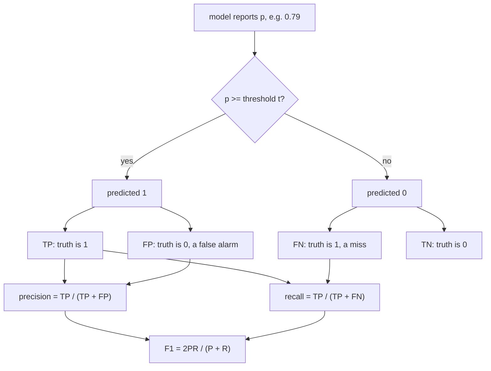
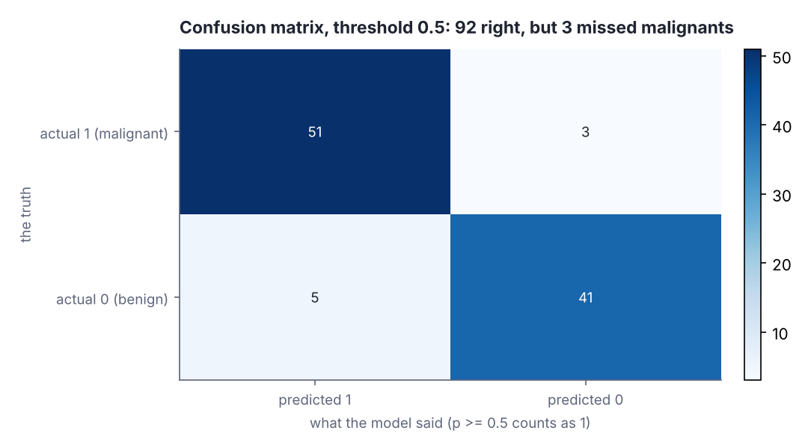
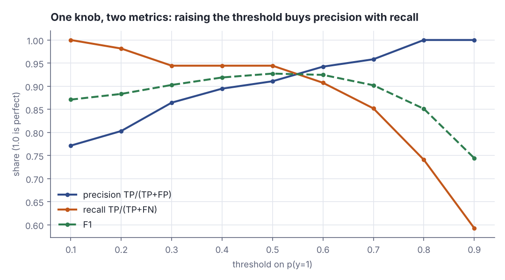
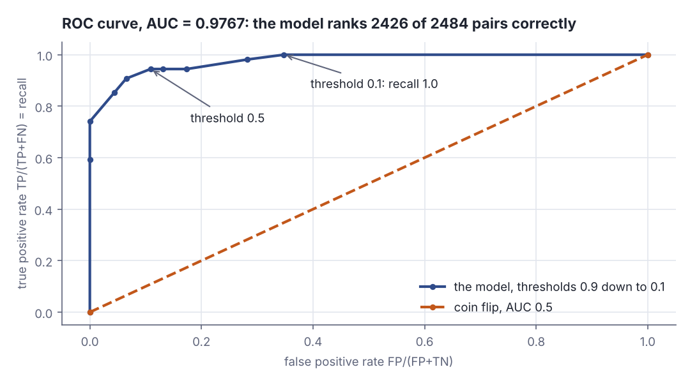
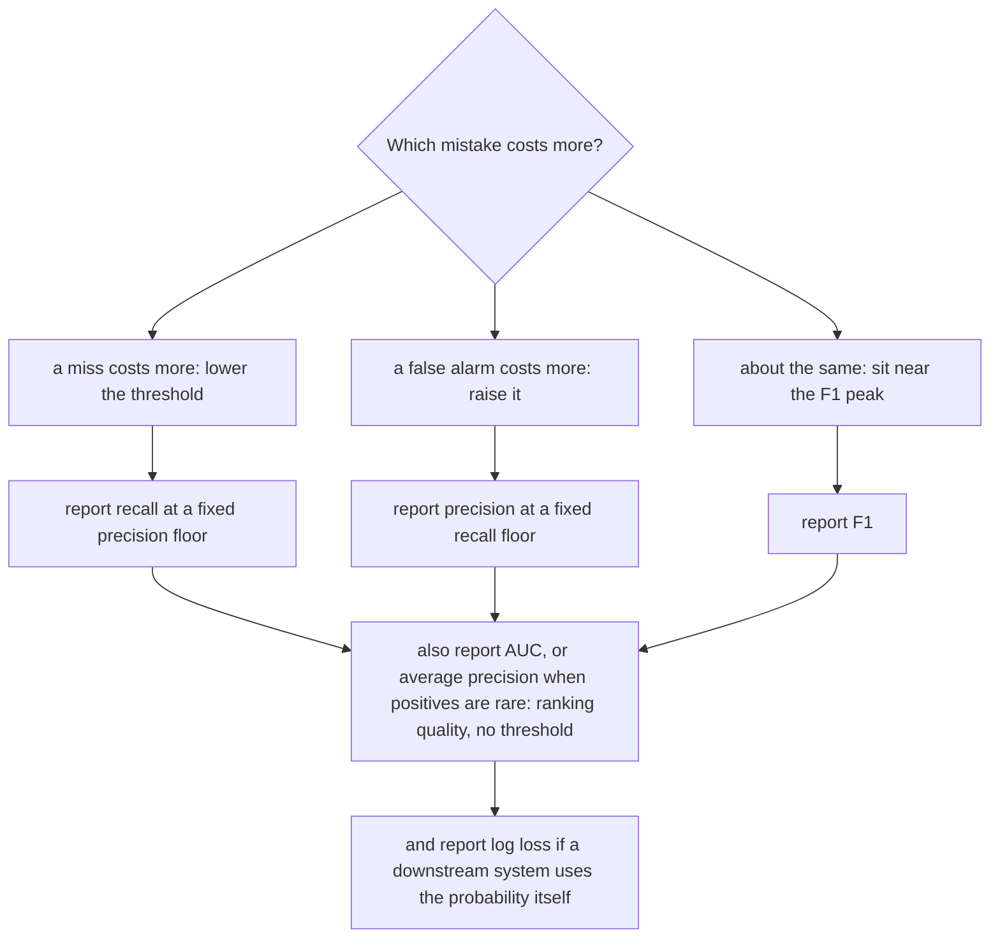
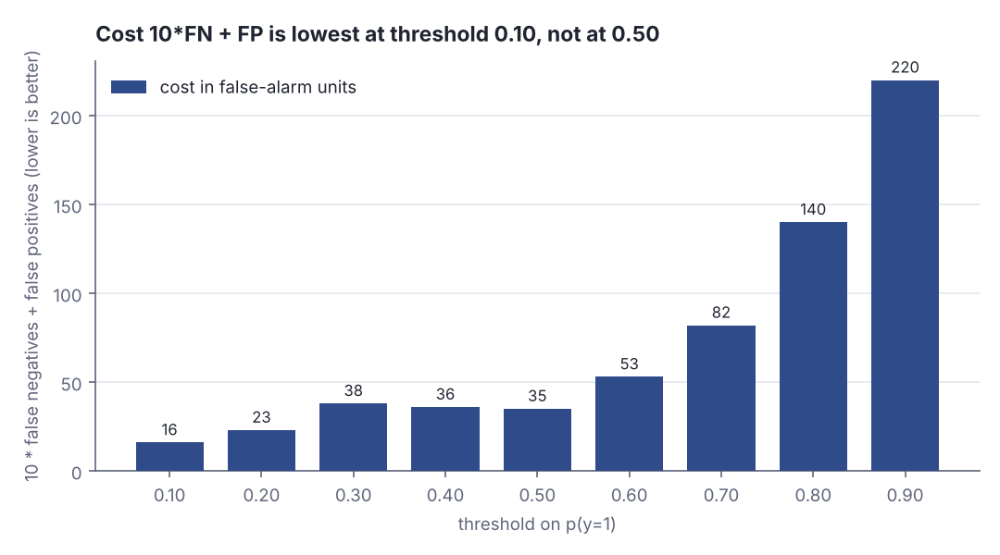

# Evaluation metrics: choosing what good means

> AI / ML foundations · Beginner · ~25 min · rung 11 of 38 · needs: Validation, overfitting and data leakage (ai-ml-03); Logistic regression: from scores to probabilities (ai-ml-09)

## Why this matters

Sooner or later someone asks you "is the model good enough to ship?", and whoever chooses the metric has already chosen the answer — 99% accuracy on a problem where 1% of rows are positive is exactly what a model that never says yes scores.
You spent years as a QA lead sorting defects into "we shipped a bug" and "we blocked a good build"; precision, recall and the confusion matrix are the same two piles with arithmetic attached, and a threshold is the knob that moves rows between them.
It sits here because rung 09 handed you a model that outputs probabilities, and every rung after this one reports numbers you have to be able to read.

## The idea

A metric compresses (predictions, truth) into one number you can sort models by. That compression is both the point and the danger: one number cannot tell a model that is wrong rarely but catastrophically from one wrong often and harmlessly. Pick the number that tracks the damage your mistakes do.

### Regression first: which error you average changes the winner

Write the per-row error `e = y − ŷ` (truth minus prediction). Two averages dominate, both in the units of `y` and both listed in the scikit-learn User Guide's "Regression metrics" section:

- **MAE**, mean absolute error: `mean(|e|)`. Every row counts the same.
- **RMSE**, root mean squared error: `sqrt(mean(e²))`. Squaring first means a row ten times further off contributes a hundred times more.

Neither means anything without a **baseline**: predict the training mean for every row. A model that cannot beat that constant has learned nothing from the features.

```scala
// file: Ex1.scala
@main def ex1(): Unit =
  val y = Vector(10.0, 12.0, 11.0, 13.0, 60.0)
  val p = Vector(10.5, 11.5, 11.0, 12.5, 14.0)
  val m = Vector.fill(5)(y.sum / 5)
  def mae(q: Vector[Double]) = y.zip(q).map((a, b) => math.abs(a - b)).sum / 5
  def rmse(q: Vector[Double]) = math.sqrt(y.zip(q).map((a, b) => (a - b) * (a - b)).sum / 5)
  println(f"model      MAE ${mae(p)}%6.3f   RMSE ${rmse(p)}%6.3f")
  println(f"mean-only  MAE ${mae(m)}%6.3f   RMSE ${rmse(m)}%6.3f")
```

```text
model      MAE  9.500   RMSE 20.575
mean-only  MAE 15.520   RMSE 19.426
```

The two metrics disagree about the winner. On MAE the model beats the baseline (9.500 against 15.520); on RMSE it loses (20.575 against 19.426), because one row — truth 60, prediction 14 — contributes `46² = 2116` of its `2116.75` squared error. Choose MAE when big errors are rare and survivable, RMSE when one big miss is worse than several small ones.

### Every classification answer lands in one of four cells

Fix a **positive class** — the thing you are hunting, by convention label 1 — and a **threshold** `t`. The predicted label is `1` when `p ≥ t`, else `0`. Crossing prediction with truth gives four counts: **TP** (said 1, truly 1), **FP** (said 1, truly 0 — a false alarm), **FN** (said 0, truly 1 — a miss), **TN** (said 0, truly 0). That 2×2 table is the **confusion matrix**; every metric below is a ratio of its cells (Google Machine Learning Crash Course, "Classification" → "Thresholds and the confusion matrix").



*Figure 1: one probability becomes one of four cells; precision and recall are two ways of dividing TP. Source: drawn from the definitions in the Google Machine Learning Crash Course, "Classification".*



*Figure 2: the real table — rung-09's model on 100 validation rows at threshold 0.5 (STEP 2 of the Lab, `python3 dojo/engine/run_lab.py 2026-11-19-1`). Adapted from the scikit-learn User Guide's confusion-matrix display, https://scikit-learn.org/stable/modules/model_evaluation.html.*

### Accuracy is a trap the moment one class is rare

**Accuracy** is `(TP + TN) / n`. It treats a miss and a false alarm as equally bad, and whichever class is bigger dominates it.

```scala
// file: Ex2.scala
@main def ex2(): Unit =
  val y = Vector.tabulate(1000)(i => if i < 10 then 1 else 0)
  def acc(q: Vector[Int]) = y.zip(q).count((a, b) => a == b) / 1000.0
  def tp(q: Vector[Int]) = y.zip(q).count((a, b) => a == 1 && b == 1)
  val never = Vector.fill(1000)(0)
  val always = Vector.fill(1000)(1)
  println(f"never-yes   accuracy ${acc(never)}%.3f   TP ${tp(never)}%2d of 10")
  println(f"always-yes  accuracy ${acc(always)}%.3f   TP ${tp(always)}%2d of 10")
```

```text
never-yes   accuracy 0.990   TP  0 of 10
always-yes  accuracy 0.010   TP 10 of 10
```

On 1000 rows with 10 positives, answering "no" to everything scores 0.990 and finds nothing; answering "yes" to everything finds all ten and scores 0.010. Accuracy ranks the useless model first by a factor of 99 — which is why the Crash Course sends you to precision and recall as soon as classes are imbalanced (Google Machine Learning Crash Course, "Classification" → "Accuracy, recall, precision, and related metrics").

### Precision, recall, F1, and the one knob that moves them

- **Precision** `= TP / (TP + FP)`: of the rows you flagged, how many were real — what your on-call engineer feels.
- **Recall** (= sensitivity = true positive rate) `= TP / (TP + FN)`: of the real positives, how many you caught — what the thing you missed feels.
- **F1** `= 2PR / (P + R)`: the harmonic mean, which sits near the smaller of the two, so you cannot buy a good F1 by maxing one and dropping the other (scikit-learn User Guide, "Classification metrics" → "Precision, recall and F-measures").

None of these is a property of the model alone. The model produces `p`; the threshold manufactures the label:

> "The numerical output of the logistic regression, which is the predicted probability, can be used as a classifier by applying a threshold (by default 0.5) to it."
>
> — scikit-learn developers, *Linear Models — Logistic regression*, scikit-learn User Guide, https://scikit-learn.org/stable/modules/linear_model.html#logistic-regression

0.5 is a default, not a law. Lower `t` and more rows cross the line: TP and FP both rise, FN falls — recall up, precision down. Raise `t` and the opposite happens.



*Figure 3: precision, recall and F1 at thresholds 0.1 … 0.9, from STEP 4 of the Lab (`python3 dojo/engine/run_lab.py 2026-11-19-1`). Source: this lesson's lab output.*

### ROC and AUC: how good the ranking is, before you pick a threshold

Sweep `t` from 1 down to 0 and plot **TPR** (= recall) against **FPR** `= FP / (FP + TN)`, the share of true negatives you falsely flagged. That curve is the **ROC curve**; the area under it is **AUC**, which has an exact combinatorial meaning: take a random positive and a random negative, and AUC is the probability the positive scored higher. A coin flip gets half the pairs right, scores 0.5 and draws the diagonal; a perfect ranker scores 1.0 (StatQuest, "ROC and AUC, Clearly Explained!"; scikit-learn User Guide, "Classification metrics" → "Receiver operating characteristic (ROC)").



*Figure 4: the ROC curve on 100 validation rows, with the coin-flip diagonal and the point threshold 0.5 produces (STEP 4 of the Lab). Source: this lesson's lab output.*

AUC's weakness: `FPR` divides by `TN`, which is enormous when positives are rare. With 10 positives and 99 990 negatives, 1000 false alarms move FPR only to 0.01 while precision collapses to about 1%. For rare positives plot **precision against recall** instead and summarise it with **average precision**: walk the rows in descending score order, average the precision at each positive. A random ranker's average precision equals the positive rate, so the floor is 0.01, not 0.5.

### Log loss: scoring the probability, not the label

Everything above throws away how confident the model was. **Log loss** keeps it: `−(1/n) Σ [ y·log p + (1−y)·log(1−p) ]`, the quantity rung 09 minimised. It is a **proper scoring rule** — minimised in expectation exactly when the reported probability equals the true one — so bluffing cannot improve it.

```scala
// file: Ex3.scala
@main def ex3(): Unit =
  val y = Vector(1.0, 1.0, 0.0, 0.0, 1.0)
  val cautious = Vector(0.60, 0.70, 0.40, 0.30, 0.45)
  val cocky = Vector(0.99, 0.99, 0.01, 0.01, 0.02)
  def hits(q: Vector[Double]) = q.zip(y).count((a, t) => (if a >= 0.5 then 1.0 else 0.0) == t)
  def ll(q: Vector[Double]) =
    -q.zip(y).map((a, t) => t * math.log(a) + (1 - t) * math.log(1 - a)).sum / 5
  println(f"cautious  correct ${hits(cautious)}%d/5   log loss ${ll(cautious)}%.4f")
  println(f"cocky     correct ${hits(cocky)}%d/5   log loss ${ll(cocky)}%.4f")
```

```text
cautious  correct 4/5   log loss 0.5067
cocky     correct 4/5   log loss 0.7904
```

Both get 4 of 5 labels right, so accuracy, precision, recall and F1 cannot tell them apart; log loss can, because the confident model's one mistake (`p = 0.02` on a true positive) costs `−log(0.02) = 3.912` by itself. Watch it whenever a downstream system multiplies your probability by a money amount. Rung 32 returns here with the **Brier score** (`mean((p − y)²)`) and **calibration**: do rows you score 0.7 come true 70% of the time?



*Figure 5: the decision a metric choice really encodes — the relative cost of the two mistakes. Source: drawn from the trade-off discussion in the Google Machine Learning Crash Course, "Classification" → "Choosing a metric and tradeoffs".*

## Lab

**The question:** on the rung-09 model's own 100 validation probabilities, what do the confusion matrix, precision, recall, F1, AUC and average precision actually say — and if a missed malignant case costs ten false alarms, is 0.5 still the threshold you should ship?

### Step 1 — know what to expect before you run

The program re-creates rung 09 exactly: 400 points from two overlapping 2-D Gaussians under `Random(7)` (200 "benign" around `(−1.0, −0.4)`, 200 "malignant" around `(1.0, 0.9)`, standard deviation 1.0 each), 300 rows for training and 100 held back for validation, both columns standardised with the **training** mean and standard deviation, then 600 steps of gradient descent on log loss at learning rate 0.5. The clouds overlap, so perfect separation is impossible: expect accuracy around 0.9 at threshold 0.5 and an AUC well above 0.5 but short of 1.0. Expect the cost rule `10·FN + FP` to prefer a *lower* threshold than 0.5, because it prices one miss at ten false alarms.

### Step 2 — the program

Scala 3, standard library only. Save as `Lab.scala` and run `scala Lab.scala`.

```scala
// file: Lab.scala
import scala.util.Random

type Mat = Vector[Vector[Double]]

def sigmoid(z: Double): Double = 1.0 / (1.0 + math.exp(-z))

def probsOf(x: Mat, w: Vector[Double], b: Double): Vector[Double] =
  x.map(r => sigmoid(r.zip(w).map((a, c) => a * c).sum + b))

def grad(x: Mat, y: Vector[Double], w: Vector[Double], b: Double): (Vector[Double], Double) =
  val res = probsOf(x, w, b).zip(y).map((p, t) => p - t)
  val n = y.size.toDouble
  val gw = w.indices.toVector.map(j => x.zip(res).map((r, e) => r(j) * e).sum / n)
  (gw, res.sum / n)

def train(x: Mat, y: Vector[Double], lr: Double, steps: Int): (Vector[Double], Double) =
  var w = Vector.fill(x.head.size)(0.0)
  var b = 0.0
  for _ <- 1 to steps do
    val (gw, gb) = grad(x, y, w, b)
    w = w.zip(gw).map((a, g) => a - lr * g)
    b = b - lr * gb
  (w, b)

// the four cells of the 2x2 table at one threshold: (TP, FP, FN, TN)
def cells(p: Vector[Double], y: Vector[Double], t: Double): (Int, Int, Int, Int) =
  val pred = p.map(q => if q >= t then 1.0 else 0.0)
  (pred.zip(y).count((a, c) => a == 1.0 && c == 1.0),
   pred.zip(y).count((a, c) => a == 1.0 && c == 0.0),
   pred.zip(y).count((a, c) => a == 0.0 && c == 1.0),
   pred.zip(y).count((a, c) => a == 0.0 && c == 0.0))

@main def lab(): Unit =
  // ---------- STEP 1: rung-09's data and model, unchanged ----------
  val r = Random(7)
  val c0 = Vector.fill(200)((-1.0 + r.nextGaussian(), -0.4 + r.nextGaussian()))
  val c1 = Vector.fill(200)((1.0 + r.nextGaussian(), 0.9 + r.nextGaussian()))
  val all = r.shuffle(c0.map(q => (Vector(q._1, q._2), 0.0)) ++ c1.map(q => (Vector(q._1, q._2), 1.0)))
  val (trainRows, valRows) = all.splitAt(300)
  val xtr: Mat = trainRows.map(_._1); val ytr = trainRows.map(_._2)
  val mu = (0 to 1).toVector.map(j => xtr.map(_(j)).sum / xtr.size)
  val sd = (0 to 1).toVector.map { j =>
    val m = mu(j); math.sqrt(xtr.map(v => (v(j) - m) * (v(j) - m)).sum / xtr.size)
  }
  def std(m: Mat): Mat = m.map(v => Vector((v(0) - mu(0)) / sd(0), (v(1) - mu(1)) / sd(1)))
  val (w, b) = train(std(xtr), ytr, 0.5, 600)
  val xv = std(valRows.map(_._1)); val yv = valRows.map(_._2)
  val p = probsOf(xv, w, b)
  println("== STEP 1: the rung-09 model's 100 validation probabilities ==")
  println(f"  w = (${w(0)}%.4f, ${w(1)}%.4f)   b = $b%.4f")
  println(f"  validation rows = ${yv.size}%d   positives = ${yv.sum.toInt}%d   negatives = ${(yv.size - yv.sum).toInt}%d")
  println("  row |  p(y=1) | y | pred at 0.5 | cell")
  for i <- 0 until 8 do
    val pr = if p(i) >= 0.5 then 1 else 0
    val cell = if pr == 1 && yv(i) == 1.0 then "TP" else if pr == 1 then "FP"
               else if yv(i) == 1.0 then "FN" else "TN"
    println(f"  $i%3d | ${p(i)}%7.4f | ${yv(i).toInt}%d | $pr%11d | $cell%4s")

  // ---------- STEP 2: the confusion matrix at 0.5 ----------
  println("\n== STEP 2: confusion matrix at threshold 0.5, and the four ratios ==")
  val (tp, fp, fn, tn) = cells(p, yv, 0.5)
  println("              predicted 1   predicted 0")
  println(f"  actual 1    TP = $tp%3d      FN = $fn%3d")
  println(f"  actual 0    FP = $fp%3d      TN = $tn%3d")
  val prec = tp.toDouble / (tp + fp)
  val rec = tp.toDouble / (tp + fn)
  val f1 = 2 * prec * rec / (prec + rec)
  println(f"  accuracy  = (TP+TN)/n   = ($tp%d+$tn%d)/100 = ${(tp + tn) / 100.0}%.4f")
  println(f"  precision = TP/(TP+FP)  = $tp%d/${tp + fp}%d    = $prec%.4f")
  println(f"  recall    = TP/(TP+FN)  = $tp%d/${tp + fn}%d    = $rec%.4f")
  println(f"  F1        = 2PR/(P+R)              = $f1%.4f")
  val base = -(yv.map(t => t * math.log(0.54) + (1 - t) * math.log(0.46)).sum) / 100
  val ll = -(p.zip(yv).map((q, t) => t * math.log(q) + (1 - t) * math.log(1 - q)).sum) / 100
  println(f"  log loss (the probabilities, not the labels) = $ll%.4f")
  println(f"  log loss of 'always answer 0.54, the positive rate' = $base%.4f")

  // ---------- STEP 3: AUC by pair counting, and average precision ----------
  println("\n== STEP 3: ROC AUC as the share of (positive, negative) pairs ranked correctly ==")
  val pos = p.zip(yv).filter(_._2 == 1.0).map(_._1)
  val neg = p.zip(yv).filter(_._2 == 0.0).map(_._1)
  var win = 0.0; var tie = 0.0
  for a <- pos; c <- neg do
    if a > c then win += 1.0 else if a == c then tie += 1.0
  val pairs = pos.size.toDouble * neg.size
  val auc = (win + 0.5 * tie) / pairs
  println(f"  pairs = ${pos.size}%d positives x ${neg.size}%d negatives = ${pairs.toInt}%d")
  println(f"  correctly ranked = ${win.toInt}%d   ties = ${tie.toInt}%d")
  println(f"  AUC = (${win.toInt}%d + 0.5*${tie.toInt}%d) / ${pairs.toInt}%d = $auc%.4f")
  val sorted = p.zip(yv).sortBy(-_._1)
  var seen = 0; var hit = 0; var apSum = 0.0
  println("  the top of the ranking, scores sorted descending:")
  println("  rank |  score | y | positives so far | precision@rank | into AP")
  for ((q, t) <- sorted) do
    seen += 1
    if t == 1.0 then
      hit += 1
      apSum += hit.toDouble / seen
    if seen <= 8 then
      val mark = if t == 1.0 then f"${hit.toDouble / seen}%.4f" else "-"
      println(f"  $seen%4d | $q%6.4f | ${t.toInt}%d | $hit%16d | ${hit.toDouble / seen}%14.4f | $mark%7s")
  val ap = apSum / pos.size
  println(f"  average precision = mean of precision@rank over the ${pos.size}%d positives = $ap%.4f")
  println(f"  a coin-flip ranker scores AUC 0.5000 and AP ${pos.size / 100.0}%.4f (the positive rate)")

  // ---------- STEP 4: threshold sweep ----------
  println("\n== STEP 4: thresholds 0.1 .. 0.9, and the cost 10*FN + FP ==")
  println("   thr |  TP |  FP |  FN |  TN | precision | recall |     F1 |    FPR | TPR=recall | 10*FN+FP")
  val grid = (1 to 9).toVector.map(_ / 10.0)
  val rows = grid.map { t =>
    val (a, c, d, e) = cells(p, yv, t)
    val pr = if a + c == 0 then 0.0 else a.toDouble / (a + c)
    val rc = a.toDouble / (a + d)
    val ff = if pr + rc == 0 then 0.0 else 2 * pr * rc / (pr + rc)
    val fpr = c.toDouble / (c + e)
    val cost = 10 * d + c
    println(f"  $t%4.2f | $a%3d | $c%3d | $d%3d | $e%3d | $pr%9.4f | $rc%6.4f | $ff%6.4f | $fpr%6.4f | $rc%10.4f | $cost%8d")
    (t, a, c, d, e, pr, rc, ff, fpr, cost)
  }
  println("  the ROC polyline the chart draws, (FPR, TPR), anchored at (0,0) and (1,1):")
  println("  point |    FPR |    TPR | threshold")
  val roc = Vector((0.0, 0.0, 1.00)) ++ rows.reverse.map(r => (r._9, r._7, r._1)) ++ Vector((1.0, 1.0, 0.00))
  for ((fx, ty, th), i) <- roc.zipWithIndex do
    println(f"  ${i + 1}%5d | $fx%6.4f | $ty%6.4f | $th%9.2f")

  // ---------- STEP 5: the cheapest threshold ----------
  println("\n== STEP 5: 'a missed malignant case costs ten false alarms' ==")
  val best = rows.minBy(_._10)
  println(f"  cheapest threshold = ${best._1}%.2f   cost = ${best._10}%d   (TP ${best._2}%d, FP ${best._3}%d, FN ${best._4}%d, TN ${best._5}%d)")
  val at05 = rows.find(_._1 == 0.5).get
  println(f"  threshold 0.50      cost = ${at05._10}%d   (TP ${at05._2}%d, FP ${at05._3}%d, FN ${at05._4}%d, TN ${at05._5}%d)")
  val bestF1 = rows.maxBy(_._8)
  println(f"  best-F1 threshold  = ${bestF1._1}%.2f   F1 = ${bestF1._8}%.4f   cost = ${bestF1._10}%d")
  println(f"  moving 0.50 -> ${best._1}%.2f saves ${at05._10 - best._10}%d cost units: ${at05._4 - best._4}%d fewer FN, ${best._3 - at05._3}%d more FP")
  println(f"  accuracy at ${best._1}%.2f = ${(best._2 + best._5) / 100.0}%.4f, lower than the ${(at05._2 + at05._5) / 100.0}%.4f at 0.50, and still the right call")
```

### Step 3 — the real output

```text
== STEP 1: the rung-09 model's 100 validation probabilities ==
  w = (2.9431, 1.5589)   b = -0.1694
  validation rows = 100   positives = 54   negatives = 46
  row |  p(y=1) | y | pred at 0.5 | cell
    0 |  0.1731 | 0 |           0 |   TN
    1 |  0.9983 | 1 |           1 |   TP
    2 |  0.0028 | 0 |           0 |   TN
    3 |  0.7904 | 1 |           1 |   TP
    4 |  0.0270 | 0 |           0 |   TN
    5 |  0.0628 | 0 |           0 |   TN
    6 |  0.0050 | 0 |           0 |   TN
    7 |  0.6387 | 1 |           1 |   TP

== STEP 2: confusion matrix at threshold 0.5, and the four ratios ==
              predicted 1   predicted 0
  actual 1    TP =  51      FN =   3
  actual 0    FP =   5      TN =  41
  accuracy  = (TP+TN)/n   = (51+41)/100 = 0.9200
  precision = TP/(TP+FP)  = 51/56    = 0.9107
  recall    = TP/(TP+FN)  = 51/54    = 0.9444
  F1        = 2PR/(P+R)              = 0.9273
  log loss (the probabilities, not the labels) = 0.2070
  log loss of 'always answer 0.54, the positive rate' = 0.6899

== STEP 3: ROC AUC as the share of (positive, negative) pairs ranked correctly ==
  pairs = 54 positives x 46 negatives = 2484
  correctly ranked = 2426   ties = 0
  AUC = (2426 + 0.5*0) / 2484 = 0.9767
  the top of the ranking, scores sorted descending:
  rank |  score | y | positives so far | precision@rank | into AP
     1 | 0.9997 | 1 |                1 |         1.0000 |  1.0000
     2 | 0.9995 | 1 |                2 |         1.0000 |  1.0000
     3 | 0.9995 | 1 |                3 |         1.0000 |  1.0000
     4 | 0.9994 | 1 |                4 |         1.0000 |  1.0000
     5 | 0.9993 | 1 |                5 |         1.0000 |  1.0000
     6 | 0.9988 | 1 |                6 |         1.0000 |  1.0000
     7 | 0.9984 | 1 |                7 |         1.0000 |  1.0000
     8 | 0.9983 | 1 |                8 |         1.0000 |  1.0000
  average precision = mean of precision@rank over the 54 positives = 0.9818
  a coin-flip ranker scores AUC 0.5000 and AP 0.5400 (the positive rate)

== STEP 4: thresholds 0.1 .. 0.9, and the cost 10*FN + FP ==
   thr |  TP |  FP |  FN |  TN | precision | recall |     F1 |    FPR | TPR=recall | 10*FN+FP
  0.10 |  54 |  16 |   0 |  30 |    0.7714 | 1.0000 | 0.8710 | 0.3478 |     1.0000 |       16
  0.20 |  53 |  13 |   1 |  33 |    0.8030 | 0.9815 | 0.8833 | 0.2826 |     0.9815 |       23
  0.30 |  51 |   8 |   3 |  38 |    0.8644 | 0.9444 | 0.9027 | 0.1739 |     0.9444 |       38
  0.40 |  51 |   6 |   3 |  40 |    0.8947 | 0.9444 | 0.9189 | 0.1304 |     0.9444 |       36
  0.50 |  51 |   5 |   3 |  41 |    0.9107 | 0.9444 | 0.9273 | 0.1087 |     0.9444 |       35
  0.60 |  49 |   3 |   5 |  43 |    0.9423 | 0.9074 | 0.9245 | 0.0652 |     0.9074 |       53
  0.70 |  46 |   2 |   8 |  44 |    0.9583 | 0.8519 | 0.9020 | 0.0435 |     0.8519 |       82
  0.80 |  40 |   0 |  14 |  46 |    1.0000 | 0.7407 | 0.8511 | 0.0000 |     0.7407 |      140
  0.90 |  32 |   0 |  22 |  46 |    1.0000 | 0.5926 | 0.7442 | 0.0000 |     0.5926 |      220
  the ROC polyline the chart draws, (FPR, TPR), anchored at (0,0) and (1,1):
  point |    FPR |    TPR | threshold
      1 | 0.0000 | 0.0000 |      1.00
      2 | 0.0000 | 0.5926 |      0.90
      3 | 0.0000 | 0.7407 |      0.80
      4 | 0.0435 | 0.8519 |      0.70
      5 | 0.0652 | 0.9074 |      0.60
      6 | 0.1087 | 0.9444 |      0.50
      7 | 0.1304 | 0.9444 |      0.40
      8 | 0.1739 | 0.9444 |      0.30
      9 | 0.2826 | 0.9815 |      0.20
     10 | 0.3478 | 1.0000 |      0.10
     11 | 1.0000 | 1.0000 |      0.00

== STEP 5: 'a missed malignant case costs ten false alarms' ==
  cheapest threshold = 0.10   cost = 16   (TP 54, FP 16, FN 0, TN 30)
  threshold 0.50      cost = 35   (TP 51, FP 5, FN 3, TN 41)
  best-F1 threshold  = 0.50   F1 = 0.9273   cost = 35
  moving 0.50 -> 0.10 saves 19 cost units: 3 fewer FN, 11 more FP
  accuracy at 0.10 = 0.8400, lower than the 0.9200 at 0.50, and still the right call
```

### Reading the output

**STEP 1 — the raw material.** Each validation row carries one probability `p(y=1)` and one true label `y`. Row 0 scores 0.1731 with truth 0, so at threshold 0.5 it is predicted 0 and lands in **TN**; row 3 scores 0.7904 with truth 1 and lands in **TP**. Nothing has been decided yet — these 100 probabilities are the only thing the model produced, and every metric below is computed from them plus a threshold.

**Verdict:** the model is a probability source; everything that follows is a decision you layer on top of it.

**STEP 2 — the 2×2 table at threshold 0.5.**

| cell | count | meaning | direction |
| --- | --- | --- | --- |
| TP | 51 | malignant, correctly flagged | higher is better |
| FN | 3 | malignant, missed | lower is better |
| FP | 5 | benign, false alarm | lower is better |
| TN | 41 | benign, correctly cleared | higher is better |

Trace the arithmetic: accuracy `= (51 + 41)/100 = 92/100 = 0.9200`; precision `= 51/(51 + 5) = 51/56 = 0.910714…`, printed `0.9107`; recall `= 51/(51 + 3) = 51/54 = 0.944444…`, printed `0.9444`; F1 `= 2 × 0.9107 × 0.9444 / (0.9107 + 0.9444) = 1.72019… / 1.85516… = 0.9273`. Log loss on the probabilities is 0.2070 against 0.6899 for a model that answers the positive rate 0.54 to every row — the probabilities carry real information, not just the labels.

**Verdict:** 92% accuracy sounds excellent, and it is hiding three women sent home with an undetected malignancy.



*Figure 6: the cost `10·FN + FP` at each threshold, from the last column of STEP 4 (`python3 dojo/engine/run_lab.py 2026-11-19-1`). Source: generated from this lesson's lab output.*

**STEP 3 — ranking quality, no threshold involved.** There are 54 positives and 46 negatives, hence `54 × 46 = 2484` (positive, negative) pairs. In 2426 of them the positive scored higher and there were no ties, so `AUC = (2426 + 0.5 × 0)/2484 = 0.976651…`, printed `0.9767`. Average precision walks the 100 rows in descending score order: the first 8 rows are all truly positive, so precision@rank is `1/1, 2/2, … 8/8 = 1.0000` at each of them; averaging precision@rank over all 54 positives gives 0.9818. A coin flip would score AUC 0.5000 and AP 0.5400, the positive rate.

**Verdict:** the model's *ordering* of patients is near-perfect (0.9767); whatever is wrong at threshold 0.5 is a threshold problem, not a model problem.

**STEP 4 — the sweep.** Columns, left to right: the threshold; the four cells; precision (higher better); recall (higher better); F1 (higher better); FPR `= FP/(FP + TN)`, the x-axis of the ROC curve (lower better); TPR, printed again to make the point that **TPR and recall are the same number**; and the cost `10·FN + FP` (lower better). Reading down: precision climbs 0.7714 → 1.0000 while recall falls 1.0000 → 0.5926. At 0.80 and 0.90 precision is a perfect 1.0000 — and the model is missing 14 and 22 malignancies respectively. Note too that accuracy's favourite and F1's favourite (both 0.50) are not the cost rule's favourite.

**Verdict:** one knob, moved monotonically, walks you across every operating point on Figure 4's curve; the curve is the model, the point on it is your choice.

**STEP 5 — pricing the mistakes.** At 0.50 the cost is `10 × 3 + 5 = 35`. At 0.10 it is `10 × 0 + 16 = 16`. Moving the threshold from 0.50 to 0.10 trades 3 missed malignancies for 11 extra false alarms, and under "a miss costs ten false alarms" that trade is worth `30 − 11 = 19` cost units. Accuracy *falls* from 0.9200 to 0.8400 while the thing you actually care about improves by more than half.

**Verdict:** ship threshold 0.10 and report recall 1.0000 at precision 0.7714 — and never quote accuracy for this problem again.

### Cause → consequence

1. **Cause:** the model emits a continuous probability, but a decision is binary, so a threshold must be inserted between them.
2. **Mechanism:** lowering the threshold moves rows from the "predicted 0" column to the "predicted 1" column — every row that moves converts one FN into one TP or one TN into one FP, so recall can only rise and precision can only fall.
3. **Consequence:** precision, recall, F1 and accuracy are all properties of *(model, threshold)*; only AUC, average precision and log loss describe the model alone. At 0.10 this model's accuracy is 8 points worse and its real-world cost is 54% lower.
4. **In practice:** before you compare two models, write down the price of a false positive and the price of a false negative in the same units. Then pick the threshold that minimises that cost on validation data, and report the metric pair at that operating point. When you cannot price the mistakes yet, compare models on AUC (or average precision, if positives are rare) and leave the threshold as a configuration value the product owner can turn — which, in your current job, is you.

## Self-check

1. A fraud classifier reports 99.4% accuracy on a month where 0.6% of transactions were fraudulent. What is the single most likely explanation, and which two numbers would you ask for instead? <details><summary>Answer</summary>The most likely explanation is that it predicts "not fraud" for every transaction: with a 0.6% positive rate, always answering 0 scores 99.4% accuracy and catches nothing — exactly the `never-yes` model in the second example above, which scored 0.990 accuracy with 0 of 10 positives found. Ask for recall (TP/(TP+FN) — what share of the actual fraud was caught) and precision (TP/(TP+FP) — what share of the alerts were real). Because positives are rare, also prefer average precision over AUC: FPR divides by the huge TN count, so thousands of false alarms barely move it.</details>
2. Your model's AUC is 0.9767 but at the threshold you currently ship, recall is only 0.5926. Is the fix to retrain the model? <details><summary>Answer</summary>No. AUC is threshold-free: 0.9767 means that for a random (positive, negative) pair the positive gets the higher score 97.67% of the time, so the ranking is already good. Low recall at a high threshold is a decision problem, not a learning problem — in the lab, recall 0.5926 is exactly what threshold 0.90 produces, and sliding the threshold down to 0.10 lifts recall to 1.0000 on the same model and the same probabilities. Retraining would be work spent on the part that is not broken.</details>
3. Two models score identical accuracy, precision, recall and F1 on the same validation set. The downstream system multiplies your probability by a payout amount. Which metric separates them, and why? <details><summary>Answer</summary>Log loss (or the Brier score). Those four label metrics only see the thresholded decision, so two models that produce the same labels are indistinguishable to them — the `cautious` and `cocky` models in the third example both got 4 of 5 right. Log loss sees the probability itself: `0.5067` versus `0.7904`, because one confident mistake at `p = 0.02` on a true positive costs `−log(0.02) = 3.912` on its own. Since the downstream system multiplies by the probability, an overconfident model loses real money that the label metrics cannot see.</details>

## Sources

- [scikit-learn User Guide — Metrics and scoring](https://scikit-learn.org/stable/modules/model_evaluation.html) — scikit-learn developers; section "Classification metrics" → "Precision, recall and F-measures" gave the F-measure definition used above, "Receiver operating characteristic (ROC)" the AUC framing, and "Regression metrics" the MAE/RMSE pair; its confusion-matrix display is the layout Figure 2 adapts (accessed 2026-11-19).
- [scikit-learn User Guide — Linear Models, Logistic regression](https://scikit-learn.org/stable/modules/linear_model.html#logistic-regression) — scikit-learn developers; source of the quoted sentence establishing that 0.5 is a default threshold applied to the predicted probability, not part of the model (accessed 2026-11-19).
- [Google Machine Learning Crash Course](https://developers.google.com/machine-learning/crash-course) — Google; module "Classification" → "Thresholds and the confusion matrix" for the four cells, "Accuracy, recall, precision, and related metrics" for why accuracy fails under class imbalance, "ROC and AUC" for the curve, and "Choosing a metric and tradeoffs" for Figure 5's decision (accessed 2026-11-19).
- [StatQuest — video index](https://statquest.org/video-index/) — Josh Starmer; "Machine Learning Fundamentals: The Confusion Matrix" for the 2×2 presentation and "ROC and AUC, Clearly Explained!" for the threshold-sweep construction of the ROC curve and the pairwise reading of AUC (accessed 2026-11-19).

## Next on this track
Next on AI / ML foundations: **From perceptron to multilayer network** (rung 12 of 38, Beginner).
