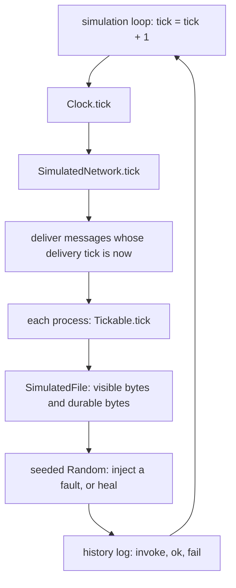
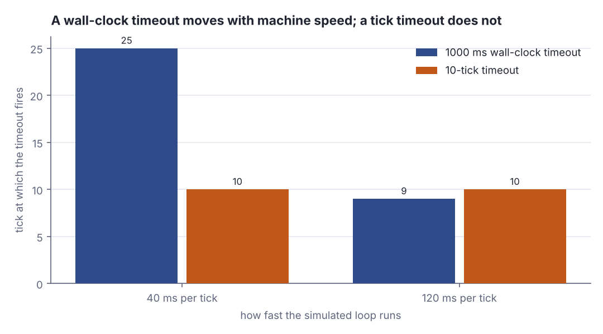
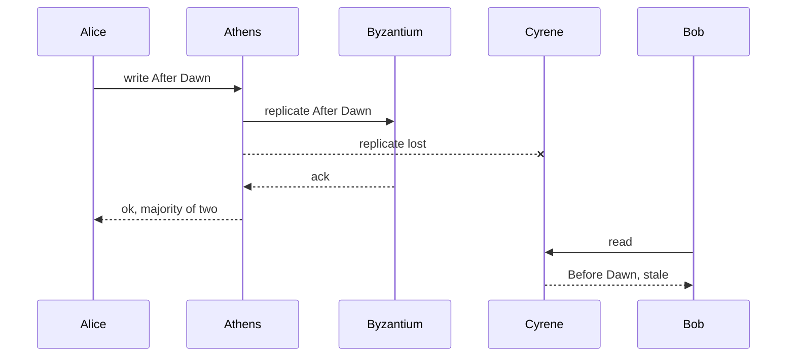
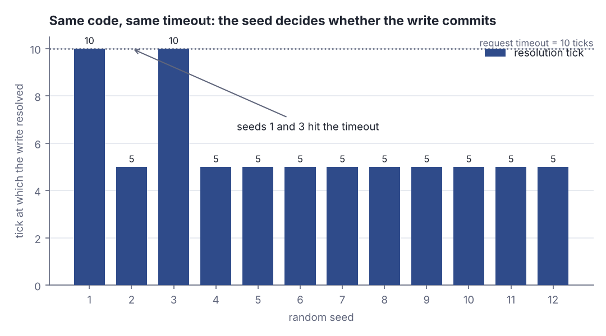

# Deterministic simulation testing: one thread, one seed, the same bug every time

> Fresh · Software architecture & design · Intermediate · ~25 min · from today's feeds

## Why this matters
Unmesh Joshi — Distinguished Engineer at Thoughtworks and the author of *Patterns of Distributed Systems* — published "Deterministic Simulation Testing" on martinfowler.com on 17 November 2026, and it is the clearest write-up yet of how FoundationDB and TigerBeetle actually find their distributed bugs.
The claim is one you can act on: the bugs that matter live in the *interleavings* of partial failure with live traffic, and you cannot reproduce an interleaving you did not control.
You ran QA for years and have shipped Akka systems; this is the piece that explains why the flaky test you kept re-running was never about a flaky network.

## Primer
You are solid on services, timeouts, retries and integration tests. Four ideas sit between that and today's lesson.

**Partial failure.** In one JVM a call either returns or throws. Across a network there is a third outcome: you sent the request, you got nothing back, and you cannot tell whether the other side applied it, applied it and lost the reply, or never saw it. Every timeout you have ever tuned is a guess about which of those happened.

**Quorum.** A common way to survive partial failure is to keep N copies and require a majority to agree. With three replicas the majority is two: a write is acknowledged once two of three have it, a read that touches two of three must see the latest write. Three nodes tolerate one dead node. The uncomfortable case is not a dead node — it is a *slow* one, because slow is indistinguishable from dead until a timeout fires.

**Linearizability.** The strongest single-object guarantee: the system behaves as if every operation took effect instantaneously at some point between the client sending it and the client getting the reply, and once a write is acknowledged no later read may return an older value. It is defined purely over what clients see, which is why it can be checked from a log of client requests and responses without looking inside the system.

**Nondeterminism.** A test is nondeterministic when the same inputs can produce different executions. In a distributed test the inputs are not just the data: they include which thread the OS scheduled, what the clock read, and the order the network happened to deliver messages in. Change any of those and you get a different execution trace from identical code. That is why re-running a failed distributed test so often "fixes" it — and why your flaky integration test was almost never a flaky network. It was you, not controlling the schedule.

Hold on to one consequence: if you want a distributed bug to be reproducible, something has to make time, scheduling and delivery order into explicit inputs of the test.

## The idea
Deterministic simulation testing (DST) does exactly that. The whole cluster — every node, the network between them, the disks under them, the clock above them — runs inside one process, on one thread, driven by a loop that advances time by calling an explicit `tick()` on each component. Nothing moves on its own: no thread wakes, no socket delivers, no `fsync` completes, no timer expires, except because the loop decided it should on tick N. The seed of a single pseudo-random generator decides which faults occur and when.

> "Distributed systems are hard to test because partial failures overlap with live traffic and the same fault can produce different execution traces on different runs."
> — Unmesh Joshi, *Deterministic Simulation Testing*, 2026-11-17, https://martinfowler.com/articles/deterministic-simulation-testing.html

The architecture that makes this possible is a *seam*: the process talks to Clock, Network, FileSystem and FileIO through interfaces, and the test substitutes simulated implementations for all four (Joshi, *Deterministic Simulation Testing*, "Example Implementation"). In production the same process gets real adapters — `NioNetwork` over TCP, real file I/O — and may use threads freely *outside* the seam.



*Figure 1: the deterministic seam. One thread, one loop; Clock, Network and FileSystem are simulated objects the loop advances by hand, so the whole execution is a function of the seed. Source: mechanism as described in Joshi, Deterministic Simulation Testing, "Single-Threaded Execution" and "Simulating the Network", https://martinfowler.com/articles/deterministic-simulation-testing.html*

### Time is counted in ticks, not milliseconds

Inside the simulation a timeout does not measure elapsed milliseconds; it counts `tick()` calls. A timeout of 10 expires after the tenth tick, on every machine, every run (Joshi, *Deterministic Simulation Testing*, "Timeouts in Ticks"). Not an idea invented for simulators: etcd's Raft implementation drives elections from a 100 ms ticker with an election timeout of 10 ticks — one second — and TigerBeetle fixes `tick_ms = 10` (Joshi, *Deterministic Simulation Testing*, "Tick-Based Timeouts in etcd" and "Timeouts in Ticks").

Price the same timeout on two machines of different speed:

```scala
// file: Clock.scala
@main def clock(): Unit =
  for msPerTick <- List(40, 120) do
    var t = 0
    var elapsed = 0
    while elapsed < 1000 do
      t += 1
      elapsed += msPerTick
    println(s"$msPerTick ms per tick: a 1000 ms wall-clock timeout fires at tick $t")
  println("a timeout counted as 10 ticks fires at tick 10 on both machines")
```

```text
40 ms per tick: a 1000 ms wall-clock timeout fires at tick 25
120 ms per tick: a 1000 ms wall-clock timeout fires at tick 9
a timeout counted as 10 ticks fires at tick 10 on both machines
```

The same 1000 ms timeout lands on tick 25 on the fast loop and tick 9 on the slow one, so the fast machine gives the network sixteen more delivery opportunities before giving up — a different execution from identical code. Counted in ticks the deadline is tick 10 on both, which is what makes a failing run replayable.



*Figure 2: a wall-clock deadline is a different number of delivery opportunities on every machine; a tick-counted deadline is the same everywhere. Source: the numbers printed by Clock.scala above, via `python3 dojo/engine/run_lab.py 2026-11-19-2`.*

### The rules that keep the seam deterministic

Determinism is lost with one careless line, so the article names six rules for code inside the seam: no system-clock calls, no unseeded randomness, no threads or standard futures, no direct network or disk I/O, no iteration over unordered collections, and no cross-thread callbacks across the seam. The first five are enforced with ArchUnit, the sixth with runtime thread checks (Joshi, *Deterministic Simulation Testing*, "Strict Coding Rules").

Rule five looks like pedantry until you see it:

```scala
// file: Order.scala
@main def order(): Unit =
  val three = scala.collection.immutable.HashSet("Athens", "Byzantium", "Cyrene")
  val four = three + "Delphi"
  println("HashSet, 3 nodes: " + three.mkString(", "))
  println("HashSet, 4 nodes: " + four.mkString(", "))
  println("sorted,   4 nodes: " + four.toList.sorted.mkString(", "))
```

```text
HashSet, 3 nodes: Athens, Cyrene, Byzantium
HashSet, 4 nodes: Athens, Cyrene, Delphi, Byzantium
sorted,   4 nodes: Athens, Byzantium, Cyrene, Delphi
```

Byzantium was inserted second and comes out third, and adding a fourth node moves the others again: the traversal order is a function of hashing, not of your code, so "send to each replica" silently becomes "send in an order nobody chose". Sort, or use an ordered collection, and the send order becomes part of the program instead of part of the runtime.

The same reasoning bans `java.util.concurrent.CompletableFuture` inside the seam: `get()` and `join()` would block the one thread that drives everything, and the `*Async` combinators hand work to a thread pool, putting scheduler nondeterminism back in. The article's implementation uses a non-blocking `TickCompletableFuture` with no `get()` at all (Joshi, *Deterministic Simulation Testing*, "Non-Blocking Futures").

### Faults come from a seed

With time under control, faults become data. A `SimulationRunner` builds a `Random(randomSeed)`, and `SimulationDecisions` uses it to decide, tick by tick, whether to issue a client request (default probability 0.4), whether to inject a fault (default 0.08) and when to heal — every 40 ticks by default. The faults are `ISOLATE_NODE`, `PARTITION_PAIR`, `DELAY_LINK` and `DROP_LINK`, and each one is written to a tick-stamped schedule (Joshi, *Deterministic Simulation Testing*, "Seeded Fault Injection").

> "Making it seeded for every run, makes sure the run is repeatable."
> — Unmesh Joshi, *Deterministic Simulation Testing*, 2026-11-17, https://martinfowler.com/articles/deterministic-simulation-testing.html

> "If a bug shows up for seed 42, running seed 42 again reproduces it."
> — Unmesh Joshi, *Deterministic Simulation Testing*, 2026-11-17, https://martinfowler.com/articles/deterministic-simulation-testing.html

Two more pieces complete the picture. Because the loop never waits for real time, ticks run as fast as the CPU allows, so a scenario covering minutes of simulated cluster life finishes in seconds — the article calls this fast-forward execution. And correctness is judged from the outside: client-visible histories are recorded in Jepsen's EDN format with `:invoke`, `:ok` and `:fail` entries, and a `ConsistencyChecker` tests them for linearizability; liveness is checked by healing the network and ticking for a bounded number of ticks to see whether the cluster recovers (Joshi, *Deterministic Simulation Testing*, "Correctness Checking").

Storage works the same way. A `SimulatedFile` holds two byte arrays, `visible` and `durable`; `sync()` copies visible to durable, and `crash()` resets visible back to durable, so every unsynced write is lost exactly as it would be on a real power cut — which lets a write-ahead log be tested across crashes with no reboot (Joshi, *Deterministic Simulation Testing*, "Simulating the File System").

The running example in the article is the failure this buys you: a three-node key-value store — Athens, Byzantium, Cyrene — where Alice's write of "After Dawn" reaches a majority of two, and Bob then reads a stale "Before Dawn" from the replica that missed it.



*Figure 3: the stale read the article uses as its running example — an acknowledged write followed by a read that returns the older value, which is a linearizability violation. Adapted from Unmesh Joshi, Deterministic Simulation Testing, https://martinfowler.com/articles/deterministic-simulation-testing.html*

### What it costs

> "Deterministic simulation testing cannot be added as an afterthought; it requires upfront architectural investment."
> — Unmesh Joshi, *Deterministic Simulation Testing*, 2026-11-17, https://martinfowler.com/articles/deterministic-simulation-testing.html

The trade-offs: a single-threaded core, async interfaces for all I/O, and no thread-heavy libraries inside the seam. Message-level simulation like TigerBeetle's cannot catch a framing bug — a frame split across two reads — because it never deals in bytes; FoundationDB simulates at byte-stream granularity instead (Joshi, *Deterministic Simulation Testing*, "Deciding the Boundary: Messages or Bytes"). Scaling across cores means running several independent processes rather than threading one. And if re-architecting is off the table, the hypervisor-level option exists — Antithesis runs unmodified applications deterministically — but building one is, as the article puts it, daunting engineering work (Joshi, *Deterministic Simulation Testing*, "Application-Level vs. Hypervisor-Level Simulation").

## Lab
**The question this lab answers:** does a tick-driven simulator with a seeded fault schedule really make a distributed failure reproducible — the same seed giving the same trace, a different seed giving a different failure?

You will build a miniature of the article's architecture in one Scala file: three nodes (Athens, Byzantium, Cyrene), a priority-queue network keyed by delivery tick, a seeded fault generator, and a quorum write with a timeout counted in ticks. One-way latency is 2 ticks, a replica needs 1 extra tick to make its write durable before acking, the quorum is 2 of 3, and the request timeout is 10 ticks. Fault probability is 0.25 per tick so that a ten-tick run finds something; the article's default is 0.08 (Joshi, *Deterministic Simulation Testing*, "Seeded Fault Injection").

### Step 1 — the simulator

```scala
// file: Lab.scala
import scala.collection.mutable
import scala.util.Random

// A message in flight. The loop delivers it when it reaches `deliverAt`;
// `seq` breaks ties so messages due on the same tick keep send order (FIFO).
case class Msg(deliverAt: Int, seq: Long, from: String, to: String,
               kind: String, clogged: Boolean)

val peers = Vector("Byzantium", "Cyrene")

class Sim(seed: Int, faultProb: Double, timeoutTicks: Int, clogTicks: Int):
  private val rnd = new Random(seed)                 // the only randomness in the run
  private val ord = Ordering.by[Msg, (Int, Long)](m => (-m.deliverAt, -m.seq))
  private val q = mutable.PriorityQueue.empty[Msg](ord)
  private var seq = 0L
  private var isolated = Set.empty[String]
  private var clogged = Set.empty[String]
  private var acks = 1                               // Athens counts its own local copy
  private var tick = 0
  private var verdict = ""
  val trace = mutable.ArrayBuffer.empty[String]
  val faults = mutable.ArrayBuffer.empty[String]

  // one-way latency is 2 ticks; `extra` adds the replica's fsync
  private def send(from: String, to: String, kind: String, extra: Int): Unit =
    seq += 1
    q.enqueue(Msg(tick + 2 + extra, seq, from, to, kind, false))

  private def injectFaults(): Unit =
    if tick % 40 == 0 then
      isolated = Set.empty; clogged = Set.empty; faults += s"t$tick HEAL"
    if rnd.nextDouble() < faultProb then
      val n = peers(rnd.nextInt(2))
      if rnd.nextInt(2) == 0 then
        isolated += n; faults += s"t$tick ISOLATE_NODE($n)"
      else
        clogged += n; faults += s"t$tick DELAY_LINK(Athens<->$n,+$clogTicks)"

  def run(): (String, Int) =
    send("Athens", "Byzantium", "W", 0)
    send("Athens", "Cyrene", "W", 0)
    while verdict == "" do
      tick += 1
      injectFaults()
      val due = mutable.ArrayBuffer.empty[Msg]
      while q.nonEmpty && q.head.deliverAt <= tick do due += q.dequeue()
      var dropped = 0
      var held = 0
      for m <- due do
        val other = if m.from == "Athens" then m.to else m.from
        if isolated(other) then dropped += 1
        else if clogged(other) && !m.clogged then
          held += 1
          q.enqueue(m.copy(deliverAt = tick + clogTicks, clogged = true))
        else if m.kind == "W" then send(m.to, m.from, "A", 1)      // +1 tick fsync
        else acks += 1
      if acks >= 2 then verdict = "COMMITTED"
      else if tick >= timeoutTicks then verdict = "TIMEOUT"
      val f = (isolated.toList.sorted.map("iso:" + _.take(3)) ++
               clogged.toList.sorted.map("dly:" + _.take(3))).mkString(",")
      trace += f"$tick%4d  ${due.size}%9d  $dropped%7d  $held%6d  ${q.size}%9d  $acks%5d  " +
               f"${if f.isEmpty then "-" else f}%-24s  ${if verdict == "" then "waiting" else verdict}"
    (verdict, tick)

val header = "tick  delivered  dropped  clogd  in-flight  acks  faults                    state"

def faultStr(s: Sim): String =
  val fl = s.faults.filterNot(_.endsWith("HEAL"))
  if fl.isEmpty then "(none)" else fl.mkString(" ")

def show(label: String, seed: Int, clog: Int, verbose: Boolean = true): Sim =
  val sim = Sim(seed, 0.25, 10, clog)
  val (v, t) = sim.run()
  println(s"--- $label: seed $seed, clog +$clog ticks")
  if verbose then
    println(header)
    sim.trace.foreach(println)
    println("faults: " + faultStr(sim))
  println(s"verdict: $v at tick $t")
  sim

@main def lab(): Unit =
  val a = show("Step 2", 1, 20)

  println()
  println("=== Step 3: run seed 1 twice more, byte for byte ===")
  val reps = (1 to 2).map(i => show(s"replay $i", 1, 20, verbose = false))
  println(s"all three traces identical: ${reps.forall(_.trace == a.trace)}")
  println(s"all three fault schedules identical: ${reps.forall(_.faults == a.faults)}")

  println()
  println("=== Step 4: seeds 1..12, identical code, request timeout 10 ticks ===")
  println("seed  verdict     tick  fault schedule")
  for s <- 1 to 12 do
    val sim = Sim(s, 0.25, 10, 20)
    val (v, t) = sim.run()
    println(f"$s%4d  $v%-10s  $t%4d  ${faultStr(sim)}")

  println()
  println("=== Step 5: seed 3, a different seed and a different failure ===")
  show("Step 5", 3, 20)

  println()
  println("=== Step 6: same seed 1, clog shortened from +20 to +1 tick ===")
  show("Step 6", 1, 1)
```

Run it with `python3 dojo/engine/run_lab.py 2026-11-19-2`, or save it and run `scala Lab.scala`.

### Step 2 — one seeded run, printed tick by tick

```text
--- Step 2: seed 1, clog +20 ticks
tick  delivered  dropped  clogd  in-flight  acks  faults                    state
   1          0        0       0          2      1  -                         waiting
   2          2        0       0          2      1  -                         waiting
   3          0        0       0          2      1  dly:Byz                   waiting
   4          0        0       0          2      1  dly:Byz                   waiting
   5          2        1       1          1      1  iso:Cyr,dly:Byz           waiting
   6          0        0       0          1      1  iso:Cyr,dly:Byz           waiting
   7          0        0       0          1      1  iso:Cyr,dly:Byz           waiting
   8          0        0       0          1      1  iso:Cyr,dly:Byz           waiting
   9          0        0       0          1      1  iso:Cyr,dly:Byz           waiting
  10          0        0       0          1      1  iso:Cyr,dly:Byz           TIMEOUT
faults: t3 DELAY_LINK(Athens<->Byzantium,+20) t5 ISOLATE_NODE(Cyrene)
verdict: TIMEOUT at tick 10
```

**Verdict:** seed 1 produces the article's own worked case — one replica isolated, the other's link clogged — and the write fails at exactly tick 10.

### Step 3 — the same seed, again

```text
=== Step 3: run seed 1 twice more, byte for byte ===
--- replay 1: seed 1, clog +20 ticks
verdict: TIMEOUT at tick 10
--- replay 2: seed 1, clog +20 ticks
verdict: TIMEOUT at tick 10
all three traces identical: true
all three fault schedules identical: true
```

**Verdict:** three runs, one trace. The failure is a value you can put in a ticket, not an event you hope to catch again.

### Step 4 — twelve seeds

```text
=== Step 4: seeds 1..12, identical code, request timeout 10 ticks ===
seed  verdict     tick  fault schedule
   1  TIMEOUT       10  t3 DELAY_LINK(Athens<->Byzantium,+20) t5 ISOLATE_NODE(Cyrene)
   2  COMMITTED      5  (none)
   3  TIMEOUT       10  t2 DELAY_LINK(Athens<->Byzantium,+20) t4 ISOLATE_NODE(Cyrene) t6 ISOLATE_NODE(Cyrene) t8 DELAY_LINK(Athens<->Cyrene,+20)
   4  COMMITTED      5  t5 DELAY_LINK(Athens<->Byzantium,+20)
   5  COMMITTED      5  t2 DELAY_LINK(Athens<->Byzantium,+20)
   6  COMMITTED      5  t4 DELAY_LINK(Athens<->Byzantium,+20)
   7  COMMITTED      5  (none)
   8  COMMITTED      5  t3 ISOLATE_NODE(Cyrene)
   9  COMMITTED      5  (none)
  10  COMMITTED      5  t3 ISOLATE_NODE(Byzantium)
  11  COMMITTED      5  t4 ISOLATE_NODE(Byzantium) t5 ISOLATE_NODE(Byzantium)
  12  COMMITTED      5  t5 ISOLATE_NODE(Byzantium)
```



*Figure 4: ten of twelve seeds commit on tick 5; seeds 1 and 3 run into the ten-tick timeout. Generated from the Step 4 output of `python3 dojo/engine/run_lab.py 2026-11-19-2`.*

**Verdict:** the seed, not the code and not the machine, decides the outcome — and a single fault is survivable while the right pair is not.

### Step 5 — a different seed, a different failure

```text
=== Step 5: seed 3, a different seed and a different failure ===
--- Step 5: seed 3, clog +20 ticks
tick  delivered  dropped  clogd  in-flight  acks  faults                    state
   1          0        0       0          2      1  -                         waiting
   2          2        0       1          2      1  dly:Byz                   waiting
   3          0        0       0          2      1  dly:Byz                   waiting
   4          0        0       0          2      1  iso:Cyr,dly:Byz           waiting
   5          1        1       0          1      1  iso:Cyr,dly:Byz           waiting
   6          0        0       0          1      1  iso:Cyr,dly:Byz           waiting
   7          0        0       0          1      1  iso:Cyr,dly:Byz           waiting
   8          0        0       0          1      1  iso:Cyr,dly:Byz,dly:Cyr   waiting
   9          0        0       0          1      1  iso:Cyr,dly:Byz,dly:Cyr   waiting
  10          0        0       0          1      1  iso:Cyr,dly:Byz,dly:Cyr   TIMEOUT
faults: t2 DELAY_LINK(Athens<->Byzantium,+20) t4 ISOLATE_NODE(Cyrene) t6 ISOLATE_NODE(Cyrene) t8 DELAY_LINK(Athens<->Cyrene,+20)
verdict: TIMEOUT at tick 10
```

**Verdict:** the same ten-tick verdict reached by a different route — the clog lands at tick 2, while the write is still in flight, so Byzantium never even receives it.

### Step 6 — change one number, keep the seed

```text
=== Step 6: same seed 1, clog shortened from +20 to +1 tick ===
--- Step 6: seed 1, clog +1 ticks
tick  delivered  dropped  clogd  in-flight  acks  faults                    state
   1          0        0       0          2      1  -                         waiting
   2          2        0       0          2      1  -                         waiting
   3          0        0       0          2      1  dly:Byz                   waiting
   4          0        0       0          2      1  dly:Byz                   waiting
   5          2        1       1          1      1  iso:Cyr,dly:Byz           waiting
   6          1        0       0          0      2  iso:Cyr,dly:Byz           COMMITTED
```

**Verdict:** identical seed, identical fault schedule, one changed parameter — the write now commits at tick 6. This is the article's own experiment: a 20-tick delay fails every run, a 1-tick delay succeeds every run (Joshi, *Deterministic Simulation Testing*, "Seeded Fault Injection").

### Reading the output

| column | meaning | which direction is good |
| --- | --- | --- |
| `tick` | the loop counter; the only clock in the system | — |
| `delivered` | messages whose delivery tick arrived this tick | higher means traffic is flowing |
| `dropped` | messages discarded because one endpoint was isolated | 0 is good |
| `clogd` | messages re-queued because their link was delayed | 0 is good |
| `in-flight` | messages still in the priority queue | should fall to 0 |
| `acks` | durable copies Athens knows about, itself included | needs to reach 2 |
| `faults` | faults in force this tick, from the seeded schedule | `-` is good |
| `state` | `waiting`, then `COMMITTED` or `TIMEOUT` | `COMMITTED` is good |

Trace seed 1 with digits, since every number above is arithmetic and not luck:

- **tick 0** — Athens sends `W` to both peers. Delivery tick = 0 + 2 (latency) + 0 = **2**. `in-flight` is 2.
- **tick 2** — both `W` arrive (`delivered 2`). Each replica schedules its ack: 2 + 2 (latency) + 1 (fsync) = **5**. `in-flight` is 2 again.
- **tick 3** — the seeded generator draws below 0.25 and clogs the Athens–Byzantium link by 20 ticks. Nothing is in flight on that link yet, so the row is quiet.
- **tick 5** — a fault lands first (`ISOLATE_NODE(Cyrene)`), then both acks come due. Cyrene's ack is dropped (`dropped 1`). Byzantium's ack hits the clog and is re-queued for 5 + 20 = **25** (`clogd 1`). `acks` stays at 1.
- **tick 10** — `acks` is 1, below the quorum of 2, and tick 10 ≥ the 10-tick request timeout, so the verdict is `TIMEOUT`. The ack is still sitting in the queue, due at tick 25, fifteen ticks after anyone cares.

**Verdict:** the failure is fully explained by three integers — latency 2, fsync 1, clog 20 — against a deadline of 10. Change the clog to 1 (Step 6) and the ack is re-queued for 5 + 1 = 6, arrives at tick 6, `acks` becomes 2, and the write commits. Nothing here depends on the machine, the OS scheduler or the hour of the day.

Cause → consequence:

1. **Cause:** every source of timing — the clock, message delivery, the disk fsync — is behind an interface the test owns, and the only randomness is `new Random(seed)`.
2. **Mechanism:** nothing advances unless the loop calls it, so one run is a pure function of (seed, parameters). Message order is fixed by a priority queue keyed on delivery tick with a sequence number for ties, and timeouts count ticks instead of milliseconds.
3. **Consequence:** a failing run is identified by a seed. Step 3 shows three runs of seed 1 producing the same trace; Step 4 shows ten of twelve seeds committing at tick 5 while seeds 1 and 3 time out, each with its own fault schedule.
4. **What it means in practice:** when a distributed test of yours fails once in forty runs, the useful question is not "is the network flaky?" but "what in this test is not an input?" Any Akka or JVM service you own has the same four leaks — `System.currentTimeMillis`, unseeded `Random`, a dispatcher thread pool, real sockets and files. Putting those four behind interfaces is a day's work on a new service and buys you a test harness that can hand you a reproduction instead of a screenshot. Retro-fitting it to a running system is a different proposition, which is exactly the trade-off the article names.

## Self-check
1. Why does a timeout counted in ticks make a run reproducible, when the same timeout counted in milliseconds does not? <details><summary>Answer</summary>A millisecond timeout fires after however many loop iterations happen to fit in that interval, which depends on machine speed, GC and load: the `Clock.scala` example shows the same 1000 ms deadline landing on tick 25 at 40 ms per tick and on tick 9 at 120 ms per tick, which are two different executions of the same code. A tick-counted timeout expires on the tenth `tick()` call on every machine, so the deadline occupies a fixed position in the message schedule. etcd does this in production with a 100 ms ticker and a 10-tick election timeout (Joshi, *Deterministic Simulation Testing*, "Tick-Based Timeouts in etcd").</details>
2. The seam bans `CompletableFuture` and iteration over a `HashSet`. What exactly does each one break? <details><summary>Answer</summary>`CompletableFuture.get()` or `join()` blocks the single thread that drives every component, so the simulation deadlocks; its `*Async` combinators hand continuations to a thread pool, which reintroduces scheduler nondeterminism — hence the non-blocking `TickCompletableFuture` with no `get()` (Joshi, *Deterministic Simulation Testing*, "Non-Blocking Futures"). `HashSet`/`HashMap` iteration order is a function of hashing and of the set's contents, not of your source: the `Order.scala` example emits Athens, Cyrene, Byzantium for three nodes and reorders again when a fourth is added, so "send to each replica" becomes an order nobody chose and the fault schedule no longer determines the run. Sort, or use an ordered collection.</details>
3. Your three-node store passes under one isolated replica but your simulator reports a timeout under two faults. Does that mean the system is broken? <details><summary>Answer</summary>Not necessarily. With a quorum of two out of three, one impaired replica is survivable — Step 4 shows seeds 8, 10, 11 and 12 committing at tick 5 despite an isolated node — but two impaired peers leave Athens with one copy, below the quorum, so a timeout is the correct answer rather than a bug. What would be a bug is a *client-visible* violation: an acknowledged write later read back as the old value, which is what the article's Jepsen-format history and `ConsistencyChecker` test for, or a cluster that fails to recover after the network is healed and the loop is ticked on (Joshi, *Deterministic Simulation Testing*, "Correctness Checking").</details>

## Sources
- [Deterministic Simulation Testing](https://martinfowler.com/articles/deterministic-simulation-testing.html) — Unmesh Joshi, martinfowler.com, published 17 November 2026 — the whole lesson: the tick loop, the deterministic seam, tick-counted timeouts, seeded fault injection, the six coding rules, the Athens/Byzantium/Cyrene example and the trade-offs; source of all four quoted passages (accessed 2026-11-19).
- [Tickloom](https://github.com/unmeshjoshi/tickloom) — Unmesh Joshi — the Java reference implementation the article walks through (`Tickable`, `SimulatedNetwork`, `SimulationRunner`, the ArchUnit `DeterminismRulesTest`); named as the article's reference, not independently reviewed here (accessed 2026-11-19).
- [FoundationDB](https://github.com/apple/foundationdb) — Apple — cited by the article as the system that pioneered deterministic simulation for distributed databases, with byte-stream-level network simulation (accessed 2026-11-19).
- [TigerBeetle](https://github.com/tigerbeetle/tigerbeetle) — TigerBeetle — cited by the article for its single-threaded tick-driven architecture, message-level simulator and fixed `tick_ms = 10` (accessed 2026-11-19).
- [etcd-raft](https://github.com/etcd-io/raft) — etcd authors — cited by the article as a production system driving elections from `Node.Tick()` with a 10-tick election timeout (accessed 2026-11-19).
- [Jepsen](https://jepsen.io) — Kyle Kingsbury — the history format (`:invoke`, `:ok`, `:fail`) and the linearizability checking the article's correctness checker follows (accessed 2026-11-19).
- [Antithesis](https://antithesis.com/) — Antithesis — cited by the article as the commercial hypervisor-level deterministic platform for when re-architecting an application is not feasible (accessed 2026-11-19).
- [ArchUnit](https://www.archunit.org/) — ArchUnit — the tool the article uses to enforce five of the six determinism rules at build time (accessed 2026-11-19).
- [Gray Failure: The Achilles' Heel of Cloud-Scale Systems](https://www.microsoft.com/en-us/research/wp-content/uploads/2017/06/paper-1.pdf) — Huang et al., Microsoft Research — the gray-failure notion the article opens with, where a component is degraded but not dead; cited as the article's reference (accessed 2026-11-19).
- [Designing Data-Intensive Applications](https://dataintensive.net/) — Martin Kleppmann — background on quorums and linearizability used in the Primer; linked by the article (accessed 2026-11-19).
