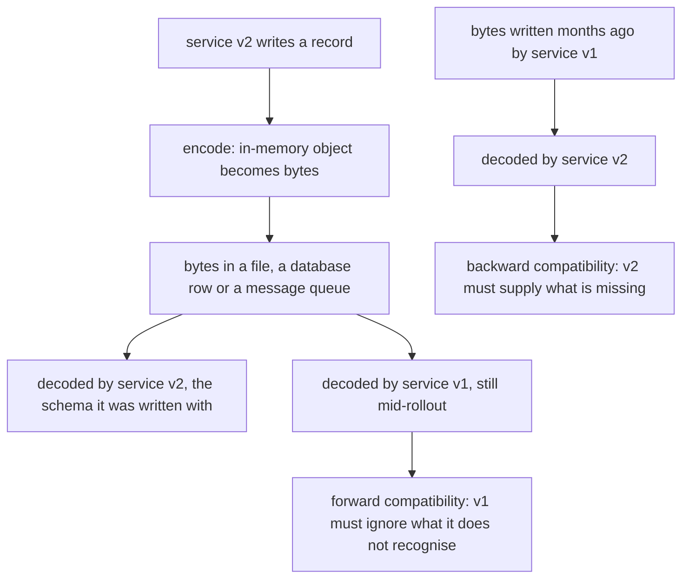
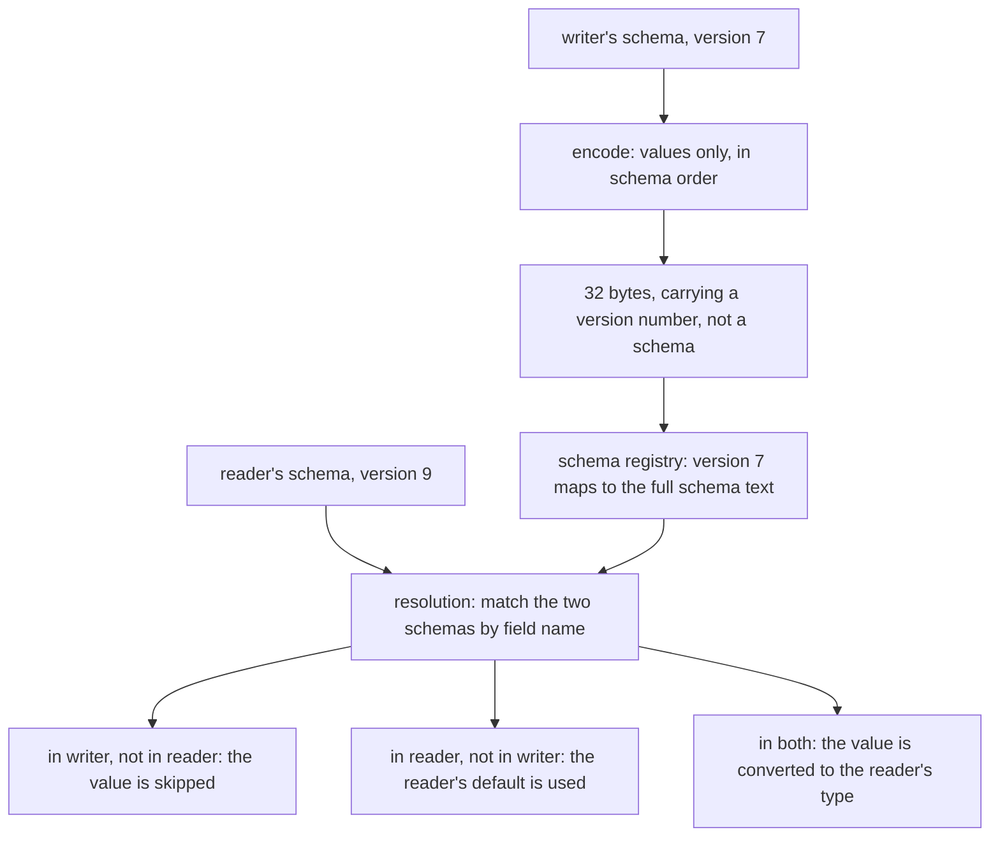
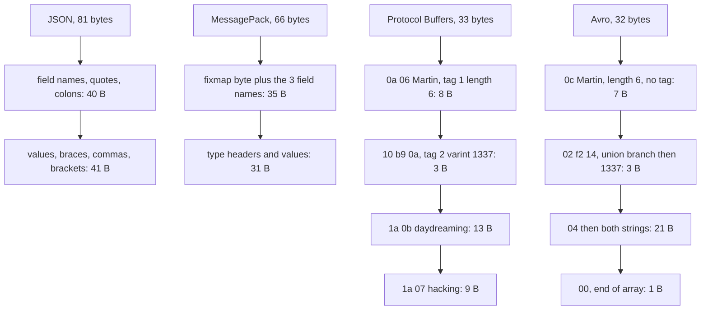
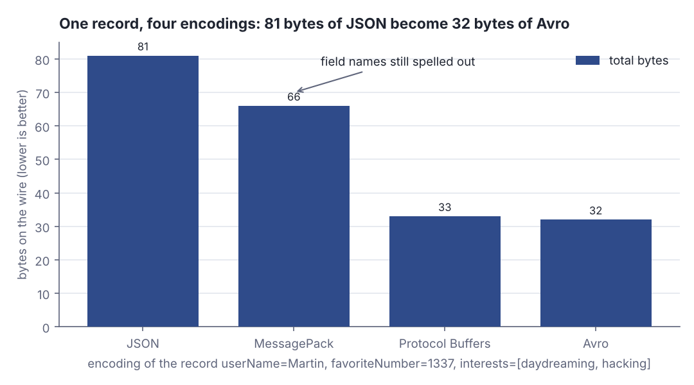
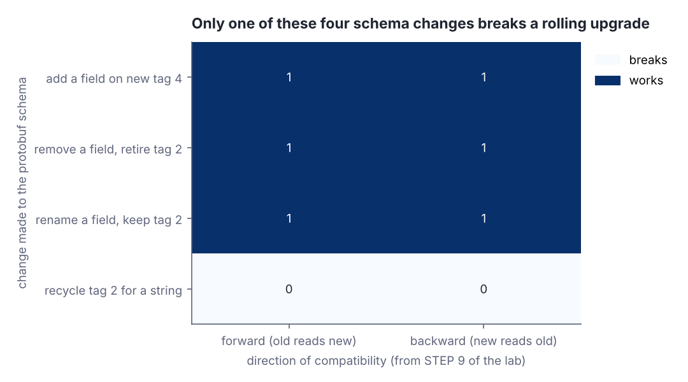

# Encoding formats and schema evolution

> Designing Data-Intensive Applications · Intermediate · ~25 min · rung 7 of 26 · needs: Relational vs document data models (ddia-02)

## Why this matters

Every rolling deploy you have ever run put two versions of your code on the cluster at once, reading each other's bytes; the schema change that looks free in a pull request is the one that fills the error budget at 02:00. This chapter gives you the two words that make that risk reviewable — *backward* and *forward* compatibility — and shows that the encoding you pick decides which schema edits are free and which need a coordinated outage. As the person who now signs off on "we're just adding a field to the event", this is the rung that tells you which of those sentences is true.

## The idea

> Chapter map: Designing Data-Intensive Applications (Kleppmann, 1st ed., 2017), ch. 4 "Encoding and Evolution", first half — "Formats for Encoding Data" and its sub-sections in the book's order: §4.1 "Language-Specific Formats", §4.2 "JSON, XML, and Binary Variants", §4.3 "Thrift and Protocol Buffers", §4.4 "Avro", §4.5 "The Merits of Schemas", preceded by the chapter's opening on compatibility (§4.0). The § numbers are positional — DDIA names these sections but does not number them. https://dataintensive.net/

In memory, data lives in objects, structs, lists and trees held together by pointers that mean nothing to another process; on disk or on a wire it must be a self-contained byte sequence. One way is **encoding**, the other **decoding**; the book avoids "serialization" because transactions already own that word (Kleppmann, DDIA ch. 4, chapter opening).

### §4.0 The chapter's premise: two directions of compatibility

Code and data do not change at the same instant. In a **rolling upgrade** you deploy a few nodes at a time, so old and new code — and old and new data — coexist. That forces two separate properties:

- **Backward compatibility** — newer code reads data written by older code. Usually easy: you know the old format.
- **Forward compatibility** — older code reads data written by newer code. Harder: the old code must ignore additions made by a version that did not exist when it was written (Kleppmann, DDIA ch. 4, "Formats for Encoding Data").



*Figure 1: during a rolling upgrade both directions are live at once. Source: drawn from Kleppmann, DDIA ch. 4, "Formats for Encoding Data".*

### §4.1 Language-Specific Formats

Most languages ship a built-in encoder: `java.io.Serializable`, Ruby's `Marshal`, Python's `pickle`, Kryo on the JVM. One line restores an object graph — and the book gives four reasons not to use one beyond the process. They **tie the data to one language**. **Decoding instantiates arbitrary classes**, so anything that can send you bytes can often make your process run code — the Java deserialization RCE hole. **Versioning is an afterthought**; **efficiency is poor**. Use them only for transient purposes (DDIA ch. 4, "Language-Specific Formats").

### §4.2 JSON, XML, and Binary Variants

JSON, XML and CSV are the standardised, human-readable, cross-language answer; agreement matters more than elegance. The flaws are real:

- **Numbers are ambiguous.** XML and CSV cannot tell a number from a string of digits. JSON separates strings from numbers but not integers from floats, and says nothing about precision: past 2⁵³ a schemaless parser puts the value in an IEEE 754 double — which is why Twitter's API, says the book, returns each tweet ID twice, as a number and as a decimal string.
- **No binary strings.** JSON and XML carry text, so binary goes through Base64 and grows by a third.
- **Schemas are optional and complicated.** XML Schema and JSON Schema are powerful but awkward; many tools skip them, so the encoding rules end up hardcoded in the application.

```scala
// file: Ex1.scala
@main def ex1(): Unit =
  val id = 9007199254740993L              // 2^53 + 1, the shape of a tweet ID
  val roundTripped = id.toDouble.toLong   // what a JSON parser with no schema does
  println(s"written : $id")
  println(s"read    : $roundTripped")
  println(s"lost    : ${id - roundTripped}")
  val raw = Array[Byte](0, 1, -1, 16)
  val b64 = java.util.Base64.getEncoder.encodeToString(raw)
  println(s"4 raw bytes -> JSON must send Base64 '$b64' = ${b64.length} characters")
```

```text
written : 9007199254740993
read    : 9007199254740992
lost    : 1
4 raw bytes -> JSON must send Base64 'AAH/EA==' = 8 characters
```

The integer comes back off by one, silently, and four raw bytes cost eight characters. Neither is a bad implementation; both follow from a data model with no schema to say "this is a 64-bit integer" or "these are bytes".

**Binary variants** — MessagePack, BSON, UBJSON, Smile; WBXML and Fast Infoset for XML — widen the datatypes but keep the JSON data model, whose named fields every record still spells out. The lab gets the book's record to 66 bytes in MessagePack against JSON's 81: a marginal saving paid for in readability, which is why the book doubts it is worth it (DDIA ch. 4, "Binary encoding", Figure 4-1).

### §4.3 Thrift and Protocol Buffers

Thrift (Facebook) and Protocol Buffers (Google), both open-sourced in 2007–08, **require a schema** in an interface definition language, from which a code generator produces classes. The book's running record is the one the lab uses:

```text
{ "userName": "Martin", "favoriteNumber": 1337, "interests": ["daydreaming", "hacking"] }
```

The encoded bytes contain no field names. Each field is preceded by a **key byte** carrying its **tag number** from the schema plus a type annotation, then a length or the value. Thrift's BinaryProtocol gets this record to 59 bytes, CompactProtocol to 34 by packing tag and type into one byte and using varints, Protocol Buffers to 33 (Kleppmann, DDIA ch. 4, "Thrift and Protocol Buffers", Figures 4-2 to 4-4).

```scala
// file: Ex2.scala
@main def ex2(): Unit =
  def varint(n: Long): List[Int] =
    if n < 0x80 then List(n.toInt) else ((n & 0x7f) | 0x80).toInt :: varint(n >>> 7)
  def hex(xs: List[Int]): String = xs.map(b => f"$b%02x").mkString(" ")
  println(s"key byte for tag 2, wire type 0 : ${hex(List((2 << 3) | 0))}")
  println(s"1337 as a varint                : ${hex(varint(1337))}")
  val martin = ((1 << 3) | 2) :: 6 :: "Martin".map(_.toInt).toList
  println(s"tag 1, length 6, 'Martin'       : ${hex(martin)}")
  println(s"total for those two fields      : ${martin.size + 1 + varint(1337).size} bytes")
```

```text
key byte for tag 2, wire type 0 : 10
1337 as a varint                : b9 0a
tag 1, length 6, 'Martin'       : 0a 06 4d 61 72 74 69 6e
total for those two fields      : 11 bytes
```

The key byte is `tag << 3 | wire type`: tag 2, wire type 0 is `0x10`; tag 1, wire type 2 is `0x0a`. Eleven bytes carry what JSON spells out in 41. Evolution follows from this layout:

- **Field names are free to change**, because the data never refers to them; **tag numbers are not** — the tag is the field's identity.
- **Adding a field** means a new tag number. Old code meets a tag it has never heard of, reads the type annotation in the key byte to learn how many bytes to skip, and skips them — forward compatibility by construction.
- For **backward compatibility**, a field added after the first release must be optional or carry a default, or new code rejects every record written before it existed — you can never add a required field.
- **Removing a field** works only for optional fields, and **its tag number may never be reused**, because old data still carries it. Protocol Buffers' `reserved` declaration makes the compiler refuse a later reuse (Protocol Buffers Language Guide (proto 3), "Updating A Message Type" and "Reserved Fields").
- **Changing a datatype** risks silent truncation: widening a 32-bit integer to 64 bits is fine for new code reading old data; old code reading new data truncates whatever no longer fits.

Kleppmann put the rule in one line five years earlier:

> "You can rename fields, because field names don’t exist in the binary serialization, but you can never change a tag number."
> — Martin Kleppmann, *Schema evolution in Avro, Protocol Buffers and Thrift*, 5 December 2012, https://martin.kleppmann.com/2012/12/05/schema-evolution-in-avro-protocol-buffers-thrift.html


### §4.4 Avro

Avro began in 2009 as a Hadoop sub-project because Thrift did not fit. It has two schema languages — Avro IDL for humans, a JSON one for machines — and an encoding of only values:

```scala
// file: Ex3.scala
@main def ex3(): Unit =
  val b = Array(0x0c, 0x4d, 0x61, 0x72, 0x74, 0x69, 0x6e, 0x02, 0xf2, 0x14)
  def zigzag(n: Long): Long = (n >>> 1) ^ -(n & 1)
  val len = zigzag(b(0)).toInt
  val name = b.slice(1, 1 + len).map(_.toChar).mkString
  val branch = zigzag(b(7))
  val number = zigzag((b(8) & 0x7f) | (b(9) << 7))
  println(s"first value 0x0c -> length $len, so userName = '$name'")
  println(s"next byte 0x02   -> union branch $branch (1 = long, not null)")
  println(s"varint f2 14     -> favoriteNumber = $number")
  println("no byte in there names a field: the schema does")
```

```text
first value 0x0c -> length 6, so userName = 'Martin'
next byte 0x02   -> union branch 1 (1 = long, not null)
varint f2 14     -> favoriteNumber = 1337
no byte in there names a field: the schema does
```

No tags, no type annotations — strings are length-prefixed, integers are zigzag varints, fields follow in schema order. Hence 32 bytes, the most compact of the four, and bytes undecodable without the schema that wrote them (DDIA ch. 4, "Avro", Figure 4-5).

What keeps that workable is that the **writer's schema** and the **reader's schema** need not be the same, only compatible. The library reads both and resolves them field by field **by name**: a field only the writer has is skipped, a field only the reader has is filled from the reader's declared default. Hence Avro's rule — you may only add or remove a field that has a default. Renaming, and adding a branch to a union, are backward but not forward compatible unless the reader declares an alias.

The 2012 post names it — the decoder is handed both schemas and

> "it uses resolution rules to translate data from the writer schema into the reader schema"
> — Martin Kleppmann, *Schema evolution in Avro, Protocol Buffers and Thrift*, 5 December 2012, https://martin.kleppmann.com/2012/12/05/schema-evolution-in-avro-protocol-buffers-thrift.html

— which is why Avro needs no tags, and cannot decode a byte without the writer's schema.



*Figure 2: Avro's schema resolution, and the question it creates — how the reader obtains the writer's schema. Source: drawn from Kleppmann, DDIA ch. 4, "Avro" → "The writer's schema and the reader's schema".*

The book gives three answers, one per context: an **object container file** writes the schema once at the start; **individual database records** carry a version number resolved against a **schema registry**; a **network connection** negotiates the version at setup, as Avro RPC does.

The payoff for dropping tags is **dynamically generated schemas**: because fields match by name, an Avro schema can be generated straight from a relational schema and regenerated whenever a column changes. With Thrift or Protocol Buffers somebody hand-maintains a tag per column, forever. *Beyond the book:* hence Avro's fit with Confluent Schema Registry — each Kafka message carries a magic byte plus the writer's schema ID.

### §4.5 The Merits of Schemas

The idea is older than it looks: ASN.1 (1984) is a schema language with tag numbers much like Thrift's, and its DER encoding is what X.509 certificates are made of. Against "schemaless" JSON, the book says a schema-based binary encoding is **much more compact** (no field names); the schema is **documentation that cannot go stale** (decoding requires it); a **database of schemas** lets you check both compatibilities *before* deployment; and code generation gives **compile-time type checking**. Schema evolution buys the flexibility of a schema-on-read JSON database with better guarantees and tooling (Kleppmann, DDIA ch. 4, "The Merits of Schemas").

## Lab

**The question:** how many bytes does the book's record cost in each of the four encodings, and which edits to a Protocol Buffers schema survive a rolling upgrade in each direction — proved by decoding, not by argument?

### Step 1 — what to expect before you run

One Rust program encodes `{"userName": "Martin", "favoriteNumber": 1337, "interests": ["daydreaming", "hacking"]}` four ways: compact JSON via `serde_json`, MessagePack and Avro by hand (both are a few lines of length prefixes and varints), and Protocol Buffers via a `#[derive(prost::Message)]` struct with tags 1, 2 and 3 — no `protoc` and no `.proto` file needed, because the tags live in the Rust attributes. Expect JSON largest, MessagePack a little smaller, and the two schema-based encodings about half of MessagePack. Then it declares four variants of the schema — a field added on tag 4, a field removed with tag 2 retired, a field renamed on the same tag 2, and tag 2 recycled for a string — and decodes bytes across every pair. Expect the first three to survive in both directions and the fourth to fail in both.

### Step 2 — the program

Save as `src/main.rs` in a fresh `cargo new` project, `cargo add prost serde --features derive`, `cargo add serde_json`, then `cargo run --release`.

```rust
// file: main.rs
// deps: prost@0.13, serde@1.0+derive, serde_json@1.0
use prost::Message;
use serde::Serialize;

// ---- the record as a JSON document (field names exactly as the book writes them) ----
#[derive(Serialize)]
struct PersonJson {
    #[serde(rename = "userName")]
    user_name: String,
    #[serde(rename = "favoriteNumber")]
    favorite_number: i64,
    interests: Vec<String>,
}

// ---- the same record as Protocol Buffers: v1, the schema everyone starts with ----
#[derive(Clone, PartialEq, prost::Message)]
struct PersonV1 {
    #[prost(string, tag = "1")]
    user_name: String,
    #[prost(int64, tag = "2")]
    favorite_number: i64,
    #[prost(string, repeated, tag = "3")]
    interests: Vec<String>,
}

// ---- v2: a field ADDED on a brand new tag 4 ----
#[derive(Clone, PartialEq, prost::Message)]
struct PersonV2 {
    #[prost(string, tag = "1")]
    user_name: String,
    #[prost(int64, tag = "2")]
    favorite_number: i64,
    #[prost(string, repeated, tag = "3")]
    interests: Vec<String>,
    #[prost(string, optional, tag = "4")]
    photo_url: Option<String>,
}

// ---- v3: a field REMOVED; tag 2 is retired and never reused ----
#[derive(Clone, PartialEq, prost::Message)]
struct PersonV3 {
    #[prost(string, tag = "1")]
    user_name: String,
    #[prost(string, repeated, tag = "3")]
    interests: Vec<String>,
}

// ---- v4: a field RENAMED, tag 2 kept ----
#[derive(Clone, PartialEq, prost::Message)]
struct PersonV4 {
    #[prost(string, tag = "1")]
    user_name: String,
    #[prost(int64, tag = "2")]
    lucky_number: i64,
    #[prost(string, repeated, tag = "3")]
    interests: Vec<String>,
}

// ---- vBad: tag 2 RECYCLED for a string. This is the change the book forbids. ----
#[derive(Clone, PartialEq, prost::Message)]
struct PersonBad {
    #[prost(string, tag = "1")]
    user_name: String,
    #[prost(string, tag = "2")]
    nickname: String,
    #[prost(string, repeated, tag = "3")]
    interests: Vec<String>,
}

fn hex(b: &[u8]) -> String {
    b.iter().map(|x| format!("{:02x}", x)).collect::<Vec<_>>().join(" ")
}

// ---- MessagePack, hand-written: the same key/value pairs, binary framing ----
fn mp_str(o: &mut Vec<u8>, s: &str) {
    o.push(0xa0 | s.len() as u8); // fixstr header: 101xxxxx, length in the low 5 bits
    o.extend_from_slice(s.as_bytes());
}
fn msgpack(p: &PersonJson) -> Vec<u8> {
    let mut o = Vec::new();
    o.push(0x80 | 3); // fixmap with 3 key/value pairs
    mp_str(&mut o, "userName");
    mp_str(&mut o, &p.user_name);
    mp_str(&mut o, "favoriteNumber");
    o.push(0xcd); // uint16 marker
    o.extend_from_slice(&(p.favorite_number as u16).to_be_bytes());
    mp_str(&mut o, "interests");
    o.push(0x90 | p.interests.len() as u8); // fixarray
    for i in &p.interests {
        mp_str(&mut o, i);
    }
    o
}

// ---- Avro binary, hand-written: no tags, no field names, schema order only ----
fn varint(mut n: u64, o: &mut Vec<u8>) {
    while n >= 0x80 {
        o.push((n as u8 & 0x7f) | 0x80);
        n >>= 7;
    }
    o.push(n as u8);
}
fn zigzag(n: i64, o: &mut Vec<u8>) {
    varint(((n << 1) ^ (n >> 63)) as u64, o);
}
fn avro_str(o: &mut Vec<u8>, s: &str) {
    zigzag(s.len() as i64, o);
    o.extend_from_slice(s.as_bytes());
}
fn avro(p: &PersonJson) -> Vec<u8> {
    let mut o = Vec::new();
    avro_str(&mut o, &p.user_name); // field 1 of the writer's schema
    zigzag(1, &mut o); // union{null,long}: branch index 1 = long
    zigzag(p.favorite_number, &mut o);
    zigzag(p.interests.len() as i64, &mut o); // array block: 2 items
    for i in &p.interests {
        avro_str(&mut o, i);
    }
    zigzag(0, &mut o); // block count 0 = end of array
    o
}

fn main() {
    let rec = PersonJson {
        user_name: "Martin".to_string(),
        favorite_number: 1337,
        interests: vec!["daydreaming".to_string(), "hacking".to_string()],
    };
    let v1 = PersonV1 {
        user_name: "Martin".to_string(),
        favorite_number: 1337,
        interests: vec!["daydreaming".to_string(), "hacking".to_string()],
    };

    // ---------- STEP 1: JSON ----------
    println!("== STEP 1: JSON, no schema, field names on the wire ==");
    let json = serde_json::to_string(&rec).unwrap();
    println!("  text  : {}", json);
    println!("  bytes : {}", json.len());
    let names: usize = ["userName", "favoriteNumber", "interests"].iter().map(|s| s.len() + 3).sum();
    println!("  of which field names + quotes + colon: {} bytes", names);

    // ---------- STEP 2: MessagePack ----------
    println!("\n== STEP 2: MessagePack, binary JSON, still carries the field names ==");
    let mp = msgpack(&rec);
    println!("  hex   : {}", hex(&mp));
    println!("  bytes : {}", mp.len());
    let mp_names: usize = 1 + ["userName", "favoriteNumber", "interests"].iter().map(|s| s.len() + 1).sum::<usize>();
    println!("  fixmap byte + the 3 field names with their 1-byte headers: {} bytes", mp_names);
    println!("  everything else (type headers and values)               : {} bytes", mp.len() - mp_names);

    // ---------- STEP 3: Protocol Buffers ----------
    println!("\n== STEP 3: Protocol Buffers, field tags instead of names ==");
    let pb = v1.encode_to_vec();
    println!("  hex   : {}", hex(&pb));
    println!("  bytes : {}", pb.len());
    println!("  field | key byte | meaning                       | payload");
    println!("      1 | {:02x}       | tag 1, wire type 2 (bytes)    | {} 'Martin'", pb[0], hex(&pb[1..2]));
    println!("      2 | {:02x}       | tag 2, wire type 0 (varint)   | {} = 1337", pb[8], hex(&pb[9..11]));
    println!("      3 | {:02x}       | tag 3, wire type 2 (bytes)    | {} 'daydreaming'", pb[11], hex(&pb[12..13]));
    println!("      3 | {:02x}       | tag 3 again, repeated field   | {} 'hacking'", pb[24], hex(&pb[25..26]));

    // ---------- STEP 4: Avro ----------
    println!("\n== STEP 4: Avro, no tags at all; the schema supplies the order ==");
    let av = avro(&rec);
    println!("  hex   : {}", hex(&av));
    println!("  bytes : {}", av.len());
    println!("  writer's schema: record Person {{ string userName; union{{null,long}} favoriteNumber; array<string> interests }}");
    println!("  segment            | means                  | bytes");
    println!("  0c 'Martin'        | userName, length 6     | {:5}", 1 + 6);
    println!("  02                 | union branch 1 = long  | {:5}", 1);
    println!("  f2 14              | 1337, zigzag varint    | {:5}", 2);
    println!("  04                 | array block of 2 items | {:5}", 1);
    println!("  16 'daydreaming'   | item 1, length 11      | {:5}", 1 + 11);
    println!("  0e 'hacking'       | item 2, length 7       | {:5}", 1 + 7);
    println!("  00                 | block count 0 = end    | {:5}", 1);

    println!("\n== STEP 5: the four encodings side by side ==");
    println!("  format           | bytes | field names on the wire? | needs the schema to decode?");
    println!("  JSON             | {:5} | yes                      | no", json.len());
    println!("  MessagePack      | {:5} | yes                      | no", mp.len());
    println!("  Protocol Buffers | {:5} | no, tag numbers          | yes (tags + types)", pb.len());
    println!("  Avro             | {:5} | no, nothing              | yes (the writer's schema)", av.len());

    // ---------- STEP 6: forward compatibility ----------
    println!("\n== STEP 6: FORWARD compatibility — v1 code reads data written by v2 ==");
    let v2 = PersonV2 {
        user_name: "Martin".to_string(),
        favorite_number: 1337,
        interests: vec!["daydreaming".to_string(), "hacking".to_string()],
        photo_url: Some("cat.png".to_string()),
    };
    let pb2 = v2.encode_to_vec();
    println!("  v2 bytes ({}): {}", pb2.len(), hex(&pb2));
    println!("  the 9 new bytes at the end: {}  = tag 4, length 7, 'cat.png'", hex(&pb2[pb.len()..]));
    match PersonV1::decode(&pb2[..]) {
        Ok(p) => {
            println!("  v1 decode of v2 bytes: OK  userName={} favoriteNumber={} interests={:?}",
                     p.user_name, p.favorite_number, p.interests);
            let round = p.encode_to_vec();
            println!("  v1 re-encodes it as {} bytes (was {}): the unknown tag 4 was dropped", round.len(), pb2.len());
        }
        Err(e) => println!("  v1 decode of v2 bytes: FAILED {}", e),
    }

    // ---------- STEP 7: backward compatibility ----------
    println!("\n== STEP 7: BACKWARD compatibility — new code reads old data ==");
    let d3 = PersonV3::decode(&pb[..]);
    match &d3 {
        Ok(p) => println!("  v3 (tag 2 removed) reads v1 bytes:   OK  userName={} interests={:?}", p.user_name, p.interests),
        Err(e) => println!("  v3 reads v1 bytes: FAILED {}", e),
    }
    let pb3 = PersonV3 { user_name: "Martin".to_string(), interests: vec!["daydreaming".to_string(), "hacking".to_string()] }.encode_to_vec();
    println!("  v3 writes {} bytes: {}", pb3.len(), hex(&pb3));
    let back = PersonV1::decode(&pb3[..]);
    match &back {
        Ok(p) => println!("  v1 reads v3 bytes:                   OK  favoriteNumber={} (the proto3 default, not 'absent')", p.favorite_number),
        Err(e) => println!("  v1 reads v3 bytes: FAILED {}", e),
    }
    let d4 = PersonV4::decode(&pb[..]);
    match &d4 {
        Ok(p) => println!("  v4 (tag 2 renamed) reads v1 bytes:   OK  luckyNumber={} — names are not on the wire", p.lucky_number),
        Err(e) => println!("  v4 reads v1 bytes: FAILED {}", e),
    }

    // ---------- STEP 8: the forbidden change ----------
    println!("\n== STEP 8: the forbidden change — tag 2 recycled for a string ==");
    let bad_read = PersonBad::decode(&pb[..]);
    match &bad_read {
        Ok(p) => println!("  vBad reads v1 bytes: OK nickname={}", p.nickname),
        Err(e) => println!("  vBad reads v1 bytes: FAILED -> {}", e),
    }
    let pbad = PersonBad {
        user_name: "Martin".to_string(),
        nickname: "martinkl".to_string(),
        interests: vec!["daydreaming".to_string(), "hacking".to_string()],
    }.encode_to_vec();
    println!("  vBad writes {} bytes: {}", pbad.len(), hex(&pbad));
    let v1_read_bad = PersonV1::decode(&pbad[..]);
    match &v1_read_bad {
        Ok(p) => println!("  v1 reads vBad bytes: OK favoriteNumber={}", p.favorite_number),
        Err(e) => println!("  v1 reads vBad bytes: FAILED -> {}", e),
    }

    println!("\n== STEP 9: the compatibility matrix this run produced ==");
    println!("  change to the schema              | forward (old reads new) | backward (new reads old)");
    println!("  add a field on a new tag 4        | {:23} | {:23}",
             if PersonV1::decode(&pb2[..]).is_ok() { "works" } else { "breaks" },
             if PersonV2::decode(&pb[..]).is_ok() { "works" } else { "breaks" });
    println!("  remove a field, retire tag 2      | {:23} | {:23}",
             if back.is_ok() { "works" } else { "breaks" },
             if d3.is_ok() { "works" } else { "breaks" });
    println!("  rename a field, keep tag 2        | {:23} | {:23}",
             if PersonV1::decode(&PersonV4 { user_name: "Martin".into(), lucky_number: 1337, interests: vec![] }.encode_to_vec()[..]).is_ok() { "works" } else { "breaks" },
             if d4.is_ok() { "works" } else { "breaks" });
    println!("  recycle tag 2 for another type    | {:23} | {:23}",
             if v1_read_bad.is_ok() { "works" } else { "breaks" },
             if bad_read.is_ok() { "works" } else { "breaks" });
}
```

### Step 3 — the real output

Produced by `python3 dojo/engine/run_lab.py 2026-11-20-1`:

```text
== STEP 1: JSON, no schema, field names on the wire ==
  text  : {"userName":"Martin","favoriteNumber":1337,"interests":["daydreaming","hacking"]}
  bytes : 81
  of which field names + quotes + colon: 40 bytes

== STEP 2: MessagePack, binary JSON, still carries the field names ==
  hex   : 83 a8 75 73 65 72 4e 61 6d 65 a6 4d 61 72 74 69 6e ae 66 61 76 6f 72 69 74 65 4e 75 6d 62 65 72 cd 05 39 a9 69 6e 74 65 72 65 73 74 73 92 ab 64 61 79 64 72 65 61 6d 69 6e 67 a7 68 61 63 6b 69 6e 67
  bytes : 66
  fixmap byte + the 3 field names with their 1-byte headers: 35 bytes
  everything else (type headers and values)               : 31 bytes

== STEP 3: Protocol Buffers, field tags instead of names ==
  hex   : 0a 06 4d 61 72 74 69 6e 10 b9 0a 1a 0b 64 61 79 64 72 65 61 6d 69 6e 67 1a 07 68 61 63 6b 69 6e 67
  bytes : 33
  field | key byte | meaning                       | payload
      1 | 0a       | tag 1, wire type 2 (bytes)    | 06 'Martin'
      2 | 10       | tag 2, wire type 0 (varint)   | b9 0a = 1337
      3 | 1a       | tag 3, wire type 2 (bytes)    | 0b 'daydreaming'
      3 | 1a       | tag 3 again, repeated field   | 07 'hacking'

== STEP 4: Avro, no tags at all; the schema supplies the order ==
  hex   : 0c 4d 61 72 74 69 6e 02 f2 14 04 16 64 61 79 64 72 65 61 6d 69 6e 67 0e 68 61 63 6b 69 6e 67 00
  bytes : 32
  writer's schema: record Person { string userName; union{null,long} favoriteNumber; array<string> interests }
  segment            | means                  | bytes
  0c 'Martin'        | userName, length 6     |     7
  02                 | union branch 1 = long  |     1
  f2 14              | 1337, zigzag varint    |     2
  04                 | array block of 2 items |     1
  16 'daydreaming'   | item 1, length 11      |    12
  0e 'hacking'       | item 2, length 7       |     8
  00                 | block count 0 = end    |     1

== STEP 5: the four encodings side by side ==
  format           | bytes | field names on the wire? | needs the schema to decode?
  JSON             |    81 | yes                      | no
  MessagePack      |    66 | yes                      | no
  Protocol Buffers |    33 | no, tag numbers          | yes (tags + types)
  Avro             |    32 | no, nothing              | yes (the writer's schema)

== STEP 6: FORWARD compatibility — v1 code reads data written by v2 ==
  v2 bytes (42): 0a 06 4d 61 72 74 69 6e 10 b9 0a 1a 0b 64 61 79 64 72 65 61 6d 69 6e 67 1a 07 68 61 63 6b 69 6e 67 22 07 63 61 74 2e 70 6e 67
  the 9 new bytes at the end: 22 07 63 61 74 2e 70 6e 67  = tag 4, length 7, 'cat.png'
  v1 decode of v2 bytes: OK  userName=Martin favoriteNumber=1337 interests=["daydreaming", "hacking"]
  v1 re-encodes it as 33 bytes (was 42): the unknown tag 4 was dropped

== STEP 7: BACKWARD compatibility — new code reads old data ==
  v3 (tag 2 removed) reads v1 bytes:   OK  userName=Martin interests=["daydreaming", "hacking"]
  v3 writes 30 bytes: 0a 06 4d 61 72 74 69 6e 1a 0b 64 61 79 64 72 65 61 6d 69 6e 67 1a 07 68 61 63 6b 69 6e 67
  v1 reads v3 bytes:                   OK  favoriteNumber=0 (the proto3 default, not 'absent')
  v4 (tag 2 renamed) reads v1 bytes:   OK  luckyNumber=1337 — names are not on the wire

== STEP 8: the forbidden change — tag 2 recycled for a string ==
  vBad reads v1 bytes: FAILED -> failed to decode Protobuf message: PersonBad.nickname: invalid wire type: Varint (expected LengthDelimited)
  vBad writes 40 bytes: 0a 06 4d 61 72 74 69 6e 12 08 6d 61 72 74 69 6e 6b 6c 1a 0b 64 61 79 64 72 65 61 6d 69 6e 67 1a 07 68 61 63 6b 69 6e 67
  v1 reads vBad bytes: FAILED -> failed to decode Protobuf message: PersonV1.favorite_number: invalid wire type: LengthDelimited (expected Varint)

== STEP 9: the compatibility matrix this run produced ==
  change to the schema              | forward (old reads new) | backward (new reads old)
  add a field on a new tag 4        | works                   | works
  remove a field, retire tag 2      | works                   | works
  rename a field, keep tag 2        | works                   | works
  recycle tag 2 for another type    | breaks                  | breaks
```

### Reading the output

**STEPS 1–4 — where the bytes go.** The `bytes` column is a count of octets on the wire; lower is better, and the only thing that changes between the four rows is how much framing each format needs. JSON spends 40 of its 81 bytes on field names, quotes and colons — count them: `"userName":` is 8 + 2 quotes + 1 colon = 11, `"favoriteNumber":` is 14 + 3 = 17, `"interests":` is 9 + 3 = 12, and 11 + 17 + 12 = 40, almost exactly half the document. MessagePack replaces the punctuation with one-byte headers but keeps the three names, so 35 of its 66 bytes are still the map byte plus names. Protocol Buffers replaces each name with a single key byte: `0a`, `10`, `1a`, `1a` — four bytes doing the work of forty. Avro drops even those, and its seven segments add up as 7 + 1 + 2 + 1 + 12 + 8 + 1 = 32.

**Verdict:** the compression is not clever compression; it is the field names leaving the wire, which is exactly what having a schema buys.



*Figure 3: the same record as four byte strips, with the tag bytes and length prefixes called out and each strip's total. Adapted from the byte-level diagrams in Kleppmann, "Schema evolution in Avro, Protocol Buffers and Thrift", https://martin.kleppmann.com/2012/12/05/schema-evolution-in-avro-protocol-buffers-thrift.html, and DDIA ch. 4 Figures 4-1 to 4-5; the byte counts are this lab's STEPS 1–4.*



*Figure 4: the totals from STEP 5 of the lab (`python3 dojo/engine/run_lab.py 2026-11-20-1`). Source: generated from this lesson's lab output.*

**STEP 6 — forward compatibility, in bytes.** The v2 encoding is the v1 encoding with nine bytes appended: `22 07` plus `cat.png`. `0x22` is `4 << 3 | 2` — tag 4, wire type 2 — so v1 code, which has never heard of tag 4, reads the wire type, learns that a length follows, reads the length 7, and skips seven bytes. It decodes the three fields it knows and reports no error. The sting is in the next line: re-encoding from v1 produces 33 bytes, not 42, because prost discarded the unknown field rather than preserving it.

**Verdict:** forward compatibility gets you a successful parse, not a safe round trip — a v1 service that reads, modifies and writes back a v2 record silently deletes `photoUrl`.

**STEP 7 — backward compatibility, and the proto3 trap.** v3 (tag 2 removed) reads v1's bytes fine, skipping tag 2 the same way. Going the other way, v3 writes 30 bytes — the v1 33 minus the three bytes of `10 b9 0a` — and v1 reads them, reporting `favoriteNumber=0`. There is no `favoriteNumber` in those bytes at all; 0 is the proto3 default for `int64`. v4, which renamed the field to `luckyNumber` but kept tag 2, reads v1's bytes and prints 1337, because the name was never on the wire in the first place.

| change | forward: old reads new | backward: new reads old | why |
| --- | --- | --- | --- |
| add field on new tag 4 | works | works | unknown tag is skipped; absent tag takes the default |
| remove field, retire tag 2 | works | works | same mechanism, in both directions |
| rename field, keep tag 2 | works | works | names are not encoded; tag 2 is the identity |
| recycle tag 2 for a string | breaks | breaks | the wire type in the key byte no longer matches |

**Verdict:** three of the four edits are free in both directions — but "works" for a removed field means your reader cannot distinguish *absent* from *zero*, which is a correctness problem the parser will never report.



*Figure 5: STEP 9's matrix. Each cell is the result of an actual decode in this run, not a rule of thumb. Source: generated from this lesson's lab output.*

**STEP 8 — the one forbidden edit.** Recycling tag 2 from `int64` to `string` changes the low three bits of the key byte from 0 (varint) to 2 (length-delimited): `10` becomes `12`. Both directions now fail loudly — `invalid wire type: Varint (expected LengthDelimited)` when the new struct meets old bytes, and the mirror image when the old struct meets new bytes. This is why Protocol Buffers has `reserved 2;`: it makes the compiler refuse the edit that produces these errors (Protocol Buffers Language Guide (proto 3), "Reserved Fields").

**Verdict:** a reused tag is the only change here that a parser can catch, and it catches it in production, on whichever side of the rollout touches the other's bytes first.

### Cause → consequence

1. **Cause.** A schema-based binary encoding identifies each field by a small integer tag plus a wire type, and nothing else — no names, no ordering guarantees.
2. **Mechanism.** A decoder that meets an unknown tag can still read its wire type and skip exactly the right number of bytes; a decoder that misses a known tag falls back to the field's default. Both are local decisions needing no coordination with the writer.
3. **Consequence.** Adding, removing and renaming fields are safe in both directions (STEP 9: three rows of "works"), while reusing a tag number for a different type breaks both directions at once (STEP 8), and a parse that "succeeds" can still have dropped a field on re-encode (STEP 6) or invented a zero (STEP 7).
4. **In practice.** For the event schemas you sign off on: new fields always get a fresh tag and a default; retired fields get `reserved`, never a reuse; and treat "it parsed" as a weaker guarantee than "it round-trips". When a consumer reads-modifies-writes, either keep unknown fields (which prost does not, and protobuf-java does) or make that consumer the last one upgraded.

## Self-check

1. A teammate's PR deletes `optional int64 favorite_number = 2;` from a `.proto` and, two sprints later, a different PR adds `optional string nickname = 2;`. Both pass code review and CI. What happens, in which direction, and what one line in the first PR would have prevented it? <details><summary>Answer</summary>Old records on disk and in flight still carry tag 2 encoded as a varint (`10 b9 0a` in the lab). The new code reading them fails with `invalid wire type: Varint (expected LengthDelimited)`, and old code reading records written by the new code fails with the mirror error — STEP 8 shows both. The failure is in both directions, so no deploy order saves you. The first PR should have left `reserved 2;` (and ideally `reserved "favorite_number";`) in the message, which makes `protoc` reject the second PR at compile time (Protocol Buffers Language Guide (proto 3), "Reserved Fields").</details>
2. You have a relational table with 180 columns and a weekly migration that adds or drops a few. Why is Avro a better fit than Protocol Buffers for streaming that table's rows, and what new piece of infrastructure does that choice force on you? <details><summary>Answer</summary>Avro's encoding carries no tag numbers — fields are matched between the writer's and the reader's schema by name — so the schema can be generated mechanically from the table definition every time the table changes. With Protocol Buffers somebody would have to assign and maintain a unique tag number for each of the 180 columns and never reuse a retired one, by hand, forever (Kleppmann, DDIA ch. 4, "Avro" → "Dynamically generated schemas"). The cost is that Avro bytes are undecodable without the exact writer's schema, so you must give the reader a way to find it: the schema at the head of an object container file, a version negotiated at connection setup, or — for individual records — a version number on each record and a schema registry holding the versions.</details>
3. A v1 service reads a record written by v2, changes one field, and writes it back. Every parse succeeds and no error is logged. What has probably gone wrong, and which of the two compatibilities does it violate? <details><summary>Answer</summary>The fields v2 added on tags v1 does not know were skipped on decode and are not present when v1 re-encodes — STEP 6 shows exactly this: 42 bytes in, 33 bytes out, `photoUrl` gone. Strictly speaking forward compatibility held (v1 parsed v2's data without failing); what broke is the round trip, because this implementation does not retain unknown fields. Some implementations, including protobuf-java, do preserve unknown fields for exactly this reason. The practical rule is that a read-modify-write consumer must either preserve unknown fields or be the last component upgraded.</details>

## Sources

- [Designing Data-Intensive Applications (Kleppmann, 1st ed.)](https://dataintensive.net/) — Martin Kleppmann, O'Reilly, 2017 — ch. 4 "Encoding and Evolution", section "Formats for Encoding Data" and its sub-sections "Language-Specific Formats", "JSON, XML, and Binary Variants", "Thrift and Protocol Buffers", "Avro" and "The Merits of Schemas": the whole argument of this lesson, the backward/forward compatibility definitions, the `userName`/`favoriteNumber`/`interests` record, and Figures 4-1 to 4-5 with the byte counts the lab reproduces (accessed 2026-11-20).
- [Schema evolution in Avro, Protocol Buffers and Thrift](https://martin.kleppmann.com/2012/12/05/schema-evolution-in-avro-protocol-buffers-thrift.html) — Martin Kleppmann, 2012-12-05 — the byte-level diagrams of each encoding that Figure 3's byte strips are adapted from; the post is the pre-book version of this chapter's comparison the two verbatim passages quoted in §4.3 and §4.4 above — the tag-number rule and Avro's writer-to-reader resolution (accessed 2026-11-20).
- [Protocol Buffers — Language Guide (proto 3)](https://protobuf.dev/programming-guides/proto3/) — Google — sections "Updating A Message Type" and "Reserved Fields": the rules that a field number must never change, that new fields must be addable without breaking old binaries, and that a deleted field's number is declared `reserved` so it cannot be recycled (accessed 2026-11-20).
- Related in your knowledge base: `15-system-design/grpc_protobuf_schema_design.md` (§3 wire format, §5 versioning) and `06-databases-and-distributed-data/Event-Sourcing-Guide.md` (schema evolution of stored events) cover the same ground from the gRPC and event-store angles.

## Next on this track
Next on Designing Data-Intensive Applications: **Modes of dataflow — databases, services and messages** (rung 8 of 26, Intermediate).
