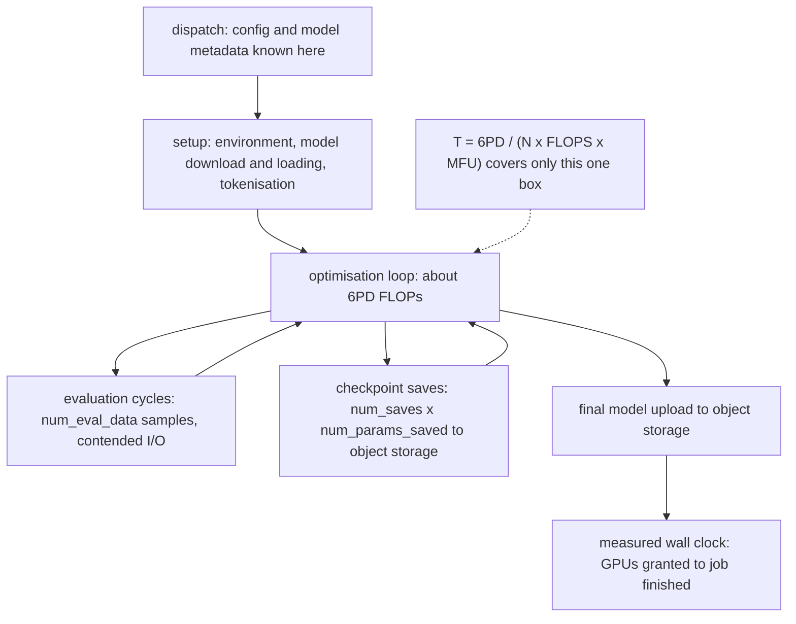
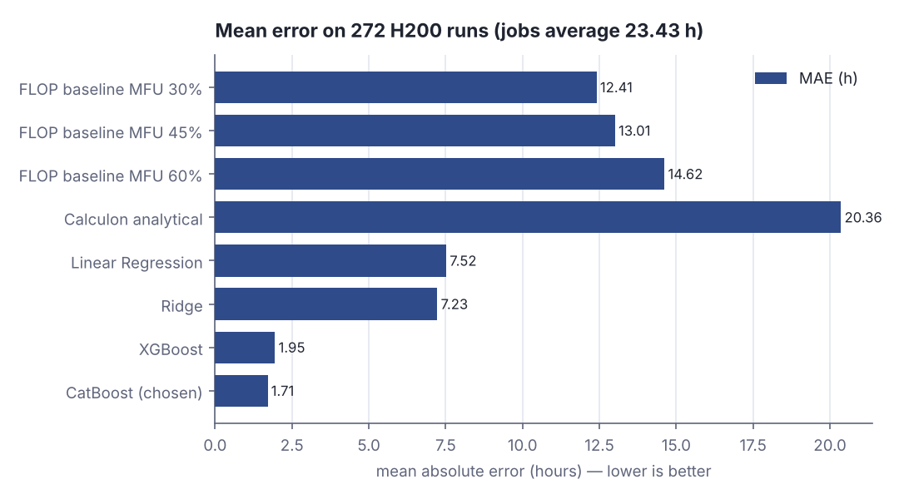
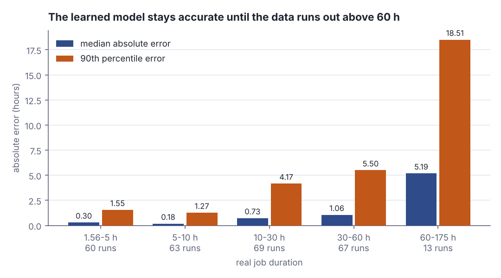
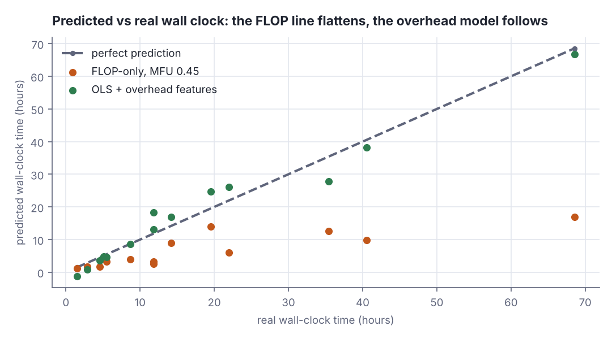

# Why fine-tuning takes longer than the FLOPs say

> Fresh · AI / ML foundations · Beginner · ~25 min · from today's feeds

## Why this matters
Dharma-AI published "Why your fine-tuning job takes longer than the FLOPs say" on the Hugging Face blog on 18 November 2026 — a preview of their paper *Predicting End-to-End Fine-Tuning Time for Generative Language Models*, built on 272 real fine-tuning runs and about 7,382 H200-GPU-hours.
It is the applied sequel to the last two rungs you finished: the problem is a regression, it is scored with exactly the MAE, RMSE and R² you worked through on rung 11, and it is won by exactly the gradient-boosted tree ensembles you met on rung 10 (XGBoost and CatBoost).
As a Product Owner you also get something directly usable: a defensible answer to "when will this job be done", and a clear account of why the arithmetic your engineers quote you is always optimistic.

## The idea
Everyone estimates training time the same way. A dense Transformer forward-and-backward pass costs about six floating-point operations per parameter per token, so a job with `P` parameters over `D` tokens costs about `6PD` FLOPs. Divide by the throughput you actually get — `N` GPUs at peak rate `FLOPS_peak`, times MFU (Model FLOPs Utilization, the fraction of peak the job really achieves) — and you have seconds:

```
T_theoretical = (6 * P * D) / (N_GPU * FLOPS_peak * MFU)
```

That formula is the baseline the post demolishes.

> "The short version: the usual FLOP-based estimate explains little of what we observed (R² = 0.31, MAE 12.41 h)."
> — Dharma-AI, *Why your fine-tuning job takes longer than the FLOPs say*, 18 November 2026, https://huggingface.co/blog/Dharma-AI/predicting-fine-tuning-time

Both numbers are the rung-11 metrics on a real system. **MAE** is the average of `|predicted − actual|` in the target's unit: the estimate is wrong by twelve and a half hours on an average job. **R²** is `1 − SSE/SST` — SSE the sum of squared errors, SST the sum of squared deviations from the target's mean — so 1 is perfect, 0 equals always answering the average duration, negative is worse than that. R² = 0.31 means the formula captures under a third of the variation, on jobs averaging 23.43 h, median 15.29 h (Dharma-AI, 18 November 2026).

The first reason it fails is that MFU is not a constant you know in advance — it is a measurement you get afterwards. Price the same job at three plausible values:

```scala
// file: Flops.scala
@main def flops(): Unit =
  val p = 7e9       // parameters
  val d = 250e6     // training tokens
  val n = 2         // GPUs
  val peak = 989e12 // dense bf16 peak per GPU, FLOP/s (a lab constant, not a measurement)
  for mfu <- List(0.30, 0.45, 0.60) do
    val hours = 6 * p * d / (n * peak * mfu) / 3600
    println(f"MFU $mfu%.2f -> T_theoretical = $hours%5.2f h")
```

```text
MFU 0.30 -> T_theoretical =  4.92 h
MFU 0.45 -> T_theoretical =  3.28 h
MFU 0.60 -> T_theoretical =  2.46 h
```

The same job is 4.92 h or 2.46 h depending on a parameter nobody can pin down beforehand. But MFU is a *multiplier*: changing it rescales every estimate by the same ratio, leaving the ordering and the shape of the predictions untouched. That is why the post's MFU sweep from 0.25 to 0.65 never rescues the baseline.

The deeper reason is that the formula describes the optimisation loop, and a real job is much more than its optimisation loop.



*Figure 1: the formula prices one box; the measured target is the whole chain. Source: mechanism as described in Dharma-AI, 18 November 2026, https://huggingface.co/blog/Dharma-AI/predicting-fine-tuning-time*

> "Before the first step there is environment setup, model download and loading, and tokenization."
> — Dharma-AI, *Why your fine-tuning job takes longer than the FLOPs say*, 18 November 2026, https://huggingface.co/blog/Dharma-AI/predicting-fine-tuning-time

These overheads are driven by configuration, not token count, and on a multi-tenant cluster they compete for network and storage bandwidth. So two jobs with identical nominal compute can differ by hours. Take a 7B LoRA job on 2 GPUs over 250M tokens and change only the evaluation volume:

```scala
// file: Twins.scala
@main def twins(): Unit =
  val compute = 6 * 7e9 * 250e6 / (2 * 989e12 * 0.47) / 3600
  val setup = 0.25 + 0.04 * 7.0
  val ckpt = (4 + 1) * 7.0 * 0.004 * 0.12
  for evalSamples <- List(20000, 90000) do
    val evalH = evalSamples / 1000.0 * 0.09
    val wall = compute + setup + evalH + ckpt
    println(f"eval $evalSamples%6d: compute $compute%5.2f + setup $setup%4.2f" +
            f" + eval $evalH%5.2f + ckpt $ckpt%4.2f = $wall%6.2f h")
  println(f"FLOP estimate for both, at MFU 0.45: " +
          f"${6 * 7e9 * 250e6 / (2 * 989e12 * 0.45) / 3600}%.2f h")
```

```text
eval  20000: compute  3.14 + setup 0.53 + eval  1.80 + ckpt 0.02 =   5.48 h
eval  90000: compute  3.14 + setup 0.53 + eval  8.10 + ckpt 0.02 =  11.78 h
FLOP estimate for both, at MFU 0.45: 3.28 h
```

Same parameters, same tokens, same GPUs — one FLOP estimate of 3.28 h for both — yet one job runs 5.48 h and the other 11.78 h, a 2.15× spread the formula has no variable to express. (These hours come from the lab's simulated cost model below, not from the post's measurements.)

### Turn it into a supervised regression

The authors stop deriving the time and start *learning* it. Input `x` = everything known at dispatch: job configuration and model metadata. Target `y` = wall clock from GPUs granted to job finished, queue time excluded. The features expose the overheads the formula cannot see: `num_eval_data` (samples across all evaluation cycles), `num_saves` and `num_params_saved` (checkpoint I/O volume), per-GPU token volumes. The FLOP estimate at MFU 0.45 goes in as a feature called `baseline_time`, so the model learns corrections *on top of* physics rather than replacing it.

They compare Linear Regression, Ridge, XGBoost and CatBoost under 5-fold stratified cross-validation; CatBoost wins with 24 features:

> "with a mean absolute error of 1.71 h and a median error of 0.51 h"
> — Dharma-AI, *Why your fine-tuning job takes longer than the FLOPs say*, 18 November 2026, https://huggingface.co/blog/Dharma-AI/predicting-fine-tuning-time

| model | MAE (h) | RMSE (h) | R² |
| --- | --- | --- | --- |
| FLOP baseline, MFU 30% | 12.41 | 20.45 | 0.31 |
| FLOP baseline, MFU 45% | 13.01 | 22.38 | 0.18 |
| FLOP baseline, MFU 60% | 14.62 | 24.56 | 0.01 |
| Calculon (analytical model) | 20.36 | 30.40 | −0.51 |
| Linear Regression | 7.52 | 13.52 | 0.69 ± 0.14 |
| Ridge | 7.23 | 12.72 | 0.73 ± 0.09 |
| XGBoost | 1.95 | 4.18 | 0.97 ± 0.01 |
| **CatBoost (chosen)** | **1.71** | **3.52** | **0.98 ± 0.01** |

*All figures: Dharma-AI, 18 November 2026, 272 SFT runs, 5-fold stratified cross-validation, https://huggingface.co/blog/Dharma-AI/predicting-fine-tuning-time*



*Figure 2: Calculon, a purely analytical model, scores worse than predicting the mean; the tree ensembles land inside two hours. Adapted from Dharma-AI, 18 November 2026, https://huggingface.co/blog/Dharma-AI/predicting-fine-tuning-time*

Two details matter. Calculon — the analytical LLM-training model from Isaev et al. at SC '23, extended by the authors to cover LoRA, grouped-query attention, fused attention, bfloat16 and SwiGLU — scores R² = −0.51, *worse than always answering 23.43 h*, its estimates a median 11% of observed wall-clock time (Dharma-AI, 18 November 2026). A better physics model does not fix this; it is not a physics problem. And the ordering 0.69 → 0.73 → 0.97 → 0.98 is the rung-10 story: configuration relates to duration through thresholds and interactions — checkpoint cost jumps with model size, evaluation cost is eval volume × model size — which axis-aligned splits represent and a straight line cannot.

CatBoost's feature importances rank `num_eval_data`, `num_trainable_params`, `batch_eval_size_percent`, `num_all_params`, `num_gpus × batch_train_percent`, with `num_params_saved` close behind (Dharma-AI, 18 November 2026). Read that again: the strongest predictor of how long your fine-tune takes is how much evaluation you asked for.

### Where it stops working

Across the 272 out-of-fold predictions the median absolute error is 0.51 h, 80% land within 2.20 h and 90% within 4.31 h — but that accuracy is not uniform (Dharma-AI, 18 November 2026):

| duration bucket | runs | median abs. error | P90 error |
| --- | --- | --- | --- |
| 1.56–5 h | 60 | 0.30 h | 1.55 h |
| 5–10 h | 63 | 0.18 h | 1.27 h |
| 10–30 h | 69 | 0.73 h | 4.17 h |
| 30–60 h | 67 | 1.06 h | 5.50 h |
| 60–175 h | 13 | 5.19 h | 18.51 h |



*Figure 3: median error stays near an hour up to 60 h, then both median and P90 widen sharply in the bucket holding only 13 runs — data sparsity, not a modelling failure. Adapted from Dharma-AI, 18 November 2026, https://huggingface.co/blog/Dharma-AI/predicting-fine-tuning-time*

The limits are stated on the page. The model is calibrated to one GPU type (H200) and would need retraining to transfer; a mixed pool would need hardware descriptors — throughput, memory, bandwidth, interconnect topology. Feature importance is not causality: a positive contribution from `num_gpus` reflects that big jobs get more GPUs. On a fixed 20% holdout MAE still falls from 1.63 h to 1.50 h as training data grows from 85% to 100% of the partition, so the model is data-limited. The scope is narrow too:

> "SFT only. We did not include other training and alignment strategies such as RLHF, DPO or RLVR."
> — Dharma-AI, *Why your fine-tuning job takes longer than the FLOPs say*, 18 November 2026, https://huggingface.co/blog/Dharma-AI/predicting-fine-tuning-time

## Lab
**The question this lab answers:** can the R² 0.31 → 0.98 jump be reproduced mechanically — that is, does adding overhead features to a FLOP baseline really move a regression from "worse than the mean" to "accurate within hours", and which jobs does the FLOP model miss?

**What is real and what is not.** The evidence for the claim is the post's 272 measured runs over 7,382 H200-GPU-hours. This lab cannot measure anything; it *simulates* fourteen jobs from a cost model whose structure follows the post's reported feature importances — evaluation volume first, trainable parameters second, checkpoint volume close behind — and then fits and scores two predictors on them by hand. Treat the lab's hours as a mechanism demonstration, and the post's table above as the evidence.

### Step 1 — the program

Fourteen jobs, each with the information a scheduler has at dispatch. Wall clock is built as `compute + setup + evaluation + checkpoints`, where compute uses each job's true (unknown-in-advance) MFU. Then two predictors: the FLOP-only baseline with MFU fixed at 0.45, and an ordinary-least-squares linear model that also sees evaluation volume and checkpoint volume. OLS is scored by leave-one-out cross-validation, so every prediction comes from a fit that never saw that job. Metrics are MAE, RMSE and R², written out by hand on `Vector[Double]`.

```scala
// file: Lab.scala

// A fine-tuning job as it is known BEFORE it starts: all of these are in the dispatch request.
case class Job(name: String, pAllB: Double, lora: Boolean, dTokM: Double,
               nGpu: Int, evalSamples: Int, saves: Int, mfuTrue: Double)

val PEAK = 989e12 // lab constant: dense bf16 peak we feed the formula, per GPU

val jobs = Vector(
  Job("j01-1.5B-lora", 1.5, true,  200,  1,   2000,  2, 0.44),
  Job("j02-1.5B-full", 1.5, false, 300,  1,   4000,  3, 0.42),
  Job("j03-3B-lora",   3.0, true,  400,  1,   8000,  3, 0.46),
  Job("j04-3B-full",   3.0, false, 300,  2,  12000,  4, 0.40),
  Job("j05-7B-lora",   7.0, true,  250,  2,  20000,  4, 0.47),
  Job("j06-7B-lora*",  7.0, true,  250,  2,  90000,  4, 0.47),
  Job("j07-7B-full",   7.0, false, 400,  4,  30000,  6, 0.43),
  Job("j08-8B-lora",   8.0, true,  600,  2,  45000,  5, 0.45),
  Job("j09-8B-full",   8.0, false, 800,  4,  60000,  8, 0.41),
  Job("j10-15B-lora",  15.0, true, 500,  2,  30000,  4, 0.49),
  Job("j11-15B-lora",  15.0, true, 900,  4, 120000,  6, 0.50),
  Job("j12-15B-full",  15.0, false,700,  4,  80000,  6, 0.38),
  Job("j13-15B-full",  15.0, false,1200, 4, 150000, 10, 0.40),
  Job("j14-7B-full",   7.0, false, 150,  1,  10000,  3, 0.45)
)

def savedB(j: Job): Double = if j.lora then j.pAllB * 0.004 else j.pAllB
def computeH(j: Job, mfu: Double): Double =
  6.0 * j.pAllB * 1e9 * j.dTokM * 1e6 / (j.nGpu * PEAK * mfu) / 3600.0
def setupH(j: Job): Double = 0.25 + 0.04 * j.pAllB
def evalH(j: Job): Double = j.evalSamples / 1000.0 * 0.09 * (j.pAllB / 7.0)
def ckptH(j: Job): Double = (j.saves + 1) * savedB(j) * 0.12
def trueH(j: Job): Double = computeH(j, j.mfuTrue) + setupH(j) + evalH(j) + ckptH(j)
def baselineH(j: Job): Double = computeH(j, 0.45)

def features(j: Job): Vector[Double] =
  Vector(1.0, baselineH(j), j.evalSamples / 1000.0, (j.saves + 1) * savedB(j))

def solve(a: Vector[Vector[Double]], b: Vector[Double]): Vector[Double] =
  val n = b.size
  val m = Array.tabulate(n, n + 1)((i, k) => if k == n then b(i) else a(i)(k))
  for col <- 0 until n do
    var piv = col
    for r <- col until n do if math.abs(m(r)(col)) > math.abs(m(piv)(col)) then piv = r
    val t = m(col); m(col) = m(piv); m(piv) = t
    val d = m(col)(col)
    for k <- col to n do m(col)(k) /= d
    for r <- 0 until n if r != col do
      val f = m(r)(col)
      if f != 0.0 then for k <- col to n do m(r)(k) -= f * m(col)(k)
  Vector.tabulate(n)(i => m(i)(n))

def ols(rows: Vector[Job]): Vector[Double] =
  val xs = rows.map(features)
  val ys = rows.map(trueH)
  val p = xs.head.size
  val xtx = Vector.tabulate(p, p)((i, k) => xs.map(x => x(i) * x(k)).sum)
  val xty = Vector.tabulate(p)(i => xs.zip(ys).map((x, y) => x(i) * y).sum)
  solve(xtx, xty)

def dot(b: Vector[Double], x: Vector[Double]): Double = b.zip(x).map(_ * _).sum

def mae(y: Vector[Double], p: Vector[Double]): Double =
  y.zip(p).map((a, b) => math.abs(a - b)).sum / y.size
def rmse(y: Vector[Double], p: Vector[Double]): Double =
  math.sqrt(y.zip(p).map((a, b) => (a - b) * (a - b)).sum / y.size)
def r2(y: Vector[Double], p: Vector[Double]): Double =
  val m = y.sum / y.size
  val sse = y.zip(p).map((a, b) => (a - b) * (a - b)).sum
  val sst = y.map(a => (a - m) * (a - m)).sum
  1.0 - sse / sst

@main def lab(): Unit =
  val y = jobs.map(trueH)

  println("=== Step 2: where the wall-clock hours actually go ===")
  println("job              gpus  compute   setup    eval   ckpt   TRUE_h   FLOP_h")
  for j <- jobs do
    println(f"${j.name}%-15s ${j.nGpu}%4d ${computeH(j, j.mfuTrue)}%8.2f ${setupH(j)}%7.2f " +
            f"${evalH(j)}%7.2f ${ckptH(j)}%6.2f ${trueH(j)}%8.2f ${baselineH(j)}%8.2f")
  val tot = jobs.map(trueH).sum
  println(f"totals: compute ${jobs.map(j => computeH(j, j.mfuTrue)).sum}%.2f h, " +
          f"setup ${jobs.map(setupH).sum}%.2f h, eval ${jobs.map(evalH).sum}%.2f h, " +
          f"checkpoint ${jobs.map(ckptH).sum}%.2f h, total $tot%.2f h")
  println(f"compute is ${100 * jobs.map(j => computeH(j, j.mfuTrue)).sum / tot}%.1f%% of wall clock")

  println()
  println("=== Step 3: per-job predictions and errors ===")
  // leave-one-out cross-validation: every OLS prediction is made by a fit that never saw that row
  val oof = jobs.indices.map { i =>
    val b = ols(jobs.patch(i, Nil, 1))
    dot(b, features(jobs(i)))
  }.toVector
  val flop = jobs.map(baselineH)
  println("job              TRUE_h   FLOP_h  FLOP_err   OLS_h  OLS_err")
  for i <- jobs.indices do
    println(f"${jobs(i).name}%-15s ${y(i)}%8.2f ${flop(i)}%8.2f ${flop(i) - y(i)}%9.2f " +
            f"${oof(i)}%7.2f ${oof(i) - y(i)}%8.2f")

  println()
  println("=== Step 4: scoring both models with rung-11 metrics ===")
  println("model                          MAE_h    RMSE_h       R2")
  for mfu <- Vector(0.30, 0.45, 0.60) do
    val p = jobs.map(j => computeH(j, mfu))
    println(f"FLOP-only, MFU $mfu%.2f            ${mae(y, p)}%7.2f ${rmse(y, p)}%9.2f ${r2(y, p)}%8.2f")
  println(f"OLS + overhead features (LOO)  ${mae(y, oof)}%7.2f ${rmse(y, oof)}%9.2f ${r2(y, oof)}%8.2f")

  println()
  println("=== Step 5: the measured numbers from the post, for comparison ===")
  println("model                       MAE_h   RMSE_h      R2   (Dharma-AI, 272 runs, 5-fold CV)")
  val paper = Vector(
    ("FLOP baseline MFU 30%", 12.41, 20.45, 0.31),
    ("FLOP baseline MFU 45%", 13.01, 22.38, 0.18),
    ("FLOP baseline MFU 60%", 14.62, 24.56, 0.01),
    ("Calculon (analytical)", 20.36, 30.40, -0.51),
    ("Linear Regression", 7.52, 13.52, 0.69),
    ("Ridge", 7.23, 12.72, 0.73),
    ("XGBoost", 1.95, 4.18, 0.97),
    ("CatBoost (chosen)", 1.71, 3.52, 0.98)
  )
  for (n, m, r, q) <- paper do println(f"$n%-26s $m%6.2f $r%8.2f $q%7.2f")

  println()
  println("=== Step 6: the twin pair j05 / j06 ===")
  val a = jobs.find(_.name == "j05-7B-lora").get
  val b = jobs.find(_.name == "j06-7B-lora*").get
  for j <- Vector(a, b) do
    println(f"${j.name}%-15s eval samples ${j.evalSamples}%6d  FLOP_h ${baselineH(j)}%6.2f  " +
            f"TRUE_h ${trueH(j)}%7.2f  ratio ${trueH(j) / baselineH(j)}%5.2f")
```

Run it with `python3 dojo/engine/run_lab.py 2026-11-20-2`, or save it and run `scala Lab.scala`.

### Step 2 — where the hours go

```text
=== Step 2: where the wall-clock hours actually go ===
job              gpus  compute   setup    eval   ckpt   TRUE_h   FLOP_h
j01-1.5B-lora      1     1.15    0.31    0.04   0.00     1.50     1.12
j02-1.5B-full      1     1.81    0.31    0.08   0.72     2.91     1.69
j03-3B-lora        1     4.40    0.37    0.31   0.01     5.08     4.49
j04-3B-full        2     1.90    0.37    0.46   1.80     4.53     1.69
j05-7B-lora        2     3.14    0.53    1.80   0.02     5.48     3.28
j06-7B-lora*       2     3.14    0.53    8.10   0.02    11.78     3.28
j07-7B-full        4     2.74    0.53    2.70   5.88    11.85     2.62
j08-8B-lora        2     8.99    0.57    4.63   0.02    14.21     8.99
j09-8B-full        4     6.58    0.57    6.17   8.64    21.96     5.99
j10-15B-lora       2    12.90    0.85    5.79   0.04    19.57    14.04
j11-15B-lora       4    11.38    0.85   23.14   0.05    35.42    12.64
j12-15B-full       4    11.64    0.85   15.43  12.60    40.52     9.83
j13-15B-full       4    18.96    0.85   28.93  19.80    68.54    16.85
j14-7B-full        1     3.93    0.53    0.90   3.36     8.72     3.93
totals: compute 92.63 h, setup 8.02 h, eval 98.47 h, checkpoint 52.95 h, total 252.08 h
compute is 36.7% of wall clock
```

**Verdict:** across these fourteen jobs the optimisation loop — the only thing the FLOP formula prices — accounts for 36.7% of the wall clock. Evaluation alone (98.47 h) costs more than compute (92.63 h).

### Step 3 — per-job predictions

```text
=== Step 3: per-job predictions and errors ===
job              TRUE_h   FLOP_h  FLOP_err   OLS_h  OLS_err
j01-1.5B-lora       1.50     1.12     -0.38   -1.25    -2.75
j02-1.5B-full       2.91     1.69     -1.23    0.90    -2.01
j03-3B-lora         5.08     4.49     -0.59    4.75    -0.33
j04-3B-full         4.53     1.69     -2.84    3.59    -0.93
j05-7B-lora         5.48     3.28     -2.21    4.70    -0.78
j06-7B-lora*       11.78     3.28     -8.51   18.24     6.46
j07-7B-full        11.85     2.62     -9.23   13.09     1.23
j08-8B-lora        14.21     8.99     -5.22   16.84     2.63
j09-8B-full        21.96     5.99    -15.97   26.05     4.09
j10-15B-lora       19.57    14.04     -5.53   24.72     5.15
j11-15B-lora       35.42    12.64    -22.78   27.91    -7.51
j12-15B-full       40.52     9.83    -30.69   38.28    -2.24
j13-15B-full       68.54    16.85    -51.69   66.74    -1.80
j14-7B-full         8.72     3.93     -4.79    8.62    -0.10
```



*Figure 4: every orange point sits below the diagonal and the gap grows with job length — a systematic, size-dependent underestimate. Generated from the Step 3 output of `python3 dojo/engine/run_lab.py 2026-11-20-2`.*

**Verdict:** the FLOP error is never positive. It is a one-sided, growing underestimate: −0.38 h on the shortest job and −51.69 h on the longest, because the missing overheads grow with model size and evaluation volume.

### Step 4 — scoring both models

```text
=== Step 4: scoring both models with rung-11 metrics ===
model                          MAE_h    RMSE_h       R2
FLOP-only, MFU 0.30               8.79     14.89     0.32
FLOP-only, MFU 0.45              11.55     18.21    -0.02
FLOP-only, MFU 0.60              13.16     19.97    -0.22
OLS + overhead features (LOO)     2.71      3.50     0.96
```

**Verdict:** sweeping MFU buys a little — 0.30 is the best of the three, exactly as in the post, where 30% was also the best setting — but it cannot cross the gap. Adding three overhead features to the same baseline takes R² from −0.02 to 0.96 and MAE from 11.55 h to 2.71 h.

### Step 5 — the lab beside the measurements

```text
=== Step 5: the measured numbers from the post, for comparison ===
model                       MAE_h   RMSE_h      R2   (Dharma-AI, 272 runs, 5-fold CV)
FLOP baseline MFU 30%       12.41    20.45    0.31
FLOP baseline MFU 45%       13.01    22.38    0.18
FLOP baseline MFU 60%       14.62    24.56    0.01
Calculon (analytical)       20.36    30.40   -0.51
Linear Regression            7.52    13.52    0.69
Ridge                        7.23    12.72    0.73
XGBoost                      1.95     4.18    0.97
CatBoost (chosen)            1.71     3.52    0.98
```

**Verdict:** the shapes agree — a FLOP baseline near R² 0.3 at its best MFU, a learned model near 0.97. The lab's 0.32 and 0.96 are not independent confirmation of the post's 0.31 and 0.98; they show that the mechanism the post describes produces this pattern, which is the most a simulation can do.

### Step 6 — the twin pair

```text
=== Step 6: the twin pair j05 / j06 ===
j05-7B-lora     eval samples  20000  FLOP_h   3.28  TRUE_h    5.48  ratio  1.67
j06-7B-lora*    eval samples  90000  FLOP_h   3.28  TRUE_h   11.78  ratio  3.60
```

**Verdict:** one FLOP estimate, two wall clocks 2.15× apart. The ratio of real to theoretical time is itself a variable — 1.67 for one job, 3.60 for its twin — which is precisely what a single MFU constant assumes away.

### Reading the output

| column | meaning | which direction is better |
| --- | --- | --- |
| `compute` | optimisation loop at the job's true MFU — the only term `6PD` prices | — |
| `setup` | environment, model download and loading, tokenisation, before step 1 | lower |
| `eval` | all evaluation cycles: `num_eval_data` samples through the model | lower |
| `ckpt` | checkpoint saves plus the final upload, in params-written volume | lower |
| `TRUE_h` | the target: wall clock from GPUs granted to job finished | — |
| `FLOP_h` | prediction of `6PD/(N·FLOPS·0.45)`, the baseline | close to `TRUE_h` |
| `OLS_h` | leave-one-out prediction of the model that also sees eval and checkpoint volume | close to `TRUE_h` |
| `*_err` | `prediction − truth`; negative means the model promised a faster job than you got | near 0 |
| `MAE_h` | mean of the absolute errors `abs(prediction − truth)`, in hours | lower |
| `RMSE_h` | square root of the mean squared error; punishes the big misses | lower |
| `R2` | `1 − SSE/SST`; 1 is perfect, 0 equals always predicting the mean, negative is worse | higher |

Trace j06 with digits, since every number in its row is arithmetic:

- **compute** — `6 × 7e9 params × 2.5e8 tokens = 1.05e19` FLOPs. Usable throughput is `2 GPUs × 9.89e14 × 0.47 = 9.2966e14` FLOP/s. So `1.05e19 / 9.2966e14 = 11,294.6 s = 3.1374 h`, printed as **3.14**.
- **setup** — `0.25 + 0.04 × 7.0 = 0.53 h`.
- **eval** — `90,000 / 1,000 × 0.09 × (7/7) = 8.10 h`. This single term is larger than the entire optimisation loop.
- **ckpt** — LoRA saves 0.4% of 7B = 28M params, five times (four checkpoints plus the final upload): `5 × 0.028 × 0.12 = 0.0168 h`, printed **0.02**.
- **TRUE_h** — `3.1374 + 0.53 + 8.10 + 0.0168 = 11.784`, printed **11.78**.
- **FLOP_h** — the same FLOPs at the assumed MFU 0.45: `1.05e19 / (2 × 9.89e14 × 0.45) = 11,796 s = 3.277 h`, printed **3.28**.
- **FLOP_err** — `3.28 − 11.78 = −8.51 h`. The baseline is off by 72% of the job, and no MFU value fixes it: even MFU 1.00 would give 1.47 h, further away, not closer.

**Verdict:** the entire −8.51 h error is one feature the formula does not have — 90,000 evaluation samples. Give a linear model that one column and the same row lands at 18.24 h instead of 3.28 h; it now overshoots, because with only fourteen rows the model has learnt one average cost per 1,000 eval samples and j06 is an outlier in that dimension, which is exactly the nonlinearity a tree ensemble handles and a straight line does not.

One more thing the table shows honestly: `OLS_h` for j01 is **−1.25 h**, a negative duration. A linear model extrapolating below its training range has nothing stopping it. Tree ensembles cannot do this — every leaf is an average of observed durations — which is a second, quieter reason the post's CatBoost beats its Ridge.

Cause → consequence:

1. **Cause.** The `6PD` formula prices the optimisation loop and nothing else, and its one free parameter, MFU, is a multiplier applied uniformly to every job.
2. **Mechanism.** Real wall clock also contains setup, evaluation cycles and checkpoint I/O, all driven by configuration rather than token count, all competing with other tenants for network and storage. In the lab these are 63.3% of total wall clock; in the post they are large enough that the best FLOP baseline still misses by a mean of 12.41 h on jobs averaging 23.43 h (Dharma-AI, 18 November 2026).
3. **Consequence.** The baseline is a one-sided underestimate that grows with job size — −0.38 h on the smallest lab job, −51.69 h on the largest — so R² sits at or below 0.32 whatever MFU you pick. Feed the same baseline into a regression together with evaluation and checkpoint volume and R² goes to 0.96 in the lab, 0.98 with CatBoost on 272 real runs.
4. **What it means in practice.** When your team quotes "about four hours of compute", that is the floor, not the estimate, and the gap is not noise — it is a function of knobs someone chose: evaluation cadence, eval set size, checkpoint frequency. The cheapest schedule win available to you is usually not a bigger GPU allocation but a smaller `num_eval_data`: in the lab, cutting j06's evaluation volume back to j05's turns an 11.78 h job into a 5.48 h one at identical model quality per optimisation step. And if you ever want deadline estimates you can put in a plan, the shape of the solution is boring and buildable — log the configuration you already dispatch, log the wall clock you already measure, fit a tree ensemble, and re-fit it per GPU type.

## Self-check
1. The FLOP baseline is scored at MFU 30%, 45% and 60% and gets R² of 0.31, 0.18 and 0.01 on the post's 272 runs. Why can no value of MFU push it much higher? <details><summary>Answer</summary>MFU enters the formula as a divisor applied identically to every job, so changing it multiplies every prediction by the same constant. It can shift the predictions up or down as a group, but it cannot change their relative ordering or spacing. R² measures how much of the *variation* in wall-clock time the prediction explains, and the variation that is missing — setup, evaluation volume, checkpoint I/O — differs from job to job in ways that have no FLOP term at all. The lab's Step 4 shows the same effect: MFU 0.30 scores R² 0.32, MFU 0.45 scores −0.02, MFU 0.60 scores −0.22, and none of them approaches the 0.96 the model with overhead features reaches.</details>
2. CatBoost's top feature is `num_eval_data`, not parameter count or token count. Explain why, and say what it implies for a job you are planning. <details><summary>Answer</summary>`num_eval_data` is the total number of samples pushed through the model across all evaluation cycles. Evaluation runs outside the optimisation loop that `6PD` prices, it repeats on a cadence set by configuration rather than by token count, and on a shared cluster each cycle contends for I/O — so it adds hours that the compute term cannot express, and it varies hugely between jobs with identical compute. In the lab j05 and j06 are the same model, tokens and GPUs, so both get a FLOP estimate of 3.28 h, but 20,000 versus 90,000 evaluation samples make them 5.48 h and 11.78 h. For planning: the evaluation cadence is a schedule knob at least as powerful as GPU count, and halving it is usually cheaper than doubling the allocation.</details>
3. Linear Regression reaches R² 0.69 on the post's data and CatBoost 0.98, with the lab's OLS at 0.96. What does the lab show about where a linear model breaks? <details><summary>Answer</summary>Two things, both visible in Step 3. First, j01's leave-one-out prediction is −1.25 h — a negative duration — because a straight line fitted mostly on larger jobs extrapolates below its training range with nothing to stop it; a tree ensemble predicts the average of observed durations in a leaf and cannot produce an impossible value. Second, j06 overshoots at 18.24 h against a truth of 11.78 h, because the true evaluation cost in the lab is evaluation volume multiplied by model size, while the linear model has one fixed coefficient per 1,000 eval samples. Interactions and thresholds like that are what axis-aligned splits in a boosted ensemble represent cheaply, which is the gap between 0.69/0.96 and 0.98.</details>

## Sources
- [Why your fine-tuning job takes longer than the FLOPs say](https://huggingface.co/blog/Dharma-AI/predicting-fine-tuning-time) — Dharma-AI (Bruno Duarte, Gabriel Pimenta de Freitas Cardoso, Isis F Carvalho, Breno de Almeida Beleza, Felipe Lima), Hugging Face blog, 18 November 2026 — the whole lesson: the `T = 6PD/(N·FLOPS·MFU)` baseline and its R² 0.31 / MAE 12.41 h, the 272-run H200 dataset over 7,382 GPU-hours, the model comparison table, the CatBoost feature importances, the error-by-duration buckets and the stated limitations; source of all four quoted passages and of Figures 2 and 3 (accessed 2026-11-20).
- Calculon — Isaev et al., SC '23 — the analytical LLM-training model the post extended (LoRA, grouped-query attention, fused attention, bfloat16, SwiGLU) and benchmarked at R² −0.51; cited here only as reported in the post above, not read independently (accessed 2026-11-20 via that post).

## Next on this track
Fresh lessons sit outside the ladder; next on AI / ML foundations: **From perceptron to multilayer network** (rung 12 of 38, Beginner).
