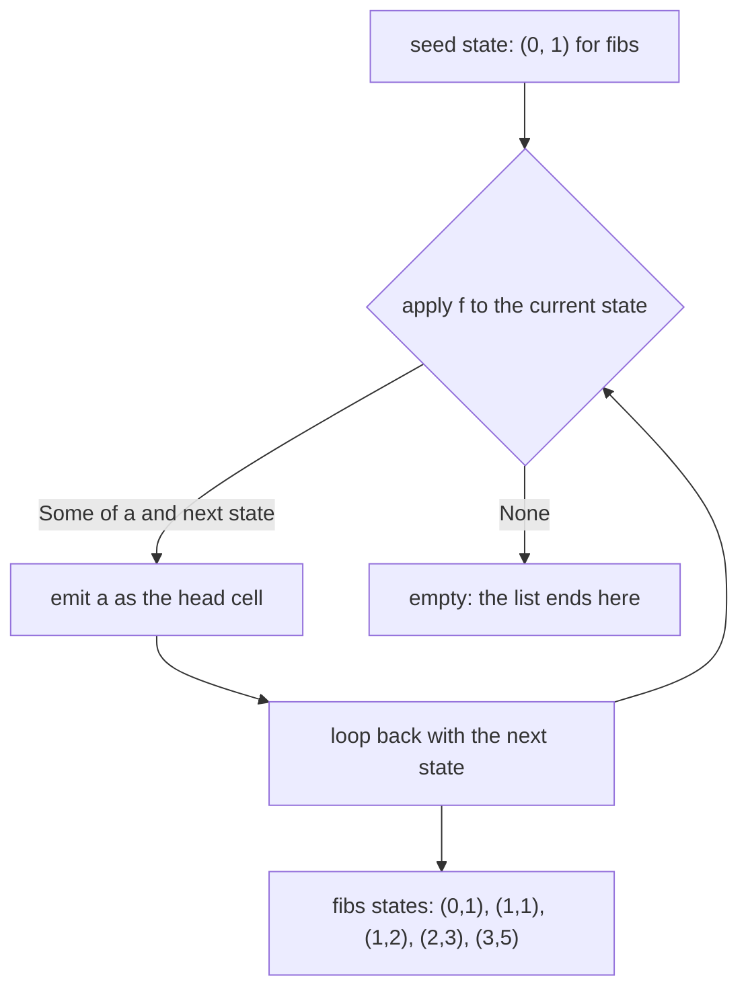
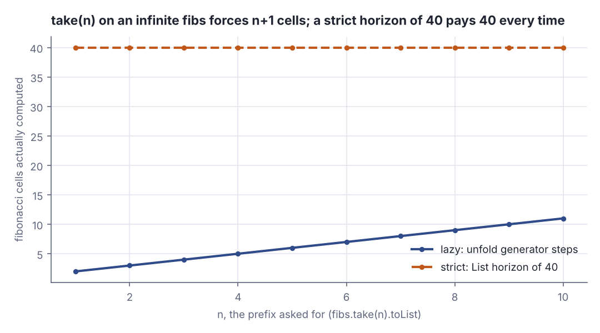
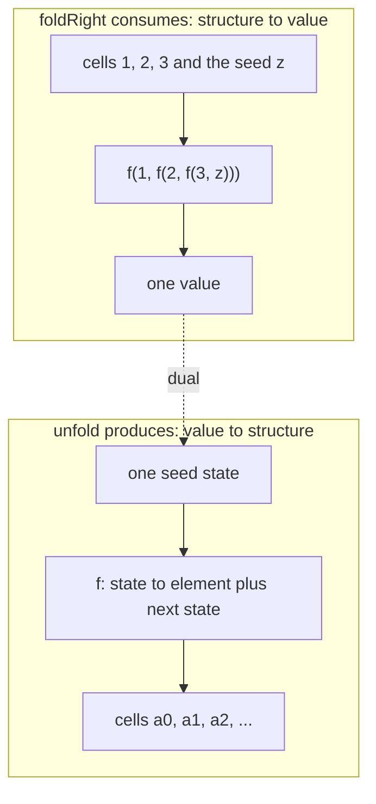

# Infinite lazy lists and corecursion: unfold

> Functional Programming in Scala (red book) · Beginner · ~25 min · rung 7 of 26 · needs: Strictness and laziness: non-strict functions and LazyList (fp-scala-06)

## Why this matters
Every pull-based stream you run in production — an Akka Streams `Source`, a Kafka consumer loop, a paginated HTTP client — is a state machine that turns one piece of state into one element plus the next state, and stops when there is no next state. That is exactly `unfold`, and this rung is where you build it in twelve lines and see that `map`, `take`, `takeWhile` and `zipWith` are all special cases of it.
It also fixes the cost model: an infinite list is safe because a consumer asking for a prefix pays only for that prefix, so you stop guessing horizons ("fetch 1000 rows, hope that is enough") and let demand decide.
The same twelve lines are the dual of `foldRight`, which is the piece of theory that makes streaming code reason-about-able rather than a pile of callbacks: one combinator consumes a structure to a value, the other produces a structure from a value.

## The idea

> Chapter map: Functional Programming in Scala, 2nd ed., ch. 5 — §5.3 Separating program description from evaluation (recap), §5.4 Infinite lazy lists and corecursion (Infinite streams and corecursion in the 1st ed.), exercises 5.11 to 5.16.

### §5.3 Separating program description from evaluation (recap)

The data type this whole chapter works on is the book's own `LazyList`, not the standard library's. A cell holds two thunks — a **thunk** is an unevaluated expression wrapped as a zero-argument function, `() => A`, forced by applying it:

```scala
enum LazyList[+A]:
  case Empty
  case Cons(h: () => A, t: () => LazyList[A])
```

`Cons` stores a head thunk and a tail thunk, so neither the first element nor the rest of the list exists until somebody applies them. The smart constructor `cons(hd: => A, tl: => LazyList[A])` takes both arguments **by name** (the caller passes an expression, the compiler wraps it in a thunk) and caches each in a `lazy val` before storing it, so a forced cell is computed at most once; `empty[A]` is the typed `Empty`. The thesis of §5.3 is that this separates the **description** of a computation from its **evaluation**: `map` and `filter` on a `LazyList` do not transform data, they describe a transformation that happens one element at a time, as the consumer pulls.

### §5.4 Infinite lazy lists and corecursion

#### Infinite is not dangerous, demand is bounded

If evaluation only happens on demand, nothing stops you writing a list with no end. The book's three examples are a constant, a counter and the Fibonacci numbers:

```scala
val ones: LazyList[Int] = cons(1, ones)
def from(n: Int): LazyList[Int] = cons(n, from(n + 1))
println(ones.take(5).toList)
println(ones.exists(_ > 0))
println(ones.map(_ + 1).take(3).toList)
```

```text
List(1, 1, 1, 1, 1)
true
List(2, 2, 2)
```

`ones` refers to itself inside the tail thunk, so the recursion never runs until something forces that thunk — and `take(5)` forces exactly five cells. `exists` returns after the first element that satisfies the predicate because `||` is non-strict in its right operand, and `map(_ + 1).take(3)` is a description three cells deep. Change `exists(_ > 0)` to `exists(_ < 0)` on `ones` and the program hangs: the guarantee is not "infinite lists are safe", it is "a terminating demand on an infinite list is safe" (FP in Scala, 2nd ed., ch. 5, §5.4).

#### Recursion consumes, corecursion produces

The book's vocabulary for this is worth keeping. A **recursive** function consumes data and terminates because the input shrinks: `foldRight` eats a list cell by cell until it hits `Empty`. A **corecursive** function produces data and need never terminate at all; what it must stay is **productive**, meaning it can always emit one more element in a finite amount of time. Corecursion is also called **guarded recursion**, because the recursive call sits guarded under a constructor — inside `cons`'s tail thunk — and so is not taken until the consumer asks. Productivity is the dual of termination: recursion is judged by whether it stops, corecursion by whether it keeps going on demand.

#### Exercise 5.11: unfold, the general builder

Generalise `ones`, `from` and `fibs` and you get one function. It takes an initial state and a step: apply the step to the state, and either get an element plus the next state, or get `None` and end the list.

```scala
def unfold[A, S](state: S)(f: S => Option[(A, S)]): LazyList[A] =
  f(state) match
    case Some((a, s)) => cons(a, unfold(s)(f))
    case None         => empty
```

Two details carry the whole mechanism. `Option` is what makes the list finite-capable: `None` is the only exit. And the recursive `unfold(s)(f)` is an argument to `cons`, which takes it by name — that is the guard, and it is why `unfold` on an infinite step function returns instantly instead of looping forever.



*Figure 1: `unfold` as a state machine. Every turn of the loop either emits one element and hands back a new state, or returns None and ends the list; the annotated states are the fibs seeds traced in Step 2 of the lab. Source: Chiusano, Bjarnason & Pilquist, Functional Programming in Scala, 2nd ed., ch. 5 §5.4, Exercise 5.11.*

#### Exercise 5.12: the generators, re-derived

Each generator is now a choice of state. `fibs` carries the pair of consecutive numbers it needs; `from` carries the counter; `continually` (named `constant` in the 1st edition) carries nothing at all, so its state is `Unit`; `ones` is `continually(1)`.

```scala
def fibs = unfold((0, 1)) { case (f0, f1) => Some((f0, (f1, f0 + f1))) }
def from(n: Int) = unfold(n)(s => Some((s, s + 1)))
def continually[A](a: A) = unfold(())(_ => Some((a, ())))
println(fibs.take(10).toList)
println(from(1).takeWhile(_ < 6).toList)
```

```text
List(0, 1, 1, 2, 3, 5, 8, 13, 21, 34)
List(1, 2, 3, 4, 5)
```

`fibs` emits the first of the pair and shifts the window: state `(f0, f1)` becomes `(f1, f0 + f1)`. None of these three ever returns `None`, so all three are infinite — and `takeWhile(_ < 6)` still terminates, because it stops pulling at the first element that fails the predicate.

#### Exercise 5.13: the combinators, re-derived

The surprise of the section is that `unfold` also rebuilds the functions that *consume* a lazy list, as long as the output is itself a lazy list. The state is simply the part of the input not yet consumed: for `map` the remaining list, for `take` the pair `(remaining list, count left)`, for `zipWith` the pair of remaining lists. Printing the step keeps the state visible:

```scala
val traced = unfold((0, 1)) { case (f0, f1) =>
  println(s"f(($f0, $f1)) = Some(($f0, ($f1, ${f0 + f1})))")
  Some((f0, (f1, f0 + f1)))
}
println(traced.take(5).toList)
```

```text
f((0, 1)) = Some((0, (1, 1)))
f((1, 1)) = Some((1, (1, 2)))
f((1, 2)) = Some((1, (2, 3)))
f((2, 3)) = Some((2, (3, 5)))
f((3, 5)) = Some((3, (5, 8)))
List(0, 1, 1, 2, 3)
```

Five applications for five elements, each printing before the next is needed — the trace is the state machine of Figure 1 walking. Note that the very first line appears while the list is being *built*: `unfold` applies `f` to the seed eagerly and only the recursive call is guarded, so one cell always exists before anyone pulls.



*Figure 2: The lazy version's cost tracks what was asked for; the strict version's does not. Generated from the lab output.*

#### Exercises 5.14 to 5.16, and the cost of holding the head

Three follow-ups extend the same move. `startsWith` (5.14) checks one lazy list against a prefix by zipping them and comparing while the prefix lasts, so it never forces more than the prefix length. `tails` (5.15) is `unfold` over the list itself, emitting each successive suffix, which makes `hasSubsequence` a one-liner: `tails.exists(_.startsWith(sub))`. `scanRight` (5.16) is the one that cannot be written with `unfold` — it generalises `foldRight` to return every intermediate accumulator, and those are produced right-to-left, against the direction `unfold` travels.

**Beyond the book:** the memoisation that makes `cons` cheap has a price. Because every forced cell caches its value, keeping a reference to the head of an infinite list keeps every cell behind it alive — a slow leak if you store `val fibs = ...` in a long-lived object and keep pulling. Call a `def` instead and each traversal recomputes from the seed; Step 6 of the lab shows both behaviours in the step counter.



*Figure 3: The duality in one picture — `foldRight` collapses a structure into a value, `unfold` grows a structure out of a value, and both stop when the non-strict argument is never forced. Source: adapted from Chiusano & Bjarnason, Functional Programming in Scala ch. 5 §5.4, https://github.com/fpinscala/fpinscala*

## Lab

How many Fibonacci cells does an infinite lazy list actually compute when you ask it for ten, and how does that compare with the strict list you would have to size up front?

The program builds the book's `LazyList` from scratch — the `enum` with `Empty` and `Cons` of two thunks, the memoising smart constructors `cons` and `empty` — then Exercise 5.11 (`unfold`), 5.12 (`fibs`, `from`, `continually`, `ones`), 5.13 (`mapViaUnfold`, `takeViaUnfold`, `takeWhileViaUnfold`, `zipWithViaUnfold`, `zipAllViaUnfold`) and 5.14 (`startsWith`). A counter ticks once per application of the generator, so the output is a direct measurement of work done, not a guess.

### Step 1 — infinite lists under a bounded demand

`ones`, `from(1)`, `fibs` and `continually`, written by hand with guarded recursion, each asked for a short prefix.

### Step 2 — Exercise 5.11, unfold traced one application at a time

The same `fibs` through `unfold`, printing each state transition, so the `(0,1) → (1,1) → (1,2) → (2,3)` walk is visible, then asked for the same prefix twice to show memoisation.

### Step 3 — Exercise 5.12, the generators through unfold

`fibs.take(10).toList` and `from(1).takeWhile(_ < 6).toList`, checked against the hand-written versions.

### Step 4 — Exercise 5.13 and 5.14, the combinators through unfold

`map`, `take`, `takeWhile`, `zipWith` and `startsWith`, all applied to infinite inputs.

### Step 5 — the measurement

`fibs.take(n).toList` for n from 1 to 10, counting generator applications, against a strict list that must choose a horizon of 40 up front.

### Step 6 — what holding the head costs

The same list kept in a `val`, pulled three times, with the counter never reset.

```scala
// file: Lab.scala
enum MyLazyList[+A]:
  case Empty
  case Cons(h: () => A, t: () => MyLazyList[A])

  def headOption: Option[A] = this match
    case Empty      => None
    case Cons(h, _) => Some(h())

  def toList: List[A] = this match
    case Empty      => Nil
    case Cons(h, t) => h() :: t().toList

  def foldRight[B](z: => B)(f: (A, => B) => B): B = this match
    case Cons(h, t) => f(h(), t().foldRight(z)(f))
    case Empty      => z

  def exists(p: A => Boolean): Boolean =
    foldRight(false)((a, acc) => p(a) || acc)

  def take(n: Int): MyLazyList[A] = this match
    case Cons(h, t) if n > 1  => MyLazyList.cons(h(), t().take(n - 1))
    case Cons(h, _) if n == 1 => MyLazyList.cons(h(), MyLazyList.empty)
    case _                    => MyLazyList.empty

  def takeWhile(p: A => Boolean): MyLazyList[A] = this match
    case Cons(h, t) if p(h()) => MyLazyList.cons(h(), t().takeWhile(p))
    case _                    => MyLazyList.empty

  def map[B](f: A => B): MyLazyList[B] =
    foldRight(MyLazyList.empty[B])((a, acc) => MyLazyList.cons(f(a), acc))

  // ---- Exercise 5.13: the same combinators, written through unfold ----

  def mapViaUnfold[B](f: A => B): MyLazyList[B] =
    MyLazyList.unfold(this):
      case Cons(h, t) => Some((f(h()), t()))
      case Empty      => None

  def takeViaUnfold(n: Int): MyLazyList[A] =
    MyLazyList.unfold((this, n)):
      case (Cons(h, t), k) if k > 0 => Some((h(), (t(), k - 1)))
      case _                        => None

  def takeWhileViaUnfold(p: A => Boolean): MyLazyList[A] =
    MyLazyList.unfold(this):
      case Cons(h, t) if p(h()) => Some((h(), t()))
      case _                    => None

  def zipWithViaUnfold[B, C](that: MyLazyList[B])(f: (A, B) => C): MyLazyList[C] =
    MyLazyList.unfold((this, that)):
      case (Cons(h1, t1), Cons(h2, t2)) => Some((f(h1(), h2()), (t1(), t2())))
      case _                            => None

  def zipAllViaUnfold[B](that: MyLazyList[B]): MyLazyList[(Option[A], Option[B])] =
    MyLazyList.unfold((this, that)):
      case (Cons(h1, t1), Cons(h2, t2)) => Some(((Some(h1()), Some(h2())), (t1(), t2())))
      case (Cons(h1, t1), Empty)        => Some(((Some(h1()), None), (t1(), MyLazyList.empty[B])))
      case (Empty, Cons(h2, t2))        => Some(((None, Some(h2())), (MyLazyList.empty[A], t2())))
      case (Empty, Empty)               => None

  /** Exercise 5.14, built on zipAll and takeWhile. */
  def startsWith[B >: A](prefix: MyLazyList[B]): Boolean =
    zipAllViaUnfold(prefix)
      .takeWhile((_, b) => b.isDefined)
      .foldRight(true)((pair, acc) => pair._1 == pair._2 && acc)

object MyLazyList:
  def cons[A](hd: => A, tl: => MyLazyList[A]): MyLazyList[A] =
    lazy val head = hd
    lazy val tail = tl
    Cons(() => head, () => tail)

  def empty[A]: MyLazyList[A] = Empty

  def apply[A](as: A*): MyLazyList[A] =
    if as.isEmpty then empty else cons(as.head, apply(as.tail*))

  /** Exercise 5.11: the corecursive dual of foldRight. */
  def unfold[A, S](state: S)(f: S => Option[(A, S)]): MyLazyList[A] =
    f(state) match
      case Some((a, s)) => cons(a, unfold(s)(f))
      case None         => empty

  // ---- Exercise 5.12: the standard generators, all through unfold ----
  def fibsViaUnfold: MyLazyList[Int] =
    unfold((0, 1)) { case (f0, f1) => Some((f0, (f1, f0 + f1))) }

  def fromViaUnfold(n: Int): MyLazyList[Int] =
    unfold(n)(s => Some((s, s + 1)))

  def continuallyViaUnfold[A](a: A): MyLazyList[A] =
    unfold(())(_ => Some((a, ())))

  def onesViaUnfold: MyLazyList[Int] = continuallyViaUnfold(1)

import MyLazyList.{cons, empty, unfold}

// the §5.4 definitions written by hand, before unfold generalises them
val ones: MyLazyList[Int] = cons(1, ones)
def continually[A](a: A): MyLazyList[A] = cons(a, continually(a))
def from(n: Int): MyLazyList[Int] = cons(n, from(n + 1))
def fibs: MyLazyList[Int] =
  def go(f0: Int, f1: Int): MyLazyList[Int] = cons(f0, go(f1, f0 + f1))
  go(0, 1)

// one tick every time the unfold generator is applied, i.e. every time a cell is produced
var genSteps = 0
def countedFibs: MyLazyList[Int] =
  genSteps = 0
  unfold((0, 1)) { case (f0, f1) => genSteps += 1; Some((f0, (f1, f0 + f1))) }

// the strict alternative: no infinite list, so you pick a horizon and pay for all of it
var strictSteps = 0
def strictFibs(horizon: Int): List[Int] =
  strictSteps = 0
  var f0 = 0
  var f1 = 1
  val buf = scala.collection.mutable.ListBuffer.empty[Int]
  while buf.size < horizon do
    strictSteps += 1
    buf += f0
    val next = f0 + f1
    f0 = f1
    f1 = next
  buf.toList

@main def lab(): Unit =
  println("== Step 1: an infinite lazy list is safe because only the prefix is demanded ==")
  println(s"  ones.take(5).toList           = ${ones.take(5).toList}")
  println(s"  ones.exists(_ > 0)            = ${ones.exists(_ > 0)}")
  println(s"  ones.map(_ + 1).take(3).toList = ${ones.map(_ + 1).take(3).toList}")
  println(s"  from(1).take(5).toList        = ${from(1).take(5).toList}")
  println(s"  fibs.take(7).toList           = ${fibs.take(7).toList}")
  println(s"  continually('x').take(4).toList = ${continually("x").take(4).toList}")

  println()
  println("== Step 2: Exercise 5.11 unfold, traced one application at a time ==")
  val traced = unfold((0, 1)) { case (f0, f1) =>
    println(s"    f(($f0, $f1)) = Some(($f0, (${f1}, ${f0 + f1})))")
    Some((f0, (f1, f0 + f1)))
  }
  println("  built the list: the first application already ran (unfold is eager in f(state))")
  println(s"  traced.take(5).toList = ${traced.take(5).toList}")
  println(s"  traced.take(5).toList again = ${traced.take(5).toList}   (memoised: no new f lines)")

  println()
  println("== Step 3: Exercise 5.12, the generators rewritten through unfold ==")
  println(s"  fibsViaUnfold.take(10).toList        = ${MyLazyList.fibsViaUnfold.take(10).toList}")
  println(s"  fromViaUnfold(1).takeWhile(_ < 6).toList = ${MyLazyList.fromViaUnfold(1).takeWhile(_ < 6).toList}")
  println(s"  continuallyViaUnfold(7).take(4).toList = ${MyLazyList.continuallyViaUnfold(7).take(4).toList}")
  println(s"  onesViaUnfold.take(5).toList         = ${MyLazyList.onesViaUnfold.take(5).toList}")
  println(s"  same answers as the hand-written ones: ${MyLazyList.fibsViaUnfold.take(10).toList == fibs.take(10).toList}")

  println()
  println("== Step 4: Exercise 5.13, map / take / takeWhile / zipWith through unfold ==")
  val nat = MyLazyList.fromViaUnfold(1)
  println(s"  from(1).mapViaUnfold(_ * 10).takeViaUnfold(5).toList = ${nat.mapViaUnfold(_ * 10).takeViaUnfold(5).toList}")
  println(s"  from(1).takeWhileViaUnfold(_ < 6).toList = ${nat.takeWhileViaUnfold(_ < 6).toList}")
  val sums = MyLazyList.fibsViaUnfold.zipWithViaUnfold(MyLazyList.fromViaUnfold(1))(_ + _)
  println(s"  fibs.zipWithViaUnfold(from(1))(_ + _).take(8).toList = ${sums.take(8).toList}")
  println(s"  fibs.startsWith(LazyList(0, 1, 1, 2)) = ${MyLazyList.fibsViaUnfold.startsWith(MyLazyList(0, 1, 1, 2))}")
  println(s"  fibs.startsWith(LazyList(0, 1, 5))    = ${MyLazyList.fibsViaUnfold.startsWith(MyLazyList(0, 1, 5))}")

  println()
  println("== Step 5: cells produced for fibs.take(n).toList, lazy against a strict horizon of 40 ==")
  println(f"${"n"}%4s${"lazy unfold steps"}%20s${"strict horizon steps"}%23s${"last element"}%15s")
  val rows = for n <- 1 to 10 yield
    val lazyOut = countedFibs.takeViaUnfold(n).toList
    val lazySteps = genSteps
    val strictOut = strictFibs(40).take(n)
    println(f"$n%4d$lazySteps%20d$strictSteps%23d${lazyOut.last}%15d")
    (n, lazySteps, strictSteps, lazyOut == strictOut)
  println(s"  lazy steps  = ${rows.map(_._2).mkString(", ")}")
  println(s"  strict steps = ${rows.map(_._3).mkString(", ")}")
  println(s"  same answers at every n: ${rows.forall(_._4)}")

  println()
  println("== Step 6: holding the head keeps every forced cell alive ==")
  val held = countedFibs
  println(s"  held.takeViaUnfold(10).toList = ${held.takeViaUnfold(10).toList}  (steps so far: $genSteps)")
  println(s"  held.takeViaUnfold(10).toList = ${held.takeViaUnfold(10).toList}  (steps so far: $genSteps)")
  println(s"  held.takeViaUnfold(14).toList = ${held.takeViaUnfold(14).toList}  (steps so far: $genSteps)")
  val fresh = countedFibs
  println(s"  fresh.takeViaUnfold(10).toList recomputed from the seed: steps = ${{ fresh.takeViaUnfold(10).toList; genSteps }}")
```

Run it with `python3 dojo/engine/run_lab.py 2026-11-21-1`:

```text
== Step 1: an infinite lazy list is safe because only the prefix is demanded ==
  ones.take(5).toList           = List(1, 1, 1, 1, 1)
  ones.exists(_ > 0)            = true
  ones.map(_ + 1).take(3).toList = List(2, 2, 2)
  from(1).take(5).toList        = List(1, 2, 3, 4, 5)
  fibs.take(7).toList           = List(0, 1, 1, 2, 3, 5, 8)
  continually('x').take(4).toList = List(x, x, x, x)

== Step 2: Exercise 5.11 unfold, traced one application at a time ==
    f((0, 1)) = Some((0, (1, 1)))
  built the list: the first application already ran (unfold is eager in f(state))
    f((1, 1)) = Some((1, (1, 2)))
    f((1, 2)) = Some((1, (2, 3)))
    f((2, 3)) = Some((2, (3, 5)))
    f((3, 5)) = Some((3, (5, 8)))
  traced.take(5).toList = List(0, 1, 1, 2, 3)
  traced.take(5).toList again = List(0, 1, 1, 2, 3)   (memoised: no new f lines)

== Step 3: Exercise 5.12, the generators rewritten through unfold ==
  fibsViaUnfold.take(10).toList        = List(0, 1, 1, 2, 3, 5, 8, 13, 21, 34)
  fromViaUnfold(1).takeWhile(_ < 6).toList = List(1, 2, 3, 4, 5)
  continuallyViaUnfold(7).take(4).toList = List(7, 7, 7, 7)
  onesViaUnfold.take(5).toList         = List(1, 1, 1, 1, 1)
  same answers as the hand-written ones: true

== Step 4: Exercise 5.13, map / take / takeWhile / zipWith through unfold ==
  from(1).mapViaUnfold(_ * 10).takeViaUnfold(5).toList = List(10, 20, 30, 40, 50)
  from(1).takeWhileViaUnfold(_ < 6).toList = List(1, 2, 3, 4, 5)
  fibs.zipWithViaUnfold(from(1))(_ + _).take(8).toList = List(1, 3, 4, 6, 8, 11, 15, 21)
  fibs.startsWith(LazyList(0, 1, 1, 2)) = true
  fibs.startsWith(LazyList(0, 1, 5))    = false

== Step 5: cells produced for fibs.take(n).toList, lazy against a strict horizon of 40 ==
   n   lazy unfold steps   strict horizon steps   last element
   1                   2                     40              0
   2                   3                     40              1
   3                   4                     40              1
   4                   5                     40              2
   5                   6                     40              3
   6                   7                     40              5
   7                   8                     40              8
   8                   9                     40             13
   9                  10                     40             21
  10                  11                     40             34
  lazy steps  = 2, 3, 4, 5, 6, 7, 8, 9, 10, 11
  strict steps = 40, 40, 40, 40, 40, 40, 40, 40, 40, 40
  same answers at every n: true

== Step 6: holding the head keeps every forced cell alive ==
  held.takeViaUnfold(10).toList = List(0, 1, 1, 2, 3, 5, 8, 13, 21, 34)  (steps so far: 11)
  held.takeViaUnfold(10).toList = List(0, 1, 1, 2, 3, 5, 8, 13, 21, 34)  (steps so far: 11)
  held.takeViaUnfold(14).toList = List(0, 1, 1, 2, 3, 5, 8, 13, 21, 34, 55, 89, 144, 233)  (steps so far: 15)
  fresh.takeViaUnfold(10).toList recomputed from the seed: steps = 11
```

### Reading the output

A "step" is one application of the `unfold` generator `f`, counted by `genSteps`, which is one Fibonacci cell produced. Fewer steps for the same answer is better, and the `last element` column plus the `same answers at every n: true` line are the control: if the answers diverged, the step counts would be measuring two different programs.

**Step 2 — the state walk, traced with digits.** The printed transitions are exactly the seeds annotated on Figure 1:

| application | state in | element out | state out |
|---|---|---|---|
| 1 (at build time) | (0, 1) | 0 | (1, 1) |
| 2 | (1, 1) | 1 | (1, 2) |
| 3 | (1, 2) | 1 | (2, 3) |
| 4 | (2, 3) | 2 | (3, 5) |
| 5 | (3, 5) | 3 | (5, 8) |

Read one row: state `(1, 2)` emits its first component, 1, and shifts to `(2, 3)` because the new pair is `(f1, f0 + f1) = (2, 1 + 2)`. Five applications emitted `List(0, 1, 1, 2, 3)`, and the sixth, which would emit 5, never ran — nobody asked. The second `take(5).toList` printed no new `f` lines at all, because `cons` cached every forced cell.

**Verdict:** the generator is a pure state machine and the consumer sets the clock. One `f` runs per element delivered, plus the one that ran eagerly when the list was constructed.

**Step 5 — the measurement.**

| n | lazy unfold steps | strict horizon steps | last element |
|---|---|---|---|
| 1 | 2 | 40 | 0 |
| 2 | 3 | 40 | 1 |
| 3 | 4 | 40 | 1 |
| 5 | 6 | 40 | 3 |
| 10 | 11 | 40 | 34 |

Lazy cost is `n + 1`, dead straight, and the extra cell is not noise: `takeViaUnfold` carries the state `(remaining list, k)`, and to build the next state it evaluates `t()` — which forces one more cell — *before* the next turn can test `k > 0` and return `None`. One cell of overshoot, always, no matter how long the list is. The strict column is flat at 40 because a strict list has no choice but to commit to a horizon: ask for 1 element, compute 40; ask for 10, compute 40. At n = 10 that is 11 against 40, a 3.6× difference, and at n = 1 it is 2 against 40, a 20× difference — and the strict version is also simply wrong if the right answer turns out to need the 41st number.

**Verdict:** laziness converts a guessed bound into a measured one. The lazy column is a function of the demand; the strict column is a function of a number somebody typed.

**Step 6 — holding the head.** The `val held` forced 11 cells on the first pull, 11 (unchanged) on the second, and 15 after asking for 14 — the first 10 were never recomputed. The `def`-built `fresh` started from the seed again at 11. Memoisation is doing the work, and every memoised cell stays reachable from `held`.

**Verdict:** a `val` of an infinite lazy list is a cache that only grows. Prefer a `def`, or let the reference go out of scope, unless re-traversal is genuinely cheaper than the memory.

The chain, in four steps:

1. **Cause.** `cons` takes its tail by name, so the recursive call inside `unfold` sits under a constructor and is not taken until forced.
2. **Mechanism.** Each force applies `f` to the current state exactly once, which emits one element and returns the next state, so the number of applications equals the number of elements the consumer pulled (plus one for the eager seed, plus one more for the overshoot of `takeViaUnfold`).
3. **Consequence.** Work scales with demand, not with a declared size: 11 cells for 10 numbers instead of a committed 40, and the list may legitimately have no end.
4. **In practice.** Write producers as `unfold`-shaped state machines — a page cursor, an offset, a retry budget — and let the consumer decide where to stop. The one thing to watch is the memoised head: keep the producer behind a `def` so a long-lived reference does not pin every element it ever yielded.

## Self-check
1. Why does `ones.exists(_ > 0)` return while `ones.exists(_ < 0)` does not? <details><summary>Answer</summary>`exists` is written with the lazy `foldRight`, whose second argument is by name, and `||` does not evaluate its right operand when the left is `true`. The first element, 1, satisfies `_ > 0`, so the fold returns `true` without forcing another cell. With `_ < 0` no element ever satisfies the predicate, so the fold keeps forcing cells forever — the safety comes from the demand terminating, not from the list being infinite.</details>
2. Write `ones` using `unfold`, and say what its state is. <details><summary>Answer</summary>`unfold(())(_ => Some((1, ())))`, which is `continually(1)`. The state is `Unit`: nothing about the next element depends on anything, so the state carries no information. Compare `from(n)`, whose state is the counter `n`, and `fibs`, whose state is the pair `(f0, f1)` of consecutive numbers it needs to compute the following one.</details>
3. Why can `map`, `take` and `zipWith` be written with `unfold` but `scanRight` cannot? <details><summary>Answer</summary>`unfold` produces its output left to right, one element per state transition, and each of `map`, `take` and `zipWith` can describe its remaining work as a state — the unconsumed input, or a pair of inputs, or an input plus a count. `scanRight` returns every intermediate accumulator of a right fold, and those are produced right to left: the first element of its result depends on all the ones after it, so there is no state that lets you emit the head first. It has to be written as a `foldRight` that carries the running list of results, sharing the tails.</details>

## Sources
- [Functional Programming in Scala, 2nd ed. (Chiusano, Bjarnason, Pilquist)](https://www.manning.com/books/functional-programming-in-scala-second-edition) — ch. 5 §5.4 'Infinite lazy lists and corecursion' ('Infinite streams and corecursion' in the 1st ed.) supplied the `ones`/`from`/`fibs` examples, the recursion-versus-corecursion vocabulary, and exercises 5.11 to 5.16; §5.3 supplied the `LazyList` cell and the memoising smart constructors recapped at the top; accessed 2026-11-21.
- [fpinscala companion repository](https://github.com/fpinscala/fpinscala) — the laziness chapter folder, `LazyList.scala`, supplied the exact shape of `unfold` and of the derived `mapViaUnfold`, `takeViaUnfold`, `takeWhileViaUnfold`, `zipWithViaUnfold` and `startsWith` in the answers; accessed 2026-11-21.

## Next on this track
Next on Functional Programming in Scala (red book): **Purely functional state: a pure random number generator** (rung 8 of 26, Beginner).
