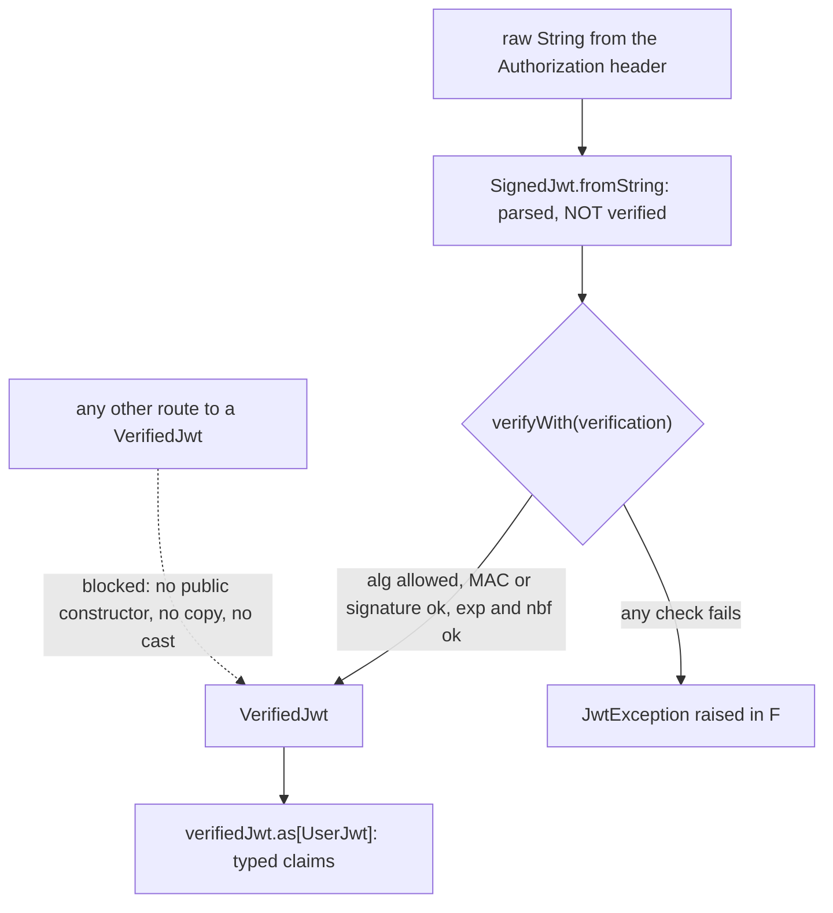
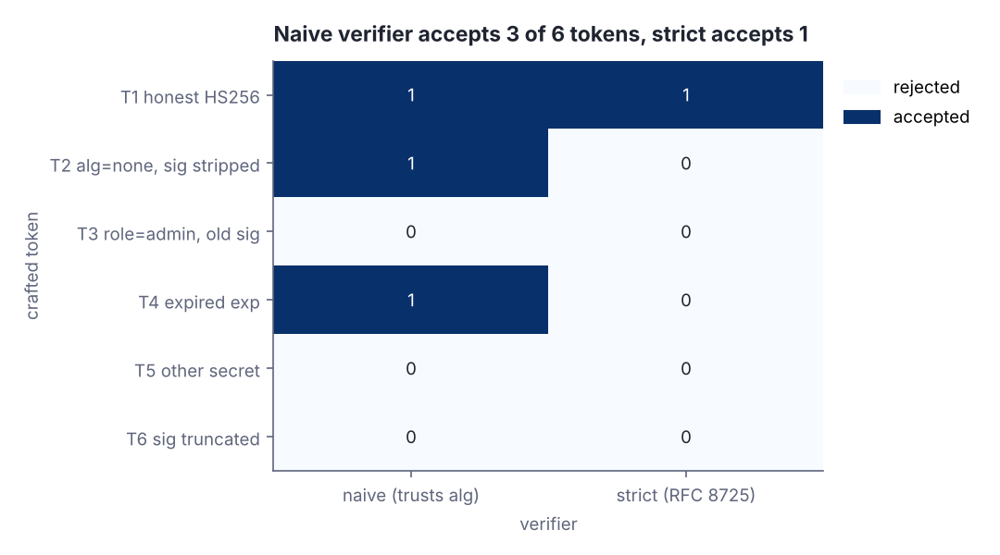
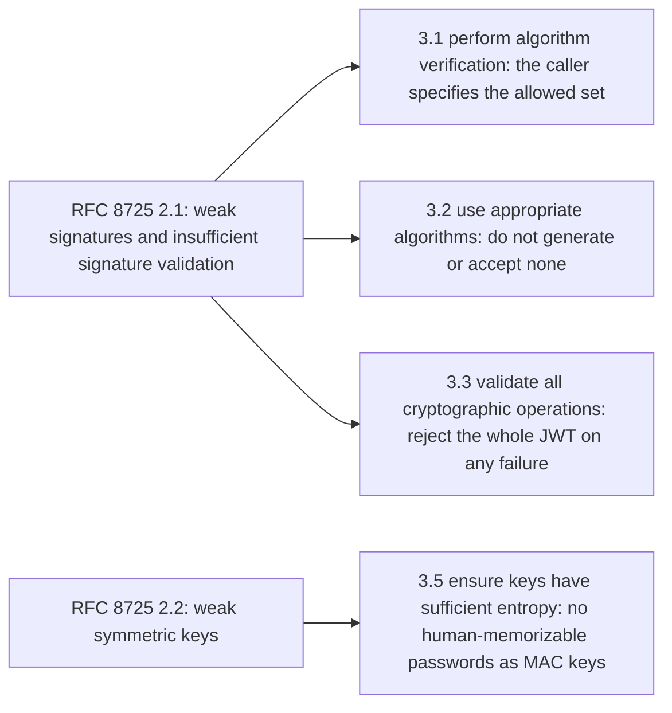

# Jots: a JWT you cannot forget to verify

> Fresh · Functional Programming in Scala (red book) · Intermediate · ~25 min · from today's feeds

## Why this matters
On 2026-11-14 Typelevel announced that Jots, a Scala JWT library, had been accepted as an affiliate project, and its central design choice is reusable far beyond JWTs: a parsed token and a verified token are two different types, so "I forgot to check the signature" stops being a code-review question and becomes a compile error.
The bug it removes is the first thing the IETF's own best-practice document for JWTs, RFC 8725 (BCP 225, February 2020), warns about, and it is how real services have been walked straight through their own auth layer.
You sit between an Akka codebase and a product org that keeps asking whether auth is safe; by the end of this you will have forged five tokens, watched a careless verifier wave three of them through, and have a precise answer ready.

## Primer
Two rungs you have already climbed set this up. On the non-strict evaluation rung you saw that *when* a computation happens can be moved into the type — a `LazyList` is a list whose tail is a description, not a value. On the error-handling rung you saw that *whether* a computation succeeded can be moved into the type — `Option` and `Either` put failure in the return type instead of in a thrown exception, so the caller cannot ignore it by accident. This lesson makes the same move for a security check: whether a token has been verified becomes part of its type.

Three things you need that are not on the ladder yet.

**A JWT is three chunks joined by dots.** `header.payload.signature`, each chunk base64url — ordinary base64 with `-` and `_` in place of `+` and `/` so the result survives in a URL. Base64url is an *encoding*, not encryption: the header and the payload are plain JSON that anyone holding the token can read in one line of code. The header says which algorithm was used (`{"alg":"HS256"}`); the payload carries claims, among them `exp` (expiration time) and `nbf` (not before), both defined in RFC 7519 §4.1.

**A MAC is a keyed checksum.** HS256 means HMAC-SHA256: feed it a secret key and the bytes `header.payload`, get back 32 bytes. Anyone holding the key can produce that tag and anyone holding the key can re-derive it and compare; without the key you cannot produce it for a message you changed. It proves origin and integrity, not confidentiality — the claims stay readable either way. The asymmetric algorithms (RS256, ES256, EdDSA) split that one key in two: a private key signs, a public key verifies. Remember which half is public; it matters in a minute.

**`F[_]`, `Sync` and `IO`.** Jots is a Cats Effect library, so its signatures are generic in an effect type. `IO[A]` is a *description* of a computation that will produce an `A` — a recipe, not a running job; nothing happens until a runtime executes it. `F[_]` is a type parameter standing for any such effect type, and `Sync[F]` is a constraint meaning "`F` is able to suspend a side effect", which verification needs because it reads a clock and calls into platform cryptography. The Akka contrast: a `Future` is already running by the time you hold it, so composing it is housekeeping over work in flight; an `IO` has not started, so composing it is building a larger recipe. Where you would expect `Either[Error, Claims]`, Jots gives you `F[Claims]` with the failure raised inside the effect, and `.attempt` turns that back into `F[Either[Throwable, Claims]]` when you want it.

## The idea
Start by taking a token apart with nothing but the JDK. No key, no library, no permission.

```scala
val enc = java.util.Base64.getUrlEncoder.withoutPadding
val dec = java.util.Base64.getUrlDecoder
val header = """{"alg":"HS256","typ":"JWT"}"""
val claims = """{"sub":"yuriy","role":"user","exp":1795255200}"""
val signingInput = enc.encodeToString(header.getBytes("UTF-8")) +
  "." + enc.encodeToString(claims.getBytes("UTF-8"))
println(s"signing input: ${signingInput.length} chars, no key involved")
println("part 2 decoded: " + new String(dec.decode(signingInput.split("\\.")(1))))
```

```text
signing input: 99 chars, no key involved
part 2 decoded: {"sub":"yuriy","role":"user","exp":1795255200}
```

Those 99 characters — the first two parts and the dot between them — are the *signing input*, and they are fully readable and fully rewritable by whoever holds the token. `"role":"user"` is one search-and-replace away from `"role":"admin"`.

The third part is what stops that, and only if someone actually computes it. Continuing with the same `signingInput`:

```scala
val secret = "dojo-iaido-hs256-secret-32bytes!".getBytes("UTF-8")
val mac = javax.crypto.Mac.getInstance("HmacSHA256")
mac.init(javax.crypto.spec.SecretKeySpec(secret, "HmacSHA256"))
val tag = mac.doFinal(signingInput.getBytes("UTF-8"))
def hex(b: Array[Byte]) = b.map(x => f"$x%02x").mkString
println(s"tag = ${hex(tag).take(16)}.. (${tag.length} bytes)")
val bent = tag.updated(31, (tag(31) ^ 1).toByte)
println(s"isEqual(tag, tag)  = ${java.security.MessageDigest.isEqual(tag, tag)}")
println(s"isEqual(tag, bent) = ${java.security.MessageDigest.isEqual(tag, bent)}")
```

```text
tag = c2f23bd4cd30ce34.. (32 bytes)
isEqual(tag, tag)  = true
isEqual(tag, bent) = false
```

Flipping a single bit of the 32-byte tag makes the comparison fail, which is the whole security property. `MessageDigest.isEqual` is used rather than `==` because it compares in time independent of where the first difference falls, so an attacker cannot learn the correct tag byte by byte from response timings.

### What RFC 8725 says actually goes wrong

RFC 8725 — *JSON Web Token Best Current Practices*, Sheffer, Hardt and Jones, February 2020, which updates RFC 7519 — names two failure modes before it gives any advice. The first is its §2.1, "Weak Signatures and Insufficient Signature Validation", and it comes in two shapes. One: "The algorithm can be changed to "none" by an attacker, and some libraries would trust this value" (RFC 8725 §2.1). That value is legal — RFC 7519 §6 defines an Unsecured JWT as "a JWS using the "alg" Header Parameter value "none"" "with the empty string for its JWS Signature value" — so the question is never "is this a valid JWT" but "is this algorithm acceptable *here*", and RFC 7519 §7.2 is explicit that "it is an application decision which algorithms may be used in a given context." A library that answers that question out of the token's own header has let the attacker answer it. Two: "An "RS256" (RSA, 2048 bit) parameter value can be changed into "HS256" (HMAC, SHA-256)" (RFC 8725 §2.1, crediting the attack to Tim McLean) — the server then checks an HMAC keyed with what it believed was an RSA *public* key, and public keys are public.

The second failure mode is the key material itself: symmetric keys with too little entropy. HMAC verification is cheap, so a stolen token is an offline password-cracking target, which is why the BCP rules that "human-memorizable passwords MUST NOT be directly used as the key to a keyed-MAC algorithm" (RFC 8725 §3.5).

Its mitigations are equally blunt. §3.1 "Perform Algorithm Verification" requires that "Libraries MUST enable the caller to specify a supported set of algorithms" and that "each key MUST be used with exactly one algorithm". §3.2 adds that "JWT libraries SHOULD NOT generate JWTs using "none" unless explicitly requested to do so by the caller." §3.3 "Validate All Cryptographic Operations" states that "All cryptographic operations used in the JWT MUST be validated" and that "the entire JWT MUST be rejected if any of them fail to validate." Notice what all three have in common: they are obligations on a human to call something. Nothing in the format enforces them.

### Making the obligation a type

That is the gap Jots closes.

> "Jots is a library for working with JSON Web Tokens (JWTs) in Scala, Scala.js and Scala Native."
> — Viktor Rudebeck, *Jots: Functional JWTs for Scala*, 2026-11-14, https://typelevel.org/blog/jots.html

The design moves "has this been verified?" out of the programmer's memory and into the type checker. Parsing produces one type:

> "The `SignedJwt` represents a parsed or generated token which has *not* been verified."
> — Viktor Rudebeck, *Jots documentation* v0.4.0, Signing, accessed 2026-11-21, https://vlovgr.github.io/jots/

Reading claims needs a different one, `VerifiedJwt`, and the only thing that can produce a `VerifiedJwt` is a `JwtVerification` instance — which cannot be talked out of checking the signature:

> "It is not possible to disable signature verification for the default `JwtVerification` instances"
> — Viktor Rudebeck, *Jots documentation* v0.4.0, Verification (sentence fragment), accessed 2026-11-21, https://vlovgr.github.io/jots/



*Figure 1: the type gate. `VerifiedJwt` has exactly one producer, so a claim you can read is a claim someone verified. Source: mechanism as described in the Jots documentation v0.4.0, https://vlovgr.github.io/jots/*

In use it collapses to one line, because the library offers the parse-verify-decode chain as a single call that returns the effect:

```scala
val userJwt: SyncIO[UserJwt] =
  for {
    verification <- jwtVerification
    userJwt <- verification.decodeAs[UserJwt](jwt)
  } yield userJwt
```

Spelled out, the three steps are visibly three different types, and there is no way to skip the middle one:

```scala
def userJwtSeparate(verification: JwtVerification[SyncIO]): SyncIO[UserJwt] =
  for {
    signedJwt <- SignedJwt.fromString(jwt).liftTo[SyncIO]
    verifiedJwt <- signedJwt.verifyWith(verification)
    userJwt <- verifiedJwt.as[UserJwt].liftTo[SyncIO]
  } yield userJwt
```

The verifier itself is where RFC 8725 §3.1's "supported set of algorithms" lives: you name the algorithm and the key when you build it, not when you read the token.

```scala
val jwtVerificationCustom: IO[JwtVerification[IO]] =
  JwtVerificationBuilder
    .default[IO]
    .ecdsa(ES256, publicKey)
    .withAcceptedAudiences("https://api.example.com")
    .withAcceptedIssuers("https://example.auth0.com/")
    .withRequireExpiration(true)
    .withClockSkew(30.seconds)
    .build
```

A default verifier checks, in order, that the key meets the JWA requirements for the algorithm (HS256 needs at least 256 bits, RS256 at least 2048, ES256 exactly 256), that the signature verifies under that algorithm and key, that `exp` — when present — is in the future, that `nbf` is not, that no `crit` header is present, and it rejects any token carrying an `aud` claim until you list the audiences you accept. Clock skew defaults to zero. The supported algorithms are Ed25519, Ed448, ES256/384/512, HS256/384/512, PS256/384/512 and RS256/384/512; `none` is not among them, and there is no switch that adds it. Tests get their own escape hatch, in a separate module you do not ship:

> "Allows tests to bypass signature verification, which is something the core module prevents."
> — Viktor Rudebeck, *Jots: Functional JWTs for Scala*, 2026-11-14, https://typelevel.org/blog/jots.html

### What the gate is worth, in rejected tokens

The lab below mints one honest HS256 token and five forgeries, then runs each through two verifiers written by hand: a naive one that reads `alg` out of the token and skips the MAC when it says `none`, and a strict one that follows RFC 8725 §3.1, §3.2 and §3.3 — an allowlist the application owns, a MAC always recomputed and compared with `MessageDigest.isEqual`, and `exp` enforced against a fixed clock.



*Figure 2: the naive verifier accepts 3 of the 6 tokens, including one with no signature at all; the strict verifier accepts only the honest one. Generated from the lab output (`python3 dojo/engine/run_lab.py 2026-11-21-2`).*

The type gate is what makes the right-hand column the only reachable one. A naive verifier is not written by a careless person; it is written by someone who read `alg` because the token offered it. When `VerifiedJwt` can only come out of a verifier that was configured in advance, the left-hand column has no corresponding program.



*Figure 3: the two failure modes and the practices that answer them. Source: Adapted from RFC 8725 §2–§3, https://datatracker.ietf.org/doc/rfc8725/*

## Lab
Question: of six tokens — one honest and five forged — how many does a verifier that trusts the token's own `alg` header accept, and how many does a verifier that follows RFC 8725 accept?

Everything is JDK-only: `java.util.Base64`, `javax.crypto.Mac` with `HmacSHA256`, and `java.security.MessageDigest.isEqual`. The clock is fixed at `2026-11-21T09:00:00Z` and the secrets are literals, so your output will match the output below character for character.

### Step 1 — mint an honest token and print its parts
The program builds the signing input `base64url(header).base64url(claims)`, HMACs it with a 32-byte secret, and prints the tag in hex and in base64url, so you can see that the third part of the token is exactly that tag.

### Step 2 — craft five variants
T2 rewrites `alg` to `none` and deletes the signature. T3 edits `"role":"user"` into `"role":"admin"` and keeps the original signature. T4 is correctly signed but already expired. T5 is signed with a different 32-byte secret. T6 truncates the honest signature from 43 base64url characters to 20.

### Step 3 — run both verifiers over all six, printing every decision with its reason

```scala
// file: Lab.scala
import java.security.MessageDigest
import java.util.Base64
import javax.crypto.Mac
import javax.crypto.spec.SecretKeySpec

val enc = Base64.getUrlEncoder.withoutPadding
val dec = Base64.getUrlDecoder

// Fixed so every run prints the same thing.
val NOW = java.time.Instant.parse("2026-11-21T09:00:00Z").getEpochSecond
val secret = "dojo-iaido-hs256-secret-32bytes!".getBytes("UTF-8")
val stolen = "attacker-side-secret-32-bytes-ok".getBytes("UTF-8")

def b64(s: String): String = enc.encodeToString(s.getBytes("UTF-8"))
def unb64(s: String): String = new String(dec.decode(s), "UTF-8")
def hex(b: Array[Byte]): String = b.map(x => f"$x%02x").mkString

def hmac(key: Array[Byte], msg: String): Array[Byte] =
  val m = Mac.getInstance("HmacSHA256")
  m.init(SecretKeySpec(key, "HmacSHA256"))
  m.doFinal(msg.getBytes("UTF-8"))

def mint(header: String, claims: String, key: Array[Byte]): String =
  val si = b64(header) + "." + b64(claims)
  si + "." + enc.encodeToString(hmac(key, si))

def field(json: String, name: String): Option[String] =
  val re = ("\"" + name + "\"\\s*:\\s*\"?([^\",}]*)\"?").r
  re.findFirstMatchIn(json).map(_.group(1))

// ---- the naive verifier: trusts the token's own alg header, never looks at exp
def naive(tok: String): (Boolean, String) =
  val p = tok.split("\\.", -1)
  if p.length != 3 then (false, "not three dot-separated parts")
  else
    val alg = field(unb64(p(0)), "alg").getOrElse("none")
    if alg == "none" then (true, "alg=none -> header trusted, no MAC computed")
    else
      val expected = enc.encodeToString(hmac(secret, p(0) + "." + p(1)))
      if expected == p(2) then (true, s"alg=$alg, signature string matched")
      else (false, s"alg=$alg, signature string differed")

// ---- the strict verifier: RFC 8725 section 3.1 / 3.2 / 3.3 plus exp
val allowed = Set("HS256")
def strict(tok: String): (Boolean, String) =
  val p = tok.split("\\.", -1)
  if p.length != 3 then (false, "not three dot-separated parts")
  else
    val alg = field(unb64(p(0)), "alg").getOrElse("<absent>")
    if !allowed.contains(alg) then (false, s"alg=$alg is not in the allowlist $allowed")
    else
      val expected = hmac(secret, p(0) + "." + p(1))
      val supplied = scala.util.Try(dec.decode(p(2))).getOrElse(Array.empty[Byte])
      if !MessageDigest.isEqual(expected, supplied) then
        (false, s"MAC mismatch: want ${expected.length}B ${hex(expected).take(12)}.., " +
                       s"got ${supplied.length}B ${hex(supplied).take(12)}..")
      else
        field(unb64(p(1)), "exp") match
          case None => (false, "no exp claim")
          case Some(e) if e.toLong <= NOW => (false, s"expired: exp=$e <= now=$NOW")
          case Some(e) => (true, s"alg=$alg, MAC ok, exp=$e > now=$NOW")

@main def lab(): Unit =
  val hdr256 = """{"alg":"HS256","typ":"JWT"}"""
  val hdrNone = """{"alg":"none","typ":"JWT"}"""
  val claims = s"""{"sub":"yuriy","role":"user","exp":${NOW + 3600}}"""
  val honest = mint(hdr256, claims, secret)

  println(s"now (fixed)        = $NOW  (2026-11-21T09:00:00Z)")
  println(s"secret length      = ${secret.length} bytes")
  println(s"signing input      = ${(b64(hdr256) + "." + b64(claims)).take(48)}...")
  println(s"signing input len  = ${(b64(hdr256) + "." + b64(claims)).length} chars")
  val tag = hmac(secret, b64(hdr256) + "." + b64(claims))
  println(s"HMAC-SHA256        = ${hex(tag)}")
  println(s"base64url of it    = ${enc.encodeToString(tag)}")
  println(s"T1 part 3 (sig)    = ${honest.split("\\.")(2)}")
  println()

  val tokens = List(
    ("T1 honest HS256", honest),
    ("T2 alg->none, sig stripped", b64(hdrNone) + "." + b64(claims) + "."),
    ("T3 role->admin, old sig", b64(hdr256) + "." +
      b64(claims.replace("\"role\":\"user\"", "\"role\":\"admin\"")) + "." + honest.split("\\.")(2)),
    ("T4 expired exp", mint(hdr256, s"""{"sub":"yuriy","role":"user","exp":${NOW - 60}}""", secret)),
    ("T5 signed with other secret", mint(hdr256, claims, stolen)),
    ("T6 signature truncated", honest.split("\\.")(0) + "." + honest.split("\\.")(1) + "." +
      honest.split("\\.")(2).take(20))
  )

  val rows = for (name, tok) <- tokens yield
    val p = tok.split("\\.", -1)
    println(s"== $name")
    println(s"   header  : ${unb64(p(0))}")
    println(s"   claims  : ${unb64(p(1))}")
    println(s"   sig     : ${p(2).length} base64url chars")
    val (na, nr) = naive(tok)
    val (sa, sr) = strict(tok)
    println(s"   naive   : ${if na then "ACCEPT" else "REJECT"}  ($nr)")
    println(s"   strict  : ${if sa then "ACCEPT" else "REJECT"}  ($sr)")
    (name, if na then 1 else 0, if sa then 1 else 0)

  println()
  println("matrix  token                        naive strict")
  for (n, a, b) <- rows do println(f"        $n%-28s $a%5d $b%6d")
  println(f"        accepted of ${rows.size}%d                 ${rows.map(_._2).sum}%5d ${rows.map(_._3).sum}%6d")
```

Real output, from `python3 dojo/engine/run_lab.py 2026-11-21-2` on 2026-11-21 with Scala 3.3.4:

```text
now (fixed)        = 1795251600  (2026-11-21T09:00:00Z)
secret length      = 32 bytes
signing input      = eyJhbGciOiJIUzI1NiIsInR5cCI6IkpXVCJ9.eyJzdWIiOiJ...
signing input len  = 99 chars
HMAC-SHA256        = c2f23bd4cd30ce34e97bd5e2d9827ce3c6407094f5163b5efeb37fa94e54bdf2
base64url of it    = wvI71M0wzjTpe9Xi2YJ848ZAcJT1Fjte_rN_qU5UvfI
T1 part 3 (sig)    = wvI71M0wzjTpe9Xi2YJ848ZAcJT1Fjte_rN_qU5UvfI

== T1 honest HS256
   header  : {"alg":"HS256","typ":"JWT"}
   claims  : {"sub":"yuriy","role":"user","exp":1795255200}
   sig     : 43 base64url chars
   naive   : ACCEPT  (alg=HS256, signature string matched)
   strict  : ACCEPT  (alg=HS256, MAC ok, exp=1795255200 > now=1795251600)
== T2 alg->none, sig stripped
   header  : {"alg":"none","typ":"JWT"}
   claims  : {"sub":"yuriy","role":"user","exp":1795255200}
   sig     : 0 base64url chars
   naive   : ACCEPT  (alg=none -> header trusted, no MAC computed)
   strict  : REJECT  (alg=none is not in the allowlist Set(HS256))
== T3 role->admin, old sig
   header  : {"alg":"HS256","typ":"JWT"}
   claims  : {"sub":"yuriy","role":"admin","exp":1795255200}
   sig     : 43 base64url chars
   naive   : REJECT  (alg=HS256, signature string differed)
   strict  : REJECT  (MAC mismatch: want 32B 3224f1274c6f.., got 32B c2f23bd4cd30..)
== T4 expired exp
   header  : {"alg":"HS256","typ":"JWT"}
   claims  : {"sub":"yuriy","role":"user","exp":1795251540}
   sig     : 43 base64url chars
   naive   : ACCEPT  (alg=HS256, signature string matched)
   strict  : REJECT  (expired: exp=1795251540 <= now=1795251600)
== T5 signed with other secret
   header  : {"alg":"HS256","typ":"JWT"}
   claims  : {"sub":"yuriy","role":"user","exp":1795255200}
   sig     : 43 base64url chars
   naive   : REJECT  (alg=HS256, signature string differed)
   strict  : REJECT  (MAC mismatch: want 32B c2f23bd4cd30.., got 32B afa7402b0b7e..)
== T6 signature truncated
   header  : {"alg":"HS256","typ":"JWT"}
   claims  : {"sub":"yuriy","role":"user","exp":1795255200}
   sig     : 20 base64url chars
   naive   : REJECT  (alg=HS256, signature string differed)
   strict  : REJECT  (MAC mismatch: want 32B c2f23bd4cd30.., got 15B c2f23bd4cd30..)

matrix  token                        naive strict
        T1 honest HS256                  1      1
        T2 alg->none, sig stripped       1      0
        T3 role->admin, old sig          0      0
        T4 expired exp                   1      0
        T5 signed with other secret      0      0
        T6 signature truncated           0      0
        accepted of 6                     3      1
```

### Reading the output
Each token block prints four things: the decoded header, the decoded claims, the length of the third part in base64url characters, and then one line per verifier with its decision and the reason behind it. `ACCEPT` is the dangerous direction here — for five of the six tokens, `REJECT` is the correct answer, so a column with fewer accepts is the better column.

| token | what was tampered with | naive | strict | reason strict gives |
| --- | --- | --- | --- | --- |
| T1 honest HS256 | nothing | ACCEPT | ACCEPT | alg=HS256, MAC ok, exp=1795255200 > now=1795251600 |
| T2 alg→none | header `alg` set to `none`, signature deleted | ACCEPT | REJECT | alg=none is not in the allowlist Set(HS256) |
| T3 role→admin | payload edited, original signature kept | REJECT | REJECT | MAC mismatch: want 32B 3224f1274c6f.., got 32B c2f23bd4cd30.. |
| T4 expired | `exp` set 60 s in the past, signed correctly | ACCEPT | REJECT | expired: exp=1795251540 <= now=1795251600 |
| T5 other secret | signed with a different 32-byte key | REJECT | REJECT | MAC mismatch: want 32B c2f23bd4cd30.., got 32B afa7402b0b7e.. |
| T6 truncated | signature cut to 20 base64url chars | REJECT | REJECT | MAC mismatch: want 32B c2f23bd4cd30.., got 15B c2f23bd4cd30.. |

**Verdict:** the naive verifier accepts a token carrying no signature at all (T2, `sig : 0 base64url chars`) and a token that expired a minute ago (T4). Neither forgery needed a key; T2 needed a text editor.

The arithmetic, traced on the honest token. The signing input is the first 99 characters of the token — `eyJhbGciOiJIUzI1NiIsInR5cCI6IkpXVCJ9` (36 chars, the header) plus a dot plus `eyJzdWIiOiJ5dXJpeSIsInJvbGUiOiJ1c2VyIiwiZXhwIjoxNzk1MjU1MjAwfQ` (62 chars, the claims). HMAC-SHA256 over those 99 bytes under the 32-byte secret is `c2f23bd4cd30ce34e97bd5e2d9827ce3c6407094f5163b5efeb37fa94e54bdf2`, and base64url of those 32 bytes is `wvI71M0wzjTpe9Xi2YJ848ZAcJT1Fjte_rN_qU5UvfI` — which the output shows is byte-for-byte the token's third part, 43 characters. Change one character of the claims, as T3 does, and the recomputed tag starts `3224f127` instead of `c2f23bd4`: the very first byte differs, 0x32 against 0xc2, so `MessageDigest.isEqual` returns false. T6 shows the other half of that check — its first twelve hex digits `c2f23bd4cd30` agree with the expected tag exactly, because it is a prefix of it, and it is still rejected, because 15 bytes is not 32 and `isEqual` compares lengths first. The expiry check is plain subtraction against the fixed clock: `exp` 1795251540 minus `now` 1795251600 is −60, i.e. the token died 60 seconds ago, so the comparison `exp <= now` holds and the token is rejected; the naive verifier never evaluates it.

**Verdict:** three accepts out of six on the left, one out of six on the right — and the one on the right is the only token that should ever have been accepted. Those are the numbers plotted in Figure 2.

Cause to consequence, in four steps:

1. **Cause.** The JWT format puts the algorithm in the header, inside the token, where the sender controls it — and that is the most obvious place for a verifier to read it from.
2. **Mechanism.** A verifier that reads `alg` out of the token lets the sender choose the verification path. `none` removes the MAC comparison entirely; swapping `RS256` for `HS256` keeps the comparison but hands the attacker the key, because the RSA public key is published (RFC 8725 §2.1).
3. **Consequence.** The left-hand column: a token with a zero-length signature passes, an expired token passes, and no secret was needed to build either. The only thing standing between those tokens and your handler was a human remembering to configure a verifier correctly.
4. **What it means in practice.** The algorithm and the key are application configuration, fixed at startup (RFC 8725 §3.1), and the obligation to run the check belongs in the type rather than in a reviewer's memory — that is precisely what `SignedJwt` versus `VerifiedJwt` buys. In your own services, check four things: whether any auth path can build a claims object without a verifier instance in scope; whether the accepted algorithms are an explicit allowlist rather than whatever the token says; whether `exp` is enforced with a deliberate clock skew instead of a default zero you never chose; and whether test helpers that skip verification live in a module that production code cannot depend on.

## Self-check
1. RFC 8725 §2.1 describes two attacks on signature validation. Name both and say what they have in common. <details><summary>Answer</summary>First, the algorithm is changed to `none`: "The algorithm can be changed to "none" by an attacker, and some libraries would trust this value" (RFC 8725 §2.1), which is a legal JWT under RFC 7519 §6 with an empty signature. Second, an `"RS256"` header value is changed to `"HS256"`, so the server verifies an HMAC keyed with the published RSA public key. Both work by letting the token tell the verifier how to verify it; the fix in both cases is that the application, not the token, decides the algorithm and the key (RFC 8725 §3.1).</details>
2. The naive verifier in the lab accepted T4, which was signed correctly with the real secret. What did it fail to do, and what would you have to add to it? <details><summary>Answer</summary>It never looked at the claims. T4's signature is genuine, so any check of the MAC alone passes it; the token carries `exp` = 1795251540 against the fixed `now` = 1795251600, so it expired 60 seconds before the run. The strict verifier adds the claim check RFC 7519 §4.1.4 calls for — `exp` "identifies the expiration time on or after which the JWT MUST NOT be accepted for processing" — and rejects on `exp <= now`. A real deployment also needs a deliberate clock skew allowance, which Jots defaults to zero and exposes as `.withClockSkew(30.seconds)`.</details>
3. If a `VerifiedJwt` can only be produced by a `JwtVerification` instance, what stops a hurried colleague from writing a helper that returns one anyway — and how do tests that need to skip verification still work? <details><summary>Answer</summary>Nothing in the type system can be bypassed here because `VerifiedJwt` has no public constructor and no copy or cast that produces one; the default `JwtVerification` instances are the only producers, and they cannot be configured to skip the signature check — "It is not possible to disable signature verification for the default `JwtVerification` instances" (Jots documentation v0.4.0, Verification). Tests use a separate module, `jots-testing`, which "Allows tests to bypass signature verification, which is something the core module prevents" (Typelevel blog, 2026-11-14) — so the escape hatch exists, but it is a dependency you can see in a build file and keep out of production code.</details>

## Sources
- [Jots: Functional JWTs for Scala](https://typelevel.org/blog/jots.html) — Viktor Rudebeck, Typelevel blog, 2026-11-14; the announcement, the feature list, and the separate testing module that may bypass verification; accessed 2026-11-21.
- [Jots documentation, version 0.4.0](https://vlovgr.github.io/jots/) — Viktor Rudebeck, Apache 2.0; the `SignedJwt` / `VerifiedJwt` split, the verification API and its builder, the default checks and their order, and the supported algorithm and key-size table; accessed 2026-11-21.
- [RFC 8725 — JSON Web Token Best Current Practices (BCP 225)](https://datatracker.ietf.org/doc/rfc8725/) — Sheffer, Hardt and Jones, IETF, February 2020; the two failure modes in §2 and the practices in §3.1, §3.2, §3.3 and §3.5 that the strict verifier implements; accessed 2026-11-21.
- [RFC 7519 — JSON Web Token (JWT)](https://www.rfc-editor.org/rfc/rfc7519.html) — Jones, Bradley and Sakimura, IETF, May 2015; the token format, the `exp` and `nbf` claims in §4.1, Unsecured JWTs in §6, and the validation rules in §7.2; accessed 2026-11-21.
