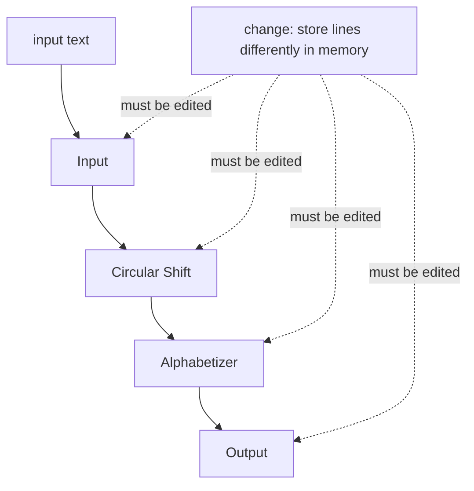
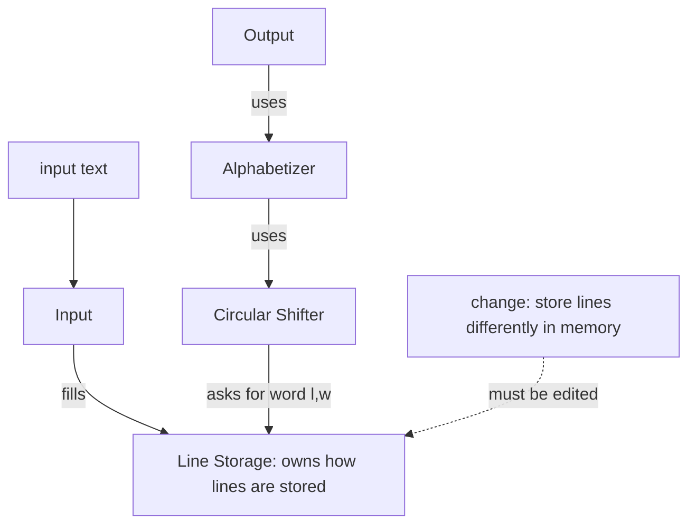
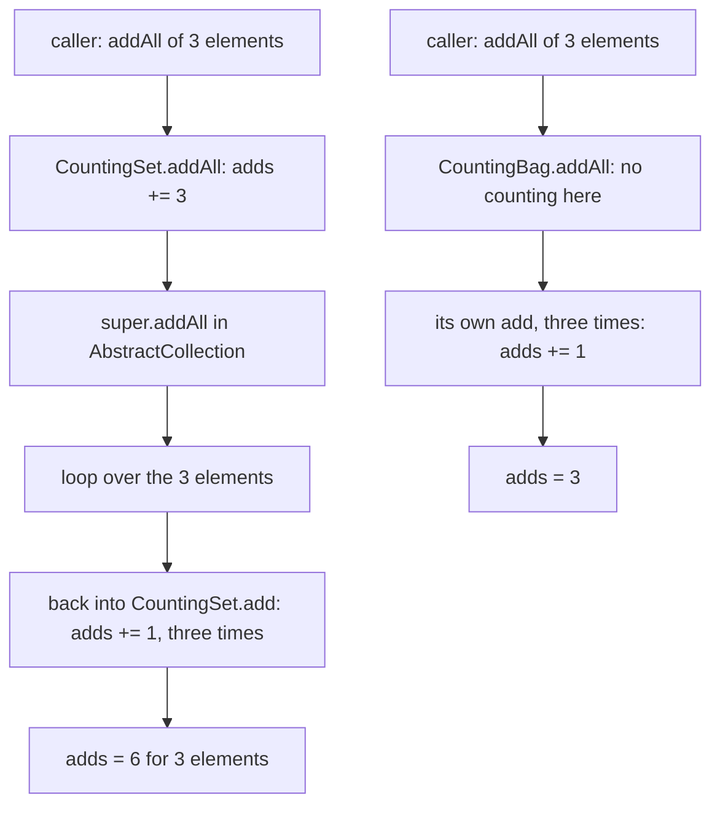
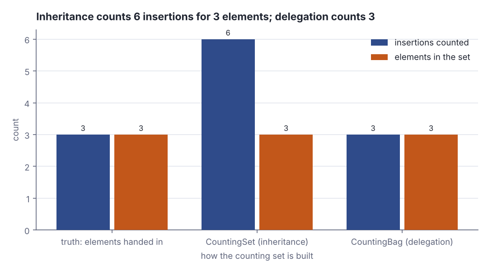

# Composition over inheritance, and information hiding

> Software architecture & design · Beginner · ~25 min · rung 5 of 20 · needs: Coupling and cohesion (architecture-01)

## Why this matters
Every architecture decision you make as a PO — "can we swap the store?", "why did that one-line change touch nine files?" — is a question about where the system's secrets live, and the answer has been written down since 1972.
Inheritance is the mechanism that quietly leaks those secrets: a subclass is coupled not to its parent's interface but to the parent's internal call pattern, which nobody promised to keep.
By the end of this you will have run a three-element insert that a subclass counts as six, and the same job by delegation that counts three.

## The idea

### The criterion: modularise by secrets, not by steps

David Parnas's 1972 paper asks a narrow question and answers it in a way that defined the word *module* for everyone after him. His example is a KWIC index: a Key Word In Context index takes a set of lines, produces every *circular shift* of each line (move the first word to the end, repeat until you are back where you started), and prints all the shifts in alphabetical order. For `pay the bill` the shifts are `pay the bill`, `the bill pay`, `bill pay the`.

He then writes the system twice. **Modularization 1** has modules that are the steps of the flowchart: Input, Circular Shift, Alphabetizer, Output, Master Control. Each step hands the next one a shared data structure — the lines held in core as characters, with an index of where each word starts. **Modularization 2** has Line Storage, Input, Circular Shifter, Alphabetizer, Output, Master Control. The names look similar; the boundaries are not. Line Storage owns the decision *how are lines and words actually stored*, and exposes only calls like "give me word `w` of line `l`". Nobody else knows whether that is an array, a packed blob or something on disk (Parnas, CACM 1972, "Modularization 2").

The criterion Parnas proposes is the point: start from the list of design decisions that are difficult or likely to change, and give each one its own module that hides it. A flowchart is a bad decomposition guide, because the steps of a computation and the decisions of a design are different things (Parnas, CACM 1972, the criteria section).



*Figure 1: Modularization 1 — modules are processing steps, so the storage decision is a shared secret and one change ripples into four of them. Adapted from Parnas, "On the Criteria To Be Used in Decomposing Systems into Modules", 1972, https://dl.acm.org/doi/10.1145/361598.361623*



*Figure 2: Modularization 2 — one module hides the storage decision, so the same change stops at its interface. Adapted from Parnas, "On the Criteria To Be Used in Decomposing Systems into Modules", 1972, https://dl.acm.org/doi/10.1145/361598.361623*

### Information hiding: the interface says as little as it can

A module interface is a promise about what callers may rely on. Information hiding means making that promise as small as possible, so that everything *not* promised is free to change. Here two completely different storage schemes sit behind the same three-method interface:

```scala
trait LineStore:
  def lineCount: Int
  def word(l: Int, w: Int): String

class ArrayStore(ls: Array[Array[String]]) extends LineStore:
  def lineCount = ls.length
  def word(l: Int, w: Int) = ls(l)(w)

class PackedStore(blob: String) extends LineStore:
  private val rows = blob.split('\n').map(_.split(' '))
  def lineCount = rows.length
  def word(l: Int, w: Int) = rows(l)(w)

def firstWords(s: LineStore) = (0 until s.lineCount).map(s.word(_, 0)).mkString(",")
```

```text
ArrayStore  first words: pay,the
PackedStore first words: pay,the
same answer: true
```

`firstWords` never learns which it is holding; it only ever calls `lineCount` and `word`. That is the whole of information hiding: the caller's code contains no fact about the representation, so changing the representation cannot break the caller. The cost is that `word(l, w)` is now a method call rather than an array index — Parnas's own answer to that objection is that the efficiency argument is about the compiled program, not about the module boundary.

### Inheritance is white-box reuse

Now the failure mode. When you extend a class you inherit more than its interface: you inherit its *internal call pattern*, which no interface documents. `java.util.HashSet` does not define `addAll`; it gets the one in `AbstractCollection`, which loops over the collection calling `add` on itself. So a subclass that overrides both `add` and `addAll` to count insertions counts every element twice — once in its own `addAll`, once more when the parent's `addAll` re-enters its own `add`. The lab below runs exactly that and prints 6 for 3 elements.



*Figure 3: the fragile base class. Inheritance lets the parent call back into the override (self-call); delegation cannot, because the inner set has no reference to the wrapper. Source: mechanism of `java.util.AbstractCollection.addAll`, demonstrated by the lab below.*

This is the **fragile base class problem**: the subclass is correct only for one particular implementation of the parent, and a later JDK that makes `HashSet` implement `addAll` directly would silently change the subclass's answer from 6 to 3. Inheritance is *white-box* reuse — reuse that requires knowing how the reused thing is built.

Scala's traits are the same mechanism with better composition. The Scala 3 Book is explicit about why you reach for them:

> "Traits are more flexible to compose—you can mix in multiple traits, but only extend one class—and should be preferred to classes and abstract classes most of the time. The rule of thumb is to use classes whenever you want to create instances of a particular type, and traits when you want to decompose and reuse behaviour."
> — Scala 3 Book, *Domain Modeling — Tools*, "Traits", accessed 2026-11-22, https://docs.scala-lang.org/scala3/book/domain-modeling-tools.html

Better composition, same white-box exposure. A mixin that calls `super` is reaching into the linearised chain beneath it, and what the bottom of the chain receives is whatever the layers above decided to pass:

```scala
trait Base:
  val seen = scala.collection.mutable.ListBuffer[String]()
  def push(x: Int): Unit = seen += s"Base.push($x)"

trait Doubling extends Base:
  override def push(x: Int): Unit =
    seen += s"Doubling.push($x)"
    super.push(x * 2)

val s = new Base with Doubling {}
s.push(5)
println(s.seen.mkString(" -> "))
```

```text
Doubling.push(5) -> Base.push(10)
```

`Base.push` was called with 5 from the outside and saw 10. Nothing in `Base`'s signature warned that a mixin could rewrite its arguments; change the order of mixins and you change the answer. Mix in traits for behaviour you own, and keep `super`-chains shallow.

### Composition, delegation, and ADTs

The alternative is to *hold* the thing instead of *being* it. A wrapper owns a `Set`, calls only its public methods, and counts in one place; the inner set has no way to call back into the wrapper, so there is no self-call to double-count. That is *black-box* reuse, and it is what "favour composition over inheritance" means. You pay for it in forwarding methods and in losing the `is-a` relation — a `CountingBag` is not a `java.util.Set` and cannot be passed where one is expected.

Scala's third option removes the hierarchy altogether. An algebraic data type lists the shapes the data can take, and behaviour lives in ordinary functions that pattern-match on them:

```scala
enum Shape:
  case Circle(r: Double)
  case Rect(w: Double, h: Double)
  case Square(side: Double)

def area(s: Shape): Double = s match
  case Shape.Circle(r)  => math.Pi * r * r
  case Shape.Rect(w, h) => w * h
  case Shape.Square(a)  => a * a

val shapes = List(Shape.Circle(1.0), Shape.Rect(2.0, 3.0), Shape.Square(2.0))
shapes.foreach(s => println(f"$s%-18s area=${area(s)}%.3f"))
```

```text
Circle(1.0)        area=3.142
Rect(2.0,3.0)      area=6.000
Square(2.0)        area=4.000
```

No base class, no `super`, nothing to override — the only thing `area` can depend on is the set of cases, and the compiler checks it covered them. The Scala 3 Book describes the construct plainly: "An enumeration can be used to define a type that consists of a finite set of named values" (Scala 3 Book, *Domain Modeling — Tools*, "Enums"). Case classes supply the data half, and because their fields are immutable the compiler generates `unapply`, `copy`, structural `equals`/`hashCode` and `toString` for you (Scala 3 Book, *Domain Modeling — Tools*, "Case classes").

The trade is real and worth naming. An ADT is closed to new cases and open to new functions: adding `perimeter` touches nothing, adding `Triangle` makes every match fail to compile — which is usually what you want, since the compiler shows you each place to fix. A class hierarchy is the mirror image: adding a subclass touches nothing, adding a method touches every subclass. Pick by which axis your domain actually grows along.

## Lab
**The question:** how many insertions does a counting set see when you hand it three elements — and how many modules must you edit when the way lines are stored changes?

Copy the program into `Lab.scala` and run `scala Lab.scala`.

### Step 1 — KWIC the Parnas way, twice
`Mod1` is Modularization 1: every function's signature names `Array[Array[String]]`, the shared representation. `Mod2` is Modularization 2: `LineStorage` owns the representation and two implementations of it — an array of arrays, and one flat string with integer offsets — are run through the same shifter, alphabetizer and output.

### Step 2 — count the modules a storage change touches
Each module is listed with its interface signature; the program marks every module whose interface names the secret `Array[Array[String]]`, because those are the ones a representation change forces you to edit.

### Step 3 — the fragile base class and its wrapper
`CountingSet` extends `java.util.HashSet` and overrides `add` and `addAll`, printing each call as it happens. `CountingBag` does the same job by holding a `java.util.Set` and forwarding to it.

```scala
// file: Lab.scala
import scala.collection.mutable

// ============ Step 1a: KWIC, Modularization 1 - modules are processing steps ============
// Every module's interface names the shared representation: Array[Array[String]].
object Mod1:
  type Lines = Array[Array[String]]
  def input(text: String): Lines =
    text.split('\n').map(_.trim.split(' '))
  def circularShifts(ls: Lines): Lines =
    for l <- ls; i <- l.indices yield l.drop(i) ++ l.take(i)
  def alphabetize(sh: Lines): Lines =
    sh.sortBy(_.mkString(" ").toLowerCase)
  def output(sh: Lines): Seq[String] =
    sh.toSeq.map(_.mkString(" "))
  def run(text: String): Seq[String] =
    output(alphabetize(circularShifts(input(text))))

// ============ Step 1b: KWIC, Modularization 2 - modules hide a decision ============
// LineStorage hides HOW lines sit in memory. Nobody else can see the representation.
trait LineStorage:
  def lineCount: Int
  def wordCount(l: Int): Int
  def word(l: Int, w: Int): String

class ArrayLineStorage(text: String) extends LineStorage:
  private val rows: Array[Array[String]] = text.split('\n').map(_.trim.split(' '))
  def lineCount = rows.length
  def wordCount(l: Int) = rows(l).length
  def word(l: Int, w: Int) = rows(l)(w)
  override def toString = "ArrayLineStorage(Array[Array[String]])"

// A different secret, same interface: one flat blob plus integer offsets into it.
class PackedLineStorage(text: String) extends LineStorage:
  private val blob: String = text.split('\n').map(_.trim).mkString(" ")
  private val index: Array[Array[(Int, Int)]] =
    var pos = 0
    val out = mutable.ArrayBuffer[Array[(Int, Int)]]()
    for line <- text.split('\n').map(_.trim) do
      val spans = mutable.ArrayBuffer[(Int, Int)]()
      var start = pos
      for i <- 0 to line.length do
        if i == line.length || line(i) == ' ' then
          spans += ((start, pos + i))
          start = pos + i + 1
      pos += line.length + 1
      out += spans.toArray
    out.toArray
  def lineCount = index.length
  def wordCount(l: Int) = index(l).length
  def word(l: Int, w: Int) =
    val (a, b) = index(l)(w)
    blob.substring(a, b)
  override def toString = "PackedLineStorage(String + offsets)"

// Shifter, alphabetizer and output talk only to the interface above.
class CircularShifter(store: LineStorage):
  val shifts: Array[(Int, Int)] =
    for l <- (0 until store.lineCount).toArray; i <- 0 until store.wordCount(l) yield (l, i)
  def render(s: (Int, Int)): String =
    val (l, i) = s
    val n = store.wordCount(l)
    (0 until n).map(k => store.word(l, (i + k) % n)).mkString(" ")

class Alphabetizer(sh: CircularShifter):
  val ordered: Array[(Int, Int)] = sh.shifts.sortBy(s => sh.render(s).toLowerCase)

object Mod2:
  def run(store: LineStorage): Seq[String] =
    val sh = CircularShifter(store)
    Alphabetizer(sh).ordered.toSeq.map(sh.render)

// ============ Step 2: which modules must be edited when the secret changes? ============
case class Module(name: String, signature: String)
val mod1Modules = Seq(
  Module("Input",           "input(text: String): Array[Array[String]]"),
  Module("CircularShifter", "circularShifts(ls: Array[Array[String]]): Array[Array[String]]"),
  Module("Alphabetizer",    "alphabetize(sh: Array[Array[String]]): Array[Array[String]]"),
  Module("Output",          "output(sh: Array[Array[String]]): Seq[String]"),
  Module("MasterControl",   "run(text: String): Seq[String]"))
val mod2Modules = Seq(
  Module("LineStorage",     "word(l: Int, w: Int): String  // owns the representation"),
  Module("Input",           "ArrayLineStorage(text: String): LineStorage"),
  Module("CircularShifter", "CircularShifter(store: LineStorage)"),
  Module("Alphabetizer",    "Alphabetizer(sh: CircularShifter)"),
  Module("Output",          "render(s: (Int, Int)): String"),
  Module("MasterControl",   "run(store: LineStorage): Seq[String]"))

def exposure(ms: Seq[String], secret: String): Int =
  ms.count(_.contains(secret))

// ============ Step 3a: the fragile base class ============
class CountingSet[A] extends java.util.HashSet[A]:
  var adds = 0
  override def add(e: A): Boolean =
    adds += 1
    println(s"    CountingSet.add($e)      -> adds = $adds")
    super.add(e)
  override def addAll(c: java.util.Collection[? <: A]): Boolean =
    adds += c.size
    println(s"    CountingSet.addAll(${c.size} elems) -> adds = $adds")
    super.addAll(c)

// ============ Step 3b: the same job by delegation ============
class CountingBag[A](inner: java.util.Set[A]):
  private var n = 0
  def adds: Int = n
  def size: Int = inner.size
  def add(e: A): Boolean =
    n += 1
    println(s"    CountingBag.add($e)      -> adds = $n")
    inner.add(e)
  def addAll(c: java.util.Collection[? <: A]): Boolean =
    println(s"    CountingBag.addAll(${c.size} elems) -> delegating element by element")
    var changed = false
    c.forEach(e => if add(e) then changed = true)
    changed

@main def lab(): Unit =
  val text = "pay the bill\nthe bill came"

  println("=== Step 1: Modularization 1 (modules = processing steps) ===")
  Mod1.run(text).foreach(s => println(s"  $s"))

  println("\n=== Step 2: Modularization 2 (LineStorage hides the representation) ===")
  val a: LineStorage = ArrayLineStorage(text)
  val p: LineStorage = PackedLineStorage(text)
  val outA = Mod2.run(a)
  val outP = Mod2.run(p)
  println(s"  storage = $a")
  outA.foreach(s => println(s"    $s"))
  println(s"  storage = $p")
  outP.foreach(s => println(s"    $s"))
  println(s"  identical output across both representations: ${outA == outP}")

  println("\n=== Step 3: change 'store lines differently in memory' ===")
  val secret = "Array[Array[String]]"
  println("  modularisation  module            interface names the secret?")
  for (label, ms) <- Seq("Mod 1" -> mod1Modules, "Mod 2" -> mod2Modules); m <- ms do
    val hit = m.signature.contains(secret) || m.signature.contains("owns the representation")
    println(f"  $label%-15s ${m.name}%-17s ${if hit then "YES  must be edited" else "no"}")
  val e1 = exposure(mod1Modules.map(_.signature), secret)
  val e2 = mod2Modules.count(_.signature.contains("owns the representation"))
  println(s"  modules to edit: Mod 1 = $e1 of ${mod1Modules.size}, Mod 2 = $e2 of ${mod2Modules.size}")

  println("\n=== Step 4: CountingSet extends java.util.HashSet (inheritance) ===")
  val cs = CountingSet[String]()
  val three = java.util.List.of("a", "b", "c")
  println("  calling cs.addAll(List.of(\"a\",\"b\",\"c\"))")
  cs.addAll(three)
  println(s"  elements in the set : ${cs.size}")
  println(s"  insertions counted  : ${cs.adds}")

  println("\n=== Step 5: CountingBag delegates to a java.util.Set (composition) ===")
  val cb = CountingBag[String](java.util.HashSet[String]())
  println("  calling cb.addAll(List.of(\"a\",\"b\",\"c\"))")
  cb.addAll(three)
  println(s"  elements in the set : ${cb.size}")
  println(s"  insertions counted  : ${cb.adds}")

  println("\n=== Summary ===")
  println(f"  ${"what"}%-34s ${"insertions"}%10s ${"elements"}%9s")
  println(f"  ${"truth (elements handed in)"}%-34s ${3}%10d ${3}%9d")
  println(f"  ${"CountingSet (inheritance)"}%-34s ${cs.adds}%10d ${cs.size}%9d")
  println(f"  ${"CountingBag (delegation)"}%-34s ${cb.adds}%10d ${cb.size}%9d")
```

### Step 4 — run it
`python3 dojo/engine/run_lab.py 2026-11-22-1` (or `scala Lab.scala` on your Mac). Real output, first half:

```text
=== Step 1: Modularization 1 (modules = processing steps) ===
  bill came the
  bill pay the
  came the bill
  pay the bill
  the bill came
  the bill pay

=== Step 2: Modularization 2 (LineStorage hides the representation) ===
  storage = ArrayLineStorage(Array[Array[String]])
    bill came the
    bill pay the
    came the bill
    pay the bill
    the bill came
    the bill pay
  storage = PackedLineStorage(String + offsets)
    bill came the
    bill pay the
    came the bill
    pay the bill
    the bill came
    the bill pay
  identical output across both representations: true

=== Step 3: change 'store lines differently in memory' ===
  modularisation  module            interface names the secret?
  Mod 1           Input             YES  must be edited
  Mod 1           CircularShifter   YES  must be edited
  Mod 1           Alphabetizer      YES  must be edited
  Mod 1           Output            YES  must be edited
  Mod 1           MasterControl     no
  Mod 2           LineStorage       YES  must be edited
  Mod 2           Input             no
  Mod 2           CircularShifter   no
  Mod 2           Alphabetizer      no
  Mod 2           Output            no
  Mod 2           MasterControl     no
  modules to edit: Mod 1 = 4 of 5, Mod 2 = 1 of 6
```

And the second half:

```text
=== Step 4: CountingSet extends java.util.HashSet (inheritance) ===
  calling cs.addAll(List.of("a","b","c"))
    CountingSet.addAll(3 elems) -> adds = 3
    CountingSet.add(a)      -> adds = 4
    CountingSet.add(b)      -> adds = 5
    CountingSet.add(c)      -> adds = 6
  elements in the set : 3
  insertions counted  : 6

=== Step 5: CountingBag delegates to a java.util.Set (composition) ===
  calling cb.addAll(List.of("a","b","c"))
    CountingBag.addAll(3 elems) -> delegating element by element
    CountingBag.add(a)      -> adds = 1
    CountingBag.add(b)      -> adds = 2
    CountingBag.add(c)      -> adds = 3
  elements in the set : 3
  insertions counted  : 3

=== Summary ===
  what                               insertions  elements
  truth (elements handed in)                  3         3
  CountingSet (inheritance)                   6         3
  CountingBag (delegation)                    3         3
```



*Figure 4: the blue bars are what each counter reports, the orange bars what the set actually holds. Only the inheritance version disagrees with itself. Generated from the lab output above with `python3 dojo/engine/chart.py dojo/lessons/assets/2026-11-22-1-chart-1.json`.*

### Reading the output

**Block one — the two modularisations.** Three things to read. First, both modularisations print the same six circular shifts, so they compute the same KWIC index; nothing in the comparison is about correctness. Second, `ArrayLineStorage` and `PackedLineStorage` keep lines in completely different shapes — an `Array[Array[String]]` versus one flat `String` plus `(start, end)` offset pairs — and the shifter, alphabetizer and output code is byte-for-byte the same for both; `identical output across both representations: true` is the proof. Third, the table: a `YES` means that module's interface names `Array[Array[String]]`, so a change of representation forces an edit there.

| modularisation | modules | must be edited | share |
|---|---|---|---|
| Mod 1 (by processing step) | 5 | 4 | 80% |
| Mod 2 (by hidden decision) | 6 | 1 | 17% |

Trace Mod 1 by hand: `input` returns `Array[Array[String]]` (1), `circularShifts` takes and returns it (2), `alphabetize` takes and returns it (3), `output` takes it (4); only `run(text: String): Seq[String]` never mentions it. 4 ÷ 5 = 0.8, so 80%. In Mod 2 only `LineStorage` names it: 1 ÷ 6 = 0.1666…, so 17%. Lower is better — it is the number of files in the pull request.

**Verdict:** the same change costs four edits under decomposition by processing step and one under decomposition by secret, with identical behaviour either way.

**Block two — the counting sets.** Each indented line is one method entry printed as it happens, with the running counter after it. `elements in the set` is what the underlying set actually holds; `insertions counted` is what the counter believes. They should agree.

| what | insertions counted | elements in the set | correct? |
|---|---|---|---|
| truth (elements handed in) | 3 | 3 | — |
| `CountingSet` (inheritance) | 6 | 3 | no |
| `CountingBag` (delegation) | 3 | 3 | yes |

Trace the 6 with digits. `cs.addAll(["a","b","c"])` enters the override, which does `adds += c.size` → `adds = 0 + 3 = 3`. It then calls `super.addAll(c)`, which is `java.util.AbstractCollection.addAll`, and that method loops over the three elements calling `add(e)` **on `this`** — and `this` is the `CountingSet`, so each call lands in the override: `3 + 1 = 4`, `4 + 1 = 5`, `5 + 1 = 6`. The set itself still holds 3 elements, so the counter is off by exactly the batch size. `CountingBag` never offers the parent a chance to call back: its `addAll` prints once and then calls its own `add` three times, `0 + 1 + 1 + 1 = 3`.

**Verdict:** inheritance reports 6 insertions for 3 elements and delegation reports 3; the bug lives in the invisible self-call, not in either counter's arithmetic.

### Cause → consequence

1. **Cause.** `java.util.HashSet` does not implement `addAll`; it inherits `AbstractCollection.addAll`, whose body calls `this.add(e)` once per element. That self-call is an implementation detail — it appears in no interface, no Javadoc contract and no type signature.
2. **Mechanism.** Overriding a method in a subclass rebinds every call to it, including calls the *parent* makes to itself. The subclass therefore depends on the parent's internal call pattern, which nobody promised to preserve. That is the fragile base class problem, and it is why inheritance is called white-box reuse.
3. **Consequence.** The counter is wrong by the batch size — and it would silently become right again, changing behaviour with no code change on your side, if a later JDK gave `HashSet` its own `addAll`. Either way you learn about it from production numbers, not from the compiler.
4. **What it means in practice.** When you need to add behaviour to something you do not own, hold it and forward to it; the inner object cannot call back into you, so there is no self-call to double-count. Reserve `extends` and trait mixins for hierarchies you control and can change in one commit, and keep `super`-chains shallow. When the domain is data plus operations rather than objects plus overrides, skip the hierarchy and use an `enum` ADT with pattern-matching functions — then the compiler tells you every site that a new case touches. And when you are deciding where a module boundary goes, ask Parnas's question first: what decision does this module hide, and who would have to change if that decision changed?

## Self-check
1. Parnas's KWIC system has roughly the same module *names* in both decompositions, yet one of them survives a change of storage representation and the other does not. What exactly is different? <details><summary>Answer</summary>The boundaries, not the names. In Modularization 1 the modules are the steps of the computation (input, shift, alphabetize, output) and they all share one data structure, so the storage decision is public knowledge among them — the lab shows 4 of 5 module interfaces naming `Array[Array[String]]`. In Modularization 2 one module, Line Storage, owns that decision and exposes only `word(l, w)`-style calls; the lab shows 1 of 6 interfaces naming it, so the change stops there. Parnas's criterion is to pick boundaries from the list of decisions likely to change, not from the flowchart.</details>
2. `CountingSet` overrides both `add` and `addAll` and still miscounts. Where is the dependency that nobody declared, and why does the delegating wrapper not have it? <details><summary>Answer</summary>The dependency is on `AbstractCollection.addAll` calling `this.add(e)` for each element. Because `this` is the subclass, the override intercepts the parent's own internal calls, and the element is counted twice: once in the subclass `addAll` (`adds = 3`) and once per element on re-entry (`4, 5, 6`). The wrapper holds a plain `java.util.HashSet` and calls only its public methods; the inner set has no reference back to the wrapper, so it cannot re-enter the counting code. Inheritance is white-box reuse (you depend on how the parent is built), delegation is black-box reuse (you depend only on what it promises).</details>
3. You are modelling payment instruments — card, bank transfer, voucher — and expect to keep adding *operations* (validate, settle, refund, report) more often than new instrument kinds. Hierarchy or ADT, and what breaks if you guess wrong? <details><summary>Answer</summary>An ADT: a Scala 3 `enum` with one case per instrument and each operation as a function that pattern-matches. Adding an operation then touches exactly one new function and no existing code. A class hierarchy would force you to add a method to every subclass for each new operation. The mirror risk is real: if instrument kinds turn out to churn instead, every `match` in the codebase fails to compile when you add one — though that is a loud failure the compiler hands you with a list of sites, rather than a silent one.</details>

## Sources
- [On the Criteria To Be Used in Decomposing Systems into Modules (D. L. Parnas, CACM 1972)](https://dl.acm.org/doi/10.1145/361598.361623) — D. L. Parnas, Communications of the ACM 15(12), December 1972. Supplied the KWIC index example and its two decompositions (Modularization 1 by processing step, Modularization 2 by hidden decision) and the criterion of modularising by design decisions likely to change; Figures 1 and 2 are redrawn from it. The ACM page is paywalled and the paper is not openly licensed, so it is cited by locator and no passage is quoted (accessed 2026-11-22).
- [Scala 3 Book — Domain Modeling, Tools](https://docs.scala-lang.org/scala3/book/domain-modeling-tools.html) — Scala documentation team. Supplied the quoted guidance on traits versus classes, and the descriptions of enums as finite sets of named values and of the methods the compiler generates for case classes (accessed 2026-11-22). The quoted wording was read from the page's own source file, [`_overviews/scala3-book/domain-modeling-tools.md`](https://raw.githubusercontent.com/scala/docs.scala-lang/main/_overviews/scala3-book/domain-modeling-tools.md), because the rendered site was not reachable from this environment (accessed 2026-11-22).


## Next on this track
Next on Software architecture & design: **Layered, hexagonal (ports and adapters) and clean architecture** (rung 6 of 20, Intermediate).
