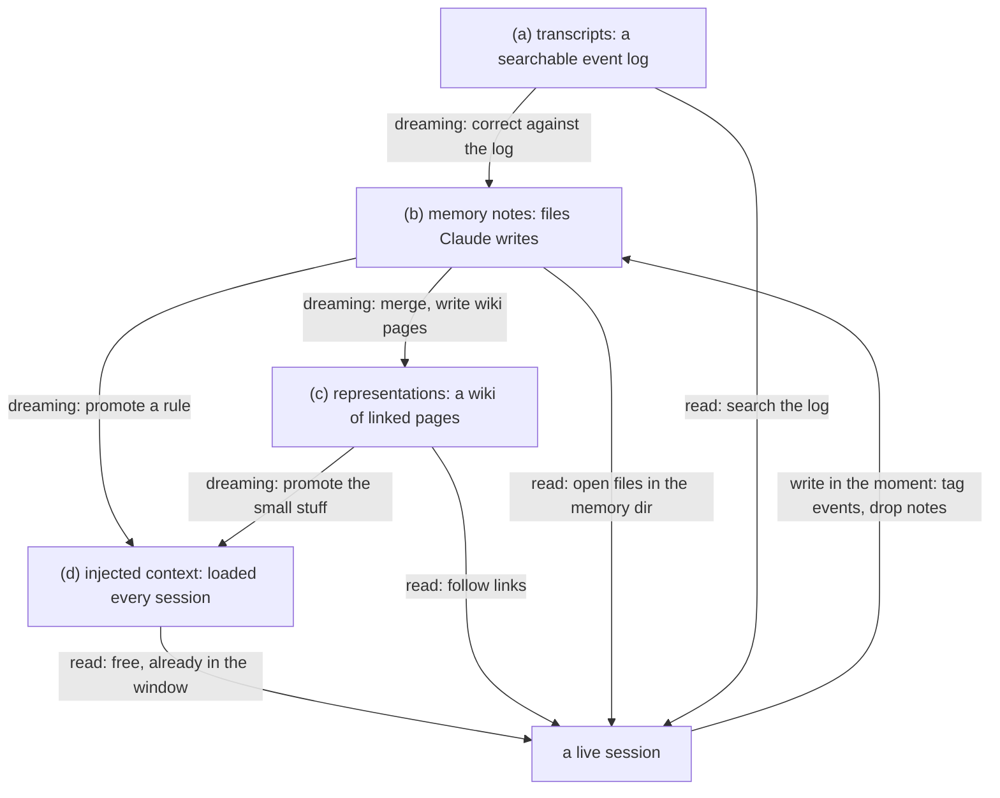
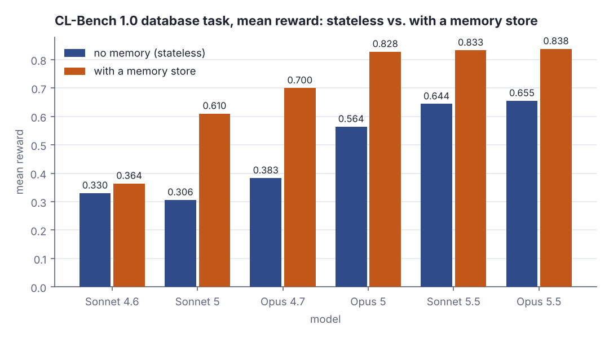
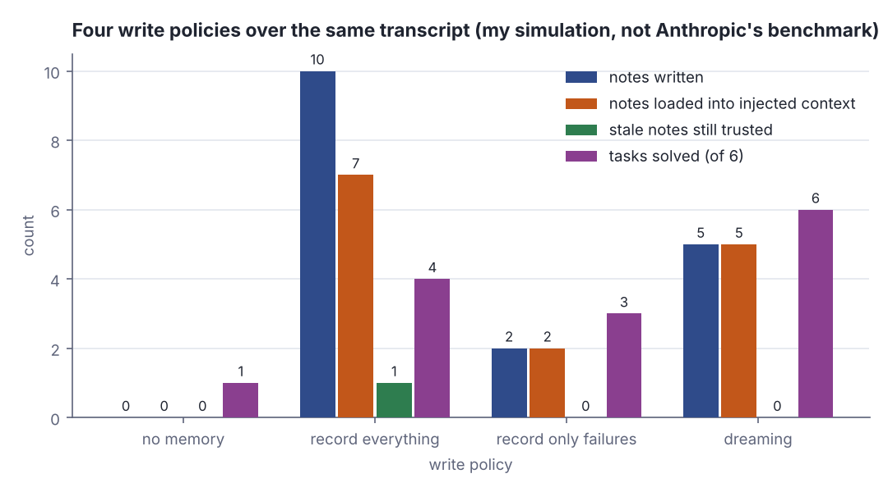

# Agent memory in four layers, and the offline pass that fixes it

> Fresh · AI / ML foundations · Intermediate · ~25 min · from today's feeds

## Why this matters

You write and maintain the context files other teams inherit, so you are already making the call
about what an agent should remember — and on 2026-11-06 Anthropic published how its engineering
team now frames that call (Anthropic, "The components of agent memory", 2026-11-06,
https://www.anthropic.com/research/components-of-agent-memory). It names four distinct storage
layers and an offline repair pass between them, which turns "write a good MEMORY.md" into a
design with parts you can reason about separately. The failure it documents most sharply — a note
that was right when written, is wrong now, and is still trusted every session — is exactly the
one that bites a shared instruction file.

## Primer

A model has no state of its own between runs. Everything it "knows" at inference time is either
baked into its weights or present in the **context window**: the bounded block of text — system
prompt, your messages, tool results, its own output so far — that it reads before producing each
token. When a session ends the window is thrown away, so the next session starts blank. Anything
that is to survive has to be written somewhere outside the window and read back in.

An **agent session** is one such run with tools attached: the model reads, calls a tool, reads the
result, calls another, until it stops. The **transcript** is the full ordered record of that run —
every message, tool call and result. It is the rawest thing you can keep.

Two nearby things are explicitly *not* memory in this post. **In-context learning** is the model
picking up a pattern from examples inside one conversation; it dies with the window.
**Compaction** is replacing older turns with a summary so a long session fits in the window; it
moves text around inside one session rather than carrying anything to the next. The post defines
agent memory as knowledge Claude gains from experience and keeps between sessions as readable
context, and excludes weight changes, in-context learning and compaction from that definition
(Anthropic, "The components of agent memory", 2026-11-06,
https://www.anthropic.com/research/components-of-agent-memory).

Last term: **mean reward**. On an agentic benchmark each task ends with an automatic check — did
the database end up in the required state, for example — scored between 0 and 1. The mean reward
is that score averaged over the task set. A move from 0.564 to 0.828 means the same agent now
passes the checker substantially more often; it is not a percentage of anything you can inspect
by hand.

## The idea

### Four places a memory can live

The post's central move is to stop treating "agent memory" as one store and split it into a
hierarchy of four layers, bottom to top: (a) **transcripts**, a searchable event log; (b)
**memory notes** written by Claude; (c) **memory representations** such as wikis; and (d)
**injected context**, loaded into every session (Anthropic, "The components of agent memory",
2026-11-06, https://www.anthropic.com/research/components-of-agent-memory). Each layer is cheaper
to write and more expensive to read than the one above it: a transcript costs nothing to keep but
needs a search, while injected context costs tokens every session and needs no search.

> "Agent memory can use a similar division of labor."
> — Anthropic, *The components of agent memory*, 2026-11-06, https://www.anthropic.com/research/components-of-agent-memory



*Figure 1: The four layers, the offline dreaming pass that moves information upward, and the four read paths a live session can take. Source: drawn for this lesson from Anthropic, "The components of agent memory", 2026-11-06 (Figure 1), https://www.anthropic.com/research/components-of-agent-memory*

There are two write paths. **In the moment**, during a session, Claude can tag a salient event in
its own log or write a note into a memory store — in practice a folder of files. **Offline**, a
separate process the post calls **dreaming**, modelled on sleep-time consolidation, re-reads
transcripts and pushes information up: it corrects notes, merges them, writes wiki pages and
promotes a few facts into the top layer. A wiki page is one Claude writes and maintains on a
single subject, linked to other notes, and the links double as a map for locating memories. When
several dreaming sessions run in sequence they share a log so each builds on the last.

### A note is a prediction

The reason this is hard is that salience cannot be judged at write time with the information you
have at write time. The agent does not know what it will be asked next week.

> "By writing down a rule, an agent predicts that the pattern it’s describing will be relevant again."
> — Anthropic, *The components of agent memory*, 2026-11-06, https://www.anthropic.com/research/components-of-agent-memory

Predictions can be scored after the fact. Here are three notes checked against what a later
session needed and what the environment now holds:

```scala
val notes = Map("db.port" -> "5433", "pokecenter.route" -> "route-4: PokeCenter")
val truthNow = Map("db.port" -> "5433", "pokecenter.route" -> "route-4: no PokeCenter")
val neededLater = List("db.port", "pokecenter.route", "index.name")
for k <- neededLater do
  val verdict = (notes.get(k), truthNow.get(k)) match
    case (Some(v), Some(t)) if v == t => "prediction held"
    case (Some(v), Some(_))           => "prediction broke, note still trusted"
    case (None, _)                    => "nothing was written"
    case (Some(_), None)              => "note unused"
  println(f"$k%-18s note=${notes.getOrElse(k, "-")}%-22s $verdict")
```

```text
db.port            note=5433                   prediction held
pokecenter.route   note=route-4: PokeCenter    prediction broke, note still trusted
index.name         note=-                      nothing was written
```

Only the first is a win; the second is worse than having written nothing, because a wrong note is
read with the same confidence as a right one; the third is the cost of being conservative. The post's Pokémon Red comparison is this trade-off at
scale: Sonnet 3.7 wrote 413 memory files across 225 folders (977,930 characters) and earned one
badge, while Fable 5 wrote nine files in two folders plus a top-level global.md (43,406
characters) and earned four badges (Anthropic, "The components of agent memory", 2026-11-06,
https://www.anthropic.com/research/components-of-agent-memory). Around step 10,000 Sonnet 3.7
spent 17 steps creating six files, deleting nine others and taking no action in the game at all
(same source).

### The top layer is the scarce one

> "Injected memories use up valuable tokens, and an incorrect note can be carried into every session."
> — Anthropic, *The components of agent memory*, 2026-11-06, https://www.anthropic.com/research/components-of-agent-memory

This is the layer you touch professionally. The post notes that Claude Code's auto memory loads
only the first 200 lines or 25 KB of MEMORY.md, which therefore works as an index rather than as
the knowledge itself (Anthropic, "The components of agent memory", 2026-11-06,
https://www.anthropic.com/research/components-of-agent-memory). A fixed budget filled in write
order behaves like this:

```scala
val index = List("db.port" -> 32, "chatter.greeting" -> 38, "pokecenter.route" -> 56,
                 "chatter.summary" -> 37, "auth.header" -> 42, "retry.backoff" -> 45,
                 "chatter.ack" -> 33, "pokecenter.route" -> 59, "chatter.handoff" -> 37,
                 "index.name" -> 44)
var used = 0
for (name, b) <- index do
  val fits = used + b <= 300
  if fits then used += b
  println(f"$name%-18s $b%3d B  used=$used%3d  ${if fits then "loaded" else "DROPPED"}")
```

```text
db.port             32 B  used= 32  loaded
chatter.greeting    38 B  used= 70  loaded
pokecenter.route    56 B  used=126  loaded
chatter.summary     37 B  used=163  loaded
auth.header         42 B  used=205  loaded
retry.backoff       45 B  used=250  loaded
chatter.ack         33 B  used=283  loaded
pokecenter.route    59 B  used=283  DROPPED
chatter.handoff     37 B  used=283  DROPPED
index.name          44 B  used=283  DROPPED
```

Four low-value entries consumed 145 of the 300 bytes, and the correction to `pokecenter.route` —
written later, because the environment changed later — fell outside the window entirely. The old,
wrong entry is still in there. Over-recording does not merely waste tokens; it evicts the fixes.

### Dreaming, and what it buys

> "Dreaming gives Claude a way to test its notes against the original transcripts (Figure 6)."
> — Anthropic, *The components of agent memory*, 2026-11-06, https://www.anthropic.com/research/components-of-agent-memory

Because the transcript is kept, a wrong note is falsifiable: an offline pass can re-read the
source and repair it. On a Pokémon navigation run the memory-plus-dreaming agent reached Cerulean
at action 1,935, the raw-memory agent fell off the ledge and backtracked to Pewter City (dropping
back onto the earlier route three times over 3,000 cumulative actions), and the no-memory agent
never reached Cerulean (Anthropic, "The components of agent memory", 2026-11-06,
https://www.anthropic.com/research/components-of-agent-memory). On a corpus of ~350,000 files and
~420M tokens with 25 evaluation questions, 128 dreaming sessions took performance from 13% to 48%
of graded criteria, and a wiki plus search rose from 54% to 61% against 53% for search alone while
saving about 20,000 tokens per question (same source).

Simply having a store helps a lot, before any dreaming:



*Figure 2: Every number here is quoted from the post, not measured by me — mean reward on the CL-Bench 1.0 database task. Adapted from Anthropic, "The components of agent memory", 2026-11-06, https://www.anthropic.com/research/components-of-agent-memory*

Two things matter more than the sizes of the jumps. First, with memory Opus 5.5
(0.838) and Sonnet 5.5 (0.833) land about where Opus 5 does (0.828) even though their stateless
baselines were slightly higher, which is the post's own observation. Second, Sonnet 4.6 barely
moves (0.330 → 0.364) — and the post shows that is a *usage* problem, not a storage one: Sonnet 5
read its memory before answering 9 times out of 10, Sonnet 4.6 less than half the time, and
prompting Sonnet 4.6 to read its memory and test theories took it from 0.364 to 0.641 (Anthropic,
"The components of agent memory", 2026-11-06,
https://www.anthropic.com/research/components-of-agent-memory).

The same post is blunt about the costs. Dreaming needs compute, so checking every memory
continuously may be impractical and you tune the cadence or focus on volatile information. Its
outputs are not immediately available to the session that generated the transcript. Hand-written
salience rules can *remove* the benefit: the rule "record only failures" changed memory gain by
−0.234 for Opus 5 and −0.150 for Opus 4.7 while barely touching Sonnet 4.6 (−0.020) (same source).
And representations can bloat — one wiki came out at 68 pages, 255 links and 203 KB from a 115 KB
corpus, 1.77 times the size of its source, abstracting nothing (same source).

## Lab

**Question: over one fixed transcript, which write policy leaves a session able to answer the most
questions — and what does over-recording actually cost?**

This is a simulation of the mechanism the post describes, run on numbers I made up. Nothing below
reproduces Anthropic's benchmark; treat the two as separate things.

### Step 1 — the setup

Layer (a) is a hand-written transcript of ten events over three sessions. Six are durable facts
worth remembering, four are noise. One key, `pokecenter.route`, is observed as true in session 1
and contradicted in session 3 — the environment changed under the note. Session 4 then asks six
questions, each with a `truth` value as the environment holds it *now*. One question is easy and
is solved by rediscovery with no memory at all; the other five need a remembered fact.

### Step 2 — four write policies over the same log

`recordEverything` turns every event into a note. `recordOnlyFailures` applies the post's steering
rule and writes only when an event failed. `dreaming` ignores both and re-reads the transcript
offline: one note per key, keeping the **latest** observation, which repairs the stale one. Layer
(d) is a 300-byte injected index filled in write order — a toy stand-in for the 200-line / 25 KB
auto-memory window. Notes past the budget stay in the store but never reach the session.

### Step 3 — run it

```scala
// file: Lab.scala
// A deterministic simulation of the four memory layers and the dreaming pass described in
// Anthropic, "The components of agent memory", 2026-11-06. These are MY numbers from a toy
// model of the mechanism, not a reproduction of that post's benchmark.

case class Event(session: Int, key: String, ok: Boolean, observed: String, durable: Boolean)
case class Note(key: String, value: String, body: String):
  def bytes: Int = body.getBytes("UTF-8").length
case class Task(key: String, truth: String, easy: Boolean)

// Layer (a): the transcript. A searchable event log of three past sessions.
val transcript = List(
  Event(1, "db.port",          true,  "5433",                  true),
  Event(1, "chatter.greeting", true,  "-",                     false),
  Event(1, "pokecenter.route", true,  "route-4: PokeCenter",   true),
  Event(2, "chatter.summary",  true,  "-",                     false),
  Event(2, "auth.header",      false, "X-Trace-Id",            true),
  Event(2, "retry.backoff",    true,  "jitter=full",           true),
  Event(2, "chatter.ack",      true,  "-",                     false),
  Event(3, "pokecenter.route", false, "route-4: no PokeCenter", true),
  Event(3, "chatter.handoff",  true,  "-",                     false),
  Event(3, "index.name",       true,  "idx_orders_ts",         true)
)

// What session 4 is actually asked. truth = the value the environment holds NOW.
val tasks = List(
  Task("build.flag",       "-Yexplicit-nulls",      true),
  Task("db.port",          "5433",                  false),
  Task("auth.header",      "X-Trace-Id",            false),
  Task("retry.backoff",    "jitter=full",           false),
  Task("pokecenter.route", "route-4: no PokeCenter", false),
  Task("index.name",       "idx_orders_ts",         false)
)

val Budget = 300 // bytes of layer (d), injected context: a toy MEMORY.md window

def noteOf(e: Event): Note =
  if e.durable then Note(e.key, e.observed, s"# ${e.key}\n${e.observed}\nseen in session ${e.session}")
  else Note(e.key, "-", s"# ${e.key}\nsession ${e.session} went fine")

def recordEverything: List[Note] = transcript.map(noteOf)
def recordOnlyFailures: List[Note] = transcript.filter(!_.ok).map(noteOf)

// The dreaming pass: re-read the transcript offline, keep one note per key, and take the
// LATEST observation as the value, which repairs a note the environment has invalidated.
def dreaming: List[Note] =
  val durable = transcript.filter(_.durable)
  val order = durable.map(_.key).distinct
  order.map { k =>
    val last = durable.filter(_.key == k).last
    Note(k, last.observed, s"# $k\n${last.observed}\n(verified, session ${last.session})")
  }

def loadIndex(notes: List[Note], label: String): List[Note] =
  println(s"--- $label: injected index, budget $Budget B ---")
  var used = 0
  var loaded = List.empty[Note]
  for n <- notes do
    val fits = used + n.bytes <= Budget
    if fits then
      used += n.bytes
      loaded = loaded :+ n
    println(f"  ${n.key}%-18s ${n.bytes}%3d B  used=$used%3d  ${if fits then "loaded" else "DROPPED"}")
  println(f"  => written ${notes.size}%2d notes / ${notes.map(_.bytes).sum}%3d B, loaded ${loaded.size}%2d notes / $used%3d B")
  loaded

def evaluate(loaded: List[Note], label: String): (Int, Int) =
  println(s"--- $label: session 4 ---")
  var solved = 0
  for t <- tasks do
    val n = loaded.find(_.key == t.key)
    val (ok, why) =
      if t.easy then (true, "easy, rediscovered without memory")
      else n match
        case Some(x) if x.value == t.truth => (true,  s"note '${x.value}' matches truth")
        case Some(x)                       => (false, s"note '${x.value}' is STALE, truth '${t.truth}'")
        case None                          => (false, "no note in the injected index")
    if ok then solved += 1
    println(f"  ${t.key}%-18s ${if ok then "SOLVED" else "failed"}%-6s  $why")
  val taskKeys = tasks.map(t => t.key -> t.truth).toMap
  val stale = loaded.count(n => taskKeys.get(n.key).exists(_ != n.value))
  println(f"  => solved $solved%d/${tasks.size}%d, stale notes still trusted: $stale%d")
  (solved, stale)

@main def run(): Unit =
  println(s"=== layer (a) transcript: ${transcript.size} events over ${transcript.map(_.session).distinct.size} sessions ===")
  for e <- transcript do
    println(f"  s${e.session}%d ${if e.ok then "ok    " else "FAILED"}%s ${e.key}%-18s ${if e.durable then "durable" else "noise  "}%s observed: ${e.observed}%s")
  println()

  val runs = List(
    ("no memory",            List.empty[Note]),
    ("record everything",    recordEverything),
    ("record only failures", recordOnlyFailures),
    ("dreaming",             dreaming)
  )
  val rows = runs.map { (label, notes) =>
    val loaded = loadIndex(notes, label)
    val (solved, stale) = evaluate(loaded, label)
    println()
    (label, notes.size, notes.map(_.bytes).sum, loaded.size, stale, solved)
  }

  println("=== summary ===")
  println(f"${"run"}%-21s ${"notes"}%5s ${"bytes"}%6s ${"loaded"}%7s ${"stale"}%6s ${"solved"}%7s")
  for (l, n, b, ld, st, sv) <- rows do
    println(f"$l%-21s $n%5d $b%6d $ld%7d $st%6d ${s"$sv/${tasks.size}"}%7s")
```

Run it with `python3 dojo/engine/run_lab.py 2026-11-22-2`. Real output:

```text
=== layer (a) transcript: 10 events over 3 sessions ===
  s1 ok     db.port            durable observed: 5433
  s1 ok     chatter.greeting   noise   observed: -
  s1 ok     pokecenter.route   durable observed: route-4: PokeCenter
  s2 ok     chatter.summary    noise   observed: -
  s2 FAILED auth.header        durable observed: X-Trace-Id
  s2 ok     retry.backoff      durable observed: jitter=full
  s2 ok     chatter.ack        noise   observed: -
  s3 FAILED pokecenter.route   durable observed: route-4: no PokeCenter
  s3 ok     chatter.handoff    noise   observed: -
  s3 ok     index.name         durable observed: idx_orders_ts

--- no memory: injected index, budget 300 B ---
  => written  0 notes /   0 B, loaded  0 notes /   0 B
--- no memory: session 4 ---
  build.flag         SOLVED  easy, rediscovered without memory
  db.port            failed  no note in the injected index
  auth.header        failed  no note in the injected index
  retry.backoff      failed  no note in the injected index
  pokecenter.route   failed  no note in the injected index
  index.name         failed  no note in the injected index
  => solved 1/6, stale notes still trusted: 0

--- record everything: injected index, budget 300 B ---
  db.port             32 B  used= 32  loaded
  chatter.greeting    38 B  used= 70  loaded
  pokecenter.route    56 B  used=126  loaded
  chatter.summary     37 B  used=163  loaded
  auth.header         42 B  used=205  loaded
  retry.backoff       45 B  used=250  loaded
  chatter.ack         33 B  used=283  loaded
  pokecenter.route    59 B  used=283  DROPPED
  chatter.handoff     37 B  used=283  DROPPED
  index.name          44 B  used=283  DROPPED
  => written 10 notes / 423 B, loaded  7 notes / 283 B
--- record everything: session 4 ---
  build.flag         SOLVED  easy, rediscovered without memory
  db.port            SOLVED  note '5433' matches truth
  auth.header        SOLVED  note 'X-Trace-Id' matches truth
  retry.backoff      SOLVED  note 'jitter=full' matches truth
  pokecenter.route   failed  note 'route-4: PokeCenter' is STALE, truth 'route-4: no PokeCenter'
  index.name         failed  no note in the injected index
  => solved 4/6, stale notes still trusted: 1

--- record only failures: injected index, budget 300 B ---
  auth.header         42 B  used= 42  loaded
  pokecenter.route    59 B  used=101  loaded
  => written  2 notes / 101 B, loaded  2 notes / 101 B
--- record only failures: session 4 ---
  build.flag         SOLVED  easy, rediscovered without memory
  db.port            failed  no note in the injected index
  auth.header        SOLVED  note 'X-Trace-Id' matches truth
  retry.backoff      failed  no note in the injected index
  pokecenter.route   SOLVED  note 'route-4: no PokeCenter' matches truth
  index.name         failed  no note in the injected index
  => solved 3/6, stale notes still trusted: 0

--- dreaming: injected index, budget 300 B ---
  db.port             36 B  used= 36  loaded
  pokecenter.route    63 B  used= 99  loaded
  auth.header         46 B  used=145  loaded
  retry.backoff       49 B  used=194  loaded
  index.name          48 B  used=242  loaded
  => written  5 notes / 242 B, loaded  5 notes / 242 B
--- dreaming: session 4 ---
  build.flag         SOLVED  easy, rediscovered without memory
  db.port            SOLVED  note '5433' matches truth
  auth.header        SOLVED  note 'X-Trace-Id' matches truth
  retry.backoff      SOLVED  note 'jitter=full' matches truth
  pokecenter.route   SOLVED  note 'route-4: no PokeCenter' matches truth
  index.name         SOLVED  note 'idx_orders_ts' matches truth
  => solved 6/6, stale notes still trusted: 0

=== summary ===
run                   notes  bytes  loaded  stale  solved
no memory                 0      0       0      0     1/6
record everything        10    423       7      1     4/6
record only failures      2    101       2      0     3/6
dreaming                  5    242       5      0     6/6
```

**Verdict: over one identical transcript the four policies land on 1/6, 4/6, 3/6 and 6/6. Writing
more is not the lever; writing one verified note per key is.**

### Reading the output

Six columns, and the direction each one should move:

| column | meaning | better |
| --- | --- | --- |
| `notes` | notes the policy wrote into the memory store (layer b) | fewer, for the same coverage |
| `bytes` | total size of those notes | smaller |
| `loaded` | notes that fit the 300-byte injected index (layer d) | should equal `notes` |
| `stale` | loaded notes whose value no longer matches the environment | 0, always |
| `solved` | of 6 questions in session 4 | higher |

| run | notes | bytes | loaded | stale | solved |
| --- | --- | --- | --- | --- | --- |
| no memory | 0 | 0 | 0 | 0 | 1/6 |
| record everything | 10 | 423 | 7 | 1 | 4/6 |
| record only failures | 2 | 101 | 2 | 0 | 3/6 |
| dreaming | 5 | 242 | 5 | 0 | 6/6 |

Trace the `record everything` budget with digits. The notes are loaded in write order:
32 + 38 = 70, + 56 = 126, + 37 = 163, + 42 = 205, + 45 = 250, + 33 = 283. The eighth note is the
corrected `pokecenter.route` at 59 bytes, and 283 + 59 = 342 > 300, so it is dropped; so are
`chatter.handoff` (37) and `index.name` (44). Of the 283 bytes that *did* load, the four noise
notes account for 38 + 37 + 33 = 108 bytes plus a stale 56-byte note — 164 of 283 bytes, 58% of
the window, actively harmful or useless. Dreaming writes 242 bytes, every one of them a verified
fact, and 242 ≤ 300 so nothing is dropped.

**Verdict on `record everything`: it buys three answers and pays with one confidently wrong answer
plus one fact evicted by chatter. The eviction is the quiet part — the fix existed and never got
read.**

**Verdict on `record only failures`: 101 bytes, zero stale notes, and still worse than recording
everything, because `db.port`, `retry.backoff` and `index.name` were only ever learned from events
that went fine. A salience rule that looks disciplined threw away three correct predictions.**



*Figure 3: My simulation's numbers, not Anthropic's — produced by `python3 dojo/engine/run_lab.py 2026-11-22-2` and rendered with `python3 dojo/engine/chart.py dojo/lessons/assets/2026-11-22-2-chart-1.json`. Source: the Lab above.*

The bars make the shape obvious: the tallest `notes` bar does not sit over the tallest `solved`
bar, and the only green bar — a stale note still trusted — belongs to the policy that wrote most.

### Cause → mechanism → consequence → practice

1. **Cause.** Salience has to be judged at write time, but usefulness is only revealed later. In
   the lab, `pokecenter.route` was a correct, valuable note in session 1 and a lie by session 3.
2. **Mechanism.** The note outlives the condition that made it true, and nothing in the read path
   re-checks it. The reader of layer (d) cannot tell a verified fact from a fossil; both are plain
   text in the window. That is the force behind "an incorrect note can be carried into every
   session" (Anthropic, "The components of agent memory", 2026-11-06,
   https://www.anthropic.com/research/components-of-agent-memory).
3. **Consequence.** The wrong answer is *more* confident than the no-memory answer, because the
   agent now has a reason for it. `record everything` answers `pokecenter.route` wrongly where
   `no memory` would at least have gone and looked.
4. **What it means in practice.** For the CLAUDE.md and MEMORY.md files you hand to other teams:
   (i) treat the top of that file as a 200-line / 25 KB index, not a knowledge base — the post
   states that is all Claude Code's auto memory loads, and that longer instruction files reduce
   adherence (same source), which the lab's eviction trace shows from the other side: padding does
   not sit harmlessly at the bottom, it pushes corrections out; (ii) every line in it should be a
   claim you can falsify against something — a command, a file path, a test — because a line
   nobody can check is a line that will be wrong silently; (iii) schedule the re-check rather than
   hoping for it. A periodic pass that re-reads the repo and the last weeks of sessions, fixes the
   lines that no longer hold and deletes the ones nothing used is the cheap version of dreaming,
   and it is the only mechanism in this whole design that removes a wrong fact; (iv) tune the
   cadence by volatility — the post's own advice is to focus on volatile information, so your
   build flags and endpoints need re-checking far more often than your code-review conventions.

## Self-check

1. The post excludes compaction from its definition of agent memory, even though compaction also
   rewrites context. Why does that exclusion follow from the definition?
   <details><summary>Answer</summary>The post defines agent memory as knowledge kept <em>between sessions</em> as readable context (Anthropic, "The components of agent memory", 2026-11-06). Compaction replaces older turns with a summary so a long run fits the context window — it moves text around inside one session and dies with it, so nothing crosses a session boundary. In-context learning is excluded for the same reason, and weight changes because they are not readable context.</details>
2. In the lab, `record only failures` wrote 101 bytes with zero stale notes and still solved fewer
   tasks than `record everything`, which wrote 423 bytes and carried a wrong note. What does that
   pattern correspond to in the post's results, and what is the general lesson?
   <details><summary>Answer</summary>It is the steering result: applying the rule "record only failures" changed memory gain by −0.234 for Opus 5 and −0.150 for Opus 4.7, while barely moving Sonnet 4.6 at −0.020 (Anthropic, "The components of agent memory", 2026-11-06). A hand-written salience rule overrides a judgement the strong model was already making well, and discards everything learned from successful runs. The lesson: constrain what gets <em>promoted</em> to the expensive layers, not what gets observed.</details>
3. Your team's MEMORY.md has grown to 900 lines and someone reports Claude ignoring a convention
   documented in it. Name two distinct mechanisms from this lesson that could produce that, and
   the one fix that addresses both.
   <details><summary>Answer</summary>(a) Truncation: Claude Code's auto memory loads only the first 200 lines or 25 KB, so a convention below the cut is simply never in the window (Anthropic, "The components of agent memory", 2026-11-06). (b) Dilution: the post states that longer instruction files reduce adherence, so even a loaded line competes with 900 lines of other text. The fix for both is the same — shrink the top layer to a small index of verified, falsifiable lines and push the detail into files that are read on demand, which is exactly what the dreaming run in the lab does when it collapses ten notes into five verified ones.</details>

## Sources

- [The components of agent memory](https://www.anthropic.com/research/components-of-agent-memory) — Anthropic, Team: Engineering, written by Lance Martin, published 2026-11-06; the entire lesson: the four-layer hierarchy, the dreaming pass and its read/write paths, the CL-Bench 1.0 mean-reward figures replicated in Figure 2, the Pokémon Red and Mt Moon runs, the steering results, the Stainless and Harvey wiki evaluations, the 200-line / 25 KB auto-memory limit, and all four quoted passages; accessed 2026-11-22.

## Next on this track
Fresh lessons sit outside the ladder; next on AI / ML foundations: **From perceptron to multilayer network** (rung 12 of 38, Beginner).
