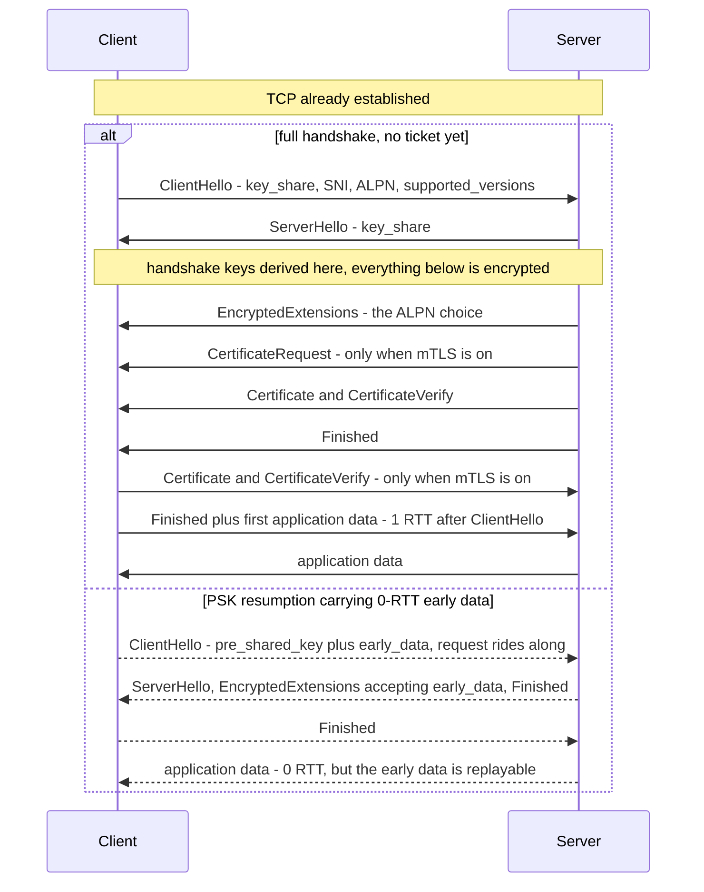
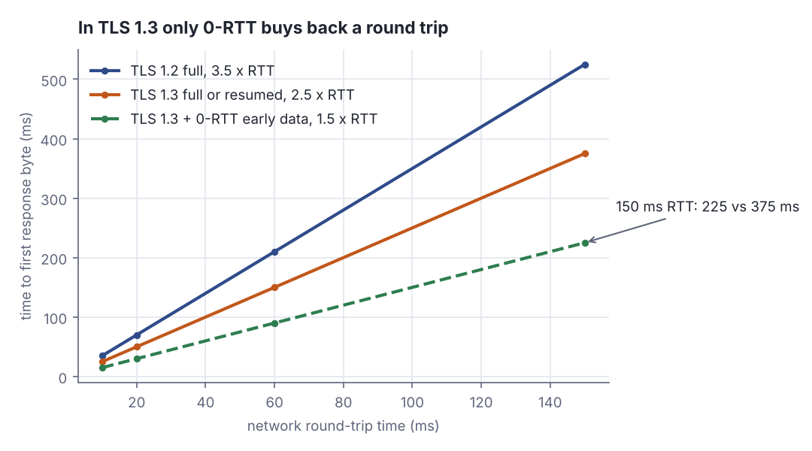
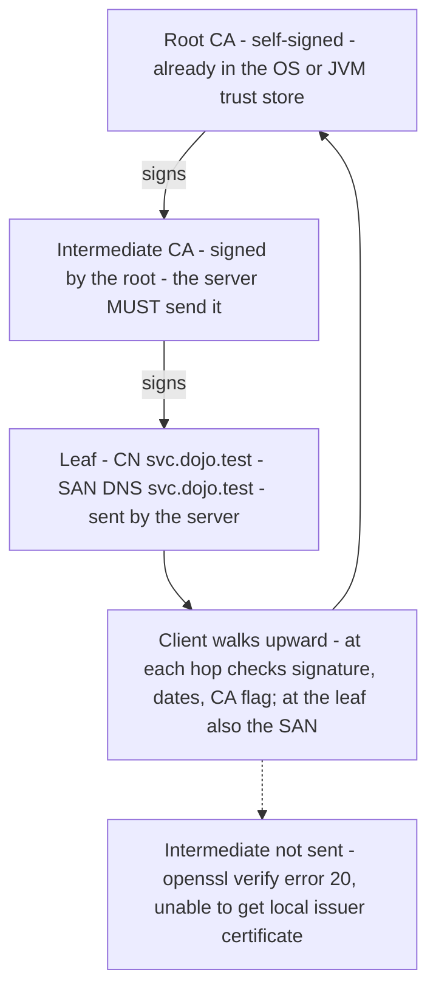

# TLS 1.3 handshake and certificates in practice

> Networking, modern · Intermediate · ~25 min · rung 5 of 16 · needs: What really happens in a TCP handshake and teardown (networking-01)

## Why this matters
Almost every production incident you will own that says "TLS handshake failure" is really one of four things: the wrong certificate was selected, an intermediate was not sent, a name did not match a SAN, or a client and server disagreed about protocol or ALPN — and `openssl s_client` tells you which within one command.
TLS 1.3 also changed the cost model: the handshake is one round trip instead of two, resumption no longer saves a round trip on its own, and 0-RTT does — at the price of replayable requests, which is a correctness question for you as a Product Owner, not only for the ops team.
Everything in a service mesh above this rung — mTLS, SPIFFE identities, zero-trust policy — is the same handshake with the client authenticated too, so the vocabulary you fix here is the vocabulary you will debug with later.

## The idea

### One round trip, and almost all of it encrypted

The handshake starts on an already-established TCP connection. The client sends a **ClientHello** that is deliberately optimistic: a `key_share` extension holding a freshly generated ephemeral public key (X25519 in practice), plus `supported_versions`, `signature_algorithms`, the server name it wants (SNI) and the protocols it will accept (ALPN). TLS 1.3 removed every static-RSA key exchange, so there is nothing left for the client to guess wrong — that is why one flight is enough.

> "TLS 1.3 does not support RSA, nor other cipher suites and parameters that are vulnerable to attack." … "It also shortens the TLS handshake, making a TLS 1.3 handshake both faster and more secure."
> — Cloudflare, *What happens in a TLS handshake?*, accessed 2026-11-23, https://www.cloudflare.com/learning/ssl/what-happens-in-a-tls-handshake/

The server answers with a **ServerHello** carrying its own `key_share`. Both sides can now do the Diffie-Hellman computation and derive the **handshake traffic keys**, so every later handshake message is encrypted. RFC 8446 §2 names three phases; the first, *Key Exchange*, is the hello pair just described, and the two that follow are carried inside this encryption: *Server Parameters* (`EncryptedExtensions`, plus `CertificateRequest` when the server wants a client certificate) and *Authentication* (`Certificate`, `CertificateVerify`, `Finished`). `CertificateVerify` signs the whole transcript with the leaf's private key — that, not the certificate, is what proves possession. The client checks the chain, sends its own `Finished`, and may append application data in the same flight (RFC 8446 §2, §4.1).



*Figure 1: the TLS 1.3 full handshake and, in the dashed lane, PSK resumption with 0-RTT. Everything after ServerHello is protected by handshake keys; the client may send application data one round trip after ClientHello, the 0-RTT client immediately. Source: RFC 8446 §2 "Protocol Overview" and §2.3 "0-RTT Data", https://www.rfc-editor.org/rfc/rfc8446.html.*

Count round trips from the first SYN to the first response byte: TCP costs 1 RTT, the TLS 1.3 handshake 1 RTT, request-plus-response half an RTT more — 2.5 RTT. TLS 1.2 needed two handshake round trips, so 3.5 RTT (HPBN ch. 4, "TLS Handshake"). Run this with `scala Ttfb.scala`:

```scala
// file: Ttfb.scala
@main def ttfb(): Unit =
  val plans = List(("TLS 1.2 full", 3.5), ("TLS 1.3 full", 2.5),
                   ("TLS 1.3 resumed", 2.5), ("TLS 1.3 + 0-RTT", 1.5))
  println(f"${"plan / rtt ms"}%-16s" + List(10, 20, 60, 150).map(r => f"${r}%7d").mkString)
  for (name, rtts) <- plans do
    val ttfb = List(10, 20, 60, 150).map(r => r * rtts)
    println(f"$name%-16s" + ttfb.map(t => f"${t}%7.0f").mkString + f"   = $rtts%3.1f x RTT")
```

```text
plan / rtt ms        10     20     60    150
TLS 1.2 full         35     70    210    525   = 3.5 x RTT
TLS 1.3 full         25     50    150    375   = 2.5 x RTT
TLS 1.3 resumed      25     50    150    375   = 2.5 x RTT
TLS 1.3 + 0-RTT      15     30     90    225   = 1.5 x RTT
```

The third row is the one people get wrong: a resumed TLS 1.3 handshake is still 1-RTT, identical in round trips to a full one. Resumption saves a signature, a chain on the wire and the CPU to verify it — not a round trip. Only 0-RTT removes one: at 150 ms RTT, 375 ms down to 225 ms.



*Figure 2: the same rows plotted, three lines for four plans — full and resumed TLS 1.3 share one line because both cost 2.5 x RTT, which is why the chart has no separate curve for resumption. The dashed 0-RTT line is the only one that drops below it; TLS 1.2 sits above it. Source: generated from the `Ttfb.scala` output above.*

### SNI selects the certificate, ALPN selects the protocol

Both travel in the plaintext ClientHello; both are offered by the client and resolved by the server. SNI is how one IP address serves a thousand hostnames: the server reads the name and picks the matching certificate before it has sent anything. ALPN is how one port serves HTTP/2 and HTTP/1.1: the client offers `h2,http/1.1` and the server names its pick in `EncryptedExtensions` (HPBN ch. 4, "Application Layer Protocol Negotiation (ALPN)" and "Server Name Indication (SNI)"). `-brief` prints the result:

```bash
openssl s_client -connect github.com:443 -servername github.com \
  -tls1_3 -alpn h2,http/1.1 -brief </dev/null
```

```text
CONNECTION ESTABLISHED
Protocol version: TLSv1.3
Ciphersuite: TLS_AES_128_GCM_SHA256
Peer certificate: CN = github.com
Hash used: SHA256
Signature type: RSA-PSS
Verification: OK
Server Temp Key: X25519, 253 bits
DONE
```

`Server Temp Key: X25519, 253 bits` is the ephemeral `key_share`; `Signature type: RSA-PSS` is the algorithm of the `CertificateVerify` signature. Note also that RSA appears here as a *signature* algorithm, which TLS 1.3 keeps; what it removed is static-RSA *key exchange*, so the Cloudflare sentence above is loose shorthand for that.

One honesty note that pays off twice. This output comes from the cloud container that wrote the lesson, whose egress goes through an intercepting proxy. The proxy terminates TLS itself and mints a fresh `github.com` leaf per connection, so the `Peer certificate`, the ciphersuite and the `Signature type` above are the *proxy's* choices, not GitHub's, and `Verification: OK` holds only because the proxy's own CA sits in this container's trust store. It also declines ALPN, which is why there is no `ALPN protocol:` line. On your Mac the same command talks to GitHub directly, shows GitHub's real public chain, and adds `ALPN protocol: h2`. Step 2 of the lab takes that interception apart, because it is the clearest live demonstration of the chain of trust you will get.

### The chain of trust, and the intermediate everybody forgets

A certificate is a signed statement "this public key belongs to these names, until this date". The signer is a CA whose own certificate is signed by another CA, up to a self-signed **root** that must already be in your trust store — some servers send it too, but that copy proves nothing, because trust comes from the local store and not from the wire. The server must send the **intermediates**, because the client has no other way to get them (HPBN ch. 4, "Chain of Trust and Certificate Authorities").



*Figure 3: signing runs downward from the trust anchor, validation runs upward from the leaf, and a missing intermediate breaks the upward walk. Adapted from High Performance Browser Networking, ch. 4, "Chain of Trust and Certificate Authorities", https://hpbn.co/transport-layer-security-tls/.*

Name checking does not use the subject CN any more; it uses the Subject Alternative Name list, and a wildcard matches exactly one label. That is the whole rule (`scala San.scala`):

```scala
// file: San.scala
@main def san(): Unit =
  val presented = List("github.com", "*.github.com")
  def matches(host: String, pat: String): Boolean =
    if pat.startsWith("*.") then host.split('.').drop(1).mkString(".") == pat.drop(2)
    else host == pat
  for host <- List("github.com", "api.github.com", "a.b.github.com", "github.io") do
    val hit = presented.find(p => matches(host, p))
    println(f"$host%16s -> ${hit.getOrElse("NO MATCH")}")
```

```text
      github.com -> github.com
  api.github.com -> *.github.com
  a.b.github.com -> NO MATCH
       github.io -> NO MATCH
```

`*.github.com` covers `api.github.com` but not `a.b.github.com`: the wildcard replaces one label, never a dotted sub-tree. That single rule is behind a large share of "certificate is valid in my browser but my service rejects it" tickets.

The other large share is the missing intermediate, which is confusing because browsers hide it: they cache intermediates they have seen and will fetch a missing one over the Authority Information Access URL in the leaf. A JVM client does neither — `javax.net.ssl` builds the path only from what the server sent plus the local trust store — so a server that omits its intermediate works in Chrome and fails in your Akka HTTP client with `PKIX path building failed`. Step 4 of the lab reproduces that, with the error code.

### Resumption, 0-RTT, and why 0-RTT is a correctness decision

After a handshake the server may send `NewSessionTicket` messages. A ticket encodes a **pre-shared key**; a later ClientHello carrying it in `pre_shared_key` skips the certificate and the signature entirely. If the client also sends `early_data`, the request itself travels in that first flight, encrypted under a key derived from the PSK alone. Nobody has proved liveness yet, and that is the whole problem: an attacker who captured the flight can send it again.

> "As noted in Section 2.3 and Appendix E.5, TLS does not provide inherent replay protections for 0-RTT data." … "The second class of attack cannot be prevented at the TLS layer and MUST be dealt with by any application."
> — IETF, *RFC 8446 §8 "0-RTT and Anti-Replay"*, August 2018, https://www.rfc-editor.org/rfc/rfc8446.html

> "This is great for performance, but comes at a cost: replayability."
> — Nick Sullivan, Cloudflare, *A Detailed Look at RFC 8446 (a.k.a. TLS 1.3)*, 10 August 2018, https://blog.cloudflare.com/rfc-8446-aka-tls-1-3/

The rule is therefore operational, not cryptographic: only idempotent requests may ride in early data — `GET` yes, `POST /payments` no — and the server should accept each ticket once, which RFC 8446 §8.1 "Single-Use Tickets" calls "the simplest form of anti-replay defense". If your gateway offers 0-RTT, that policy is yours to own.

### mTLS is the same handshake with one extra certificate

When the server includes `CertificateRequest` in its encrypted flight, the client answers with its own `Certificate` and a `CertificateVerify` signed by its private key. Nothing else changes. That is the whole mechanism behind service-mesh identity: each sidecar holds a short-lived leaf naming its service, and both ends verify the other against the mesh CA. In the full `s_client` output, `No client certificate CA names sent` means the server did not ask.

## Lab

**Question the lab answers:** for one real HTTPS endpoint, which certificate did the server pick, who signed it, which names does it cover, and what exactly breaks when the intermediate is missing?

macOS ships LibreSSL as `/usr/bin/openssl`, which lacks `-brief` and several TLS 1.3 options. Install OpenSSL 3 and use that binary.

### Step 1 — Get OpenSSL 3 and open one connection

```bash
brew install openssl@3
export OSSL=$(brew --prefix openssl@3)/bin/openssl
$OSSL version
$OSSL s_client -connect github.com:443 -servername github.com \
  -tls1_3 -alpn h2,http/1.1 -brief </dev/null
```

Real output, from the container that wrote this lesson (it has no direct egress, so every command here was run with `-proxy 127.0.0.1:44315` added; on your Mac drop that flag):

```text
OpenSSL 3.0.13 30 Jan 2024 (Library: OpenSSL 3.0.13 30 Jan 2024)
CONNECTION ESTABLISHED
Protocol version: TLSv1.3
Ciphersuite: TLS_AES_128_GCM_SHA256
Peer certificate: CN = github.com
Hash used: SHA256
Signature type: RSA-PSS
Verification: OK
Server Temp Key: X25519, 253 bits
DONE
```

### Step 2 — Print the chain the server actually sent

```bash
$OSSL s_client -connect github.com:443 -servername github.com -tls1_3 </dev/null \
  2>/dev/null | sed -n '/Certificate chain/,/^---$/p'
```

```text
Certificate chain
 0 s:CN = github.com
   i:CN = CCR agent-proxy interception CA (production) 2026-08, O = Anthropic
   a:PKEY: rsaEncryption, 2048 (bit); sigalg: RSA-SHA256
   v:NotBefore: Nov 23 05:39:29 2026 GMT; NotAfter: Nov 23 06:39:29 2027 GMT
 1 s:CN = CCR agent-proxy interception CA (production) 2026-08, O = Anthropic
   i:CN = CCR agent-proxy interception CA (production) 2026-08, O = Anthropic
   a:PKEY: rsaEncryption, 4096 (bit); sigalg: RSA-SHA256
   v:NotBefore: Aug  5 23:00:04 2026 GMT; NotAfter: Aug  2 23:00:04 2036 GMT
```

### Step 3 — Save the leaf and read its fields

```bash
$OSSL s_client -connect github.com:443 -servername github.com -tls1_3 </dev/null \
  2>/dev/null | $OSSL x509 -out leaf.pem
$OSSL x509 -in leaf.pem -noout -subject -issuer -dates -ext subjectAltName
```

```text
subject=CN = github.com
issuer=CN = CCR agent-proxy interception CA (production) 2026-08, O = Anthropic
notBefore=Nov 23 05:24:15 2026 GMT
notAfter=Nov 23 06:24:15 2027 GMT
X509v3 Subject Alternative Name: 
    DNS:github.com
```

### Step 4 — Break the chain on purpose, with your own three-tier PKI

```bash
$OSSL req -x509 -newkey rsa:2048 -nodes -keyout root.key -out root.pem -days 3650 \
  -subj "/CN=Dojo Root CA"
$OSSL req -newkey rsa:2048 -nodes -keyout int.key -out int.csr -subj "/CN=Dojo Intermediate CA"
printf "basicConstraints=critical,CA:TRUE,pathlen:0\nkeyUsage=critical,keyCertSign\n" > int.ext
$OSSL x509 -req -in int.csr -CA root.pem -CAkey root.key -out int.pem -days 1825 -extfile int.ext
$OSSL req -newkey rsa:2048 -nodes -keyout leaf.key -out leaf.csr -subj "/CN=svc.dojo.test"
printf "subjectAltName=DNS:svc.dojo.test\nbasicConstraints=critical,CA:FALSE\n" > leaf.ext
$OSSL x509 -req -in leaf.csr -CA int.pem -CAkey int.key -out svc.pem -days 365 -extfile leaf.ext
$OSSL verify -CAfile root.pem svc.pem
$OSSL verify -CAfile root.pem -untrusted int.pem svc.pem
$OSSL verify -CAfile root.pem -untrusted int.pem -verify_hostname api.dojo.test svc.pem
$OSSL verify -CAfile root.pem -untrusted int.pem -verify_hostname svc.dojo.test svc.pem
```

```text
CN = svc.dojo.test
error 20 at 0 depth lookup: unable to get local issuer certificate
error svc.pem: verification failed
svc.pem: OK
CN = svc.dojo.test
error 62 at 0 depth lookup: hostname mismatch
error svc.pem: verification failed
svc.pem: OK
```

### Step 5 — Resumption, and the time the handshake really takes

```bash
$OSSL s_client -connect github.com:443 -servername github.com -tls1_3 \
  -sess_out s.pem </dev/null 2>/dev/null | grep -E '^(New|Reused)'
$OSSL s_client -connect github.com:443 -servername github.com -tls1_3 \
  -sess_in s.pem </dev/null 2>/dev/null | grep -E '^(New|Reused)'
for i in 1 2 3 4 5; do s=$(date +%s%N)
  $OSSL s_client -connect github.com:443 -servername github.com -tls1_3 -brief \
    </dev/null >/dev/null 2>&1
  e=$(date +%s%N); echo "run $i: $(( (e-s)/1000000 )) ms"; done
```

```text
New, TLSv1.3, Cipher is TLS_AES_128_GCM_SHA256
New, TLSv1.3, Cipher is TLS_AES_128_GCM_SHA256
run 1: 162 ms
run 2: 163 ms
run 3: 226 ms
run 4: 161 ms
run 5: 165 ms
```

**Real output, captured in this container.** It says `New` twice because the intercepting proxy terminates every connection separately and issues no usable ticket for the second one — the same full output also shows `Max Early Data: 0`, so 0-RTT is not offered either. Against a real server on your Mac the second line instead reads `Reused, TLSv1.3, Cipher is TLS_AES_128_GCM_SHA256`; that one line is the only part of this block you cannot reproduce here, and seeing `New` where you expected `Reused` is itself the signal that something is terminating TLS in the middle.

### Reading the output

**Step 1 fields.** `Protocol version` is the negotiated version (lower is worse; anything below TLSv1.2 should fail your review). `Ciphersuite` in TLS 1.3 names only the AEAD and hash, because key exchange and signature moved into separate extensions. `Server Temp Key: X25519, 253 bits` is the ephemeral `key_share` — if this line is missing you are not on a forward-secret exchange. `Verification: OK` means the chain terminated at a trust anchor your machine already had. There is no `ALPN protocol:` line, so no application protocol was agreed; a server that cannot do `h2` forces your client back to HTTP/1.1.

**Verdict:** TLS 1.3, X25519, verified — but ALPN did not negotiate, which on a real endpoint would be the finding to chase.

**Step 2 chain, read as a table.**

| depth | subject (`s:`) | issuer (`i:`) | key | meaning |
|---|---|---|---|---|
| 0 | `CN = github.com` | CCR agent-proxy interception CA | RSA 2048 | the leaf, one hour old, one year of validity |
| 1 | CCR agent-proxy interception CA | itself | RSA 4096 | self-signed, so this is a root, not an intermediate |

Depth 1 has `s:` equal to `i:`, which is the definition of self-signed. The honest reading: this container's egress goes through an intercepting proxy that mints a fresh `github.com` leaf per connection and signs it with its own CA, and `Verification: OK` only because that CA sits in the container's trust store. This is exactly what a corporate MITM middlebox looks like from the client side. On your Mac the same command shows `CN = github.com` issued by a public CA such as Sectigo, with a real intermediate at depth 1 and the root absent from the wire.

**Verdict:** always read `i:` at every depth, not just `Verification: OK` — "verified" answers "does this chain reach *some* anchor I trust", not "did I talk to the origin".

**Step 3 fields.** `subject` is legacy identity, `issuer` must equal depth 1's `s:` from Step 2, the dates bound validity, and `X509v3 Subject Alternative Name` is the only list that decides whether the name you dialled is covered. Here `DNS:github.com` matches the `-servername` you sent. The `notBefore` here is *earlier* than Step 2's by about fifteen minutes even though this command ran later: the proxy mints a fresh leaf per connection and these two captures came from different connections taken at different points while the lesson was being written, so their timestamps carry no ordering. On a real endpoint the leaf is stable and `notBefore` would be identical across both runs.

**Verdict:** SAN present and matching, dates current — the leaf is the right one for the name.

**Step 4, traced.** Run 1 trusts the root and is handed only the leaf. The client needs the issuer of `CN = svc.dojo.test`, which is `CN = Dojo Intermediate CA`; it is neither in the trust store nor on the wire, so path building stops at depth 0 with `error 20`. Run 2 adds `-untrusted int.pem`, giving the builder the missing link: leaf → intermediate (signature checks, `CA:TRUE`, `pathlen:0` allows zero further CAs below) → root (in `-CAfile`) → `OK`. Run 3 keeps the complete chain but asks for `api.dojo.test`; the SAN list holds only `DNS:svc.dojo.test`, so the chain is cryptographically fine and the identity check still fails with `error 62`. Run 4 asks for the name in the SAN and passes.

**Verdict:** `error 20` means "send your intermediate" (a server config bug); `error 62` means "right CA, wrong name" (a certificate issuance bug). They look identical from a JVM client, which reports both as `PKIX path building failed` / `No subject alternative DNS name matching …`, so reproduce with `openssl verify` before blaming the trust store.

**Step 5, traced.** The five wall-clock measurements include DNS, the TCP handshake, the proxy's own connection to the origin and the TLS handshake: 162, 163, 226, 161, 165 ms, mean (162 + 163 + 226 + 161 + 165) / 5 = 877 / 5 = 175.4 ms, median 163 ms. Run 3's 226 ms is 63 ms above the median — one slow path, not a trend. Compare with Figure 2: at a 60 ms RTT the model predicts 2.5 × 60 = 150 ms to first byte, and these runs sit just above it, which is what you expect once the proxy's own upstream handshake is included.

**Verdict:** handshake cost here is dominated by round trips, not by RSA verification; the lever is fewer round trips (resumption, 0-RTT, connection reuse), not a faster cipher.

### Cause → consequence

1. **Cause:** TLS 1.3 deleted static RSA key exchange, so the client can send its `key_share` speculatively in the ClientHello.
2. **Mechanism:** the server can derive handshake keys at ServerHello, encrypt everything after it, and finish the handshake in one round trip; the client may attach application data to its own `Finished`.
3. **Consequence:** a new HTTPS request costs 2.5 RTT instead of 3.5, resumption saves CPU and bytes but no round trip, and only 0-RTT removes one — at the price of replayable early data.
4. **What this means for your work:** when a connection fails, run `s_client` first and read `i:` at every depth and the SAN list before touching code; when a gateway offers 0-RTT, treat it as a product decision about which endpoints are idempotent; and when you turn on mTLS in a mesh, remember you have only added a `CertificateRequest` and one more chain to validate — every failure mode above now applies to the client certificate too.

## Self-check
1. A colleague says "we enabled TLS 1.3 session resumption, so repeat requests skip a round trip." What is wrong with that sentence, and what does resumption actually save? <details><summary>Answer</summary>A resumed TLS 1.3 handshake is still 1-RTT: ClientHello with `pre_shared_key`, ServerHello, Finished, and only then the request. The round trip comes back only with 0-RTT `early_data`. Resumption saves the certificate chain on the wire, the `CertificateVerify` signature and its verification — bytes and CPU, not latency. In the lesson's model both full and resumed sit at 2.5 × RTT (375 ms at a 150 ms RTT) while 0-RTT is 1.5 × RTT (225 ms).</details>
2. A page loads fine in Chrome but your Akka HTTP client fails with `PKIX path building failed`. What is the most likely server-side cause, and which single `openssl` command proves it? <details><summary>Answer</summary>The server is not sending its intermediate certificate. Browsers paper over this by caching intermediates and fetching them via the leaf's Authority Information Access URL; the JVM does neither, so path building stops. Prove it with `openssl s_client -connect host:443 -servername host -tls1_3 </dev/null | sed -n '/Certificate chain/,/^---$/p'` — if the chain has only depth 0, the intermediate is missing. Locally, `openssl verify -CAfile root.pem leaf.pem` reproduces it as `error 20 ... unable to get local issuer certificate`, and adding `-untrusted int.pem` makes it `OK`.</details>
3. Your API gateway offers 0-RTT early data. Which requests may use it, and what must the server do even then? <details><summary>Answer</summary>Only idempotent requests — `GET`, `HEAD`, safe reads — because an attacker who captures the first flight can replay it and the server has not yet proved liveness; RFC 8446 §2.3 states there are no guarantees of non-replay between connections, and §8 says the application layer MUST handle the second class of attack. The server should additionally accept each session ticket only once (RFC 8446 §8.1 "Single-Use Tickets", "the simplest form of anti-replay defense") and reject early data whose ticket age is implausible. Anything that mutates state — payments, writes, counters — must wait for the full handshake.</details>

## Sources
- [What happens in a TLS handshake? (Cloudflare Learning Center)](https://www.cloudflare.com/learning/ssl/what-happens-in-a-tls-handshake/) — Cloudflare, undated; the quoted sentences on TLS 1.3 dropping RSA and shortening the handshake, used in "One round trip" (accessed 2026-11-23).
- [RFC 8446: The Transport Layer Security (TLS) Protocol Version 1.3](https://www.rfc-editor.org/rfc/rfc8446.html) — IETF, August 2018; §2 "Protocol Overview" and §4.1 "Key Exchange Messages" for the message flow and the three phases (Key Exchange, Server Parameters, Authentication) behind Figure 1, §2.3 "0-RTT Data" and §8 "0-RTT and Anti-Replay" with §8.1 "Single-Use Tickets" for the replay rules and the single-use-ticket defence (accessed 2026-11-23).
- [High Performance Browser Networking, ch. 4 "Transport Layer Security (TLS)"](https://hpbn.co/transport-layer-security-tls/) — Ilya Grigorik, O'Reilly, 2013; "TLS Handshake" for the round-trip accounting against TLS 1.2, "Chain of Trust and Certificate Authorities" for the structure replicated in Figure 3, "Server Name Indication (SNI)" and "Application Layer Protocol Negotiation (ALPN)" for the two ClientHello extensions (accessed 2026-11-23).
- [A Detailed Look at RFC 8446 (a.k.a. TLS 1.3)](https://blog.cloudflare.com/rfc-8446-aka-tls-1-3/) — Nick Sullivan, Cloudflare, 10 August 2018; the quoted sentence naming replayability as the cost of 0-RTT (accessed 2026-11-23).
- Related in your knowledge base: `10-networking/Networking-HTTPS-TLS.md`.

## Next on this track
Next on Networking, modern: **HTTP/1.1 vs HTTP/2: multiplexing, HPACK, head-of-line blocking** (rung 6 of 16, Intermediate).
