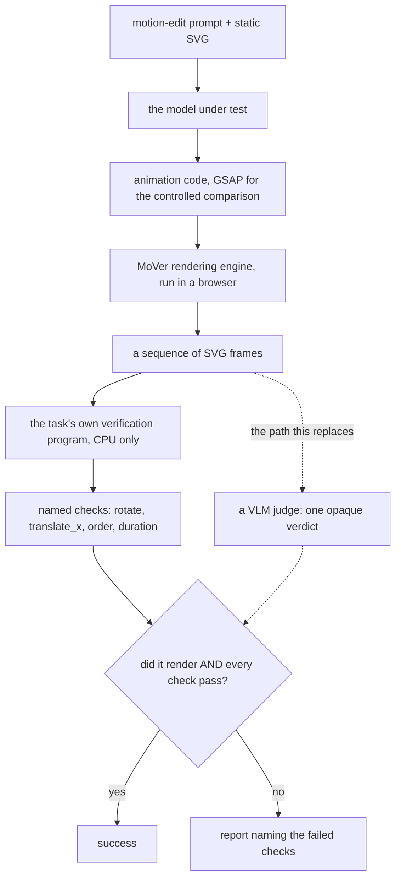
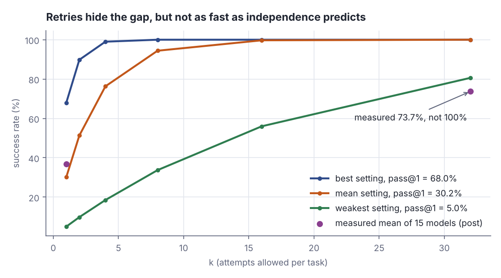
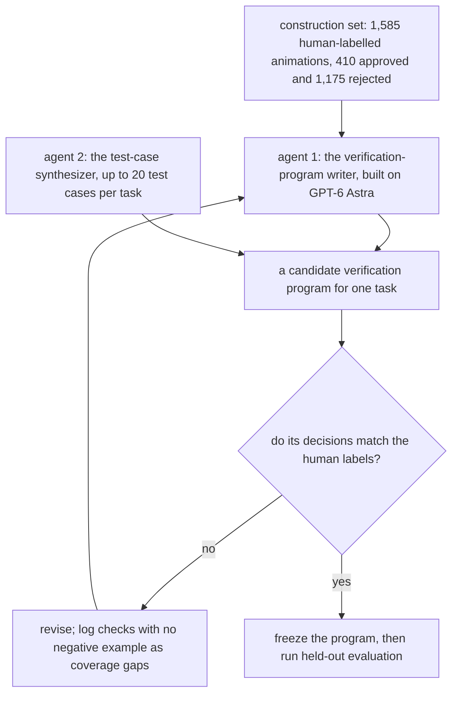
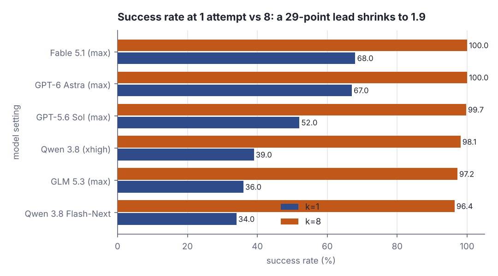

# A program instead of a judge: what deterministic checks measured across 32 models

> Fresh · AI / ML foundations · Intermediate · ~25 min · from today's feeds

## Why this matters

You are standing on the rung called "choosing what good means", and on 2026-11-10 Figma published
a benchmark that is really a worked answer to exactly that question (Ma, Jindal, Wang and
Bhakthavatsalam, "MotionGraphicsBench", 2026-11-10,
https://huggingface.co/blog/figma-ai/motion-graphics-bench). Their output is open-ended — an
animation, where dozens of different results are all correct — so neither "match the golden
reference" nor "ask a bigger model" works, and they built a third thing instead: a small,
readable program per task that returns named pass/fail checks. Read it for the method, not the
motion graphics: as a Product Owner you will be asked which success number goes on a dashboard,
and this post shows how much that choice changes the picture.

## Primer

Five terms carry the lesson. This is the vocabulary of the evaluation-metrics rung you are on
(ai-ml-11), so it is worth holding on to past today.

**pass@1 and pass@k.** Give a model one attempt at a task and score it: the fraction of tasks it
gets right on that single attempt is **pass@1**. Give it *k* independent attempts and count the
task as solved if *any* attempt is right: that is **pass@k**. They measure different products.
pass@1 is "what the user sees when they press the button once"; pass@8 is "what the user sees if
your system quietly retries up to eight times and shows the first thing that works". Same model,
same tasks, two very different numbers.

**LLM-as-judge and VLM-as-judge.** Instead of writing a checker, you hand the output to another
model and ask it to grade. A **VLM** (vision-language model) is one that reads images and video as
well as text, which is what you need when the output is a rendered animation rather than a string.
It is flexible and costs one model call per evaluation; the price is that its verdict can move
between runs and you cannot see which requirement drove it.

**Approval recall and rejection recall.** Take a set of outputs that humans approved. **Approval
recall** is the fraction of those the automatic checker also approved — of everything genuinely
good, how much did it catch. **Rejection recall** is the mirror image on the human-rejected set:
of everything genuinely bad, how much did it catch. A lenient checker has high approval recall and
low rejection recall; it waves bad work through. Recall is per-class, so quoting one without the
other tells you almost nothing.

**Raw agreement vs chance-corrected agreement.** **Raw agreement** is simply the fraction of items
two judges decided the same way. Its weakness is that on a two-way decision, two people flipping
coins agree 50% of the time, so 88% raw agreement is less impressive than it sounds.
**Krippendorff's alpha** and **Fleiss' kappa** both subtract the agreement you would expect by
chance and rescale so that 1.0 is perfect and 0.0 is chance. A value of 0.718 is conventionally
read as *substantial but not perfect* agreement — real signal, with a residue of genuinely
ambiguous cases that honest humans score differently.

**GRPO** (Group Relative Policy Optimisation) is a reinforcement-learning method for post-training
a model: generate a group of candidate answers for the same prompt, score each one, and push the
model's weights towards the answers that scored above the group's average. The only thing it needs
from you is a reward — a number per attempt. That is the hinge of today's item: if your evaluation
is already a program returning pass/fail checks, the pass/fail *is* the reward signal, and the
same artefact you used to measure the model can be used to train it.

## The idea

### Three ways to say what good means

Think of a task where many different outputs are correct: animate this static icon so the arrow
rotates into place while the label fades in. You have three options for scoring it.

*Reference matching* compares the output to one stored golden answer. It is cheap and
reproducible, and wrong here: an equally good animation that differs in easing scores zero. *A judge model* fixes the rigidity by asking a VLM whether the animation
satisfies the prompt — flexible, but opaque. *A verification program* is the third option: for
each task, a human-readable program that inspects the rendered output and evaluates each
requirement of the prompt as a separately named check.

> "Instead, we use deterministic human-readable verification programs to evaluate generated animations at scale."
> — Jiaju Ma, Ashvini Kumar Jindal, Chuhua Wang and Sumithra Bhakthavatsalam (Figma), *MotionGraphicsBench: Evaluating Motion Graphics Generation with Programmatic Verification*, 2026-11-10, https://huggingface.co/blog/figma-ai/motion-graphics-bench

The data structure is the point. A verification report is a list of named booleans, and the task's
verdict is a fold over it:

```scala
type Report = List[(String, Boolean)]
val report: Report = List(
  "translate_x(circle)" -> true,
  "rotate(arrow, 90deg)" -> true,
  "scale(label, 1.5x)" -> false)
println(s"succeeded = ${report.forall(_._2)}")
println(s"passed    = ${report.count(_._2)} of ${report.size}")
println(s"failed    = ${report.filterNot(_._2).map(_._1).mkString(", ")}")
```

```text
succeeded = false
passed    = 2 of 3
failed    = scale(label, 1.5x)
```

Two different things fall out of the same list. `forall(_._2)` gives the strict verdict used for
scoring; `filterNot(_._2)` gives the diagnosis. A judge model returns the first and throws the
second away. The post's success rule is exactly that `forall`:

> "We count a generated animation as successful only if it renders and every check within its verification program passes."
> — Ma et al. (Figma), *MotionGraphicsBench*, 2026-11-10, https://huggingface.co/blog/figma-ai/motion-graphics-bench

### The mechanism

The benchmark has 100 expert-curated tasks covering 17 animation requirement types, each prompt
combining 7–14 of them, over 100 source Lottie animations averaging 3.50 s (SD 1.89) with prompts
averaging 193.8 words (SD 57.2) (Ma et al., "MotionGraphicsBench", 2026-11-10,
https://huggingface.co/blog/figma-ai/motion-graphics-bench). For a controlled comparison every
model is asked to emit GSAP animation code — a widely used JavaScript animation library — which
MoVer's rendering engine runs in a browser and converts into a sequence of SVG frames. The
verification program never looks at the code; it measures how geometry, appearance and
relationships change across those frames. No model is called, and it runs on CPU.



*Figure 1: the verification pipeline. The output is judged on rendered behaviour, not on its
similarity to a reference; the dotted branch is the judge-model alternative it replaces. Source:
Ma et al. (Figma), "MotionGraphicsBench", 2026-11-10, https://huggingface.co/blog/figma-ai/motion-graphics-bench.*

### The number you report is a product decision

32 proprietary and open-weight models from 12 providers were evaluated, from the GPT, Claude,
Gemini, Qwen, DeepSeek, GLM and Gemma families among others (Ma et al., "MotionGraphicsBench",
2026-11-10, https://huggingface.co/blog/figma-ai/motion-graphics-bench).
Only three settings cleared 50% pass@1: Fable 5.1 (max) at 68.0%, GPT-6 Astra (max) at 67.0% and
GPT-5.6 Sol (max) at 52.0%, with the best open-weight settings at 39.0% (Qwen 3.8, xhigh), 36.0%
(GLM 5.3, max) and 34.0% (Qwen 3.8 Flash-Next, xhigh); across 47 settings pass@1 ranged 5.0%–68.0%
with a mean of 30.2% (same source). Now allow retries. The arithmetic for *k* independent attempts
is one line:

```scala
def passAtK(p: Double, k: Int): Double = 1.0 - math.pow(1.0 - p, k)
val p = 0.302
for k <- List(1, 8, 32) do
  println(f"mean setting p=0.302, pass@$k%-2s = ${passAtK(p, k) * 100}%.1f%%")
println(f"best setting p=0.680, pass@8  = ${passAtK(0.680, 8) * 100}%.1f%%")
println(f"worst setting p=0.050, pass@8 = ${passAtK(0.050, 8) * 100}%.1f%%")
```

```text
mean setting p=0.302, pass@1  = 30.2%
mean setting p=0.302, pass@8  = 94.4%
mean setting p=0.302, pass@32 = 100.0%
best setting p=0.680, pass@8  = 100.0%
worst setting p=0.050, pass@8 = 33.7%
```

The average setting goes from failing about seven tasks in ten on one try to clearing better than
nine in ten within eight tries, purely by being allowed to retry. That is the independence model;
reality is softer, because attempts on a hard task correlate:

> "Across the 15 models in the pass@k study, mean success rises from 36.7% at pass@1 to 73.7% at pass@32."
> — Ma et al. (Figma), *MotionGraphicsBench*, 2026-11-10, https://huggingface.co/blog/figma-ai/motion-graphics-bench



*Figure 2: three measured pass@1 values (5.0%, 30.2%, 68.0%) extended by 1-(1-p)^k, with the
post's two measured mean points (36.7% at k=1, 73.7% at k=32) overlaid. Generated from the lab
output, Step 4. Source: Ma et al. (Figma), "MotionGraphicsBench", 2026-11-10, https://huggingface.co/blog/figma-ai/motion-graphics-bench.*

The caution sits between the purple measured point and the 100% ceiling the two stronger curves
reach long before k=32: independence predicts 100%, the measurement says 73.7%. The green curve,
the weakest setting, is the one case where independence roughly holds. pass@32 ranged 38.0%–95.0% across the 51,200
attempts of that study; the top five models gained only 2.6 points going from 16 attempts to 32,
while the bottom five gained 6.7 over the same step (Ma et al., "MotionGraphicsBench", 2026-11-10,
same source) — weak models are the ones that keep
buying something with extra retries, and they are also the ones you would least like to pay 32×
inference for.

### A failing score is a diagnosis

Because every check is named, a failure is informative. Of 29,632 failed attempts with complete
reports, 93.6% passed at least one check and 31.6% failed exactly one (Ma et al.,
"MotionGraphicsBench", 2026-11-10, https://huggingface.co/blog/figma-ai/motion-graphics-bench).
Nearly a third of failures are one requirement away from success, so a binary dashboard number
throws away most of what the run told you. The post is careful about how far to push this:

> "A single failed check can combine several conditions, so it does not necessarily represent just one missed requirement."
> — Ma et al. (Figma), *MotionGraphicsBench*, 2026-11-10, https://huggingface.co/blog/figma-ai/motion-graphics-bench

### Does the program agree with people?

A checker is only worth having if it decides as a careful human would. Human judgments were
collected for 1,980 generated animations across 29 model settings from seven providers, two
annotators each, who agreed with each other 88.88% of the time raw, with Krippendorff's alpha and
Fleiss' kappa both at 0.718 (Ma et al., "MotionGraphicsBench", 2026-11-10,
https://huggingface.co/blog/figma-ai/motion-graphics-bench). On a balanced held-out set of 180
animations (90 approved, 90 rejected) the verification programs reached 93.3% raw agreement with
humans against 80.6%–88.9% for four VLM judges — Opus 5, Opus 5.5, GPT-6 Astra and GPT-6.1 Sol —
with 90.0% approval recall and 96.7% rejection recall; Opus 5 managed only 61.1% rejection recall
and was described as overly lenient (same source). Convert those rates to animations:

```scala
val n = 180
val scores = List(("verification programs", 0.933),
                  ("strongest VLM judge", 0.889),
                  ("weakest VLM judge", 0.806))
scores.foreach { (name, a) =>
  println(f"$name%-22s ${a * 100}%.1f%%  ->  ${a * n}%.0f of 180 judged as the humans did")
}
println(f"programs minus strongest judge = ${(0.933 - 0.889) * n}%.0f animations out of 180")
```

```text
verification programs  93.3%  ->  168 of 180 judged as the humans did
strongest VLM judge    88.9%  ->  160 of 180 judged as the humans did
weakest VLM judge      80.6%  ->  145 of 180 judged as the humans did
programs minus strongest judge = 8 animations out of 180
```

Eight animations out of 180 separates the program from the best judge, and 23 separate it from the
worst — on a set where a coin lands at 90. The 12 cases where the programs disagreed with people
split nine false rejections to three false approvals, all three of the approvals involving how
parts of a graphic move relative to each other (Ma et al., "MotionGraphicsBench", 2026-11-10,
https://huggingface.co/blog/figma-ai/motion-graphics-bench). The judge's weakness is not accuracy
alone:

> "… its judgments can vary and it can be difficult to inspect how individual requirements affect the decision …"
> — Ma et al. (Figma), *MotionGraphicsBench*, 2026-11-10, https://huggingface.co/blog/figma-ai/motion-graphics-bench

### Where the programs come from, and what they cost

The programs are not free. Two agents built on GPT-6 Astra — a verification-program writer and a
test-case synthesizer, the latter allowed up to 20 test cases per task — construct each program
against 1,585 human-labelled animations from 25 model settings (410 approved, 1,175 rejected), and
freeze it before held-out evaluation (Ma et al., "MotionGraphicsBench", 2026-11-10,
https://huggingface.co/blog/figma-ai/motion-graphics-bench). Checks with no known negative example
are logged as coverage gaps, not claimed as verified.



*Figure 3: how each verification program is built and validated before it is allowed to score
anything. Adapted from Ma et al. (Figma), "MotionGraphicsBench: Evaluating Motion Graphics
Generation with Programmatic Verification", 2026-11-10,
https://huggingface.co/blog/figma-ai/motion-graphics-bench.*

Two further limits the post states: the GSAP route is a controlled comparison, so models never
emit the source Lottie format, and the scope is animating elements that already exist. The payoff
for all that construction work is reuse. Because each check returns a number, the same programs become
a reward function: Qwen3.8-27B fine-tuned with GRPO on 90 tasks, holding 10 out, went from 30.31%
to 52.19% pass@1 and from 60.0% to 100.0% pass@32 after 41 policy updates (Ma et al.,
"MotionGraphicsBench", 2026-11-10, same source). The evaluation harness and the training signal are the same artefact.

## Lab

The question: **if I report pass@1 and my colleague reports pass@8 for the same two models, how
different do they look — and what does the retry budget behind pass@8 actually cost?**

### Step 1 — a verification report, and the two things you can read off it

Build a five-check report for one attempt and print both the strict verdict and the list of failed
check names.

### Step 2 — pass@k for six real model settings

Take the six named pass@1 values the post reports and extend each to k = 1, 2, 4, 8, 16 and 32 with
1-(1-p)^k, printing every cell rather than a summary.

### Step 3 — the gap between two models at k=1 and at k=8

For two model pairs, print how far apart they look at one attempt and at eight, plus 1/p: the
average number of attempts each needs before one succeeds.

### Step 4 — the three reference curves, against the post's measured mean

Print the three curves Figure 2 plots, then the post's two measured mean points, so you can see how
far the independence assumption overshoots.

### Step 5 — rebuilding the 93.3% agreement figure from the two recalls

Reconstruct the headline human-agreement number from approval recall and rejection recall on the
balanced 180-animation held-out set.

All five steps are one program; run it once and read the sections of its output in order.

```scala
// file: Lab.scala
type Report = List[(String, Boolean)]

def succeeded(r: Report): Boolean = r.forall(_._2)

def passAtK(p: Double, k: Int): Double = 1.0 - math.pow(1.0 - p, k)

def pct(x: Double): String = f"${x * 100}%5.1f%%"

@main def lab(): Unit =
  val ks = List(1, 2, 4, 8, 16, 32)

  println("== Step 1: one verification report, five named checks ==")
  val report: Report = List(
    "translate_x(circle)" -> true,
    "rotate(arrow, 90deg)" -> true,
    "scale(label, 1.5x)" -> false,
    "order(circle before arrow)" -> true,
    "duration(total <= 3.5s)" -> true)
  report.foreach { (name, ok) =>
    println(f"  ${if ok then "pass" else "FAIL"}%-4s  $name")
  }
  val nPassed = report.count(_._2)
  println(s"  checks passed: $nPassed of ${report.size}")
  println(s"  attempt succeeded: ${succeeded(report)}")
  println(s"  diagnosis: failed checks = ${report.filterNot(_._2).map(_._1).mkString(", ")}")

  println()
  println("== Step 2: pass@k from one measured pass@1, assuming independent attempts ==")
  val models = List(
    ("Fable 5.1 (max)", 0.680),
    ("GPT-6 Astra (max)", 0.670),
    ("GPT-5.6 Sol (max)", 0.520),
    ("Qwen 3.8 (xhigh)", 0.390),
    ("GLM 5.3 (max)", 0.360),
    ("Qwen 3.8 Flash-Next", 0.340))
  println("  model                 " + ks.map(k => f"${"k=" + k}%6s").mkString("  "))
  models.foreach { (name, p) =>
    val row = ks.map(k => pct(passAtK(p, k))).mkString("  ")
    println(f"  $name%-20s  $row")
  }

  println()
  println("== Step 3: how far apart do two models look at k=1 and k=8? ==")
  val pairs = List(("Fable 5.1 (max)", 0.680, "Qwen 3.8 (xhigh)", 0.390),
                   ("GPT-5.6 Sol (max)", 0.520, "Qwen 3.8 Flash-Next", 0.340))
  pairs.foreach { (a, pa, b, pb) =>
    val g1 = passAtK(pa, 1) - passAtK(pb, 1)
    val g8 = passAtK(pa, 8) - passAtK(pb, 8)
    println(f"  $a%-20s vs $b%-20s  gap@1 ${pct(g1)}  gap@8 ${pct(g8)}")
    println(f"    expected attempts to first success: ${1 / pa}%.2f vs ${1 / pb}%.2f")
  }

  println()
  println("== Step 4: the three reference curves the chart plots ==")
  val refs = List(("weakest setting p=0.050", 0.050),
                  ("mean setting   p=0.302", 0.302),
                  ("best setting   p=0.680", 0.680))
  refs.foreach { (name, p) =>
    println(f"  $name%-24s " + ks.map(k => pct(passAtK(p, k))).mkString("  "))
  }
  println(f"  measured mean in the post: pass@1 ${pct(0.367)}, pass@32 ${pct(0.737)}")
  println(f"  independence model from p=0.367 would predict pass@32 = ${pct(passAtK(0.367, 32))}")

  println()
  println("== Step 5: raw agreement rebuilt from the two recalls (90 approved, 90 rejected) ==")
  val hitsApproved = math.round(0.900 * 90).toInt
  val hitsRejected = math.round(0.967 * 90).toInt
  println(s"  approval recall 90.0% of 90 approved  -> $hitsApproved agreed approvals")
  println(s"  rejection recall 96.7% of 90 rejected -> $hitsRejected agreed rejections")
  val agree = (hitsApproved + hitsRejected).toDouble / 180
  println(f"  raw agreement = ($hitsApproved + $hitsRejected) / 180 = ${pct(agree)}")
```

Run it with `python3 dojo/engine/run_lab.py 2026-11-23-2`. The real output:

```text
== Step 1: one verification report, five named checks ==
  pass  translate_x(circle)
  pass  rotate(arrow, 90deg)
  FAIL  scale(label, 1.5x)
  pass  order(circle before arrow)
  pass  duration(total <= 3.5s)
  checks passed: 4 of 5
  attempt succeeded: false
  diagnosis: failed checks = scale(label, 1.5x)

== Step 2: pass@k from one measured pass@1, assuming independent attempts ==
  model                    k=1     k=2     k=4     k=8    k=16    k=32
  Fable 5.1 (max)        68.0%   89.8%   99.0%  100.0%  100.0%  100.0%
  GPT-6 Astra (max)      67.0%   89.1%   98.8%  100.0%  100.0%  100.0%
  GPT-5.6 Sol (max)      52.0%   77.0%   94.7%   99.7%  100.0%  100.0%
  Qwen 3.8 (xhigh)       39.0%   62.8%   86.2%   98.1%  100.0%  100.0%
  GLM 5.3 (max)          36.0%   59.0%   83.2%   97.2%   99.9%  100.0%
  Qwen 3.8 Flash-Next    34.0%   56.4%   81.0%   96.4%   99.9%  100.0%

== Step 3: how far apart do two models look at k=1 and k=8? ==
  Fable 5.1 (max)      vs Qwen 3.8 (xhigh)      gap@1  29.0%  gap@8   1.9%
    expected attempts to first success: 1.47 vs 2.56
  GPT-5.6 Sol (max)    vs Qwen 3.8 Flash-Next   gap@1  18.0%  gap@8   3.3%
    expected attempts to first success: 1.92 vs 2.94

== Step 4: the three reference curves the chart plots ==
  weakest setting p=0.050    5.0%    9.8%   18.5%   33.7%   56.0%   80.6%
  mean setting   p=0.302    30.2%   51.3%   76.3%   94.4%   99.7%  100.0%
  best setting   p=0.680    68.0%   89.8%   99.0%  100.0%  100.0%  100.0%
  measured mean in the post: pass@1  36.7%, pass@32  73.7%
  independence model from p=0.367 would predict pass@32 = 100.0%

== Step 5: raw agreement rebuilt from the two recalls (90 approved, 90 rejected) ==
  approval recall 90.0% of 90 approved  -> 81 agreed approvals
  rejection recall 96.7% of 90 rejected -> 87 agreed rejections
  raw agreement = (81 + 87) / 180 =  93.3%
```

### Reading the output

**Step 1.** Each line is one named check and its boolean. `checks passed: 4 of 5` is the
diagnostic view; `attempt succeeded: false` is the scoring view, and it is `false` because the rule
is all-or-nothing — four of five is still a failure. Higher is better for "checks passed", but only
5 of 5 moves the score. The `diagnosis` line is what a judge model cannot give you: this attempt
failed on scaling and nothing else, so the fix is one requirement wide.

**Verdict:** one list of named booleans yields both the strict verdict and the repair instruction;
collapsing it to a single number before you store it is the mistake.

**Step 2.** Columns are *k*, the attempts allowed; rows are real pass@1 values from the post. Every
cell is the modelled chance that at least one of *k* independent attempts succeeds — higher is
better, and every row is monotonically increasing by construction.

| model setting | k=1 | k=2 | k=4 | k=8 | k=16 | k=32 |
| --- | --- | --- | --- | --- | --- | --- |
| Fable 5.1 (max) | 68.0% | 89.8% | 99.0% | 100.0% | 100.0% | 100.0% |
| GPT-6 Astra (max) | 67.0% | 89.1% | 98.8% | 100.0% | 100.0% | 100.0% |
| GPT-5.6 Sol (max) | 52.0% | 77.0% | 94.7% | 99.7% | 100.0% | 100.0% |
| Qwen 3.8 (xhigh) | 39.0% | 62.8% | 86.2% | 98.1% | 100.0% | 100.0% |
| GLM 5.3 (max) | 36.0% | 59.0% | 83.2% | 97.2% | 99.9% | 100.0% |
| Qwen 3.8 Flash-Next | 34.0% | 56.4% | 81.0% | 96.4% | 99.9% | 100.0% |

Trace one cell by hand. For Qwen 3.8 (xhigh), p = 0.390, so the chance of one attempt failing is
1 − 0.390 = 0.610. Eight independent failures, 0.610^8 by repeated squaring: 0.610 × 0.610 = 0.3721; squared = 0.13846;
squared again = 0.019171. So pass@8 = 1 − 0.019171 = 0.98083 → 98.1%, the cell above. The same
arithmetic on the mean setting, p = 0.302: 0.698^8 = 0.05634, so pass@8 = 94.4%.



*Figure 4: the k=1 and k=8 columns of the table above as paired bars, one pair per model setting —
the blue k=1 bars fan out from 34.0 to 68.0, the orange k=8 bars bunch between 96.4 and 100.0.
Generated from the lab output, Step 2. Source: pass@1 values from Ma et al. (Figma),
"MotionGraphicsBench: Evaluating Motion Graphics Generation with Programmatic Verification",
2026-11-10, https://huggingface.co/blog/figma-ai/motion-graphics-bench.*

**Verdict:** at k=8 the whole field sits between 96.4% and 100.0%, so a pass@8 leaderboard is
nearly flat and ranks almost nothing.

**Step 3.** `gap@1` and `gap@8` are the differences in success rate between the two named settings;
`expected attempts to first success` is 1/p, the average number of tries before one works. Smaller
is better for attempts, larger is better for the gap only if you are trying to tell models apart.
Fable 5.1's 29.0-point lead over Qwen 3.8 at one attempt shrinks to 1.9 points at eight. But 1/p
says 1.47 attempts versus 2.56 — the weaker model costs you about 74% more inference for the same
delivered result, and that cost never shows up in the pass@8 number.

**Verdict:** pass@8 hides the quality difference and moves it onto your inference bill.

**Step 4.** The three reference rows are the curves on Figure 2. The last two lines are the honesty
check: the post measured a mean of 36.7% at pass@1 and 73.7% at pass@32, while treating attempts as
independent from p = 0.367 predicts 100.0% at k=32. Lower prediction error is better, and here the
error is 26 points.

**Verdict:** attempts are correlated, not independent; use 1-(1-p)^k to reason about the *shape* of
a retry curve and never to promise a number.

**Step 5.** Approval recall is measured on the 90 human-approved animations, rejection recall on
the 90 rejected ones. 0.900 × 90 = 81 and 0.967 × 90 ≈ 87, so (81 + 87) / 180 = 168/180 = 93.3% —
the post's headline agreement figure, reconstructed. Higher is better for all three. Note that
rejection recall is the higher of the two: this checker's errors are mostly false rejections, which
is the safer way round for a quality gate.

**Verdict:** a single agreement percentage decomposes into two recalls, and the decomposition is
where the behaviour lives — 93.3% could equally have been a lenient checker, and this one is not.

### Cause → consequence

1. **Cause.** The output space is open-ended: for one prompt, many different animations satisfy it,
   so there is no single correct artefact to compare against.
2. **Mechanism.** Scoring therefore has to evaluate *behaviour* against *each stated requirement*.
   A verification program does this as a list of named deterministic checks over the rendered
   frames; the task's verdict is the conjunction of that list, and the list itself is the diagnosis.
3. **Consequence.** The score you quote now depends on a policy choice — one attempt or *k*. The
   same six settings span 34 points at pass@1 and under 4 points at pass@8 (lab Step 2), and the
   post's measured pass@32 spread is 38.0%–95.0% (Ma et al., "MotionGraphicsBench", 2026-11-10,
   https://huggingface.co/blog/figma-ai/motion-graphics-bench).
4. **What it means for your work.** Put pass@1 on the dashboard when the user sees the first
   result, and pass@k only when your system genuinely retries k times — labelled with the k, beside
   the inference cost it implies (1/p attempts per delivered success: 1.47 versus 2.56 in Step 3).
   And make the automated gate return named checks rather than a verdict, so a regression report
   says *which* requirement broke; that same per-check signal is what makes a reward function
   possible later, as the GRPO run in the post shows.

## Self-check

1. A colleague says their agent "passes 95% of our acceptance scenarios" and you learn the harness
   retries up to 10 times. What number should you ask for, and why does it matter? <details><summary>Answer</summary>Ask for pass@1 — the single-attempt rate — and for the per-scenario retry count. 95% at k=10 is consistent with a one-shot rate near 26% (1 − 0.74^10 ≈ 0.95), so the user-facing experience and the inference bill both look nothing like 95%. Quote pass@k only when the product itself retries k times, and always with the k attached: in the post's own data, mean success was 36.7% at pass@1 and 73.7% at pass@32 (Ma et al., "MotionGraphicsBench", 2026-11-10, https://huggingface.co/blog/figma-ai/motion-graphics-bench).</details>
2. Why is a VLM judge with 88.9% raw agreement with humans a weaker tool than a verification
   program with 93.3%, beyond the 4.4-point difference? <details><summary>Answer</summary>Two reasons the post names. First, inspectability: the judge returns one verdict, and "its judgments can vary and it can be difficult to inspect how individual requirements affect the decision" (Ma et al., "MotionGraphicsBench", 2026-11-10, https://huggingface.co/blog/figma-ai/motion-graphics-bench), whereas the program returns named checks you can read and argue with. Second, the per-class breakdown: Opus 5 reached only 61.1% rejection recall and was described as overly lenient, so a judge's headline agreement can hide that it is waving bad outputs through. The program also runs on CPU with no model call, so it is deterministic and cheap to re-run.</details>
3. The same verification programs that score the benchmark were reused to train a model with GRPO.
   What property of the evaluation made that possible, and what is the risk of reusing it that
   way? <details><summary>Answer</summary>GRPO needs a reward number per attempt; because every requirement is a separately named check with a deterministic pass/fail, each attempt already yields a score, and partial credit is available (93.6% of failed attempts pass at least one check, 31.6% fail exactly one — Ma et al., "MotionGraphicsBench", 2026-11-10, https://huggingface.co/blog/figma-ai/motion-graphics-bench). Qwen3.8-27B went from 30.31% to 52.19% pass@1 after 41 policy updates (same source). The risk is that the metric becomes the target: the model can learn to satisfy the checks rather than the intent, and the post's own caveats — a single failed check can bundle several conditions, and checks with no known negative example are logged as coverage gaps — mark exactly where that slack lives.</details>

## Sources

- [MotionGraphicsBench: Evaluating Motion Graphics Generation with Programmatic Verification](https://huggingface.co/blog/figma-ai/motion-graphics-bench) — Jiaju Ma, Ashvini Kumar Jindal, Chuhua Wang and Sumithra Bhakthavatsalam (Figma), 2026-11-10 — the primary source for every number, quote and mechanism in this lesson: the benchmark design, the 32-model evaluation, the pass@k study, the failure-structure statistics, the human-alignment comparison against four VLM judges and the GRPO fine-tuning run (accessed 2026-11-23).
- [MotionGraphicsBench, arXiv preprint 2611.10592](https://arxiv.org/abs/2611.10592) — the full paper, linked by the post as its primary write-up; the link was checked but the page could not be retrieved in this run, so nothing here is quoted from it (checked 2026-11-23).
- [MotionGraphicsBench project site](https://motion-graphics-bench.github.io/) — the post's linked project page, where the task set and rendered examples live; listed for follow-up, not fetched, so nothing here is quoted from it (listed 2026-11-23).
- [MoVer: Motion Verification for Motion Graphics Animations](https://doi.org/10.1145/3731209) — the earlier work whose GSAP rendering engine converts generated animation code into the SVG frame sequences the verification programs read; linked by the post, listed for follow-up, not fetched, so nothing here is quoted from it (listed 2026-11-23).
- [GSAP v3 documentation](https://gsap.com/docs/v3/) — the animation library the models are asked to emit for the controlled comparison; linked by the post, listed for follow-up, not fetched, so nothing here is quoted from it (listed 2026-11-23).
- Related in your knowledge base: `24-ai-ml-foundations/decision-models-when-an-llm-answers-with-probabilities-not.md`.
