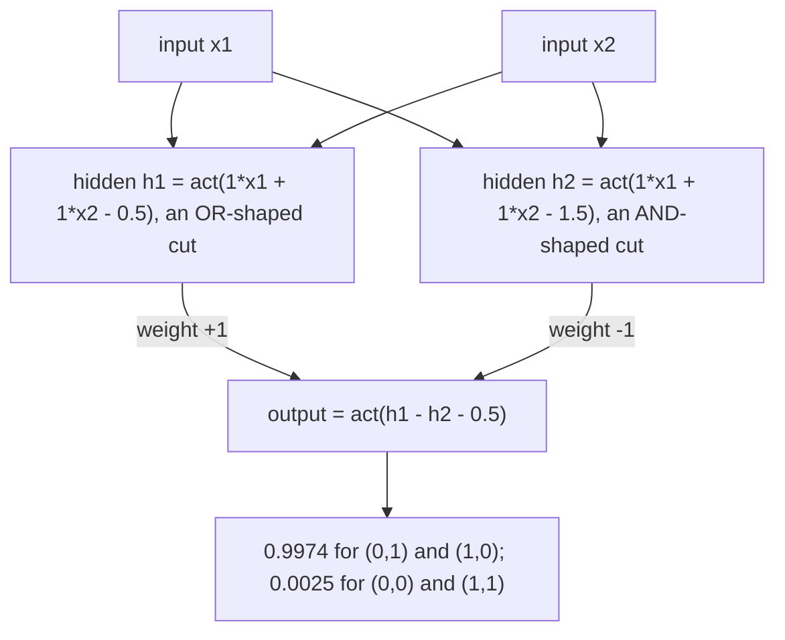
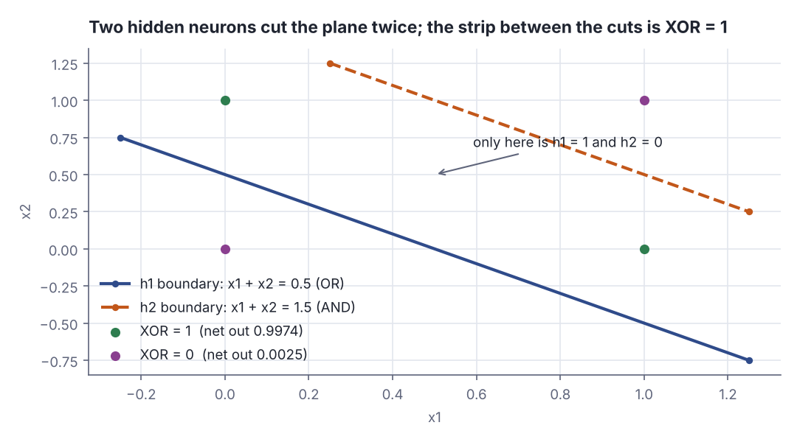
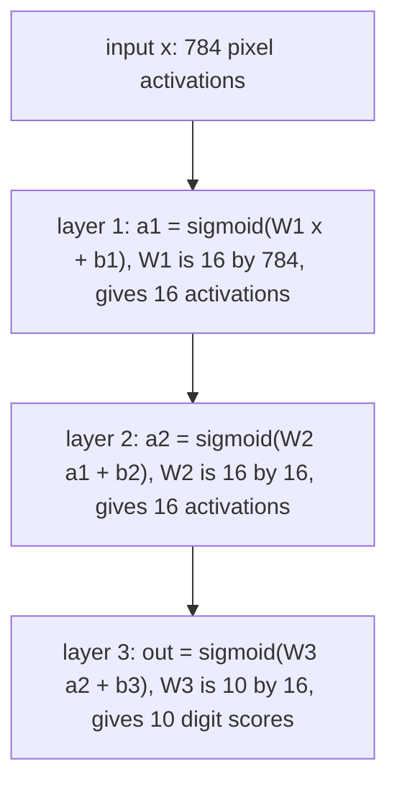
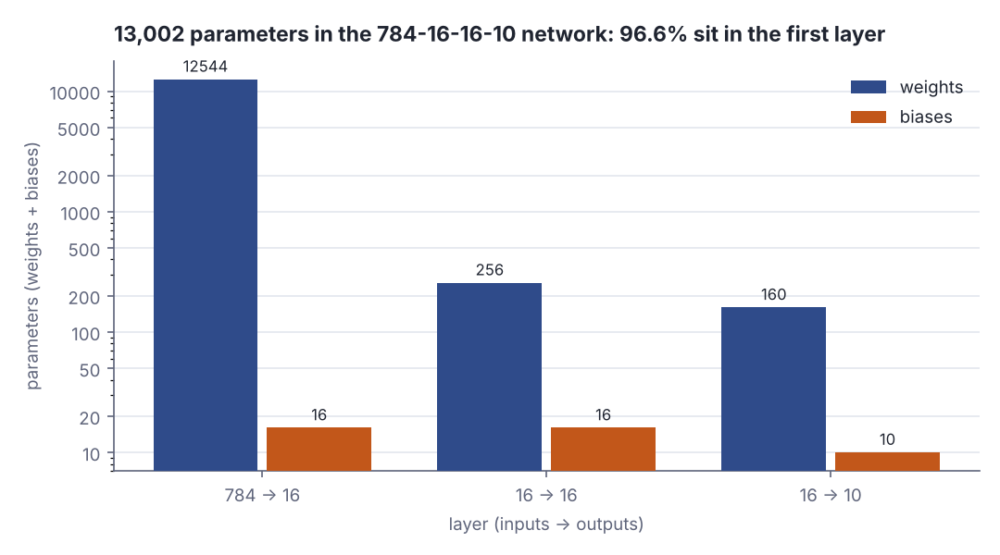

# From perceptron to multilayer network

> AI / ML foundations · Beginner · ~20 min · rung 12 of 38 · needs: Dot products and similarity (ai-ml-05); Gradient descent in many variables: fitting linear regression (ai-ml-07)

## Why this matters
Every model you will meet for the rest of this phase — the digit classifier, the transformer behind the agents you build at work — is the same object repeated: a matrix multiply, a bias, a non-linear squash, stacked.
Once you can count a network's parameters and say exactly which function class it can represent, "add another layer" becomes a sizing decision, not a ritual.
This is also the last rung where you can see every number; from the next one on, the arithmetic is done for you by backpropagation.

## The idea

### A neuron is a dot product, a bias and a squash

A single artificial neuron takes an input vector `x`, holds its own weight vector `w` and a scalar bias `b`, and computes `z = w · x + b` — the dot product you already use for similarity, plus an offset. That `z` is then passed through a non-linear **activation function**. With the logistic sigmoid `σ(z) = 1 / (1 + e^-z)`, which maps any real number into `(0, 1)`, the neuron *is* logistic regression: same weights, same bias, same squash, same output read as a probability.

```scala
// file: Neuron.scala
@main def neuron(): Unit =
  val w = Vector(2.5, -1.8, 0.4)
  val b = -0.7
  def dot(a: Vector[Double], c: Vector[Double]) = a.lazyZip(c).map(_ * _).sum
  def sigmoid(z: Double) = 1.0 / (1.0 + math.exp(-z))
  val rows = Vector(Vector(1.0, 0.2, 3.0), Vector(0.1, 2.0, 0.5))
  for x <- rows do
    val z = dot(w, x) + b
    println(f"x=${x.mkString(",")}%-14s  z=w.x+b=$z%6.3f  sigmoid(z)=${sigmoid(z)}%5.3f")
```

```text
x=1.0,0.2,3.0     z=w.x+b= 2.640  sigmoid(z)=0.933
x=0.1,2.0,0.5     z=w.x+b=-3.850  sigmoid(z)=0.021
```

The first row scores +2.640 and comes out at 0.933; the second scores −3.850 and comes out at 0.021. The weights decide the direction that counts as evidence, the bias decides where the fence stands, and the sigmoid turns a score into a number you can read as a probability. That number a neuron holds is its **activation** (3Blue1Brown, *But what is a neural network?*, ch. 1).

### One neuron draws one line, and XOR is not on one side of a line

Rosenblatt's **perceptron** is this same unit with a hard threshold instead of a sigmoid: output 1 when `w · x + b > 0`, else 0. The set of points where `w · x + b = 0` is a hyperplane — a line in two dimensions — so a single neuron can only answer problems where one straight cut separates the classes. AND and OR are such problems. XOR is not: its positives `(0,1)` and `(1,0)` sit on one diagonal of the unit square and its negatives `(0,0)` and `(1,1)` on the other, and the two diagonals cross — no line separates crossing diagonals.

```scala
// file: Perceptron.scala
@main def perceptron(): Unit =
  val xor = Vector((0.0,0.0,0.0), (0.0,1.0,1.0), (1.0,0.0,1.0), (1.0,1.0,0.0))
  val and = Vector((0.0,0.0,0.0), (0.0,1.0,0.0), (1.0,0.0,0.0), (1.0,1.0,1.0))
  val grid = for a <- -20 to 20; b <- -20 to 20; c <- -20 to 20 yield (a/4.0, b/4.0, c/4.0)
  def best(d: Vector[(Double, Double, Double)]) =
    grid.map((w1, w2, b) =>
      d.count((x1, x2, y) => (if w1*x1 + w2*x2 + b > 0 then 1.0 else 0.0) == y)).max
  println(s"AND: best score of one neuron over ${grid.size} weight triples = ${best(and)}/4")
  println(s"XOR: best score of one neuron over ${grid.size} weight triples = ${best(xor)}/4")
```

```text
AND: best score of one neuron over 68921 weight triples = 4/4
XOR: best score of one neuron over 68921 weight triples = 3/4
```

A grid search is not a theorem, but of 68,921 weight triples not one gets XOR's fourth point right, while AND is solved outright. No amount of training fixes this — the limit is in the model, not in the optimiser.

### Stacking: a layer is `W · x + b`, a network is layers composed

Put two neurons side by side and their weight vectors become the two rows of a matrix. A **layer** is `z = W · x + b` followed by the activation applied element-wise, `a = act(z)`; a **multilayer perceptron (MLP)** feeds one layer's output in as the next layer's input. Layers between input and output are **hidden layers**: nothing outside the network reads them.

> "Somewhat confusingly, and for historical reasons, such multiple layer networks are sometimes called multilayer perceptrons or MLPs, despite being made up of sigmoid neurons, not perceptrons."
>
> — Michael Nielsen, *Neural Networks and Deep Learning*, ch. 1, https://neuralnetworksanddeeplearning.com/chap1.html

XOR needs exactly two hidden neurons. Give one an OR-shaped cut (`x1 + x2 − 0.5`) and the other an AND-shaped cut (`x1 + x2 − 1.5`), then have the output neuron compute "`h1` and not `h2`" with weights `+1, −1` and bias `−0.5`.



*Figure 1: the 2-2-1 network that solves XOR — two hidden neurons each draw one line, the output neuron keeps the region between them. Source: this lesson's lab output.*

The hidden layer has re-drawn the problem: no line works in the `(x1, x2)` plane, but in the `(h1, h2)` plane the four points fold onto three positions and one line does.



*Figure 2: the four XOR inputs and the two cuts made by the hidden neurons; the positive class is exactly the strip where h1 has fired and h2 has not. Generated with `python3 dojo/engine/chart.py dojo/lessons/assets/2026-11-24-1-chart-1.json` from the lab's step-3 output.*

### Take the non-linearity out and the stack collapses

The activation is not decoration. Composing two affine maps gives an affine map: `W2 · (W1 · x + b1) + b2 = (W2 · W1) · x + (W2 · b1 + b2)`. A hundred linear layers are one linear layer with worse ergonomics.

> "Notice that the non-linearity is critical computationally - if we left it out, the two matrices could be collapsed to a single matrix, and therefore the predicted class scores would again be a linear function of the input."
>
> — Stanford CS231n course notes, *Neural Networks Part 1: Setting up the Architecture*, https://cs231n.github.io/neural-networks-1/

Run the XOR network's own weights with the activation deleted:

```scala
// file: Collapse.scala
@main def collapse(): Unit =
  def mv(m: Vector[Vector[Double]], v: Vector[Double]) =
    m.map(r => r.lazyZip(v).map(_ * _).sum)
  val w1 = Vector(Vector(1.0, 1.0), Vector(1.0, 1.0))
  val b1 = Vector(-0.5, -1.5)
  val w2 = Vector(Vector(1.0, -1.0))
  for x <- Vector(Vector(0.0,0.0), Vector(0.0,1.0), Vector(1.0,0.0), Vector(1.0,1.0)) do
    val h = mv(w1, x).lazyZip(b1).map(_ + _)
    val out = mv(w2, h).head - 0.5
    println(f"x=(${x.mkString(", ")})  h=(${h.mkString(", ")})  out=$out%5.2f")
```

```text
x=(0.0, 0.0)  h=(-0.5, -1.5)  out= 0.50
x=(0.0, 1.0)  h=(0.5, -0.5)  out= 0.50
x=(1.0, 0.0)  h=(0.5, -0.5)  out= 0.50
x=(1.0, 1.0)  h=(1.5, 0.5)  out= 0.50
```

Same weights, no squash: the output is a constant 0.50 for all four inputs, because `W2 · W1` is the zero row `[0, 0]`. The hidden layer still computed two different numbers per input — the collapse happens at the second multiply, not in the middle.

### Counting the parameters of a real network

3Blue1Brown's running example is a digit classifier: 784 inputs (one per pixel of a 28×28 image), two hidden layers of 16 — an admittedly arbitrary choice, as he says — and 10 outputs, one per digit (3Blue1Brown, *But what is a neural network?*, ch. 1). Each layer costs `in × out` weights plus `out` biases.



*Figure 3: the 784-16-16-10 network as three matrix-multiply-plus-bias-plus-squash stages. Adapted from Stanford CS231n, "Neural Networks Part 1: Setting up the Architecture", https://cs231n.github.io/neural-networks-1/, and 3Blue1Brown, "But what is a neural network?", ch. 1.*

> "All said and done, this network has 13,002 total weights and biases!"
>
> — 3Blue1Brown, *But what is a neural network?*, Deep learning ch. 1, https://3blue1brown.com/lessons/neural-networks

The lab reproduces that number from the layer sizes alone — and shows where it lives.



*Figure 4: weights and biases per layer on a log scale; the 784-to-16 layer holds 12,560 of the 13,002 parameters. Generated with `python3 dojo/engine/chart.py dojo/lessons/assets/2026-11-24-1-chart-2.json` from the lab's step-4 output.*

### What hidden layers learn, honestly

The motivating story — layer 1 learns edges, layer 2 strokes and loops, the output assembles digits — builds intuition but describes a trained net poorly. Looking at that network's actual weights after training, 3Blue1Brown reports: "There are some loose patterns, but hardly the ones we might expect" (3Blue1Brown, *Analyzing our neural network*, https://www.3blue1brown.com/lessons/neural-network-analysis). Hidden units learn *some* reusable intermediate features — that is why depth helps — but you do not get to name them in advance, and you should not promise a stakeholder that you can.

### The trade-off

Capacity is bought with parameters. A wider or deeper net represents more functions — two hidden neurons buy XOR, enough of them approximate any continuous function on a bounded region — but each added layer multiplies the parameters to fit, needs more data to fit them without memorising, and turns a convex problem (logistic regression has one optimum) into a non-convex one with many. For the tabular data you own at work that trade still favours a linear model or boosted trees; the MLP earns its keep where the raw features are pixels, tokens or waveforms and no human-chosen feature set exists.

## Lab

**The question:** can a 2-2-1 network with hand-set weights actually produce XOR on all four inputs, and where do the 13,002 parameters of the digit network come from?

Scala 3, standard library only. `dot` and `matVec` are the only linear algebra; `layer` is one `W · x + b` followed by the activation. The activation is a steep sigmoid, `act(z) = 1 / (1 + e^(-12 z))` — a soft step, so every number stays differentiable for the next rung. Save as `Lab.scala` and run `scala Lab.scala`.

### Step 1 — the network

Two hidden neurons (`W1` is 2×2, `b1` has two entries), one output neuron (`W2` is 1×2, `b2` has one entry): nine parameters in total.

### Step 2 — one forward pass per input

For each of the four inputs, print the hidden pre-activations `z1`, the hidden activations `h1, h2`, the output pre-activation `z2`, the output, the thresholded label and the target.

### Step 3 — name the two cuts

Print which half-plane each hidden neuron fires in, with the endpoints of the two boundary lines drawn in Figure 2.

### Step 4 — count the parameters of 784-16-16-10

Walk the layer sizes pairwise and print `in × out` weights plus `out` biases per layer, then the total.

```scala
// file: Lab.scala
type Mat = Vector[Vector[Double]]

def dot(a: Vector[Double], b: Vector[Double]): Double =
  require(a.length == b.length, s"dot: ${a.length} vs ${b.length}")
  a.lazyZip(b).map(_ * _).sum

def matVec(m: Mat, v: Vector[Double]): Vector[Double] =
  require(m.head.length == v.length,
    s"matVec: matrix is ${m.length}x${m.head.length}, vector has ${v.length} entries")
  m.map(row => dot(row, v))

val k = 12.0                                    // steepness of the sigmoid
def act(z: Double): Double = 1.0 / (1.0 + math.exp(-k * z))

/** One layer: pre-activations z = W.x + b, then activations a = act(z). */
def layer(w: Mat, b: Vector[Double], x: Vector[Double]): (Vector[Double], Vector[Double]) =
  val z = matVec(w, x).lazyZip(b).map(_ + _)
  (z, z.map(act))

@main def lab(): Unit =
  val w1: Mat = Vector(Vector(1.0, 1.0), Vector(1.0, 1.0))
  val b1 = Vector(-0.5, -1.5)
  val w2: Mat = Vector(Vector(1.0, -1.0))
  val b2 = Vector(-0.5)

  println("=== step 1: the 2-2-1 network, weights set by hand ===")
  println(s"W1 = ${w1.map(_.mkString("[", ", ", "]")).mkString("[", ", ", "]")}   b1 = ${b1.mkString("[", ", ", "]")}")
  println(s"W2 = ${w2.map(_.mkString("[", ", ", "]")).mkString("[", ", ", "]")}        b2 = ${b2.mkString("[", ", ", "]")}")
  println(s"parameters: layer 1 = ${2 * 2} weights + 2 biases, layer 2 = ${1 * 2} weights + 1 bias = 9")

  println()
  println("=== step 2: forward pass over all four XOR inputs ===")
  println("  x1   x2 |     z1_1   z1_2 |     h1     h2 |      z2 |    out | label | target")
  val cases = Vector((0.0, 0.0, 0.0), (0.0, 1.0, 1.0), (1.0, 0.0, 1.0), (1.0, 1.0, 0.0))
  var correct = 0
  for (x1, x2, t) <- cases do
    val (z1, h) = layer(w1, b1, Vector(x1, x2))
    val (z2, out) = layer(w2, b2, h)
    val label = if out.head >= 0.5 then 1.0 else 0.0
    if label == t then correct += 1
    println(f"$x1%4.1f $x2%4.1f | ${z1(0)}%8.2f ${z1(1)}%7.2f | ${h(0)}%6.4f ${h(1)}%6.4f | " +
      f"${z2.head}%7.4f | ${out.head}%6.4f |   $label%3.1f |   $t%3.1f")
  println(f"accuracy on the XOR truth table: $correct/4")

  println()
  println("=== step 3: what the two hidden neurons are ===")
  println("h1 fires when x1 + x2 > 0.5  (OR)   boundary endpoints (-0.25, 0.75) and (1.25, -0.75)")
  println("h2 fires when x1 + x2 > 1.5  (AND)  boundary endpoints ( 0.25, 1.25) and (1.25,  0.25)")
  println("output = act(12 * (h1 - h2 - 0.5)) = OR AND NOT AND = XOR")

  println()
  println("=== step 4: parameters of the 784-16-16-10 digit network ===")
  val sizes = Vector(784, 16, 16, 10)
  val perLayer = sizes.zip(sizes.tail).map((in, out) => (in * out, out))
  for (((in, out), (w, b)), i) <- sizes.zip(sizes.tail).zip(perLayer).zipWithIndex do
    println(f"layer ${i + 1}: $in%3d -> $out%2d   weights $in%3d*$out%2d = $w%5d   biases $b%2d   subtotal ${w + b}%5d")
  val total = perLayer.map((w, b) => w + b).sum
  println(f"total weights ${perLayer.map(_._1).sum}%5d + total biases ${perLayer.map(_._2).sum}%2d = $total%5d parameters")
```

```text
=== step 1: the 2-2-1 network, weights set by hand ===
W1 = [[1.0, 1.0], [1.0, 1.0]]   b1 = [-0.5, -1.5]
W2 = [[1.0, -1.0]]        b2 = [-0.5]
parameters: layer 1 = 4 weights + 2 biases, layer 2 = 2 weights + 1 bias = 9

=== step 2: forward pass over all four XOR inputs ===
  x1   x2 |     z1_1   z1_2 |     h1     h2 |      z2 |    out | label | target
 0.0  0.0 |    -0.50   -1.50 | 0.0025 0.0000 | -0.4975 | 0.0025 |   0.0 |   0.0
 0.0  1.0 |     0.50   -0.50 | 0.9975 0.0025 |  0.4951 | 0.9974 |   1.0 |   1.0
 1.0  0.0 |     0.50   -0.50 | 0.9975 0.0025 |  0.4951 | 0.9974 |   1.0 |   1.0
 1.0  1.0 |     1.50    0.50 | 1.0000 0.9975 | -0.4975 | 0.0025 |   0.0 |   0.0
accuracy on the XOR truth table: 4/4

=== step 3: what the two hidden neurons are ===
h1 fires when x1 + x2 > 0.5  (OR)   boundary endpoints (-0.25, 0.75) and (1.25, -0.75)
h2 fires when x1 + x2 > 1.5  (AND)  boundary endpoints ( 0.25, 1.25) and (1.25,  0.25)
output = act(12 * (h1 - h2 - 0.5)) = OR AND NOT AND = XOR

=== step 4: parameters of the 784-16-16-10 digit network ===
layer 1: 784 -> 16   weights 784*16 = 12544   biases 16   subtotal 12560
layer 2:  16 -> 16   weights  16*16 =   256   biases 16   subtotal   272
layer 3:  16 -> 10   weights  16*10 =   160   biases 10   subtotal   170
total weights 12960 + total biases 42 = 13002 parameters
```

### Reading the output

**Step 2, column by column.** `z1_1` and `z1_2` are the two hidden pre-activations, `x1 + x2 − 0.5` and `x1 + x2 − 1.5`; positive means that neuron fires. `h1`, `h2` are those scores after the squash, so they live in `(0, 1)` and 1.0000 is a rounded 0.99999. `z2 = h1 − h2 − 0.5` is the output neuron's score; `out` is it squashed. `label` is `out` thresholded at 0.5 and should equal `target`. Higher `out` is better on the two rows whose target is 1, lower on the two whose target is 0.

| x1 | x2 | z1_1 | z1_2 | h1 | h2 | z2 | out | label | target |
|---|---|---|---|---|---|---|---|---|---|
| 0.0 | 0.0 | −0.50 | −1.50 | 0.0025 | 0.0000 | −0.4975 | 0.0025 | 0.0 | 0.0 |
| 0.0 | 1.0 | 0.50 | −0.50 | 0.9975 | 0.0025 | 0.4951 | 0.9974 | 1.0 | 1.0 |
| 1.0 | 0.0 | 0.50 | −0.50 | 0.9975 | 0.0025 | 0.4951 | 0.9974 | 1.0 | 1.0 |
| 1.0 | 1.0 | 1.50 | 0.50 | 1.0000 | 0.9975 | −0.4975 | 0.0025 | 0.0 | 0.0 |

Trace row `(1.0, 1.0)` by hand. `z1_1 = 1·1 + 1·1 − 0.5 = 1.50`, so `h1 = 1/(1 + e^(−12 × 1.5)) = 1/(1 + e^−18) = 0.99999998`, printed as 1.0000. `z1_2 = 1 + 1 − 1.5 = 0.50`, so `h2 = 1/(1 + e^−6) = 0.997527`. Then `z2 = 0.99999998 − 0.997527 − 0.5 = −0.497527` and `out = 1/(1 + e^(−12 × −0.497527)) = 1/(1 + e^5.9703) = 0.002547`, printed 0.0025. Label 0.0, target 0.0.

**Verdict:** four for four. Two neurons and one non-linearity turn a problem that 68,921 single-neuron weight triples could not solve into one solved exactly, and the margin is not marginal — 0.9974 against 0.0025.

**Step 4, column by column.** Per layer: `in → out`, the `in × out` weight count, the `out` bias count, and their subtotal. The last line is the sum. 784 × 16 = 12,544 weights plus 16 biases = 12,560 for layer 1; 16 × 16 = 256 plus 16 = 272; 16 × 10 = 160 plus 10 = 170. Total 12,960 weights + 42 biases = **13,002**, matching the figure 3Blue1Brown quotes in chapter 1. Layer 1 alone is 12,560 / 13,002 = 96.6% of the model.

**Verdict:** parameter count is dictated by layer sizes alone, and in a classifier fed raw pixels the first layer dominates. Halving the hidden width to 8 would remove 6,280 parameters; adding a fourth layer of 16 would add 272.

### Cause → consequence

1. **Cause:** a neuron's output depends on `x` only through `w · x + b`, which is constant along a hyperplane.
2. **Mechanism:** the set it answers "1" to is therefore always a half-space, and XOR's positives are not a half-space — the grid search finds 3/4 and stops.
3. **Consequence:** stacking a second layer on top of a *non-linear* first layer changes the representation itself: the hidden units map the four inputs onto new coordinates `(h1, h2)` where a single half-space does work.
4. **In practice:** when you size a network, you are choosing a function class and a parameter budget in one move. `in × out + out` per layer tells you the budget, your data volume tells you whether you can afford it, and no amount of training moves a model outside the class its architecture allows.

## Self-check
1. A colleague proposes stacking three `W · x + b` layers with no activation, arguing that depth gives capacity. What do you reply, and what does the lesson's three-line experiment show? <details><summary>Answer</summary>Composing affine maps gives an affine map: `W3(W2(W1x + b1) + b2) + b3 = (W3W2W1)x + (W3W2b1 + W3b2 + b3)`, so the stack has exactly the representational power of one linear layer — only more parameters to fit and a harder optimisation. `Collapse.scala` runs the XOR weights with the activation deleted and prints `out = 0.50` for all four inputs, because `W2 · W1` is the zero row `[0, 0]`.</details>
2. Why does a single neuron fail on XOR, and what would you have to change — the optimiser, the learning rate, or the architecture — to fix it? <details><summary>Answer</summary>A single neuron answers 1 exactly on the half-plane `w1·x1 + w2·x2 + b > 0`. XOR's positives `(0,1)` and `(1,0)` cannot be put in one half-plane without also including `(0,0)` or `(1,1)`, so the best achievable score is 3/4 — the lesson's grid search over 68,921 weight triples confirms it. Nothing about the optimiser or learning rate helps; the fix is architectural — add a hidden layer with a non-linearity, which re-coordinates the points so one cut suffices.</details>
3. The 784-16-16-10 network has 13,002 parameters. How many does a 784-30-10 network have, and which layer dominates? <details><summary>Answer</summary>Layer 1: 784 × 30 = 23,520 weights + 30 biases = 23,550. Layer 2: 30 × 10 = 300 weights + 10 biases = 310. Total 23,860, of which layer 1 is 98.7%. One wider hidden layer costs nearly twice the two-by-16 design, and the cost is almost entirely in the pixels-to-hidden matrix — the usual reason image models replace that dense first layer with convolutions.</details>

## Sources
- [3Blue1Brown — Neural Networks](https://www.3blue1brown.com/topics/neural-networks) — the series this rung's mental picture comes from; accessed 2026-11-24.
- [3Blue1Brown — "But what is a neural network?" (Deep learning ch. 1)](https://3blue1brown.com/lessons/neural-networks) — the 784-16-16-10 architecture, activations, weights and biases, the quoted 13,002-parameter count and the matrix form of a layer; accessed 2026-11-24.
- [3Blue1Brown — "Analyzing our neural network" (Deep learning ch. 3 companion)](https://www.3blue1brown.com/lessons/neural-network-analysis) — the quoted honest result that the trained hidden layers show "some loose patterns, but hardly the ones we might expect"; accessed 2026-11-24.
- [Stanford CS231n — Neural Networks Part 1: Setting up the Architecture](https://cs231n.github.io/neural-networks-1/) — the quoted statement that without the non-linearity the matrices collapse to one, and the convention of counting parameters as weights plus biases per layer; the layer diagram of Figure 3 is adapted from it; accessed 2026-11-24.
- [Michael Nielsen — Neural Networks and Deep Learning, ch. 1](https://neuralnetworksanddeeplearning.com/chap1.html) — the perceptron's weights-and-threshold definition, the sigmoid neuron, hidden layers, and the quoted note on the name "multilayer perceptron"; accessed 2026-11-24.
- [Kaggle Learn — Intro to Deep Learning](https://www.kaggle.com/learn/intro-to-deep-learning) — Lesson 1 "A Single Neuron" and Lesson 2 "Deep Neural Networks" are the hands-on companions to this rung, in Keras; accessed 2026-11-24.
- [StatQuest — Neural Networks Pt. 1: Inside the Black Box](https://statquest.org/video-index/) — video index entry; the same forward pass walked through one activation at a time, if you want it narrated; accessed 2026-11-24.

## Next on this track
Next on AI / ML foundations: **Backpropagation step by step** (rung 13 of 38, Beginner) — how these weights get found instead of hand-set.
