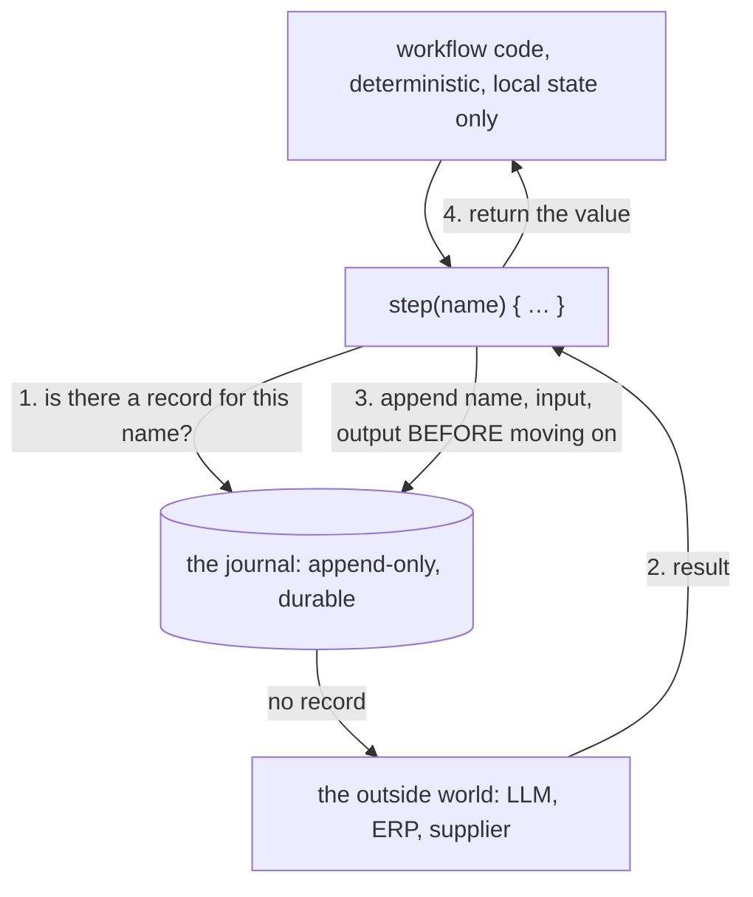
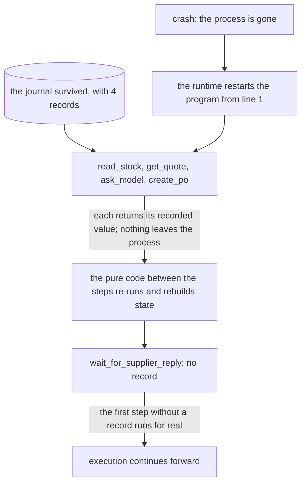
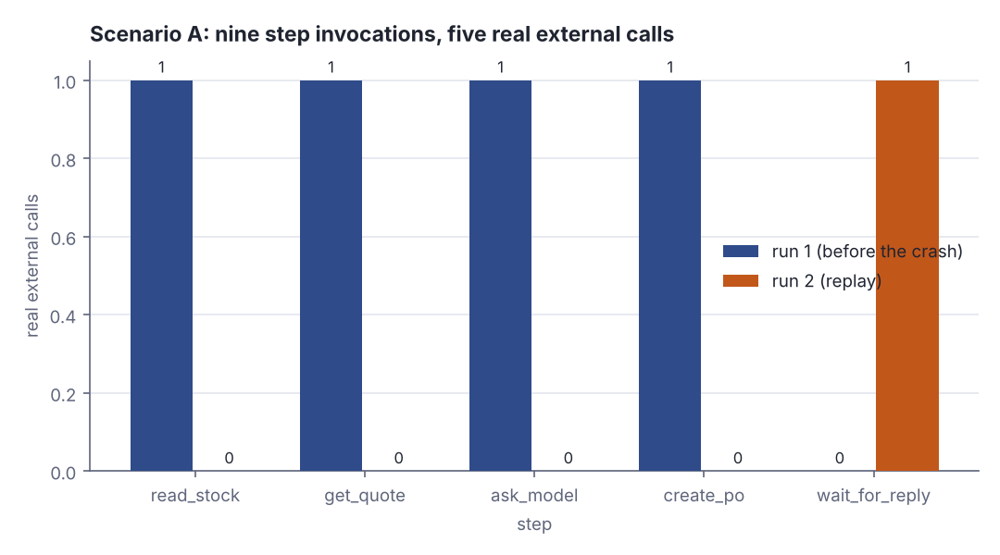
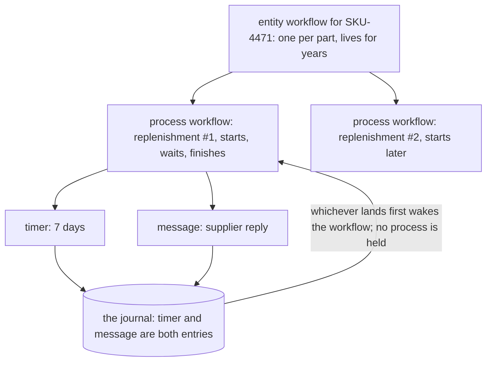
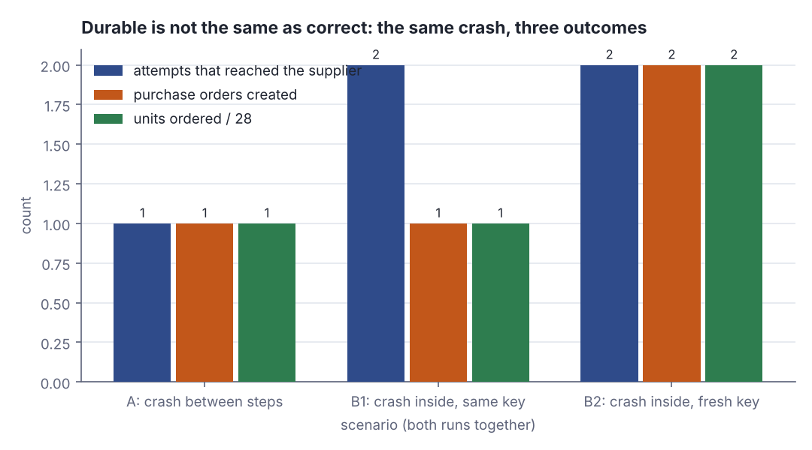

# Durable execution: how a long-horizon agent survives a crash

> Fresh · Software architecture & design · Intermediate · ~25 min · from today's feeds

## Why this matters

On 10 November 2026 Kiran Prakash, a Director of Data and AI at Thoughtworks, published
"Long-horizon agents and durable execution" on martinfowler.com — the architecture of an agent
that must keep working for three weeks while a supplier ships goods. Your architecture ladder so
far has been about where to draw boundaries; this article draws one specific boundary — between
code that only touches local state and code that calls the outside world — and shows what a
runtime can buy you once that line exists. Read it because every agent pilot you will be asked to
judge as a Product Owner dies on exactly this question: it demos fine in a notebook and cannot
survive a deploy.

## Primer

This item sits a rung above where you are, so here is the bridge, in five minutes.

**What it assumes you already have.** You know what a side effect is, you know a process can die
at any instruction, and from this track you know how to choose a dependency direction: the
volatile thing depends on the stable thing, never the other way round. It does *not* assume you
have used Temporal, event sourcing or workflow engines.

**The new boundary.** Durable execution asks you to split your program in two by *effect*, not by
layer. On one side: a **step** — any call that leaves the process (an LLM call, an ERP read, a
message to a supplier). On the other: ordinary code that only reads and writes local variables.
Composition over inheritance applies directly — you wrap each outside call in one combinator,
`step(name) { … }`, rather than deriving from a framework base class.

**The journal.** An append-only record on durable storage of what each step was given and what it
returned. Nothing is overwritten; entries are only added. This is the Write-Ahead Log pattern:

> "Store each state change as a command in a file on a hard disk."
> — Unmesh Joshi, *Write-Ahead Log*, 23 November 2023, https://martinfowler.com/articles/patterns-of-distributed-systems/wal.html

**Replay.** After a crash the program starts again from line one. Steps that already have an entry
return it from the journal instead of calling out again; the plain code between them re-runs and
rebuilds the variables. A consequence you must hold on to: the code between steps has to be
**deterministic**, because it will execute many times and must produce the same values each time.

**Two delivery words.** *At-least-once* means a call or message may arrive more than once — the
default of every retrying system. *Idempotent* means handling it twice leaves the same result as
handling it once. An **idempotency key** is the identifier you keep stable across every attempt so
the receiver can recognise the duplicate. Those three terms carry the second half of the lesson.

## The idea

### A long-horizon agent is a program that outlives its process

An agent loop is small: the model picks a tool, the harness runs it, the result goes back into the
conversation, repeat. The article's running example, "Stock Replenisher", shows what happens when
you stretch that loop over calendar time — it gets quotes, waits two days for a manager to approve
the price, then waits three weeks for the goods to arrive. The tidy loop now has to survive
deploys, pod evictions, supplier outages and the manager's weekend.

> "The agent's process may restart, supplier calls may fail, and messages may be delayed, duplicated, or missed."
> — Kiran Prakash, *Long-horizon agents and durable execution*, 2026-11-10, https://martinfowler.com/articles/durable-execution-agents.html

The usual reflex is a retry loop and a status column. The article's answer is a programming model:

> "a programming model in which the runtime keeps a record of the result of each step that interacts with the outside world"
> — Kiran Prakash, *Long-horizon agents and durable execution*, 2026-11-10, https://martinfowler.com/articles/durable-execution-agents.html

### Steps, a log, replay

Three ideas, in order. A **step** is any call to the outside world. Code between steps only reads
and writes local state. Before the next step is allowed to run, the runtime writes the current
step's input and output to a persistent log — write-ahead, so the record lands before execution
moves on.



*Figure 1: the step boundary. Every arrow that leaves the process goes through one combinator, and
the journal is written before control returns to the workflow. Source: Kiran Prakash,
"Long-horizon agents and durable execution", 2026-11-10,
https://martinfowler.com/articles/durable-execution-agents.html; the Write-Ahead Log pattern,
https://martinfowler.com/articles/patterns-of-distributed-systems/wal.html.*

The whole mechanism fits in a `getOrElseUpdate`:

```scala
val log = scala.collection.mutable.Map("get_quote" -> "unit_price_cents=425")
var calls = 0
def step(name: String)(body: => String): String =
  log.getOrElseUpdate(name, { calls += 1; body })
println(step("get_quote")("unit_price_cents=499"))      // a record exists
println(step("create_po")("PO-2026-1124-077 accepted")) // no record yet
println(s"real external calls this run = $calls")
```

```text
unit_price_cents=425
PO-2026-1124-077 accepted
real external calls this run = 1
```

Two things to notice. `get_quote` returned the *recorded* 425 and never the live 499 — the
journal, not the supplier, is the source of truth for a step that already ran. And the counter
says one: only `create_po`, the step with no record, actually left the process.

### Replay: the program runs again, the steps do not

After a crash the runtime restarts the program from the top.

> "Any step with a recorded output returns it from the log rather than running again."
> — Kiran Prakash, *Long-horizon agents and durable execution*, 2026-11-10, https://martinfowler.com/articles/durable-execution-agents.html

> "The code between steps runs again and rebuilds the program state, which in Stock Replenisher is `state`."
> — Kiran Prakash, *Long-horizon agents and durable execution*, 2026-11-10, https://martinfowler.com/articles/durable-execution-agents.html



*Figure 2: replay. The program re-executes in full; the recorded steps do not. Adapted from Kiran
Prakash, Long-horizon agents and durable execution, 2026-11-10,
https://martinfowler.com/articles/durable-execution-agents.html.*

That is why the article links durable execution to Event Sourcing
(https://martinfowler.com/eaaDev/EventSourcing.html): current state is not stored, it is derived by
replaying the recorded facts. The derivation is your own code between steps, and it must be
deterministic:

```scala
var state = scala.collection.immutable.ListMap.empty[String, Int]
state = state + ("on_hand" -> 12) + ("reorder_point" -> 40)
state = state + ("qty" -> (state("reorder_point") - state("on_hand")))
state = state + ("cost_cents" -> state("qty") * 425)
println(state.map((k, v) => s"$k=$v").mkString(" "))
println(f"order cost = ${state("cost_cents") / 100.0}%.2f")
```

```text
on_hand=12 reorder_point=40 qty=28 cost_cents=11900
order cost = 119.00
```

The 28 and the 11900 are recomputed on every replay from two journaled values (12 and 425), so
they cost nothing and can never drift. Put `System.currentTimeMillis()` or a random number in that
block and the rebuilt state no longer matches the run that wrote the journal.



*Figure 3: in the lab's scenario A the five steps are invoked nine times across the two runs, but
only five calls ever leave the process. Generated from the lab output, scenario A, "per-step real
external calls". Source: the lab in this lesson.*

### Waiting is a journal entry, not a thread

`workflow.wait_condition` suspends the workflow until a message arrives or a timeout passes;
timers and incoming messages are logged like any other step, so a wait survives a crash without a
process sitting on it. The article's own illustration: "If the supplier hasn't got back to us
within seven days, then `wait_for_supplier_reply` will mark the order as overdue." The costs are
small and measured: "In our runs, waking a workflow took under three seconds and tens of
milliseconds of CPU." (Prakash, *Long-horizon agents and durable execution*, 2026-11-10,
https://martinfowler.com/articles/durable-execution-agents.html). The article's footnote 4 breaks
that down: a workflow still in memory wakes in milliseconds — 14 ms on Temporal, about 0.1 s on
Cloudflare — while one rebuilt from its log takes about two seconds on Cloudflare and under a
tenth of a second on Temporal, growing more as the log grows; a wake uses tens of milliseconds of
CPU, and waiting workflows use none (same source, footnote 4). That last clause is the
architectural point: scale is bounded by *wakes*, not by concurrent waits, which matters when "A
manufacturer with thousands of parts will have thousands of agents." (same source).

Two shapes follow. An **entity workflow** is long-lived — one per SKU, alive for years, holding
that part's state. A **process workflow** does one job, one replenishment, and finishes.



*Figure 4: an entity workflow owns the SKU and starts one process workflow per job; the wait's
timer and the supplier's message are both journal entries. Adapted from Kiran Prakash,
Long-horizon agents and durable execution, 2026-11-10,
https://martinfowler.com/articles/durable-execution-agents.html.*

### Durable is not the same as correct

That heading is the article's own, and it carries the sentence you should remember from today:

> "What the runtime can't do is make a retry safe."
> — Kiran Prakash, *Long-horizon agents and durable execution*, 2026-11-10, https://martinfowler.com/articles/durable-execution-agents.html

The journal entry is written *after* the call returns. If the process dies between the supplier
accepting your purchase order and the runtime appending the record, replay finds no record and
calls the supplier again — delivery is at-least-once, not exactly-once. The fix is yours: keep an
idempotency key — the PO number, in the article's example — identical on every attempt and every
replay, so the receiver can spot the duplicate. That is the Idempotent Receiver pattern
(https://martinfowler.com/articles/patterns-of-distributed-systems/idempotent-receiver.html).

```scala
val seen = scala.collection.mutable.Set.empty[String]
def place(key: String): String =
  if seen.add(key) then s"$key accepted" else s"$key duplicate ignored"
println(place("PO-2026-1124-077"))  // first attempt
println(place("PO-2026-1124-077"))  // the retry, same key
println(place("PO-2026-1124-078"))  // the retry, a freshly minted key
println(s"purchase orders created = ${seen.size}")
```

```text
PO-2026-1124-077 accepted
PO-2026-1124-077 duplicate ignored
PO-2026-1124-078 accepted
purchase orders created = 2
```

Same crash, same retry, same supplier — two orders instead of one, decided entirely by where the
key came from. Minting it inside the step is the bug; journaling it, or deriving it from the
workflow id, is the fix.

### Which problems the runtime actually removes

The article tabulates the failure modes: the process does not survive; remote API calls fail; a
retry repeats work; concurrency, when a second replenishment starts while the first still waits;
an outcome nobody sees; the world changes during a wait, so the price rises while the manager
decides; code changes under a running task; history grows; untrusted input, such as a supplier
email carrying instructions. It sorts them with Brooks's distinction from "No Silver Bullet"
(1986, https://techreports.cs.unc.edu/papers/86-020.pdf): unseen outcomes and the world moving
during a wait are **essential** — properties of a business process that takes three weeks, which
no runtime deletes. Code changing under a running task and history growth are **accidental**,
artefacts of the implementation. Replay slows as the log grows, so a long-lived
entity needs snapshots (https://martinfowler.com/eaaDev/Snapshot.html) or `continue_as_new`; and a
step that cannot be retried safely needs a compensating action instead, the saga of Garcia-Molina
and Salem, 1987 (https://www.cs.cornell.edu/andru/cs711/2002fa/reading/sagas.pdf). The article's
own guard rails are mundane and worth copying: a retry policy of
`RetryPolicy(maximum_attempts=6, initial_interval=timedelta(seconds=2), backoff_coefficient=2)`
and an agent loop capped at `MAX_TURNS = 30` (Prakash, *Long-horizon agents and durable
execution*, 2026-11-10, https://martinfowler.com/articles/durable-execution-agents.html).

Runtimes the article names: Temporal, Restate, Inngest, DBOS and Cloudflare Workflows; its
example was built on the first and the last. If persistent actors with event sourcing feel
familiar from Akka, this is the same machinery with the journal promoted from a persistence
detail to the programming model.

> "Getting those trade-offs right defines how useful long-horizon agents are in an enterprise, beyond just a proof of concept."
> — Kiran Prakash, *Long-horizon agents and durable execution*, 2026-11-10, https://martinfowler.com/articles/durable-execution-agents.html

## Lab

The question: **when the process dies mid-workflow, how many of my five external calls happen
again — and at which crash point does the runtime's recovery still order the goods twice?**

### Step 1 — the runtime

`World` counts every call that leaves the process, per step name. `Supplier` is an idempotent
receiver: it remembers the keys it has seen. `Journal` is the durable log, a `LinkedHashMap` from
step name to recorded value, and it is the only thing that survives a crash. `Runtime.step(name)`
is the combinator from Figure 1: record present, return it and print `REPLAYED`; record absent,
run the body, append, print `RAN`.

### Step 2 — the workflow

Five steps: `read_stock`, `get_quote`, `ask_model`, `create_po`, `wait_for_supplier_reply`. Between
them, pure code rebuilds `state` — quantity from the stock line, cost from the quote — and prints
the arithmetic, so you can watch the rebuild on replay.

### Step 3 — scenario A: kill the process *between* steps

`crashBefore = Set("wait_for_supplier_reply")`. Run 1 completes four steps and dies; run 2 starts
the program again from the top with the same journal.

### Step 4 — scenario B: kill it *inside* the step, after the external call

`crashInside = Set("create_po")`: the supplier accepts the order, then the process dies before the
append. B1 reuses the idempotency key `PO-2026-1124-077` on the retry; B2 mints a fresh number on
every attempt. Nothing else differs.

### Step 5 — run it

```scala
// file: Lab.scala
import scala.collection.mutable
import scala.collection.immutable.ListMap

// ---------------------------- the outside world ----------------------------
// Every call that leaves the process is counted here, per step name.
object World:
  val calls = mutable.LinkedHashMap.empty[String, Int]
  def call[A](step: String)(result: A): A =
    calls(step) = calls.getOrElse(step, 0) + 1
    result
  def reset(): Unit = calls.clear()

// The supplier is an Idempotent Receiver: it remembers the keys it has seen.
object Supplier:
  val attempts = mutable.ArrayBuffer.empty[String]
  val orders = mutable.LinkedHashMap.empty[String, Int]
  def reset(): Unit = { attempts.clear(); orders.clear() }
  def placeOrder(key: String, qty: Int): String =
    attempts += key
    if orders.contains(key) then s"$key duplicate-ignored"
    else
      orders(key) = qty
      s"$key accepted qty=$qty"
  def unitsOrdered: Int = orders.values.sum

// ------------------------------- the runtime -------------------------------
case object Crash extends RuntimeException("the process died")

/** The journal: the durable record of what each step returned. Survives a crash. */
class Journal:
  val log = mutable.LinkedHashMap.empty[String, String]
  var ran = 0
  var replayed = 0

/** crashBefore: the process dies between steps.
  * crashInside: the external call lands, then the process dies before the append. */
class Runtime(val j: Journal, crashBefore: Set[String] = Set.empty,
              val crashInside: Set[String] = Set.empty):
  def step(name: String)(body: => String): String =
    if crashBefore(name) then
      println(f"  $name%-24s --        <<< the process dies here")
      throw Crash
    j.log.get(name) match
      case Some(v) =>
        j.replayed += 1
        println(f"  $name%-24s REPLAYED  $v")
        v
      case None =>
        val v = body            // the real external call; it may die after effecting
        j.log(name) = v
        j.ran += 1
        println(f"  $name%-24s RAN       $v")
        v

// ------------------------------ the workflow -------------------------------
// Five steps. The code BETWEEN steps is pure and rebuilds `state` on every replay.
def replenish(rt: Runtime, poKey: () => String): Unit =
  var state = ListMap.empty[String, Int]
  def show(): Unit =
    println("      state = " + state.map((k, v) => s"$k=$v").mkString(" "))

  val stockLine = rt.step("read_stock")(World.call("read_stock")("on_hand=12,reorder_point=40"))
  val f = stockLine.split(",").map(_.split("=")).map(a => a(0) -> a(1).toInt).toMap
  state = state + ("on_hand" -> f("on_hand")) + ("reorder_point" -> f("reorder_point"))
  state = state + ("qty" -> (f("reorder_point") - f("on_hand")))
  println(s"      qty  = ${f("reorder_point")} - ${f("on_hand")} = ${state("qty")} units")
  show()

  val quote = rt.step("get_quote")(World.call("get_quote")("unit_price_cents=425"))
  state = state + ("unit_price_cents" -> quote.split("=")(1).toInt)
  state = state + ("cost_cents" -> state("qty") * state("unit_price_cents"))
  println(s"      cost = ${state("qty")} x ${state("unit_price_cents")} = ${state("cost_cents")} cents")
  show()

  val decision = rt.step("ask_model")(World.call("ask_model")("tool=place_order"))
  println(s"      the model chose $decision")

  rt.step("create_po") {
    val key = poKey()
    val ack = World.call("create_po")(Supplier.placeOrder(key, state("qty")))
    if rt.crashInside("create_po") then
      println(f"  create_po                EFFECTED  $ack  <<< dies before the append")
      throw Crash
    ack
  }

  rt.step("wait_for_supplier_reply")(World.call("wait_for_supplier_reply")("eta=2026-12-15"))
  val billed = Supplier.unitsOrdered * state("unit_price_cents") / 100.0
  println(f"      finished. units at the supplier=${Supplier.unitsOrdered}%d billed=$billed%.2f")

def attempt(label: String, rt: Runtime, poKey: () => String): Unit =
  println(label)
  try replenish(rt, poKey)
  catch case Crash => println("  ** the process is gone **")

@main def lab(): Unit =
  val stableKey = () => "PO-2026-1124-077"

  // ---- Scenario A: the process dies BETWEEN steps ----
  println("=== Scenario A - crash between steps (create_po is already in the journal) ===")
  World.reset(); Supplier.reset()
  val jA = new Journal
  attempt("RUN 1 (crash armed before wait_for_supplier_reply)",
    new Runtime(jA, crashBefore = Set("wait_for_supplier_reply")), stableKey)
  val run1 = World.calls.toMap
  attempt("RUN 2 (replay from the journal)", new Runtime(jA), stableKey)
  println("  per-step real external calls:")
  for k <- World.calls.keys do
    println(f"    $k%-24s run1=${run1.getOrElse(k, 0)}%d " +
      f"run2=${World.calls(k) - run1.getOrElse(k, 0)}%d total=${World.calls(k)}%d")
  val a = (jA.ran, jA.replayed, Supplier.attempts.size, Supplier.orders.size, Supplier.unitsOrdered)

  // ---- Scenario B1: dies INSIDE create_po; the idempotency key is kept ----
  println()
  println("=== Scenario B1 - crash inside create_po, SAME idempotency key on the retry ===")
  World.reset(); Supplier.reset()
  val jB1 = new Journal
  attempt("RUN 1 (the external call lands, then the process dies)",
    new Runtime(jB1, crashInside = Set("create_po")), stableKey)
  attempt("RUN 2 (replay; create_po has no record, so it runs for real again)",
    new Runtime(jB1), stableKey)
  val b1 = (jB1.ran, jB1.replayed, Supplier.attempts.size, Supplier.orders.size, Supplier.unitsOrdered)

  // ---- Scenario B2: the same crash, a fresh key per attempt ----
  println()
  println("=== Scenario B2 - crash inside create_po, FRESH key on the retry ===")
  World.reset(); Supplier.reset()
  val jB2 = new Journal
  var n = 76
  val freshKey = () => { n += 1; f"PO-2026-1124-$n%03d" }
  attempt("RUN 1 (the external call lands, then the process dies)",
    new Runtime(jB2, crashInside = Set("create_po")), freshKey)
  attempt("RUN 2 (replay; create_po runs again and mints a NEW key)",
    new Runtime(jB2), freshKey)
  val b2 = (jB2.ran, jB2.replayed, Supplier.attempts.size, Supplier.orders.size, Supplier.unitsOrdered)

  println()
  println("=== Summary over both runs of each scenario ===")
  println("  scenario       RAN REPLAYED attempts orders units billed")
  for (name, t) <- List("A", "B1 same key", "B2 fresh key").zip(List(a, b1, b2)) do
    println(f"  $name%-13s ${t._1}%4d ${t._2}%8d ${t._3}%8d ${t._4}%6d ${t._5}%5d " +
      f"${t._5 * 425 / 100.0}%6.2f")
```

Run it with `python3 dojo/engine/run_lab.py 2026-11-24-2` (or `scala Lab.scala` on your Mac). The
real output:

```text
=== Scenario A - crash between steps (create_po is already in the journal) ===
RUN 1 (crash armed before wait_for_supplier_reply)
  read_stock               RAN       on_hand=12,reorder_point=40
      qty  = 40 - 12 = 28 units
      state = on_hand=12 reorder_point=40 qty=28
  get_quote                RAN       unit_price_cents=425
      cost = 28 x 425 = 11900 cents
      state = on_hand=12 reorder_point=40 qty=28 unit_price_cents=425 cost_cents=11900
  ask_model                RAN       tool=place_order
      the model chose tool=place_order
  create_po                RAN       PO-2026-1124-077 accepted qty=28
  wait_for_supplier_reply  --        <<< the process dies here
  ** the process is gone **
RUN 2 (replay from the journal)
  read_stock               REPLAYED  on_hand=12,reorder_point=40
      qty  = 40 - 12 = 28 units
      state = on_hand=12 reorder_point=40 qty=28
  get_quote                REPLAYED  unit_price_cents=425
      cost = 28 x 425 = 11900 cents
      state = on_hand=12 reorder_point=40 qty=28 unit_price_cents=425 cost_cents=11900
  ask_model                REPLAYED  tool=place_order
      the model chose tool=place_order
  create_po                REPLAYED  PO-2026-1124-077 accepted qty=28
  wait_for_supplier_reply  RAN       eta=2026-12-15
      finished. units at the supplier=28 billed=119.00
  per-step real external calls:
    read_stock               run1=1 run2=0 total=1
    get_quote                run1=1 run2=0 total=1
    ask_model                run1=1 run2=0 total=1
    create_po                run1=1 run2=0 total=1
    wait_for_supplier_reply  run1=0 run2=1 total=1

=== Scenario B1 - crash inside create_po, SAME idempotency key on the retry ===
RUN 1 (the external call lands, then the process dies)
  read_stock               RAN       on_hand=12,reorder_point=40
      qty  = 40 - 12 = 28 units
      state = on_hand=12 reorder_point=40 qty=28
  get_quote                RAN       unit_price_cents=425
      cost = 28 x 425 = 11900 cents
      state = on_hand=12 reorder_point=40 qty=28 unit_price_cents=425 cost_cents=11900
  ask_model                RAN       tool=place_order
      the model chose tool=place_order
  create_po                EFFECTED  PO-2026-1124-077 accepted qty=28  <<< dies before the append
  ** the process is gone **
RUN 2 (replay; create_po has no record, so it runs for real again)
  read_stock               REPLAYED  on_hand=12,reorder_point=40
      qty  = 40 - 12 = 28 units
      state = on_hand=12 reorder_point=40 qty=28
  get_quote                REPLAYED  unit_price_cents=425
      cost = 28 x 425 = 11900 cents
      state = on_hand=12 reorder_point=40 qty=28 unit_price_cents=425 cost_cents=11900
  ask_model                REPLAYED  tool=place_order
      the model chose tool=place_order
  create_po                RAN       PO-2026-1124-077 duplicate-ignored
  wait_for_supplier_reply  RAN       eta=2026-12-15
      finished. units at the supplier=28 billed=119.00

=== Scenario B2 - crash inside create_po, FRESH key on the retry ===
RUN 1 (the external call lands, then the process dies)
  read_stock               RAN       on_hand=12,reorder_point=40
      qty  = 40 - 12 = 28 units
      state = on_hand=12 reorder_point=40 qty=28
  get_quote                RAN       unit_price_cents=425
      cost = 28 x 425 = 11900 cents
      state = on_hand=12 reorder_point=40 qty=28 unit_price_cents=425 cost_cents=11900
  ask_model                RAN       tool=place_order
      the model chose tool=place_order
  create_po                EFFECTED  PO-2026-1124-077 accepted qty=28  <<< dies before the append
  ** the process is gone **
RUN 2 (replay; create_po runs again and mints a NEW key)
  read_stock               REPLAYED  on_hand=12,reorder_point=40
      qty  = 40 - 12 = 28 units
      state = on_hand=12 reorder_point=40 qty=28
  get_quote                REPLAYED  unit_price_cents=425
      cost = 28 x 425 = 11900 cents
      state = on_hand=12 reorder_point=40 qty=28 unit_price_cents=425 cost_cents=11900
  ask_model                REPLAYED  tool=place_order
      the model chose tool=place_order
  create_po                RAN       PO-2026-1124-078 accepted qty=28
  wait_for_supplier_reply  RAN       eta=2026-12-15
      finished. units at the supplier=56 billed=238.00

=== Summary over both runs of each scenario ===
  scenario       RAN REPLAYED attempts orders units billed
  A                5        4        1      1    28 119.00
  B1 same key      5        3        2      1    28 119.00
  B2 fresh key     5        3        2      2    56 238.00
```

### Reading the output

**The per-step columns.** `RAN` means the body executed and a real call left the process;
`REPLAYED` means the journal answered and nothing left the process. `run1` / `run2` / `total` in
the per-step table count real external calls: lower is better everywhere except the step you still
need to make progress. `attempts` is how many requests reached the supplier; `orders` is how many
purchase orders the supplier actually created; `units` and `billed` are what you pay for.

Scenario A, per step:

| step | run 1 | run 2 | total real calls |
|---|---|---|---|
| read_stock | 1 | 0 | 1 |
| get_quote | 1 | 0 | 1 |
| ask_model | 1 | 0 | 1 |
| create_po | 1 | 0 | 1 |
| wait_for_supplier_reply | 0 | 1 | 1 |

Nine step invocations across the two runs (4 in run 1 + 5 in run 2), five real calls. The arithmetic
printed between the steps is identical in both runs because it is pure: `qty = 40 - 12 = 28`, then
`cost = 28 x 425 = 11900` cents = 119.00. Run 2 recomputed both from two journaled strings and
called no one.

**Verdict:** a crash between steps costs you nothing but a replay. The LLM call, the ERP read and
the purchase order each happened exactly once, and the workflow finished at the step where it died.

The three scenarios side by side:

| scenario | RAN | REPLAYED | supplier attempts | orders created | units | billed |
|---|---|---|---|---|---|---|
| A — crash between steps | 5 | 4 | 1 | 1 | 28 | 119.00 |
| B1 — crash inside, same key | 5 | 3 | 2 | 1 | 28 | 119.00 |
| B2 — crash inside, fresh key | 5 | 3 | 2 | 2 | 56 | 238.00 |



*Figure 5: the same crash at the same instruction; the only difference is where the idempotency key
comes from. Generated from the lab's summary table. Source: the lab in this lesson.*

B1 and B2 crash at the identical instruction and both send the supplier two requests. In B1 the
second request carries `PO-2026-1124-077` again, the supplier answers `duplicate-ignored`, and
`orders` stays at 1: 28 units × 425 cents = 11900 cents = 119.00. In B2 the retry mints
`PO-2026-1124-078`, the supplier has never seen it, and `orders` becomes 2: 2 × 28 = 56 units,
56 × 425 = 23800 cents = 238.00. The journal behaved identically in both.

**Verdict:** the runtime guaranteed that the workflow finished; it guaranteed nothing about how
many times the goods were ordered. Durable is not the same as correct, and the difference is one
line of your code.

### Cause → consequence

1. **Cause** — the journal entry is written *after* the external call returns, so there is a window
   in which the effect has happened and the record has not.
2. **Mechanism** — replay looks only at the journal. A step with no record is indistinguishable
   from a step that never ran, so it runs for real again.
3. **Consequence** — any step that is not idempotent is executed twice whenever the process dies
   inside that window. In B2 that is a second purchase order, 28 extra units, 119.00 extra.
4. **In practice** — when you review an agent design, ask two questions. Which calls leave the
   process, and does each of them carry a key that is stable across attempts and replays? And is
   the code between steps deterministic? Everything else the runtime handles; those two it cannot.

## Self-check

1. In scenario A the five steps are invoked nine times across the two runs, yet only five calls
   leave the process. Which four invocations produced no call, and what exactly decided that?
   <details><summary>Answer</summary>In run 2, `read_stock`, `get_quote`, `ask_model` and `create_po`
   each found a recorded output in the journal and returned it: "Any step with a recorded output
   returns it from the log rather than running again." (Prakash, 2026-11-10,
   https://martinfowler.com/articles/durable-execution-agents.html). The decision is made purely by
   the presence of the step's name in the journal — not by any flag the workflow sets. The pure code
   between the steps re-ran all the same, recomputing qty=28 and cost=11900 cents from the journaled
   values.</details>
2. B1 and B2 crash at exactly the same instruction, and both send the supplier two requests. Why
   does one end with 28 units and the other with 56, and whose responsibility is that difference?
   <details><summary>Answer</summary>B1 reuses the idempotency key `PO-2026-1124-077` on the retry,
   so the idempotent receiver recognises the duplicate and creates no second order. B2 mints
   `PO-2026-1124-078` inside the step, so the supplier sees a new order and creates it: 56 units,
   238.00. It is the application's responsibility — the runtime cannot tell a legitimate second
   order from a retry: "What the runtime can't do is make a retry safe." (Prakash, 2026-11-10,
   https://martinfowler.com/articles/durable-execution-agents.html). Keep the key stable by
   journaling it or deriving it from the workflow id.</details>
3. An entity workflow for one SKU has been alive for two years and its log has grown large, so
   replay after a restart takes noticeably longer. Name the two mechanisms that address this, and
   say whether the problem is essential or accidental complexity.
   <details><summary>Answer</summary>Snapshots (https://martinfowler.com/eaaDev/Snapshot.html) —
   persist a compacted state so replay starts from it rather than from the first entry — and
   `continue_as_new`, which ends the current workflow run and starts a fresh one carrying only the
   state it needs, truncating the history. The article classes history growth as *accidental*
   complexity in Brooks's sense: it is an artefact of the implementation, not of the business
   process, unlike the world changing during a three-week wait, which is essential and which no
   runtime removes.</details>

## Sources

- [Long-horizon agents and durable execution](https://martinfowler.com/articles/durable-execution-agents.html) — Kiran Prakash (Thoughtworks), 10 November 2026 — the primary source: the definition of durable execution, the steps/log/replay mechanism, the Stock Replenisher example, the wait and wake measurements, the "durable is not the same as correct" argument, the failure-mode table and the runtimes named; accessed 2026-11-24.
- [Write-Ahead Log](https://martinfowler.com/articles/patterns-of-distributed-systems/wal.html) — Unmesh Joshi, 23 November 2023 — the pattern the journal implements, quoted in the Primer; accessed 2026-11-24.
- [Idempotent Receiver](https://martinfowler.com/articles/patterns-of-distributed-systems/idempotent-receiver.html) — Unmesh Joshi — the pattern the article names for duplicate suppression at the receiver, modelled by `Supplier` in the lab; linked by the article, listed for follow-up, not fetched, so nothing here is quoted from it (listed 2026-11-24).
- [Event Sourcing](https://martinfowler.com/eaaDev/EventSourcing.html) — Martin Fowler — the pattern the article links replay to: state derived by replaying recorded facts; linked by the article, not fetched, so nothing here is quoted from it (listed 2026-11-24).
- [Snapshot](https://martinfowler.com/eaaDev/Snapshot.html) — Martin Fowler — the pattern named for keeping replay cheap as a long-lived entity's log grows; linked by the article, not fetched (listed 2026-11-24).
- [Sagas](https://www.cs.cornell.edu/andru/cs711/2002fa/reading/sagas.pdf) — Hector Garcia-Molina and Kenneth Salem, 1987 — the paper the article cites for compensating a step that cannot be retried; linked by the article, not fetched (listed 2026-11-24).
- [No Silver Bullet: Essence and Accidents of Software Engineering](https://techreports.cs.unc.edu/papers/86-020.pdf) — Frederick P. Brooks Jr., 1986 — the essential/accidental distinction the article uses to sort the failure modes; linked by the article, not fetched (listed 2026-11-24).
