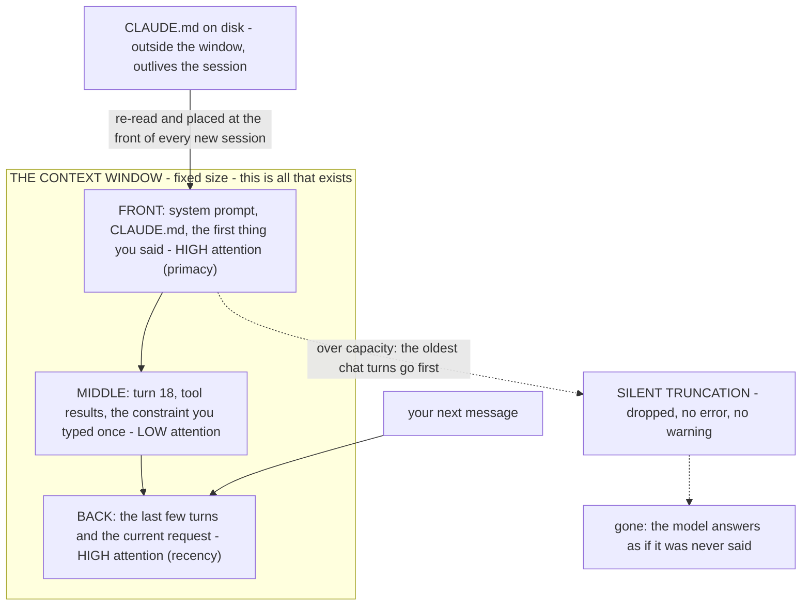
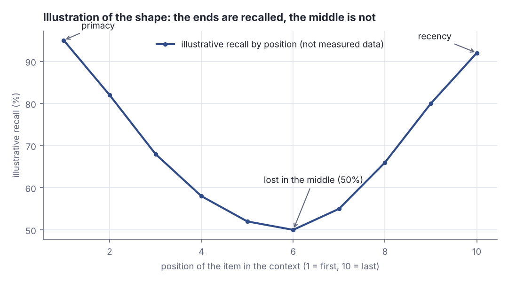
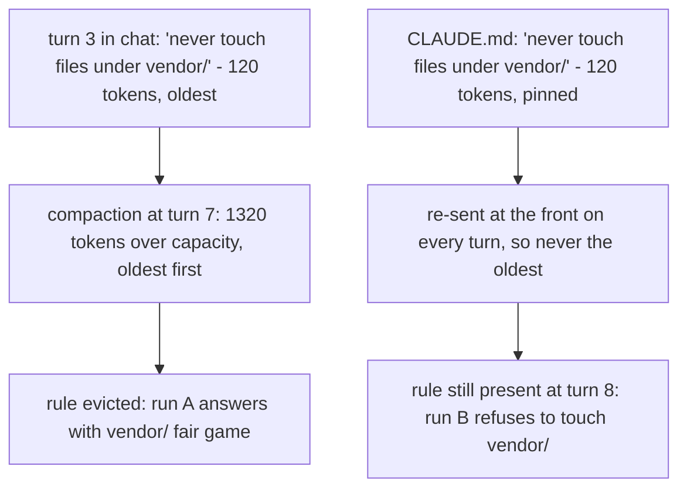
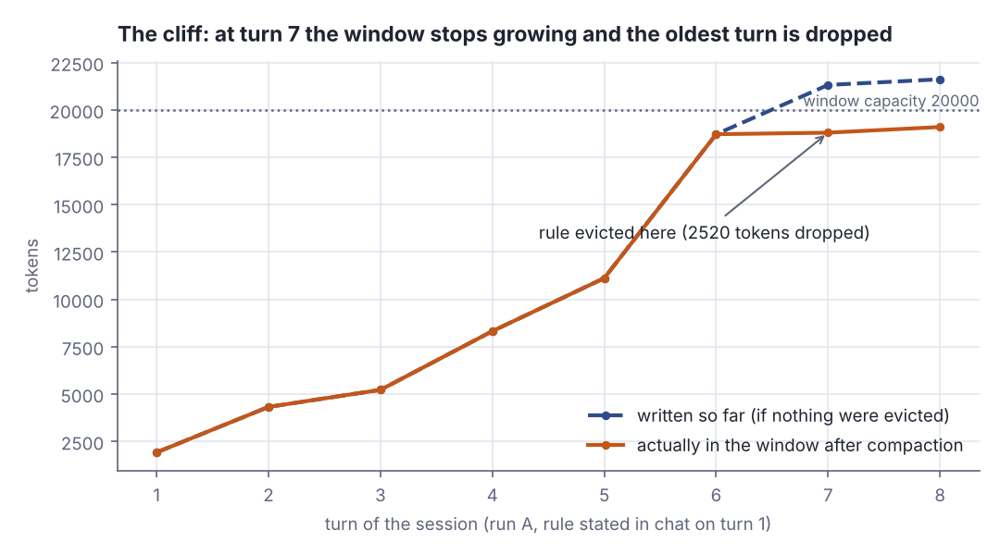

# Working memory: the context window and its silent cliff

> Claude Academy · Beginner · ~30 min · rung 5 of 20 · needs: Knowledge: what the model read, and when it stopped reading (claude-academy-04)

## Why this matters

Your long Claude Code sessions on a real repository do not fail because the model got the Lua
wrong; they fail because it no longer has what you told it on turn 3.
The window is a fixed-size buffer whose overflow path is a drop, not an exception — nothing
throws, nothing logs, and the answers keep exactly the same confident register.
Knowing where that edge sits, and which placement of an instruction survives it, is the
difference between an hour of trusted work and re-briefing the session every ten minutes.

## The idea

### The window is the whole world

For any single turn, the model is handed one flat sequence of tokens: the system prompt, the
contents of `CLAUDE.md`, every message either of you has sent, every tool result, every file it
read. That sequence has a fixed maximum length — the **context window** — and it is the entire
universe the model can attend to. Anything that is not in it does not exist for that turn:
not the part of this session that was dropped, not yesterday's session, not the file nobody
opened.

The instinct from the JVM is to read this as a cache, and that instinct is the trap. A cache
miss has a fault handler: you miss, you go to the backing store, you load, you continue. A
context miss has no handler. The text is simply not there, and the model produces the most
plausible continuation of a conversation in which it was never said.

```text
Illustrative — written for this lesson.

TURN 3  (the rule is in the window)
You:    Never touch files under vendor/. Fix the pool timeout.
Claude: Patching src/net/pool.lua only — vendor/lua-cjson is untouched.
```

```text
Illustrative — written for this lesson.

TURN 41 (same session; compaction has dropped turn 3)
You:    The cjson decoder rejects our payload — fix it.
Claude: Editing vendor/lua-cjson/cjson.c to accept the trailing comma.
```

The second response is not a refusal to obey and not a contradiction. There is no hedge, no
"I no longer have your earlier instruction", no change of tone — the only difference between
the two turns is that 120 tokens stopped being in the input. The course names this precisely:

> "Silent truncation is the failure mode, and you won't always be warned. The model doesn't learn from your corrections. It only responds to what's currently in context."
> — Claude Academy, *AI Capabilities and Limitations — Working Memory*, accessed 2026-11-25, https://academy.claude.com/courses/ai-capabilities-and-limitations/working-memory

The middle sentence is the one engineers under-rate. When you correct the model and it complies,
nothing was learned: no weights changed. The correction is now a piece of text in the window,
and it steers the next turn for exactly as long as it stays there. Repeating a correction three
times costs three times the tokens and buys you nothing once all three copies fall off the
front.



*Figure 1: The window as working memory — a fixed-size box with high attention at both ends, a low-attention middle, a capacity edge that drops the oldest turns without warning, and an external store that refills the front of every new session. Source: drawn for this lesson from Claude Academy, "AI Capabilities and Limitations", lesson 8 "Working Memory", §"The context window: AI's working memory", https://academy.claude.com/courses/ai-capabilities-and-limitations/working-memory*

### Inside the window, position is not neutral

Being inside the window is necessary, not sufficient. Attention across a long input is uneven,
and the shape is the one psychology calls the serial-position curve:

> "Items at the beginning of a list benefit from primacy (they get rehearsed more), and items at the end benefit from recency (they're still fresh)."
> — Claude Academy, *AI Capabilities and Limitations — Try It Out: Working Memory*, accessed 2026-11-25, https://academy.claude.com/courses/ai-capabilities-and-limitations/try-it-out-q7hdjm9twcbt

The practical reading is blunt: a constraint buried in the middle of a long session is weakly
attended even when it is still present, so "it is in the context" is not the same claim as "it
will be obeyed". The fix costs nothing — put what must hold at an edge. The front edge is the
system prompt and `CLAUDE.md`; the back edge is the line immediately before your request.

```text
Illustrative — written for this lesson.

RULE IN THE MIDDLE (turn 18 of 40, ~60k tokens of tool output after it)
You:    ...12 KB of grep output...
        Keep all public function signatures stable.
        ...48 KB of busted output...
You:    Rename pool.acquire to pool.checkout across the repo.
Claude: Renamed pool.acquire -> pool.checkout in 14 files, including
        the exported name in src/net/init.lua.
```

```text
Illustrative — written for this lesson.

SAME RULE, MOVED TO THE BACK EDGE (last line before the request)
You:    Rename pool.acquire to pool.checkout across the repo.
        Constraint, repeated: keep all public function signatures stable.
Claude: Renaming internal call sites only. src/net/init.lua exports
        pool.acquire, so I kept it and added checkout as an alias.
```

Same rule, same window, same model — only the position changed, and the second run respects the
public API. That is the cheapest reliability lever you have in a long session.



*Figure 2: The serial-position shape — an illustration, not measured data. The ten values (95, 82, 68, 58, 52, 50, 55, 66, 80, 92) are the illustrative numbers printed by `scala Lab.scala` in the Lab below, chosen to draw the described curve. Adapted from Claude Academy, "AI Capabilities and Limitations — Try It Out: Working Memory", https://academy.claude.com/courses/ai-capabilities-and-limitations/try-it-out-q7hdjm9twcbt*

### Across sessions, nothing survives unless something writes it down

The model has no store of its own between sessions. Close the terminal and every token of that
window is gone; open a new session and the model starts from the same weights it had before you
ever spoke to it. What looks like memory is always a file plus a re-injection: `CLAUDE.md` in the
repository, a memory file the harness maintains, the issue you paste in again. The harness reads
that file and places its text at the front of the window at the start of each session, which is
why it both survives restarts *and* lands in the highest-attention position. The Lab is how you
verify that on your own machine rather than taking it from me.

This also sets the boundary of the rung. Everything here is about *whether* a token is inside
the window and *where*. How much window a given model has, what that costs, and how to spend it
deliberately — summarising, pruning tool output, ordering a prompt — is context engineering, and
it is the subject of the AI/ML rung ai-ml-26 further along the ladder.



*Figure 3: The same 120 tokens, two placements. In a chat turn they are the oldest thing in the window and go first; in CLAUDE.md they are re-sent each turn and cannot age out. Source: drawn for this lesson from the Lab's run A and run B output below.*

## Lab

**The question:** which placement of a constraint survives a long session — a line you typed on
turn 3, or the same line in `CLAUDE.md`? Part A computes the exact turn at which the typed one
falls out. Part B checks the answer against the real thing on your Mac.

### Step 1 — the context-budget simulator

A session is a pinned prefix (system prompt, plus `CLAUDE.md` when the rule lives there) followed
by chat turns. When the total exceeds the window, the oldest chat turns are dropped until it
fits. The token counts are illustrative round numbers chosen for this lesson; the arithmetic of
eviction is the real content.

```scala
// file: Lab.scala
// Context-budget simulator for one Claude Code session on a Lua monorepo.
// Every token count below is an illustrative round number chosen for this lesson,
// not a measurement. What is real is the arithmetic of eviction.

final case class Turn(label: String, tokens: Int)

final case class Row(t: Int, label: String, tokens: Int, written: Int,
                     evicted: Int, inWin: Int, free: Int, held: Boolean)

def simulate(window: Int, pinned: Int, pinnedHoldsRule: Boolean,
             chat: Vector[Turn], ruleTurn: Int): Vector[Row] =
  var live = Vector.empty[(Int, Turn)]
  var written = pinned
  var evicted = 0
  val rows = scala.collection.mutable.ArrayBuffer.empty[Row]
  for ((turn, i) <- chat.zipWithIndex) do
    val t = i + 1
    live = live :+ ((t, turn))
    written += turn.tokens
    while live.nonEmpty && pinned + live.map(_._2.tokens).sum > window do
      val dropped = live.head._2
      live = live.tail
      evicted += dropped.tokens
    val inWin = pinned + live.map(_._2.tokens).sum
    val held = pinnedHoldsRule || live.exists(_._1 == ruleTurn)
    rows += Row(t, turn.label, turn.tokens, written, evicted, inWin, window - inWin, held)
  rows.toVector

def table(name: String, pinned: Int, window: Int, rows: Vector[Row]): Unit =
  println(s"$name   window = $window tokens   pinned (always re-sent) = $pinned tokens")
  println("  t  tokens  written  evicted  in_win    free  rule?  turn")
  for r <- rows do
    val flag = if r.held then "YES " else "no  "
    println(f"${r.t}%3d  ${r.tokens}%6d  ${r.written}%7d  ${r.evicted}%7d  ${r.inWin}%6d  ${r.free}%6d  $flag%5s  ${r.label}%s")
  val lost = rows.find(!_.held)
  lost match
    case Some(r) => println(s"  -> the rule left the window at turn ${r.t} (${r.label})")
    case None    => println("  -> the rule was inside the window at every turn")
  println()

@main def lab(): Unit =
  val window = 20000
  val systemPrompt = 1800
  val ruleTokens = 120

  val work = Vector(
    Turn("tool result: repo survey, 412 files", 2400),
    Turn("assistant: edit plan for src/net/pool.lua", 900),
    Turn("tool result: busted run, 118 specs", 3100),
    Turn("tool result: grep -rn \"require(\" src/", 2800),
    Turn("tool result: read vendor/lua-cjson/cjson.c", 7600),
    Turn("assistant: refactor diff for pool.lua", 2600),
    Turn("user: can we patch the cjson decoder?", 300)
  )

  // Run A: the rule is stated once, in chat, as turn 1.
  val chatA = Turn("user: never touch files under vendor/", ruleTokens) +: work
  val rowsA = simulate(window, systemPrompt, false, chatA, 1)
  table("RUN A  rule stated in chat", systemPrompt, window, rowsA)

  // Run B: the rule lives in CLAUDE.md, which is pinned; turn 1 costs nothing in chat.
  val chatB = Turn("(rule is in CLAUDE.md - no chat turn)", 0) +: work
  val rowsB = simulate(window, systemPrompt + ruleTokens, true, chatB, 1)
  table("RUN B  rule in CLAUDE.md", systemPrompt + ruleTokens, window, rowsB)

  println("EVICTION ARITHMETIC, run A turn 7")
  val r7 = rowsA(6)
  println(s"  written          = $systemPrompt + ${chatA.take(7).map(_.tokens).sum} = ${r7.written}")
  println(s"  over capacity by = ${r7.written} - $window = ${r7.written - window}")
  println(s"  drop oldest      = -$ruleTokens (the rule)  -> ${r7.written - ruleTokens}")
  println(s"  still over by    = ${r7.written - ruleTokens - window}, drop next = -2400 -> ${r7.inWin}")
  println(s"  recovered        = ${r7.evicted} tokens, of which the rule paid $ruleTokens")
  println()

  println("ILLUSTRATIVE ATTENTION BY POSITION (primacy / recency shape, not measured)")
  println("  position  recall_pct")
  val curve = Vector(95, 82, 68, 58, 52, 50, 55, 66, 80, 92)
  for (v, i) <- curve.zipWithIndex do println(f"  ${i + 1}%8d  $v%10d")
  println(s"  ends (1,10) = ${curve.head}, ${curve.last}   middle (5,6) = ${curve(4)}, ${curve(5)}")
  println(s"  worst position = ${curve.indexOf(curve.min) + 1}, at ${curve.min}%")
```

### Step 2 — run it

Save the block as `Lab.scala` and run it with the Scala 3 runner; it needs nothing but the
standard library.

```bash
scala Lab.scala
```

### Step 3 — the output

```text
RUN A  rule stated in chat   window = 20000 tokens   pinned (always re-sent) = 1800 tokens
  t  tokens  written  evicted  in_win    free  rule?  turn
  1     120     1920        0    1920   18080   YES   user: never touch files under vendor/
  2    2400     4320        0    4320   15680   YES   tool result: repo survey, 412 files
  3     900     5220        0    5220   14780   YES   assistant: edit plan for src/net/pool.lua
  4    3100     8320        0    8320   11680   YES   tool result: busted run, 118 specs
  5    2800    11120        0   11120    8880   YES   tool result: grep -rn "require(" src/
  6    7600    18720        0   18720    1280   YES   tool result: read vendor/lua-cjson/cjson.c
  7    2600    21320     2520   18800    1200   no    assistant: refactor diff for pool.lua
  8     300    21620     2520   19100     900   no    user: can we patch the cjson decoder?
  -> the rule left the window at turn 7 (assistant: refactor diff for pool.lua)

RUN B  rule in CLAUDE.md   window = 20000 tokens   pinned (always re-sent) = 1920 tokens
  t  tokens  written  evicted  in_win    free  rule?  turn
  1       0     1920        0    1920   18080   YES   (rule is in CLAUDE.md - no chat turn)
  2    2400     4320        0    4320   15680   YES   tool result: repo survey, 412 files
  3     900     5220        0    5220   14780   YES   assistant: edit plan for src/net/pool.lua
  4    3100     8320        0    8320   11680   YES   tool result: busted run, 118 specs
  5    2800    11120        0   11120    8880   YES   tool result: grep -rn "require(" src/
  6    7600    18720        0   18720    1280   YES   tool result: read vendor/lua-cjson/cjson.c
  7    2600    21320     2400   18920    1080   YES   assistant: refactor diff for pool.lua
  8     300    21620     2400   19220     780   YES   user: can we patch the cjson decoder?
  -> the rule was inside the window at every turn

EVICTION ARITHMETIC, run A turn 7
  written          = 1800 + 19520 = 21320
  over capacity by = 21320 - 20000 = 1320
  drop oldest      = -120 (the rule)  -> 21200
  still over by    = 1200, drop next = -2400 -> 18800
  recovered        = 2520 tokens, of which the rule paid 120

ILLUSTRATIVE ATTENTION BY POSITION (primacy / recency shape, not measured)
  position  recall_pct
         1          95
         2          82
         3          68
         4          58
         5          52
         6          50
         7          55
         8          66
         9          80
        10          92
  ends (1,10) = 95, 92   middle (5,6) = 52, 50
  worst position = 6, at 50%
```



*Figure 4: Run A plotted — the dashed line is everything written so far, the solid line is what is actually in the window. They are identical until turn 7, where the dashed line crosses capacity and the solid line flattens at 18800 because 2520 tokens were dropped. Generated from the `scala Lab.scala` output above.*

### Reading the output

| column | meaning | better direction |
| --- | --- | --- |
| `t` | turn number within the session | — |
| `tokens` | what this turn adds to the input | smaller: large tool results and file reads buy the cliff |
| `written` | pinned prefix plus every chat turn so far, as if nothing were ever dropped | — (it only ever grows) |
| `evicted` | cumulative tokens compaction has thrown away | smaller is better: every token here is something you can no longer rely on |
| `in_win` | what the model actually sees this turn = `written − evicted` | should stay below the window |
| `free` | `window − in_win`, the headroom left | larger is better; approaching 0 means the next turn evicts something |
| `rule?` | is the "never touch `vendor/`" line still in the input? | `YES` |

The arithmetic for the turn that matters, run A turn 7, digit by digit. The pinned system prompt
is 1800. The eight chat turns up to and including turn 7 are 120 + 2400 + 900 + 3100 + 2800 +
7600 + 2600 = 19520, so `written` = 1800 + 19520 = 21320. The window is 20000, so the session is
over by 21320 − 20000 = 1320 tokens. Compaction drops from the front: the oldest chat turn is the
rule itself, worth 120, leaving 21320 − 120 = 21200 — still 1200 over. It drops the next oldest,
the 2400-token repo survey, leaving 21320 − 2520 = 18800, which fits with 1200 free. Total
recovered: 2520 tokens, of which your constraint contributed 120, or 4.8 % of the relief. It was
not dropped because it was unimportant; it was dropped because it was first.

**Verdict (run A):** the constraint dies at turn 7, two turns before you ask the question it was
meant to govern, and the only visible symptom is that `free` went from 1280 to 1200.

Run B changes exactly one thing: the same 120 tokens move into the pinned prefix, so the prefix is
1800 + 120 = 1920 and the chat budget is 120 tokens smaller. Turn 7 is over capacity by the same
1320, and compaction still drops the 2400-token repo survey — but the rule is not a chat turn, so
it is not a candidate for eviction. `in_win` lands at 18920 instead of 18800, 120 higher, and
`rule?` reads `YES` on every row including turn 8.

**Verdict (run B):** moving a 120-token rule out of the transcript and into the pinned prefix costs
120 tokens of headroom permanently and buys survival through every compaction. At a 0.6 % cost of
the window, that trade is never close.

The last block is the serial-position illustration behind Figure 2: positions 1 and 10 sit at
95 and 92, positions 5 and 6 at 52 and 50. The worst place to put something you need is position
6 — the middle — at 50, roughly half the attention of either edge. These numbers are invented to
draw the shape the course describes; do not quote them as measurements.

**Verdict (position):** inside the window, the two edges are worth about twice the middle, so
placement is a decision you make, not an accident.

### Step 4 — Part B: probe it in Claude Code

The simulator shows what *must* happen given the arithmetic. This part shows what actually happens
on your machine. Budget five minutes; do it in the Lua monorepo.

1. Start a fresh Claude Code session in the repo and make sure the repo's `CLAUDE.md` does **not**
   mention `vendor/` yet. Note the time.
2. As your first message, state the constraint in chat and nothing else:
   `Never touch, edit or move any file under vendor/. Confirm you have this rule.`
3. Work normally for a while, and deliberately burn window: have it read a large generated file,
   run the full test suite, grep the repo broadly. Keep going until the session auto-compacts
   (Claude Code says so) or until you have pushed tens of thousands of tokens through it.
4. Now ask for something adjacent to the boundary:
   `The cjson decoder rejects our payload with a trailing comma — fix it.`
   Write down verbatim whether it proposed editing anything under `vendor/`, and whether it
   mentioned the rule at all.
5. End the session. Add the same sentence to `CLAUDE.md`, commit nothing, start a **new** session,
   and repeat steps 3 and 4 exactly.
6. Write down the two outcomes side by side: *chat placement — survived / did not survive*,
   *CLAUDE.md placement — survived / did not survive*, and the approximate turn at which the first
   one stopped holding. That one line is the deliverable of this lab.

What you are measuring is not the model's obedience, which is high in both runs while the rule is
present. You are measuring whether the text was still in the input.

### Cause → mechanism → consequence → what it means

1. **Cause.** The input to each turn has a fixed maximum size, and a long session writes more
   tokens than that: 21620 written against a 20000 window in run A.
2. **Mechanism.** When the total would exceed the window, the harness drops the oldest chat
   content until it fits — 2520 tokens at turn 7 — and the model is then called with the shortened
   input. No exception is raised to you and none is raised to the model.
3. **Consequence.** An instruction stated early is, by construction, the first candidate for
   eviction. After turn 7 the model is not disobeying the `vendor/` rule; it has never, in the
   input it was given, been told it. Your corrections have the same lifetime: they are text in the
   window, not learning.
4. **What it means for your work.** Anything that must hold for the whole session goes in
   `CLAUDE.md`, not in a chat turn — it is re-sent at the front of every turn and every new
   session, so it both survives compaction and lands in the primacy region. Anything that must
   hold for *this* request gets restated in the last line before it, in the recency region. The
   middle of a long transcript is where instructions go to be forgotten, and a long tool result
   or a large file read is how you pay for it. In code-review terms: treat `CLAUDE.md` as the
   invariant and the chat as the local variable.

## Self-check

1. You told Claude Code on turn 3 never to touch `vendor/`. On turn 41 it edits a file there. Is this a failure of instruction-following, and how would you tell? <details><summary>Answer</summary>Almost certainly not. The first thing to check is whether the instruction was still in the input: a long session plus a big file read or an auto-compaction evicts the oldest chat turns, and turn 3 is the oldest. In the lab's run A that happened at turn 7, when 2520 tokens were dropped to recover the 1320 the session was over by. If the text is gone the model is answering a conversation in which the rule was never stated — the behaviour is correct given its actual input. You distinguish the two cases by restating the rule immediately before the request: if it then complies, it was eviction, not disobedience.</details>
2. You have a 120-token invariant and a 20000-token window. Why is putting it in `CLAUDE.md` better than typing it once at the start of the session, and what does it cost? <details><summary>Answer</summary>A chat turn is part of the evictable transcript and the earliest one is evicted first, so a rule stated at the start is the first thing to go. `CLAUDE.md` is read by the harness and placed at the front of the window at the start of every session, so it is re-sent rather than aged out, and it also lands in the high-attention primacy region. The cost is 120 tokens of permanent headroom — in the lab, run B's pinned prefix is 1920 instead of 1800 and in-window headroom at turn 8 is 780 instead of 900. That is 0.6 % of the window to make the rule unevictable.</details>
3. The rule is still in the window but sits at turn 18 of 40, between two large tool outputs, and the model ignores it anyway. What is going on, and what is the cheapest fix? <details><summary>Answer</summary>Presence is not attention. Attention over a long input follows a serial-position curve — strong at the beginning (primacy) and at the end (recency), weak in the middle — so an instruction buried mid-transcript is weakly attended even though it is technically present; the lesson's illustration puts the middle at roughly half the value of either edge. The cheapest fix costs one line: restate the constraint immediately before the request, which puts it in the recency region. The durable fix is to move it to `CLAUDE.md` so it is always at the front.</details>

## Sources

- [Claude Academy — AI Capabilities and Limitations: Working Memory](https://academy.claude.com/courses/ai-capabilities-and-limitations/working-memory) — Anthropic, lesson 8 "Working Memory", §"The context window: AI's working memory" and §"Key takeaways". Contributed the framing of the context window as working memory and the quoted statement that silent truncation is the failure mode, that the model does not learn from corrections, and that it responds only to what is currently in context (accessed 2026-11-25).
- [Claude Academy — AI Capabilities and Limitations: Try It Out: Working Memory](https://academy.claude.com/courses/ai-capabilities-and-limitations/try-it-out-q7hdjm9twcbt) — Anthropic, lesson 9 "Try It Out: Working Memory", lesson text plus the interactive "Memory Test". Contributed the quoted description of primacy and recency, which Figure 2 illustrates and which drives the "put it at an edge" advice (accessed 2026-11-25).

## Next on this track
Next on Claude Academy: **Steerability: how much are you actually in control?** (rung 6 of 20, Beginner).
