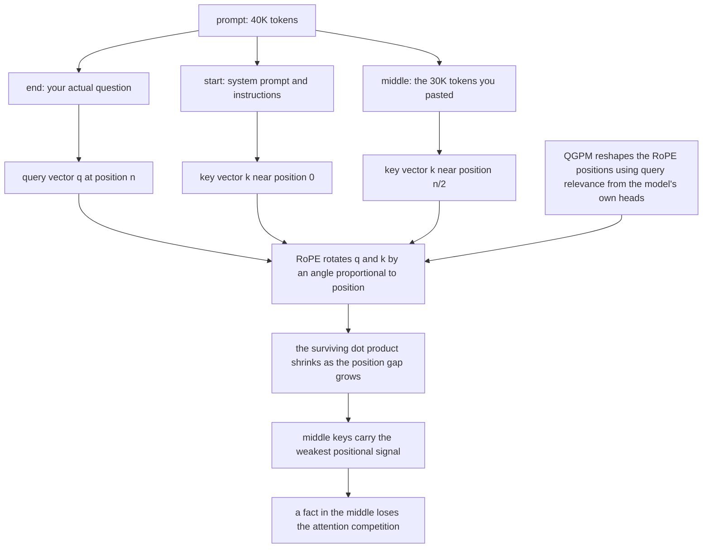
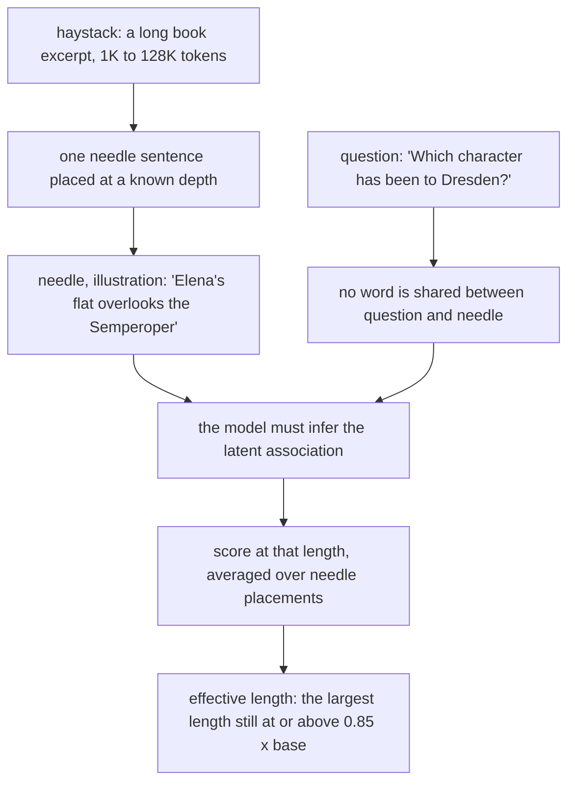
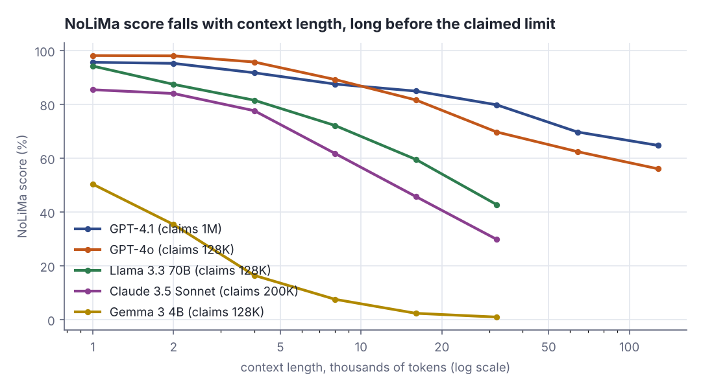
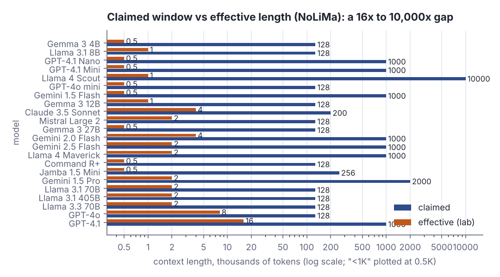

# Effective context length: 128K on the box, 2K in practice

> Fresh · AI / ML foundations · Intermediate · ~25 min · from today's feeds

## Why this matters
Every model you buy or build on is sold with a context window — 128K, 200K, 1M, 10M — and that
number is a capacity, not a competence; today's other lesson shows that attention inside the
window is uneven, and this one is the measured version of the same claim.
A 2025 ICML benchmark, NoLiMa, puts a number on it, and a preprint posted sixteen days ago
proposes a training-free fix; in this lesson you recompute the benchmark's headline column
yourself, from its raw scores, in about twenty lines of Scala.

## Primer

**Token position.** A model does not see characters; it sees a list of tokens, and each token has
an index in that list — 0, 1, 2, … n. That index is its *position*. Attention, the operation that
lets one token pull information from another, is at heart a dot product between a **query** vector
(what this token is looking for) and a **key** vector (what that token offers). A plain dot
product is order-blind: shuffle the tokens and the scores are identical. So the position has to be
injected somewhere.

**Positional encoding** is that injection. Early transformers added a fixed sine/cosine vector to
each token's embedding. **RoPE** — rotary position embedding, now the default in Llama, Gemma,
Mistral and most open models — does something cleaner: instead of adding anything, it *rotates*
the query and key vectors by an angle that grows linearly with the token's position. Take a
two-dimensional slice of the vector and spin it by angle θ·p, where p is the position. Do that for
many such slices, each with its own frequency θ.

The useful consequence: when you then take the dot product of a rotated query at position m and a
rotated key at position n, the two rotations partly cancel and what survives depends only on the
*gap* m − n, not on the absolute positions. Relative position for free. The awkward consequence:
across the bank of frequencies, the surviving value tends to shrink as the gap grows — the
high-frequency slices spin fast, land at effectively random angles, and average out. That is
RoPE's **long-range decay**.

Now the plausible story about the middle. Your question sits at the end of the prompt, so the
tokens near it keep a strong positional signal. The very first tokens get a different kind of
protection — models learn to treat the start of the sequence as an anchor. The material in the
middle has neither: it is far from the query and it is not the start. If the positional term is
quietly damping it, a fact buried there has to win on content alone. That is the mechanism this
lesson's fresh paper attacks.

This previews the deeper AI/ML rungs on attention — queries, keys, values, multi-head attention
and the softmax that turns scores into weights. You do not need any of that machinery today;
"a dot product, rotated by an angle that grows with position" is enough.

## The idea

### "Effective context length" is a measurement, not a spec

A claimed context length is an engineering limit: the longest input the serving stack will accept
without erroring. An **effective** context length is an empirical one: the longest input at which
the model still does the job roughly as well as it does on a short input. The two are different
quantities, and nothing forces them to be close.

To turn the second into a number you need three decisions: a task, a baseline, and a threshold.
NoLiMa, an ICML 2025 benchmark from LMU Munich and Adobe Research, fixes all three, and states the
third one outright:

> "we define the effective length as the maximum length at which the score remains above a threshold, set at 85% of the model's base score"
> — Modarressi et al., *NoLiMa: Long-Context Evaluation Beyond Literal Matching*, Table 3 caption, https://arxiv.org/html/2502.05167v3

That is the whole definition. Each model is scored on a short input (the **base score**, its own
ceiling), the threshold is 0.85 × that base, and the effective length is the largest tested input
length whose score still clears it. Note what this is *not*: it is not compared against other
models, and it is not an absolute pass mark. A model with a weak base score gets a correspondingly
lenient threshold. The measure asks only "how far until *you* degrade", which is why a 73.6-base
model and a 99.3-base model can be compared at all.

### Why the middle sags



*Figure 1: the proposed mechanism. The positional term damps far-away keys; the start of the
sequence is protected by other means, so the middle is left worst off, and QGPM intervenes at the
point where positions are assigned. Source: the mechanism as described in Zhang et al.,
"Query-Guided RoPE Modulation for Lost-in-the-Middle Mitigation in Long-Context LLMs",
https://arxiv.org/abs/2611.09554, plus the RoPE decay property shown in the example below.*

You can watch the decay with nothing but `math.cos`. RoPE's frequency bank is
θ_i = 10000^(−2i/d); the relative score between two tokens a given distance apart is what is left
after averaging the cosines of those angles:

```scala
val dims = 32
val freqs = (0 until dims).map(i => math.pow(10000.0, -2.0 * i / dims))
def rotated(d: Int): Double = freqs.map(f => math.cos(f * d)).sum / dims
for d <- Seq(0, 1, 4, 16, 64, 256, 1024, 4096) do
  println(f"distance $d%6d   relative q.k = ${rotated(d)}%6.3f")
```

```text
distance      0   relative q.k =  1.000
distance      1   relative q.k =  0.979
distance      4   relative q.k =  0.864
distance     16   relative q.k =  0.748
distance     64   relative q.k =  0.769
distance    256   relative q.k =  0.708
distance   1024   relative q.k =  0.632
distance   4096   relative q.k =  0.478
```

Two readings. The trend is down — a token 4096 positions away keeps under half the positional
support of its neighbour — and the fall is *not* smooth: 64 scores above 16, because the slow
frequencies drift back into phase. Decay is a tendency of the frequency bank, not a law, which is
exactly why it is a *plausible* mechanism to be argued about rather than a proof.

### Measuring it without giving the model a shortcut



*Figure 2: the NoLiMa design. The needle and question here are my own illustration of the design
the paper describes, not the paper's own needle set. Source: Modarressi et al., NoLiMa, §2 and the
repository README, https://github.com/adobe-research/NoLiMa.*

The design matters because the obvious long-context test is too easy. If the needle repeats words
from the question, a model can find it by pattern-matching:

> "literal matches can still provide cues. These cues may help models focus on potential relevant facts based on matches, as attention mechanisms excel at recalling repetitive patterns"
> — Modarressi et al., *NoLiMa: Long-Context Evaluation Beyond Literal Matching*, §2, https://arxiv.org/html/2502.05167v3

NoLiMa removes the overlap, so the only route to the answer is inference — the repository's own
one-line summary puts it as

> "requiring models to infer latent associations to locate the needle within the haystack"
> — Adobe Research, *NoLiMa* repository README, https://github.com/adobe-research/NoLiMa

and the scores fall accordingly. The paper reports that

> "Even GPT-4o, one of the top-performing exceptions, experiences a reduction from an almost-perfect baseline of 99.3% to 69.7%."
> — Modarressi et al., *NoLiMa: Long-Context Evaluation Beyond Literal Matching*, abstract, https://arxiv.org/html/2502.05167v3

That 99.3 → 69.7 is base score → 32K score for a model whose box says 128K.



*Figure 3: score against context length, five representative rows. Adapted from Modarressi et al.,
"NoLiMa: Long-Context Evaluation Beyond Literal Matching", https://arxiv.org/abs/2502.05167 —
replicated from the repository's results table rather than copied, because the NoLiMa code and
needle data are under the Adobe Research License (non-commercial research use) and the README
says nothing about reusing its images. Every plotted number is printed by the lab below.*

Applying the 85% rule to one row is four lines of arithmetic:

```scala
val base = 97.3
val scores = Seq(1 -> 94.2, 2 -> 87.4, 4 -> 81.5, 8 -> 72.1, 16 -> 59.5, 32 -> 42.7)
val thr = 0.85 * base
println(f"base $base%.1f  threshold = 0.85 x $base%.1f = $thr%.3f")
for (len, s) <- scores do
  println(f"${len}%3dK score $s%5.1f  ${if s >= thr then "pass" else "FAIL"}")
val eff = scores.filter(_._2 >= thr).map(_._1).maxOption
println("effective length = " + eff.fold("<1K")(l => s"${l}K"))
```

```text
base 97.3  threshold = 0.85 x 97.3 = 82.705
  1K score  94.2  pass
  2K score  87.4  pass
  4K score  81.5  FAIL
  8K score  72.1  FAIL
 16K score  59.5  FAIL
 32K score  42.7  FAIL
effective length = 2K
```

Llama 3.3 70B is sold with a 128K window. Its own ceiling is 97.3, its threshold is 82.705, and
the first length that misses it is 4K — so by this definition the model stops being itself
somewhere between 2K and 4K tokens, a factor of 64 below the number on the box.

### What is new: a training-free attempt to fix it

On 9 November 2026, Zhang, Ping, Bhattacharyya, Pal, Kanakaris, Cheang, Li, Yang and Bogdan posted
a v1 preprint that takes the RoPE story in Figure 1 at face value and does something about it:

> "Long-context language models often neglect information in the middle of the input"
> — Zhang et al., *Query-Guided RoPE Modulation for Lost-in-the-Middle Mitigation in Long-Context LLMs*, 2026-11-09, https://arxiv.org/abs/2611.09554

Their method, QGPM, is

> "a training-free method that reshapes RoPE positions using query relevance from the model's own attention heads"
> — Zhang et al., *Query-Guided RoPE Modulation for Lost-in-the-Middle Mitigation in Long-Context LLMs*, 2026-11-09, https://arxiv.org/abs/2611.09554

No fine-tuning, no new weights: it reads which spans the model's own heads already find relevant
to the query, then re-assigns the positional angles so that relevant spans sit, in RoPE terms,
closer to the query than their literal index would put them. The paper uses a broad relevance map
in the lower layers and a sharp one in the upper layers, and reports that

> "Experiments on NoLiMa and RULER with multiple context lengths show that QGPM improves over base models and strong baselines"
> — Zhang et al., *Query-Guided RoPE Modulation for Lost-in-the-Middle Mitigation in Long-Context LLMs*, 2026-11-09, https://arxiv.org/abs/2611.09554

and, continuing the same sentence,

> "with the largest gains on retrieval tasks, and generalizes across multiple backbones"
> — Zhang et al., *Query-Guided RoPE Modulation for Lost-in-the-Middle Mitigation in Long-Context LLMs*, 2026-11-09, https://arxiv.org/abs/2611.09554

Be precise about what you do not know: **the arXiv abstract page carries no accuracy
figures at all**. This is a v1 preprint, sixteen days old, not peer-reviewed; the numbers live in
the PDF, no licence is stated on the abstract page, and I have not read either. Treat it as a
well-motivated hypothesis with a public code link, not as a result you can quote at a vendor.

## Lab

**The question:** if a vendor says 128K, how long is the window actually usable for — and who
decides?

You will hard-code the NoLiMa results table, recompute the published "Effective Length" column
from the raw scores, and check whether your column agrees with theirs. If it does, you have
verified that the headline number is exactly the definition it claims to be, with nothing hidden
in it.

### Step 1 — the table, the threshold, and pass/fail at every length

Save this as the lesson's program. It runs all three steps in one go.

```scala
// file: Lab.scala
// Recomputes the "Effective Length" column of the NoLiMa results table from the raw scores.
// Data: the results table in https://github.com/adobe-research/NoLiMa (README), accessed 2026-11-25.
// Scores are percentages; "--" (64K/128K not reported) is simply absent from `scores`.
// "Gemini 2.5 Flash" is the README's "Gemini 2.5 Flash (w/o Thinking)" row, shortened to fit.

case class Row(name: String, claimedK: Double, base: Double,
               scores: Seq[(Int, Double)], publishedEff: String)

val table: Seq[Row] = Seq(
  Row("GPT-4.1",          1000, 97.0, Seq(1->95.6, 2->95.2, 4->91.7, 8->87.5, 16->84.9, 32->79.8, 64->69.7, 128->64.7), "16K"),
  Row("GPT-4o",            128, 99.3, Seq(1->98.1, 2->98.0, 4->95.7, 8->89.2, 16->81.6, 32->69.7, 64->62.4, 128->56.0), "8K"),
  Row("Llama 3.3 70B",     128, 97.3, Seq(1->94.2, 2->87.4, 4->81.5, 8->72.1, 16->59.5, 32->42.7), "2K"),
  Row("Llama 3.1 405B",    128, 94.7, Seq(1->89.0, 2->85.0, 4->74.5, 8->60.1, 16->48.4, 32->38.0), "2K"),
  Row("Llama 3.1 70B",     128, 94.5, Seq(1->91.0, 2->81.8, 4->71.2, 8->62.7, 16->51.8, 32->43.2), "2K"),
  Row("Gemini 1.5 Pro",   2000, 92.6, Seq(1->86.4, 2->82.7, 4->75.4, 8->63.9, 16->55.5, 32->48.2), "2K"),
  Row("Jamba 1.5 Mini",    256, 92.4, Seq(1->76.3, 2->74.1, 4->70.8, 8->62.2, 16->52.7, 32->43.6), "<1K"),
  Row("Command R+",        128, 90.9, Seq(1->77.0, 2->73.5, 4->66.3, 8->39.5, 16->21.3, 32-> 7.4), "<1K"),
  Row("Llama 4 Maverick", 1000, 90.1, Seq(1->81.6, 2->78.3, 4->68.8, 8->49.0, 16->34.3, 32->24.5), "2K"),
  Row("Gemini 2.5 Flash", 1000, 94.4, Seq(1->90.1, 2->86.1, 4->79.4, 8->68.2, 16->57.9, 32->48.4), "2K"),
  Row("Gemini 2.0 Flash", 1000, 89.4, Seq(1->87.7, 2->87.5, 4->77.9, 8->64.7, 16->48.2, 32->41.0, 64->33.0, 128->16.4), "4K"),
  Row("Gemma 3 27B",       128, 88.6, Seq(1->73.3, 2->65.6, 4->48.1, 8->32.7, 16->20.2, 32-> 9.5), "<1K"),
  Row("Mistral Large 2",   128, 87.9, Seq(1->86.1, 2->85.5, 4->73.3, 8->51.5, 16->32.6, 32->18.7), "2K"),
  Row("Claude 3.5 Sonnet", 200, 87.6, Seq(1->85.4, 2->84.0, 4->77.6, 8->61.7, 16->45.7, 32->29.8), "4K"),
  Row("Gemma 3 12B",       128, 87.4, Seq(1->74.7, 2->61.8, 4->39.9, 8->27.4, 16->16.8, 32-> 7.3), "1K"),
  Row("Gemini 1.5 Flash", 1000, 84.7, Seq(1->68.6, 2->61.6, 4->51.0, 8->44.4, 16->35.5, 32->28.6), "<1K"),
  Row("GPT-4o mini",       128, 84.9, Seq(1->67.7, 2->58.2, 4->44.1, 8->32.6, 16->20.6, 32->13.7), "<1K"),
  Row("Llama 4 Scout",   10000, 81.7, Seq(1->72.3, 2->61.8, 4->50.8, 8->35.5, 16->26.9, 32->21.6), "1K"),
  Row("GPT-4.1 Mini",     1000, 80.9, Seq(1->66.7, 2->62.8, 4->58.7, 8->51.9, 16->46.2, 32->38.8), "<1K"),
  Row("GPT-4.1 Nano",     1000, 80.7, Seq(1->60.8, 2->48.2, 4->36.7, 8->28.8, 16->19.5, 32-> 9.4), "<1K"),
  Row("Llama 3.1 8B",      128, 76.7, Seq(1->65.7, 2->54.4, 4->44.1, 8->31.9, 16->22.6, 32->14.2), "1K"),
  Row("Gemma 3 4B",        128, 73.6, Seq(1->50.3, 2->35.3, 4->16.4, 8-> 7.5, 16-> 2.3, 32-> 0.9), "<1K")
)

val tested = Seq(1, 2, 4, 8, 16, 32)

def threshold(base: Double): Double = 0.85 * base

def effective(r: Row): String =
  val thr = threshold(r.base)
  r.scores.filter(_._2 >= thr).map(_._1).maxOption.fold("<1K")(_.toString + "K")

def claimLabel(k: Double): String =
  if k >= 1000 then f"${k / 1000}%.0fM" else f"$k%.0fK"

@main def lab(): Unit =
  println("=== Step 1: threshold = 0.85 x base score, then pass (+) / fail (-) at each length ===")
  println("%-18s %5s %6s".format("model", "base", "thr") + tested.map(l => "%6s".format(s"${l}K")).mkString)
  for r <- table do
    val thr = threshold(r.base)
    val cells = tested.map { l =>
      r.scores.toMap.get(l) match
        case Some(s) => "%5.1f%s".format(s, if s >= thr then "+" else "-")
        case None    => "%6s".format("--")
    }
    println("%-18s %5.1f %6.2f".format(r.name, r.base, thr) + cells.mkString)

  println()
  println("Only three rows report 64K and 128K (the table's other rows print \"--\" there):")
  for r <- table if r.scores.exists(_._1 == 64) do
    val thr = threshold(r.base)
    val m = r.scores.toMap
    val c = Seq(64, 128).map(l => "%5.1f%s".format(m(l), if m(l) >= thr then "+" else "-"))
    println("%-18s %5.1f %6.2f".format(r.name, r.base, thr) + c.mkString)

  println()
  println("=== Step 2: derived effective length vs the published column ===")
  println("%-18s %6s %10s %10s  %s".format("model", "thr", "derived", "published", "verdict"))
  var matches = 0
  for r <- table do
    val d = effective(r)
    val ok = d == r.publishedEff
    if ok then matches += 1
    println("%-18s %6.2f %10s %10s  %s".format(r.name, threshold(r.base), d, r.publishedEff,
      if ok then "MATCH" else "MISMATCH"))
  println(s"matched $matches of ${table.size} published effective lengths")

  println()
  println("=== Step 2b: claimed length vs effective length (the chart's numbers) ===")
  println("%-18s %8s %10s %8s".format("model", "claimed", "effective", "ratio"))
  for r <- table do
    val effK = effective(r) match
      case "<1K" => 0.5
      case s     => s.dropRight(1).toDouble
    println("%-18s %8s %10s %7.0fx".format(r.name, claimLabel(r.claimedK), effective(r),
      r.claimedK / effK))

  println()
  println("=== Step 3: 32K score as a fraction of the base score ===")
  println("%-18s %5s %6s %9s  %s".format("model", "base", "32K", "32K/base", "below 50%?"))
  var below = 0
  for r <- table do
    val s32 = r.scores.toMap.apply(32)
    val ratio = s32 / r.base
    if ratio < 0.5 then below += 1
    println("%-18s %5.1f %6.1f %8.1f%%  %s".format(r.name, r.base, s32, 100 * ratio,
      if ratio < 0.5 then "YES" else "no"))
  println(s"$below of ${table.size} rows score below 50% of their own base score at 32K")
```

Run it with `python3 dojo/engine/run_lab.py 2026-11-25-2`, or save it as `Lab.scala` and run
`scala Lab.scala` on your Mac. The first block of real output:

```text
=== Step 1: threshold = 0.85 x base score, then pass (+) / fail (-) at each length ===
model               base    thr    1K    2K    4K    8K   16K   32K
GPT-4.1             97.0  82.45 95.6+ 95.2+ 91.7+ 87.5+ 84.9+ 79.8-
GPT-4o              99.3  84.41 98.1+ 98.0+ 95.7+ 89.2+ 81.6- 69.7-
Llama 3.3 70B       97.3  82.71 94.2+ 87.4+ 81.5- 72.1- 59.5- 42.7-
Llama 3.1 405B      94.7  80.50 89.0+ 85.0+ 74.5- 60.1- 48.4- 38.0-
Llama 3.1 70B       94.5  80.33 91.0+ 81.8+ 71.2- 62.7- 51.8- 43.2-
Gemini 1.5 Pro      92.6  78.71 86.4+ 82.7+ 75.4- 63.9- 55.5- 48.2-
Jamba 1.5 Mini      92.4  78.54 76.3- 74.1- 70.8- 62.2- 52.7- 43.6-
Command R+          90.9  77.27 77.0- 73.5- 66.3- 39.5- 21.3-  7.4-
Llama 4 Maverick    90.1  76.59 81.6+ 78.3+ 68.8- 49.0- 34.3- 24.5-
Gemini 2.5 Flash    94.4  80.24 90.1+ 86.1+ 79.4- 68.2- 57.9- 48.4-
Gemini 2.0 Flash    89.4  75.99 87.7+ 87.5+ 77.9+ 64.7- 48.2- 41.0-
Gemma 3 27B         88.6  75.31 73.3- 65.6- 48.1- 32.7- 20.2-  9.5-
Mistral Large 2     87.9  74.72 86.1+ 85.5+ 73.3- 51.5- 32.6- 18.7-
Claude 3.5 Sonnet   87.6  74.46 85.4+ 84.0+ 77.6+ 61.7- 45.7- 29.8-
Gemma 3 12B         87.4  74.29 74.7+ 61.8- 39.9- 27.4- 16.8-  7.3-
Gemini 1.5 Flash    84.7  72.00 68.6- 61.6- 51.0- 44.4- 35.5- 28.6-
GPT-4o mini         84.9  72.17 67.7- 58.2- 44.1- 32.6- 20.6- 13.7-
Llama 4 Scout       81.7  69.45 72.3+ 61.8- 50.8- 35.5- 26.9- 21.6-
GPT-4.1 Mini        80.9  68.77 66.7- 62.8- 58.7- 51.9- 46.2- 38.8-
GPT-4.1 Nano        80.7  68.60 60.8- 48.2- 36.7- 28.8- 19.5-  9.4-
Llama 3.1 8B        76.7  65.20 65.7+ 54.4- 44.1- 31.9- 22.6- 14.2-
Gemma 3 4B          73.6  62.56 50.3- 35.3- 16.4-  7.5-  2.3-  0.9-

Only three rows report 64K and 128K (the table's other rows print "--" there):
GPT-4.1             97.0  82.45 69.7- 64.7-
GPT-4o              99.3  84.41 62.4- 56.0-
Gemini 2.0 Flash    89.4  75.99 33.0- 16.4-
```

### Step 2 — derive the effective length and compare it with the published column

```text
=== Step 2: derived effective length vs the published column ===
model                 thr    derived  published  verdict
GPT-4.1             82.45        16K        16K  MATCH
GPT-4o              84.41         8K         8K  MATCH
Llama 3.3 70B       82.71         2K         2K  MATCH
Llama 3.1 405B      80.50         2K         2K  MATCH
Llama 3.1 70B       80.33         2K         2K  MATCH
Gemini 1.5 Pro      78.71         2K         2K  MATCH
Jamba 1.5 Mini      78.54        <1K        <1K  MATCH
Command R+          77.27        <1K        <1K  MATCH
Llama 4 Maverick    76.59         2K         2K  MATCH
Gemini 2.5 Flash    80.24         2K         2K  MATCH
Gemini 2.0 Flash    75.99         4K         4K  MATCH
Gemma 3 27B         75.31        <1K        <1K  MATCH
Mistral Large 2     74.72         2K         2K  MATCH
Claude 3.5 Sonnet   74.46         4K         4K  MATCH
Gemma 3 12B         74.29         1K         1K  MATCH
Gemini 1.5 Flash    72.00        <1K        <1K  MATCH
GPT-4o mini         72.17        <1K        <1K  MATCH
Llama 4 Scout       69.45         1K         1K  MATCH
GPT-4.1 Mini        68.77        <1K        <1K  MATCH
GPT-4.1 Nano        68.60        <1K        <1K  MATCH
Llama 3.1 8B        65.20         1K         1K  MATCH
Gemma 3 4B          62.56        <1K        <1K  MATCH
matched 22 of 22 published effective lengths

=== Step 2b: claimed length vs effective length (the chart's numbers) ===
model               claimed  effective    ratio
GPT-4.1                  1M        16K      63x
GPT-4o                 128K         8K      16x
Llama 3.3 70B          128K         2K      64x
Llama 3.1 405B         128K         2K      64x
Llama 3.1 70B          128K         2K      64x
Gemini 1.5 Pro           2M         2K    1000x
Jamba 1.5 Mini         256K        <1K     512x
Command R+             128K        <1K     256x
Llama 4 Maverick         1M         2K     500x
Gemini 2.5 Flash         1M         2K     500x
Gemini 2.0 Flash         1M         4K     250x
Gemma 3 27B            128K        <1K     256x
Mistral Large 2        128K         2K      64x
Claude 3.5 Sonnet      200K         4K      50x
Gemma 3 12B            128K         1K     128x
Gemini 1.5 Flash         1M        <1K    2000x
GPT-4o mini            128K        <1K     256x
Llama 4 Scout           10M         1K   10000x
GPT-4.1 Mini             1M        <1K    2000x
GPT-4.1 Nano             1M        <1K    2000x
Llama 3.1 8B           128K         1K     128x
Gemma 3 4B             128K        <1K     256x
```



*Figure 4: the gap, per model, on a log axis — "<1K" is plotted at 0.5K because the benchmark does
not test below 1K. Generated from the Step 2b output of this lesson's lab
(`python3 dojo/engine/run_lab.py 2026-11-25-2`); spec in
`dojo/lessons/assets/2026-11-25-2-chart-1.json`.*

### Step 3 — the 32K ratio, and a number that does not reproduce

```text
=== Step 3: 32K score as a fraction of the base score ===
model               base    32K  32K/base  below 50%?
GPT-4.1             97.0   79.8     82.3%  no
GPT-4o              99.3   69.7     70.2%  no
Llama 3.3 70B       97.3   42.7     43.9%  YES
Llama 3.1 405B      94.7   38.0     40.1%  YES
Llama 3.1 70B       94.5   43.2     45.7%  YES
Gemini 1.5 Pro      92.6   48.2     52.1%  no
Jamba 1.5 Mini      92.4   43.6     47.2%  YES
Command R+          90.9    7.4      8.1%  YES
Llama 4 Maverick    90.1   24.5     27.2%  YES
Gemini 2.5 Flash    94.4   48.4     51.3%  no
Gemini 2.0 Flash    89.4   41.0     45.9%  YES
Gemma 3 27B         88.6    9.5     10.7%  YES
Mistral Large 2     87.9   18.7     21.3%  YES
Claude 3.5 Sonnet   87.6   29.8     34.0%  YES
Gemma 3 12B         87.4    7.3      8.4%  YES
Gemini 1.5 Flash    84.7   28.6     33.8%  YES
GPT-4o mini         84.9   13.7     16.1%  YES
Llama 4 Scout       81.7   21.6     26.4%  YES
GPT-4.1 Mini        80.9   38.8     48.0%  YES
GPT-4.1 Nano        80.7    9.4     11.6%  YES
Llama 3.1 8B        76.7   14.2     18.5%  YES
Gemma 3 4B          73.6    0.9      1.2%  YES
18 of 22 rows score below 50% of their own base score at 32K
```

### Reading the output

**Step 1 columns.** `base` is the model's score on a short input — its own ceiling, higher is
better. `thr` is 0.85 × base, the bar it must clear. The six remaining columns are the score at
1K, 2K, 4K, 8K, 16K and 32K tokens, each followed by `+` (at or above the threshold) or `-`
(below). Higher is better everywhere; the only comparison that matters in a row is score against
that row's own `thr`.

Trace two rows with digits.

*Llama 3.3 70B.* base 97.3, so thr = 0.85 × 97.3 = **82.705**, printed rounded as 82.71.
1K: 94.2 ≥ 82.705 → `+`. 2K: 87.4 ≥ 82.705 → `+`. 4K: 81.5 < 82.705 → `-`, and it misses by
1.205 points. Everything after is further below. So the last `+` is at 2K.

*GPT-4o.* base 99.3, thr = 0.85 × 99.3 = **84.405**, printed 84.41. 8K: 89.2 ≥ 84.405 → `+`.
16K: 81.6 < 84.405 → `-`, missing by 2.805. The last `+` is at 8K. Note how the high base score
works against it: GPT-4o's 81.6 at 16K would have been a comfortable pass for Claude 3.5 Sonnet,
whose threshold is 74.46. The measure is strictly self-relative.

**Verdict:** every model in the table degrades inside its own advertised window, and the cliff
arrives between 2K and 16K tokens for all but two rows.

**Step 2 columns.** `derived` is the largest tested length whose score still carries a `+`,
computed by the program; `published` is the "Effective Length" column copied from the NoLiMa
README; `verdict` compares the two strings. `<1K` means even the 1K score failed. Step 2b adds
`claimed` (the vendor's advertised window) and `ratio` = claimed ÷ effective, with `<1K` counted
as 0.5K so the division is defined — higher ratio means a bigger gap between the brochure and the
measurement.

**Verdict:** 22 of 22. The published column is reproducible to the character from the raw scores
and one line of arithmetic — there is no secret smoothing, no per-model judgement, nothing but
`0.85 × base`. That is a benchmark you can argue with, because you can recompute it.

**Step 3 columns.** `32K` is the score at 32K tokens; `32K/base` expresses it as a percentage of
the model's own base score; `below 50%?` flags the rows under half. Lower is worse. Check one:
Claude 3.5 Sonnet, 29.8 ÷ 87.6 = 0.3402, printed 34.0%, so `YES`. And a near miss:
GPT-4.1 Mini, 38.8 ÷ 80.9 = 0.4796 → 48.0%, `YES` by 1.2 percentage points.

Now the honest part. The README states:

> "At 32K, for instance, 10 models drop below 50% of their strong short-length baselines."
> — Adobe Research, *NoLiMa* repository README, https://github.com/adobe-research/NoLiMa

and the lab says 18 of 22. Those are not the same claim. The sentence belongs with the README's
own "We evaluate 12 popular LLMs that claim to support contexts of at least 128K tokens", while
the table it sits above has since grown to 22 rows; the published paper's abstract, a different
and earlier cut again, says "At 32K, for instance, 11 models drop below 50% of their strong
short-length baselines" over 13 models. Three counts — 10/12, 11/13, 18/22 — for three different
model sets, all of them true of their own set. The ratio holds steady at roughly four in five.

**Verdict:** the direction reproduces and the exact count does not, because prose and tables drift
apart. When you quote a benchmark, quote the table row, not the summary sentence.

### Cause → consequence

1. **Cause.** Attention has no notion of order, so position is injected by rotating query and key
   vectors by an angle proportional to position (RoPE).
2. **Mechanism.** Across RoPE's bank of frequencies, the surviving dot product tends to shrink as
   the gap between two positions grows (1.000 → 0.478 over 4096 positions in the example above).
   The end of the prompt is near the query and the start is an anchor; the middle gets neither
   advantage, so a fact there must win on content alone.
3. **Consequence.** Measured on a benchmark that forbids literal keyword overlap, scores fall far
   inside the advertised window: by the 85%-of-base rule, 22 of 22 models in the NoLiMa table have
   an effective length of 16K or less, most of them 2K or less, against claims of 128K to 10M.
4. **What it means for your work.** Three things, concretely. *Where constraints go:* put the
   acceptance criteria, the forbidden behaviours and the output contract at the very end of the
   prompt, immediately before the question — not in a preamble 30K tokens earlier, where Figure 1
   says they are weakest. *How much to stuff in:* for Claude Code, a focused 8K-token context of
   the three files that matter beats a 100K-token dump of the repository, and the benchmark says
   the difference is not marginal. Retrieve and prune rather than paste. *What to ask a vendor:*
   not "what is your context window" but "what is your effective length, on what task, against
   what baseline, at what threshold" — and if they cannot answer in that shape, run the 85% rule
   yourself on your own eval set, exactly as this lab does.

## Self-check
1. A vendor's model claims 128K and NoLiMa reports an effective length of 2K. State precisely what
   "2K" means here, and say what would change if the threshold were 0.90 of base instead of 0.85.
   <details><summary>Answer</summary>It means: 2K tokens is the largest tested input length at
   which the model's NoLiMa score is still at least 0.85 × its own short-context base score
   (Modarressi et al., Table 3 caption). It is self-relative — the bar is set by that model's own
   ceiling, not by any other model and not by an absolute pass mark. Raising the threshold to 0.90
   can only move effective lengths down or leave them unchanged, because the bar rises while the
   scores stay put; for Llama 3.3 70B, 0.90 × 97.3 = 87.57, so its 2K score of 87.4 would now fail
   and its effective length would drop from 2K to 1K.</details>
2. Why does NoLiMa build needles that share no words with the question, and what would happen to
   the scores if it did not? <details><summary>Answer</summary>Because literal overlap turns the
   task into pattern matching rather than comprehension: "literal matches can still provide cues.
   These cues may help models focus on potential relevant facts based on matches, as attention
   mechanisms excel at recalling repetitive patterns" (Modarressi et al., §2). The paper also
   confirms the effect directly — "the presence of literal matches significantly simplifies the
   task, enabling models to achieve high accuracy in answering questions" (introduction). With
   overlap, scores would stay high at long lengths and the measured effective length would look
   much closer to the claimed one; the window would appear to work because the retrieval shortcut
   is doing the work.</details>
3. QGPM is described as training-free. What does it actually change at inference time, and what
   does the arXiv abstract page not tell you? <details><summary>Answer</summary>It changes the
   positions fed to RoPE: it reads query relevance off the model's own attention heads and
   reshapes the RoPE positions accordingly — a broad relevance map in lower layers, a sharp one in
   upper layers — so no weights are updated and no fine-tuning run is needed. What the abstract
   page does not give you is any accuracy figure: it names NoLiMa and RULER as the evaluation
   suites and claims improvements "with the largest gains on retrieval tasks", but every number is
   in the PDF. It is also a v1 preprint from 9 November 2026 with no licence stated on the
   abstract page, so treat the claim as unreviewed.</details>

## Sources
- [Query-Guided RoPE Modulation for Lost-in-the-Middle Mitigation in Long-Context LLMs](https://arxiv.org/abs/2611.09554) — Zhang, Ping, Bhattacharyya, Pal, Kanakaris, Cheang, Li, Yang, Bogdan, arXiv:2611.09554v1, submitted 2026-11-09; the fresh item: the lost-in-the-middle framing, the RoPE-decay mechanism, and the training-free QGPM method with its NoLiMa/RULER evaluation. All four quoted passages come from this abstract page, which carries no accuracy figures and states no licence; accessed 2026-11-25.
- [NoLiMa: Long-Context Evaluation Beyond Literal Matching (full text)](https://arxiv.org/html/2502.05167v3) — Modarressi, Deilamsalehy, Dernoncourt, Bui, Rossi, Yoon, Schütze (LMU Munich and Adobe Research), ICML 2025, page stamped 09 Jul 2025; the definition of effective length (Table 3 caption), the GPT-4o 99.3 → 69.7 figure, the 13-model/11-model abstract counts, and the §2 argument against literal matches; accessed 2026-11-25.
- [NoLiMa (arXiv abstract record)](https://arxiv.org/abs/2502.05167) — the canonical record for the paper, used as the citation URL in the Figure 3 caption; accessed 2026-11-25.
- [adobe-research/NoLiMa](https://github.com/adobe-research/NoLiMa) — Adobe Research; the 22-row results table that the lab hard-codes (claimed length, effective length, base score and the 1K–128K scores), the README's own 12-model/10-model counts, and the License section stating that the evaluation code and needle data are under the Adobe Research License, which prohibits commercial use and allows non-commercial research use — the reason Figure 3 is replicated rather than reproduced; accessed 2026-11-25.
- https://github.com/iZHpy/QGPM — the code repository listed on the QGPM arXiv abstract page; recorded for completeness, not opened for this lesson, so nothing here is cited from it; accessed 2026-11-25 (link as printed on the abstract page).
