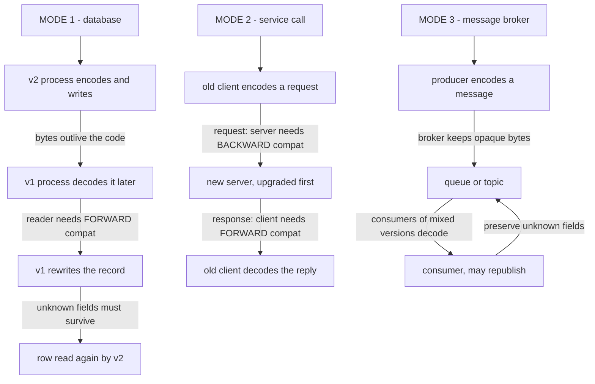
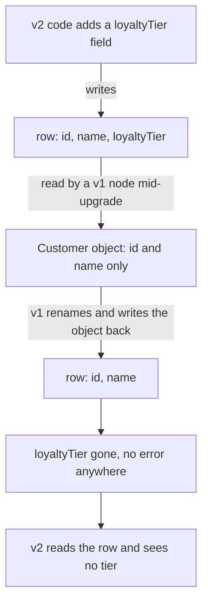
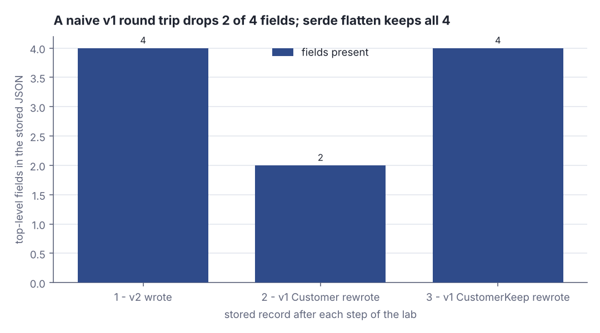

# Modes of dataflow — databases, services and messages

> Designing Data-Intensive Applications · Intermediate · ~20 min · rung 8 of 26 · needs: Encoding formats and schema evolution (ddia-07)


## Why this matters
Every integration you own is one of three modes — the Postgres row an Akka service rewrites, the REST or gRPC call it makes, the Kafka message it publishes — and each mode puts the compatibility burden on a different side.
The bug this half of the chapter is about is the quiet one: no exception, no failed deploy, just a field that is empty for the rows one not-yet-upgraded node happened to touch during a rolling upgrade.
It sits here because the previous rung gave you the encodings and their evolution rules; this rung decides who encodes, who decodes and in which order the two get upgraded — which is what actually breaks.

## The idea

> Chapter map: Designing Data-Intensive Applications (Kleppmann, 1st ed., 2017), ch. 4 Encoding and Evolution, second half "Modes of Dataflow" — § Dataflow Through Databases, § Dataflow Through Services: REST and RPC, § Message-Passing Dataflow. The book does not number these sections; §4.1–§4.3 are this lesson's numbering, matched to your copy by name. https://dataintensive.net/

The chapter's first half was formats and schema-change rules; the second half asks what those rules are for — how encoded bytes get from one process to another, in three modes: a database, a service call, asynchronous messages (Kleppmann, DDIA ch. 4, "Modes of Dataflow"). Somebody encodes, somebody else decodes, and you cannot upgrade both at once, so two properties are needed. **Backward compatibility**: newer code reads what older code wrote — easy, you know the old format. **Forward compatibility**: older code reads what newer code wrote — hard, because old code must tolerate what it has never seen.


*Figure 1: the three modes, with which side must be forward- and which backward-compatible. Source: Kleppmann, DDIA ch. 4, "Modes of Dataflow", https://dataintensive.net/.*

### §4.1 Dataflow Through Databases
The writer encodes, the reader decodes — often the same process reading its own earlier write, which the book calls sending a message to your future self. Backward compatibility is obviously required: new code must read old rows (Kleppmann, DDIA ch. 4, "Dataflow Through Databases").

Forward compatibility comes from deployment. Processes share one database, and during a rolling upgrade some nodes run new code and others old, so a value written by newer code gets read by older code. That code must not choke on a field it does not know — and must not destroy it. Decode a record into an object, change one attribute, write the object back, and the unknown field is silently dropped. The encoding layer handles unknown fields; the application layer loses them, by decoding into a model with no place for them.


*Figure 2: the chapter's field-loss hazard. Adapted from Kleppmann, Designing Data-Intensive Applications, 1st ed., ch. 4, https://dataintensive.net/.*

The v1 model, in the Lab's Rust, is two fields; `serde` ignores every other key:

```rust
#[derive(Serialize, Deserialize, Debug)]
struct Customer { id: u32, name: String }   // all v1 code knows about

let mut c: Customer = serde_json::from_str(V2).unwrap();
c.name = "Mia Kovalenko".to_string();
let back = serde_json::to_string(&c).unwrap();
```

```text
STEP 2  v1 naive deserialised   Customer { id: 17, name: "Mia Novak" }
  json   {"id":17,"name":"Mia Kovalenko"}
  field  loyaltyTier  LOST
  field  signupYear   LOST
```

Real lines from the Lab run. Nothing failed: the decode succeeded, the rename worked, two fields the v2 service wrote left the database on the write-back.

Give unknown fields somewhere to live and the round trip is lossless: `#[serde(flatten)]` on a map collects every undeclared key and writes it back beside the known ones:

```rust
#[derive(Serialize, Deserialize, Debug)]
struct CustomerKeep {
    id: u32,
    name: String,
    #[serde(flatten)]
    rest: Map<String, Value>,   // everything v1 does not know
}
```

```text
STEP 3  v1 flatten writes it back
  json   {"id":17,"name":"Mia Kovalenko","loyaltyTier":"gold","signupYear":2021}
  bytes  71   fields 4
  field  loyaltyTier  survived
```

Same code, same rename, four fields out instead of two: the tier survived a process that never heard of it.



*Figure 3: fields in the stored JSON after each Lab step. Generated from the lab output.*

The section closes on time: **data outlives code**. A five-year-old row outlives many rewrites of the application, and nobody migrates a large dataset because the model changed — relational databases allow cheap changes such as a nullable column; document ones take any fields at any time. Schema evolution makes the database *look* as if it had one schema while its records were written by many versions of the code. A dump is the exception — one pass, one version, uniform in the latest schema, so a good moment for an Avro object container file or Parquet (Kleppmann, DDIA ch. 4, "Archival storage").

### §4.2 Dataflow Through Services: REST and RPC
Servers expose an API, clients make requests — browsers, native apps, and server-to-server calls when an application is split so each piece deploys independently, the point of microservice architecture. Versions therefore run simultaneously by design, so what services exchange must be compatible across them (Kleppmann, DDIA ch. 4, "Dataflow Through Services: REST and RPC").

**Web services.** Over HTTP, two styles: REST is no protocol but a design philosophy on HTTP's own features — URLs for resources, cache control, authentication, content negotiation, simple formats; such an API is RESTful, and OpenAPI (Swagger) describes one. SOAP is XML that avoids most of HTTP, described by WSDL, which generates client classes so a remote service looks local — heavy tooling, out of favour.

**Location transparency is a fallacy.** RPC tries to make a network request look like calling a function in the same process. Why it cannot (Kleppmann, DDIA ch. 4, "The problems with RPC"):
- A local call succeeds or fails on parameters you control; a network request is unpredictable — either message may be lost, the machine slow or unavailable.
- A local function returns, throws, or never returns. A network request has a fourth outcome: it returns *without a result*, timed out, and you cannot tell whether the remote side ran it.
- So a retry may perform the action twice — perhaps only the response was lost — unless **idempotence**, a deduplication mechanism, is in the protocol.
- A local call takes about the same time every time; network latency is wildly variable.
- Locally you pass references to objects in memory; over the network every parameter must be encoded — fine for primitives, troublesome for bigger objects.
- Client and service may be in different languages, so the framework translates datatypes, and languages disagree: JavaScript numbers above 2^53 lose precision.

No point pretending a remote service is a local object; part of REST's appeal is that it does not try.

**Current directions for RPC.** The new generation is explicit about its encoding: Thrift and Avro ship RPC support, gRPC runs over Protocol Buffers. Remoteness becomes visible — futures for a call that may fail, gRPC streams, service discovery. Binary protocols can beat JSON over REST on performance, but REST wins around the call (`curl`, every language, tooling), so it rules public APIs while RPC stays inside one organisation.

**Encoding and evolution for RPC.** Deployment order fixes the direction: servers are upgraded first, clients second, so **requests need backward compatibility** and **responses need forward compatibility**. An RPC scheme otherwise inherits the compatibility properties of its encoding — Thrift, gRPC/protobuf and Avro RPC evolve by that encoding's rules; over JSON the safe moves are optional new request parameters and new response fields. The hard case crosses an organisational boundary: the provider cannot force clients to upgrade, so compatibility must hold for a long time, perhaps forever, and a breaking change means several API versions side by side. No consensus exists on expressing the version — commonly a number in the URL or the `Accept` header, or a version stored server-side against the client's API key.

### §4.3 Message-Passing Dataflow
Asynchronous message-passing sits between the two: like RPC it delivers with low latency; like a database it goes not over a direct connection but through an intermediary — a **message broker** (message queue, message-oriented middleware) that stores the message for a while (Kleppmann, DDIA ch. 4, "Message-Passing Dataflow").

What the broker buys over a direct call: buffering when the recipient is unavailable or overloaded; redelivery to a crashed process, so messages are not lost; no need to know the recipient's address and port, which matters where machines come and go; one message to several recipients; decoupling of sender from recipient. It is also **one-way and asynchronous**: the sender expects no reply and does not wait for delivery. A reply travels on a separate channel.

**Message brokers.** RabbitMQ, ActiveMQ, HornetQ, NATS, Kafka — one pattern: a producer sends to a named queue or topic and the broker gets it to that topic's consumers, of which there may be many, as of producers. A consumer may publish to a further topic (a chain of stages) or to a reply queue, which gives request/response back. Brokers enforce no data model: a message is bytes plus metadata, so any encoding works, and if it is compatible both ways, publishers and consumers deploy in any order. The §4.1 hazard returns: a republishing consumer must preserve fields it does not know.

**Distributed actor frameworks.** The actor model is concurrency for one process: instead of threads with their race conditions, locking and deadlocks, logic is packed into actors — each typically one client or entity, with unshared local state, communicating only by asynchronous messages, delivery not guaranteed. An actor handles one message at a time, so it needs no reasoning about threads. A distributed framework scales that across nodes with one mechanism whether or not the two share a node; when they do not, the message is transparently encoded, sent and decoded. Location transparency works *better* here than in RPC, for the book's reason: the model already assumes messages can be lost within one process.

What it does not solve is the upgrade. The framework fuses a broker and the actor model into one, so a rolling upgrade still has a new-version node sending to an old-version node and the reverse: the serialisation must be compatible both ways (Kleppmann, DDIA ch. 4, "Distributed actor frameworks"). The book's three: **Akka** defaults to Java's built-in serialisation, which gives neither direction, and replacing it with something like Protocol Buffers is what makes rolling upgrades possible; **Orleans** defaults to a custom format without rolling-upgrade support, so a new version means a new cluster, traffic moved across, the old shut down; **Erlang OTP** makes record schemas hard to change, so rolling upgrades need planning.

Beyond the book: in the Akka you run today Java serialisation is off by default for this reason, and the recommended serializer for messages crossing nodes is Jackson or Protocol Buffers, bound per message class, with a separate page on rolling updates (Akka documentation, Akka core → Serialization; Rolling Updates, https://doc.akka.io/). The rule for your clusters is §4.1's: a message class that crosses a node boundary is a wire format, not an internal type, so it only gains optional fields.

## Lab
Does a v1 service that has never heard of `loyaltyTier` destroy it when it renames a customer — and does `#[serde(flatten)]` stop that? Fifteen lines of Rust decide it.

### Step 1 — one record, two v1 models, one round trip each
`Customer` is the v1 model from §4.1: two fields, and `serde` drops the rest. `CustomerKeep` is the same model with a flatten map for the unknown keys. `report` prints the stored JSON, its byte length, its field count and a survived/LOST line per field, so every step is visible rather than inferred.

```rust
// file: main.rs
// deps: serde@1+derive, serde_json@1
use serde::{Deserialize, Serialize};
use serde_json::{Map, Value};

#[derive(Serialize, Deserialize, Debug)]
struct Customer { id: u32, name: String }                 // v1 code: the two fields it knows

#[derive(Serialize, Deserialize, Debug)]
struct CustomerKeep {
    id: u32,
    name: String,
    #[serde(flatten)]
    rest: Map<String, Value>,                             // everything v1 does not know
}

const V2: &str = r#"{"id":17,"name":"Mia Novak","loyaltyTier":"gold","signupYear":2021}"#;
const FIELDS: [&str; 4] = ["id", "name", "loyaltyTier", "signupYear"];

fn report(tag: &str, stored: &str) {
    let v: Value = serde_json::from_str(stored).unwrap();
    let keys: Vec<&String> = v.as_object().unwrap().keys().collect();
    println!("{tag}");
    println!("  json   {stored}");
    println!("  bytes  {}   fields {}", stored.len(), keys.len());
    for f in FIELDS {
        let verdict = if keys.iter().any(|k| *k == f) { "survived" } else { "LOST" };
        println!("  field  {f:<12} {verdict}");
    }
}

fn main() {
    report("STEP 1  v2 service writes the record", V2);

    let mut c: Customer = serde_json::from_str(V2).unwrap();
    println!("STEP 2  v1 naive deserialised   {c:?}");
    c.name = "Mia Kovalenko".to_string();
    report("STEP 2  v1 naive writes it back", &serde_json::to_string(&c).unwrap());

    let mut k: CustomerKeep = serde_json::from_str(V2).unwrap();
    println!("STEP 3  v1 flatten deserialised {k:?}");
    k.name = "Mia Kovalenko".to_string();
    report("STEP 3  v1 flatten writes it back", &serde_json::to_string(&k).unwrap());
}
```

### Step 2 — run it
Run `python3 dojo/engine/run_lab.py 2026-11-26-1` from the repo root (locally, `cargo run`; the first build in a cold container takes a couple of minutes while serde compiles). Real output:

```text
--- block 3 · rust · main.rs · deps serde@1+derive, serde_json@1 · OK
STEP 1  v2 service writes the record
  json   {"id":17,"name":"Mia Novak","loyaltyTier":"gold","signupYear":2021}
  bytes  67   fields 4
  field  id           survived
  field  name         survived
  field  loyaltyTier  survived
  field  signupYear   survived
STEP 2  v1 naive deserialised   Customer { id: 17, name: "Mia Novak" }
STEP 2  v1 naive writes it back
  json   {"id":17,"name":"Mia Kovalenko"}
  bytes  32   fields 2
  field  id           survived
  field  name         survived
  field  loyaltyTier  LOST
  field  signupYear   LOST
STEP 3  v1 flatten deserialised CustomerKeep { id: 17, name: "Mia Novak", rest: {"loyaltyTier": String("gold"), "signupYear": Number(2021)} }
STEP 3  v1 flatten writes it back
  json   {"id":17,"name":"Mia Kovalenko","loyaltyTier":"gold","signupYear":2021}
  bytes  71   fields 4
  field  id           survived
  field  name         survived
  field  loyaltyTier  survived
  field  signupYear   survived
```

### Reading the output
`bytes` is the length of the JSON actually stored, `fields` the number of top-level keys in it, and the four `field` lines say whether each key is still there after that step. More fields is better — four means nothing was lost; `LOST` is data destroyed with no error raised anywhere.

| step | stored JSON | bytes | fields | loyaltyTier |
|---|---|---|---|---|
| 1 · v2 writes | `{"id":17,"name":"Mia Novak","loyaltyTier":"gold","signupYear":2021}` | 67 | 4 | survived |
| 2 · v1 `Customer` rewrites | `{"id":17,"name":"Mia Kovalenko"}` | 32 | 2 | **LOST** |
| 3 · v1 `CustomerKeep` rewrites | `{"id":17,"name":"Mia Kovalenko","loyaltyTier":"gold","signupYear":2021}` | 71 | 4 | survived |

Trace the bytes for step 2. The rename lengthens the name by four characters: `"Mia Kovalenko"` is 13 characters against `"Mia Novak"`'s 9. Dropping `,"loyaltyTier":"gold"` removes 21 bytes (1 comma + 13 for the quoted key + 1 colon + 6 for the quoted value) and dropping `,"signupYear":2021` removes 18 (1 + 12 + 1 + 4). So 67 + 4 − 21 − 18 = 32, exactly the stored length. Step 3 keeps both, so 67 + 4 = 71.

**Verdict (step 2):** the naive v1 round trip is lossy — 2 of 4 fields gone, the process exits 0, and only the next v2 read notices that a gold customer has no tier.

**Verdict (step 3):** `#[serde(flatten)] rest: Map<String, Value>` makes the same v1 code forward-compatible: four fields in, four fields out, 71 bytes, `loyaltyTier` and `signupYear` untouched by code that cannot name them.

### Cause → consequence
1. **Cause** — the database is shared and the upgrade is rolling, so v1 code reads a record v2 code wrote.
2. **Mechanism** — v1 decodes into a struct that has no field for `loyaltyTier`, mutates the struct, and re-encodes *from the struct*, so the record is rebuilt from the v1 shape rather than patched.
3. **Consequence** — the field is deleted for exactly the rows v1 nodes touched during the window: a sparse, silent corruption that no test on either version reproduces, because each version is consistent with itself.
4. **In practice** — for any record type that more than one deployable writes, either patch the raw document instead of re-encoding a model, or carry the unknown fields explicitly (the flatten map) so a write-back is a merge and not a replacement.

### The same thing in Scala, with circe
In your services the shape of the hazard is identical: `decode[Customer](json)` gives you a case class with exactly the fields you declared, and `customer.asJson` rebuilds the document from that case class, so any key the class does not declare is gone on write-back. Do not re-encode the case class. Parse to `io.circe.Json`, keep that value, and patch it: `parse(raw)` then a cursor — `json.hcursor.downField("name").withFocus(_ => Json.fromString(newName)).top` — returns the whole original document with one field replaced and every unknown key still in place, which is what you then write. If you prefer to keep a typed model, give it the circe equivalent of the flatten map — an extra `rest: JsonObject` (or `Map[String, Json]`) populated from the fields the decoder did not consume and merged back in the encoder with `Json.fromJsonObject(rest).deepMerge(known)`. Either way the rule is the one from §4.1: a write-back of a record you only partly understand is a merge, never a replacement.

## Self-check
1. During a rolling upgrade, which compatibility direction does the database mode demand of the *older* code, and what does older code do that the encoding format cannot protect you from? <details><summary>Answer</summary>Forward compatibility: old code must read what new code wrote. The format itself handles an unknown field — it skips it. What it cannot protect you from is the application decoding the record into a model with no place for that field and then re-encoding the whole record from the model, which drops the field on write-back (Kleppmann, DDIA ch. 4, "Dataflow Through Databases"). In the Lab that is 4 fields in, 2 fields out, exit status 0.</details>
2. An RPC call to another service times out. What can you *not* conclude, and what must the protocol give you before a retry is safe? <details><summary>Answer</summary>You cannot conclude that the request never arrived or that the action did not run — a timeout returns without a result, and it may have been only the response that was lost. So a retry may perform the action twice unless the protocol provides idempotence, that is a deduplication mechanism keyed on something the client supplies (Kleppmann, DDIA ch. 4, "The problems with RPC"). This is the second item in the book's list of why RPC's location transparency is a fallacy.</details>
3. Your Akka cluster is halfway through a rolling upgrade. Which compatibility direction must the message serialisation satisfy, and why is Java's built-in serialisation the wrong default for it? <details><summary>Answer</summary>Both directions at once: a new-version node sends messages to an old-version node (the receiver needs forward compatibility) and an old-version node sends to a new-version one (the receiver needs backward compatibility). Java's built-in serialisation provides neither, which is why the book says replacing it with something like Protocol Buffers is what makes rolling upgrades possible (Kleppmann, DDIA ch. 4, "Distributed actor frameworks"); current Akka turns it off by default and points you at Jackson or Protobuf serializers instead (Akka documentation, Akka core → Serialization; Rolling Updates).</details>

## Sources
- Designing Data-Intensive Applications — Kleppmann, 1st ed. (2017) — ch. 4 "Encoding and Evolution", second half "Modes of Dataflow": "Dataflow Through Databases" (incl. "Different values written at different times", "Archival storage"), "Dataflow Through Services: REST and RPC" (incl. "Web services", "The problems with RPC", "Current directions for RPC", "Data encoding and evolution for RPC"), "Message-Passing Dataflow" (incl. "Message brokers", "Distributed actor frameworks") — the entire argument, terminology and example set of `## The idea` is a restatement of these sections. The publisher page https://dataintensive.net/ could not be accessed 2026-11-26 from this run (outbound HTTPS to it was refused), so the URL is unverified and the citations point at the book itself.
- [Akka documentation](https://doc.akka.io/) — Akka core → Serialization, and Rolling Updates — cited by section only, for the "Beyond the book" paragraph: Java serialisation off by default, Jackson or Protocol Buffers for messages that cross nodes, and the separate rolling-update requirements. The page was not reachable from this run either, so nothing is quoted from it; a section citation is given rather than an invented quote.

## Next on this track
Next on Designing Data-Intensive Applications: **Leaders and followers — single-leader replication** (rung 9 of 26, Intermediate).
