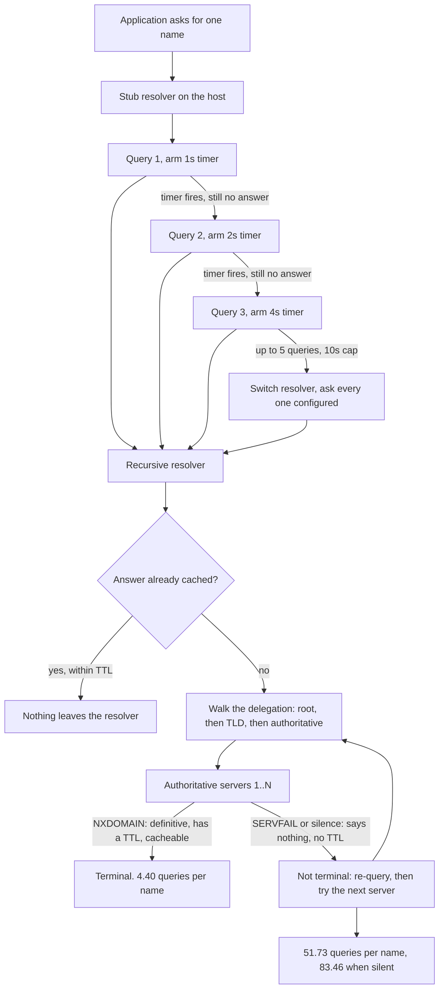
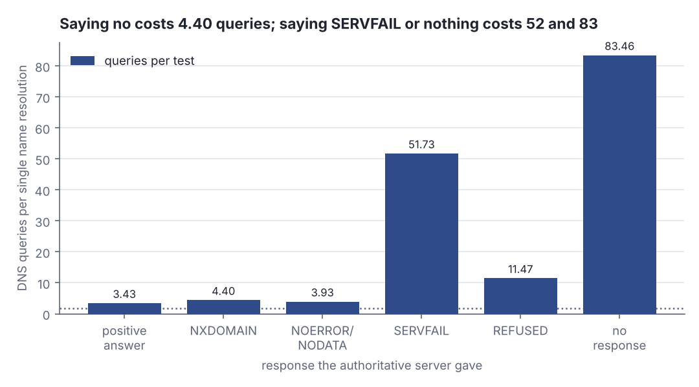
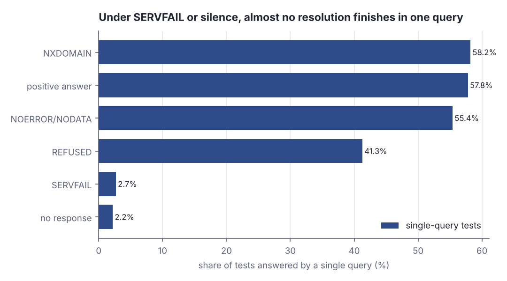
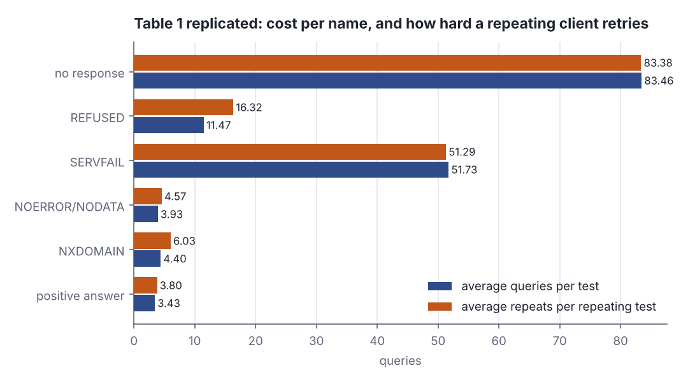

# The real cost of saying no: 4.40 DNS queries per name

> Fresh · Networking, modern · Intermediate · ~22 min · from today's feeds

## Why this matters
DNS is the first round trip of almost every request your services make, and today's item puts a
price on the case you design for least — the answer *no*. Geoff Huston's round-up of DNS-OARC 47
(APNIC Blog, 16 Nov 2026) points at an APNIC Labs measurement over 115,750,503 endpoints: one
name that does not exist costs **4.40 queries** on the wire, and an authoritative server that
answers `SERVFAIL` instead of `NXDOMAIN` costs **51.73**.
The failure response your service reaches for under load is the one that multiplies the load.

## Primer
You have done the TCP handshake, latency versus bandwidth, congestion control and UDP. DNS sits
one rung further on (the ladder calls it networking-08, "Modern DNS: resolution path, DoH/DoT,
DNSSEC, TTL games"); here is only what this lesson needs.

**One lookup is not one packet.** When your JVM calls `InetAddress.getByName`, the request goes
to a **stub resolver** in the operating system — a tiny client that knows no DNS itself. The stub
sends the question to a **recursive resolver** (your ISP's, your cloud VPC's, `8.8.8.8`). If the
answer is not already in that resolver's cache, the resolver walks the delegation chain: ask a
**root** server who serves `.com`, ask the **TLD** server who serves `example.com`, then ask the
**authoritative** server for `example.com` itself. Four hops of machinery behind one function
call.

**A query asks for exactly one record type.** Names carry typed **resource records**: `A` is an
IPv4 address, `AAAA` an IPv6 address, `HTTPS` a service-binding record that modern clients fetch
to learn about ALPN and ECH. One query carries one type, so a client that wants IPv4, IPv6 and
`HTTPS` sends three queries for the same name.

**Four outcomes matter here.** A positive answer carries the records. `NXDOMAIN` means the name
itself does not exist. `NOERROR` with no records — "NODATA" — means the name exists but has
nothing of that type. And then the non-answers: `SERVFAIL` (something broke), `REFUSED` (policy
says no) and silence.

**Nothing guarantees delivery.** DNS runs over UDP by default: no handshake, no acknowledgement,
no retransmission in the transport. If an answer does not come back, *somebody above UDP* has to
ask again. That somebody is the subject of this lesson.

## The idea

Caching is what makes DNS measurement hard: ask twice for `www.google.com` and the second ask
never leaves your resolver. The APNIC Labs study gets around that by making every measurement
unique. A script in an online advertisement makes each endpoint resolve a **randomly generated**
name that has never existed, so no cache anywhere can answer it, and APNIC's own experimental
servers are the only authoritative servers for those names — so every query that any resolver
sends is logged at the far end. The zone is not DNSSEC-signed, responses are short enough never
to be truncated, and queries are counted for 24 hours after the ad is placed (Huston, APNIC Blog,
4 Sep 2026). The result is the full on-the-wire cost of one application-level lookup.

```scala
val tests   = 115_750_503L
val queries = 509_410_787L
val repeats = 291_919_927L
val perTest = queries.toDouble / tests
println(f"NXDOMAIN: $perTest%.2f queries per name resolved")
println(f"repeats:  ${repeats.toDouble / queries * 100}%.1f%% of all queries")
```

```text
NXDOMAIN: 4.40 queries per name resolved
repeats:  57.3% of all queries
```

Those are the raw counts from the study's Table 1 (Huston, APNIC Blog, 4 Sep 2026): 509,410,787
queries arrived for 115,750,503 tests, and 291,919,927 of them were repeats of a question already
asked. More than half of all the DNS traffic the experiment generated was the same question
asked again. (The OARC 47 round-up rounds differently — 116M tests, 513M queries, 4.43 per name,
Huston, APNIC Blog, 16 Nov 2026. This lesson uses the primary study's 4.40 and derives everything
from its raw counts.)

### Where the repeats come from

Two independent layers retry, and they multiply. The stub resolver on the host arms a timer when
it sends a query; Microsoft's stub uses 1s, then 2s, then 4s, capped at five queries and ten
seconds, and when two or more resolvers are configured it switches resolver and asks all of them
(Huston, APNIC Blog, 4 Sep 2026).

> "If the timer expires and no response has been received, then the query will be repeated."
> — Geoff Huston, *What part of "No!" is so hard for the DNS to understand?*, 4 Sep 2026, https://blog.apnic.net/2026/09/04/what-part-of-no-is-so-hard-for-the-dns-understand/

```scala
val timers = List(1, 2, 4, 8)
var deadline = 0
var sent = 0
for t <- timers do
  if sent < 5 && deadline < 10 then
    sent += 1
    deadline = math.min(deadline + t, 10)
    println(s"query $sent sent, ${t}s timer, give up at ${deadline}s")
println(s"one stub, one resolver, no answer: $sent queries in ${deadline}s")
```

```text
query 1 sent, 1s timer, give up at 1s
query 2 sent, 2s timer, give up at 3s
query 3 sent, 4s timer, give up at 7s
query 4 sent, 8s timer, give up at 10s
one stub, one resolver, no answer: 4 queries in 10s
```

Four queries from one stub against one resolver, from a single application lookup. Put the
recursive resolver's own retries behind that — spread across every authoritative server the zone
lists — and the fan-out is multiplicative, not additive.



*Figure 1: how one application lookup fans out. Two layers retry independently — the stub on its own timers, the recursive resolver across the zone's authoritative servers — and whether the fan-out stops depends entirely on whether the answer was terminal. Source: mechanism described in Huston, APNIC Blog, 4 Sep 2026, https://blog.apnic.net/2026/09/04/what-part-of-no-is-so-hard-for-the-dns-understand/*

### The answer decides the cost

This is the finding. `NXDOMAIN` is *definitive* — this name does not exist — and carries a TTL,
so a resolver caches it and treats it as terminal. `SERVFAIL` says nothing: not whether the name
exists, not for how long, not for which servers. With no TTL it cannot be cached, so every
resolver treats it as transient and tries again, and tries the next authoritative server
(Huston, APNIC Blog, 4 Sep 2026).

> "Where there is no definitive response, the DNS slips into a behaviour mode that repeats queries."
> — Geoff Huston, *What part of "No!" is so hard for the DNS to understand?*, 4 Sep 2026, https://blog.apnic.net/2026/09/04/what-part-of-no-is-so-hard-for-the-dns-understand/

`REFUSED` lands in between — a policy decision rather than a breakage, so resolvers more often
accept it as final: 11.47 queries per name. Silence is worst at 83.46; the resolver has nothing
to interpret and just waits out UDP timeouts. Even the author's prediction was an order of
magnitude short:

> "Clearly, my assumption about resolver behaviour in response to a SERVFAIL response is wildly incorrect!"
> — Geoff Huston, *What part of "No!" is so hard for the DNS to understand?*, 4 Sep 2026, https://blog.apnic.net/2026/09/04/what-part-of-no-is-so-hard-for-the-dns-understand/

He had expected SERVFAIL to cost roughly 50% more queries; it cost about ten times more.



*Figure 2: the cost of each answer, in queries per single name resolution, recomputed from Table 1's raw counts by the lab below. The dotted line at 1.87 is what the study's own query-type mix would cost if nothing ever repeated. Generated from the lab output.*

The counter-intuitive part, which the round-up states flatly, is that denial is cheaper than
agreement:

> "The conventional `NXDOMAIN` response is more efficient than answering positively."
> — Geoff Huston, *Hot topics in DNS from DNS OARC 47*, 16 Nov 2026, https://blog.apnic.net/2026/11/16/hot-topics-in-dns-from-dns-oarc-47/

A positive answer costs 3.43 queries against NXDOMAIN's 4.40 — but a positive answer is usually
one query for `A` that succeeds, while the negative case drags the client through `A`, `AAAA` and
`HTTPS` before it gives up. And the round-up's blunt summary of the non-answers:

> "Returning the code `SERVFAIL` is about as bad as simply refusing to respond at all!"
> — Geoff Huston, *Hot topics in DNS from DNS OARC 47*, 16 Nov 2026, https://blog.apnic.net/2026/11/16/hot-topics-in-dns-from-dns-oarc-47/

```scala
val cost = Map("NXDOMAIN" -> 4.40, "REFUSED" -> 11.47, "SERVFAIL" -> 51.73, "silence" -> 83.46)
val nxd = cost("NXDOMAIN")
for (code, q) <- cost.toList.sortBy(_._2) do
  println(f"$code%-9s $q%6.2f q/name  = ${q / nxd}%5.2fx NXDOMAIN")
```

```text
NXDOMAIN    4.40 q/name  =  1.00x NXDOMAIN
REFUSED    11.47 q/name  =  2.61x NXDOMAIN
SERVFAIL   51.73 q/name  = 11.76x NXDOMAIN
silence    83.46 q/name  = 18.97x NXDOMAIN
```

Choosing SERVFAIL over NXDOMAIN multiplies your inbound DNS load about twelvefold; dropping the
packet, about nineteenfold. (This snippet divides already-rounded figures; the lab below divides
the raw counts and gets 11.75x and 18.96x.)



*Figure 3: the same table seen from the client's side. Under a definitive answer, 55–58% of resolutions finish on the first query; under SERVFAIL or silence, 2–3% do. Generated from the lab output.*

### Why this sits next to today's core lesson

DDIA ch. 4, "Modes of Dataflow", makes the case that a network request is not a local function
call: it can time out, be retried, and arrive twice. DNS is the largest deployed instance of
exactly that argument. The round-up puts the protocol's whole contract in one line —

> "The DNS is a one-trick pony — you send a query, and you get a response."
> — Geoff Huston, *Hot topics in DNS from DNS OARC 47*, 16 Nov 2026, https://blog.apnic.net/2026/11/16/hot-topics-in-dns-from-dns-oarc-47/

— and the measurement is what happens when the second half of that sentence does not hold. Also
from OARC 47: resolvers defend against resolution loops with CNAME-loop detection, CNAME count
limits and per-task time and work budgets, and the conclusion there was that *stopping a loop
does not stop the cost* — limiting repeated work matters more than detecting loops (Huston,
APNIC Blog, 16 Nov 2026). Same as DDIA's: retries belong in your capacity plan, not in your
exception handling.

You can watch the first half of this yourself. These commands only observe; run them on your Mac:

```bash
dig A example.com                      # one type, one query
dig +trace A example.com               # the delegation walk: root, TLD, authoritative
dig A thisnamedoesnotexist.example.com # the NXDOMAIN path
dig +tries=1 +time=1 @192.0.2.1 A example.com   # unreachable server: watch the stub give up
```

## Lab

**The question:** how much work does one failed name resolution really create, and which response
code is cheapest?

The program holds the six rows of Table 1 as raw counts and recomputes everything else, so no
ratio in this lesson is taken on trust.

### Step 1 — the ideal baseline

Before judging the measured cost you need to know what a perfect run would cost. The study reports
the query-type mix it observed: 48% of endpoints asked for both `A` and `AAAA`, 51% for `A` only,
1% for `AAAA` only, and 39% also asked for `HTTPS` (Huston, APNIC Blog, 4 Sep 2026). One query
carries one type, so the expected number of queries per test is the share-weighted sum of types.

### Step 2 — recompute Table 1

Per response code: queries per test, the share of tests that finished in a single query, the
average number of repeats among the tests that repeated, the amplification against the baseline,
and the cost relative to NXDOMAIN.

### Step 3 — split the surplus

How much of the observed traffic is first-time questions and how much is repetition.

### Step 4 — compare with 2019

The same experiment ran in October 2019 over 60,210,983 measurements against four authoritative
servers in Singapore, Frankfurt, Dallas and São Paulo, and recorded 142,631,272 queries (Huston,
APNIC Blog, 4 Sep 2026).

```scala
// file: Lab.scala
// Table 1 of Geoff Huston, "What part of 'No!' is so hard for the DNS to understand?",
// APNIC Blog, 4 Sep 2026. Raw counts only; every ratio below is recomputed from them.

case class Row(code: String, tests: Long, singleQuery: Long, queries: Long, repeats: Long)

val table1 = List(
  Row("control",     254894985L, 147233117L,  875316423L,  408891797L),
  Row("NXDOMAIN",    115750503L,  67316541L,  509410787L,  291919927L),
  Row("NODATA",      115571398L,  64033517L,  454213932L,  235724371L),
  Row("SERVFAIL",    138643924L,   3702576L, 7171673166L, 6920490780L),
  Row("REFUSED",     115415259L,  47625165L, 1324355211L, 1106379779L),
  Row("NO RESPONSE", 116050253L,   2519191L, 9685775212L, 9466474491L)
)

// The study's observed query-type mix: a test asks for one or more record TYPES,
// and one query can carry exactly one type.
val mix = List(
  ("48% ask A and AAAA ", 0.48, 2),
  ("51% ask A only     ", 0.51, 1),
  (" 1% ask AAAA only  ", 0.01, 1),
  ("39% also ask HTTPS ", 0.39, 1)
)

def comma(n: Long): String =
  val s = n.abs.toString
  val g = s.reverse.grouped(3).map(_.reverse).toList.reverse.mkString(",")
  if n < 0 then "-" + g else g

def qPerTest(r: Row): Double = r.queries.toDouble / r.tests

@main def lab(): Unit =
  println("=== Step 1: the ideal baseline - one query per record type asked ===")
  var baseline = 0.0
  for (label, share, types) <- mix do
    val contrib = share * types
    baseline += contrib
    println(f"  $label -> $share%.2f x $types type(s) = $contrib%.2f queries/test")
  println(f"  ideal baseline                       = $baseline%.2f queries/test")
  val nxd = table1.find(_.code == "NXDOMAIN").get
  val predicted = (nxd.tests * baseline).round
  println(s"  sanity check: ${comma(nxd.tests)} tests x " + f"$baseline%.2f" +
          s" = ${comma(predicted)} queries if nothing repeated")
  println(s"  observed for NXDOMAIN: ${comma(nxd.queries)} queries" +
          f" (${(nxd.queries - predicted).toDouble / nxd.queries * 100}%.1f%% are surplus)")
  println()

  println("=== Step 2: Table 1 recomputed, per response code ===")
  println("code         tests(M) queries(M)  q/test  1-query%  avg-rpt     amp   vs-NXD")
  val nxdCost = qPerTest(nxd)
  for r <- table1 do
    val qpt = qPerTest(r)
    val singleShare = r.singleQuery.toDouble / r.tests * 100
    val repeaters = r.tests - r.singleQuery
    val avgRepeats = r.repeats.toDouble / repeaters
    val amp = qpt / baseline
    val vsNxd = qpt / nxdCost
    println(f"${r.code}%-12s ${r.tests / 1e6}%8.1f ${r.queries / 1e6}%10.1f " +
            f"$qpt%7.2f ${singleShare}%8.1f%% $avgRepeats%8.2f $amp%6.2fx $vsNxd%6.2fx")
  println()

  println("=== Step 3: what the surplus is made of (NXDOMAIN) ===")
  val repeatShare = nxd.repeats.toDouble / nxd.queries * 100
  println(s"  queries ${comma(nxd.queries)} = first-time ${comma(nxd.queries - nxd.repeats)}" +
          s" + repeats ${comma(nxd.repeats)}")
  println(f"  repeats are $repeatShare%.1f%% of every query the authoritative servers saw")
  val repeaters = nxd.tests - nxd.singleQuery
  println(s"  ${comma(nxd.singleQuery)} of ${comma(nxd.tests)} tests needed one query;" +
          s" ${comma(repeaters)} repeated")
  println()

  println("=== Step 4: 2019 -> 2026 ===")
  val q2019 = 142631272L
  val t2019 = 60210983L
  val m2019 = q2019.toDouble / t2019
  val m2026 = qPerTest(nxd)
  println(s"  2019: ${comma(q2019)} queries / ${comma(t2019)} tests = " + f"$m2019%.2f")
  println(s"  2026: ${comma(nxd.queries)} queries / ${comma(nxd.tests)} tests = " + f"$m2026%.2f")
  println(f"  change: ${(m2026 - m2019) / m2019 * 100}%+.1f%% in seven years")
```

Run it with `python3 dojo/engine/run_lab.py 2026-11-26-2` (or `scala Lab.scala` on your Mac). Real
output:

```text
=== Step 1: the ideal baseline - one query per record type asked ===
  48% ask A and AAAA  -> 0.48 x 2 type(s) = 0.96 queries/test
  51% ask A only      -> 0.51 x 1 type(s) = 0.51 queries/test
   1% ask AAAA only   -> 0.01 x 1 type(s) = 0.01 queries/test
  39% also ask HTTPS  -> 0.39 x 1 type(s) = 0.39 queries/test
  ideal baseline                       = 1.87 queries/test
  sanity check: 115,750,503 tests x 1.87 = 216,453,441 queries if nothing repeated
  observed for NXDOMAIN: 509,410,787 queries (57.5% are surplus)

=== Step 2: Table 1 recomputed, per response code ===
code         tests(M) queries(M)  q/test  1-query%  avg-rpt     amp   vs-NXD
control         254.9      875.3    3.43     57.8%     3.80   1.84x   0.78x
NXDOMAIN        115.8      509.4    4.40     58.2%     6.03   2.35x   1.00x
NODATA          115.6      454.2    3.93     55.4%     4.57   2.10x   0.89x
SERVFAIL        138.6     7171.7   51.73      2.7%    51.29  27.66x  11.75x
REFUSED         115.4     1324.4   11.47     41.3%    16.32   6.14x   2.61x
NO RESPONSE     116.1     9685.8   83.46      2.2%    83.38  44.63x  18.96x

=== Step 3: what the surplus is made of (NXDOMAIN) ===
  queries 509,410,787 = first-time 217,490,860 + repeats 291,919,927
  repeats are 57.3% of every query the authoritative servers saw
  67,316,541 of 115,750,503 tests needed one query; 48,433,962 repeated

=== Step 4: 2019 -> 2026 ===
  2019: 142,631,272 queries / 60,210,983 tests = 2.37
  2026: 509,410,787 queries / 115,750,503 tests = 4.40
  change: +85.8% in seven years
```



*Figure 4: Table 1 replicated from its raw counts — the blue bar is what the whole population costs per name, the orange bar is how hard the clients that did repeat kept going. Adapted from Huston, "What part of 'No!' is so hard for the DNS to understand?", APNIC Blog, 4 Sep 2026, https://blog.apnic.net/2026/09/04/what-part-of-no-is-so-hard-for-the-dns-understand/*

### Reading the output

**Step 1.** Each line is a slice of the endpoint population, its share, and how many record types
that slice asks for. `0.48 x 2 = 0.96` means: 48% of endpoints ask for both `A` and `AAAA`, which
is two queries each, contributing 0.96 queries to the average test. The four contributions sum to
**1.87 queries per test** — the floor, the cost if every query were answered first time and never
repeated. **Lower is better everywhere in this lab.**

The sanity check multiplies that floor by the test count: 115,750,503 × 1.87 = 216,453,441. Step 3
shows the observed first-time queries as 217,490,860 — within half a percent of the predicted
floor. That agreement is what makes the rest trustworthy: the model of "one query per type asked"
is right, and everything above it really is repetition.

**Verdict: the floor is 1.87 queries per lookup. Every query beyond it is somebody retrying.**

**Step 2**, column by column:

| column | meaning | better |
|---|---|---|
| `tests(M)` | measurements in that arm, millions | — |
| `queries(M)` | queries the authoritative servers logged, millions | lower |
| `q/test` | queries per single name resolution | lower |
| `1-query%` | share of tests that finished on the first query | higher |
| `avg-rpt` | average repeats among tests that repeated at all | lower |
| `amp` | `q/test` ÷ 1.87, amplification over the ideal | lower |
| `vs-NXD` | `q/test` ÷ NXDOMAIN's 4.40, cost relative to a clean denial | lower |

| code | tests(M) | queries(M) | q/test | 1-query% | avg-rpt | amp | vs-NXD |
|---|---|---|---|---|---|---|---|
| control (positive) | 254.9 | 875.3 | 3.43 | 57.8% | 3.80 | 1.84x | 0.78x |
| NXDOMAIN | 115.8 | 509.4 | 4.40 | 58.2% | 6.03 | 2.35x | 1.00x |
| NOERROR/NODATA | 115.6 | 454.2 | 3.93 | 55.4% | 4.57 | 2.10x | 0.89x |
| SERVFAIL | 138.6 | 7171.7 | 51.73 | 2.7% | 51.29 | 27.66x | 11.75x |
| REFUSED | 115.4 | 1324.4 | 11.47 | 41.3% | 16.32 | 6.14x | 2.61x |
| NO RESPONSE | 116.1 | 9685.8 | 83.46 | 2.2% | 83.38 | 44.63x | 18.96x |

Tracing the NXDOMAIN row by hand, digits shown:

- `q/test` = 509,410,787 ÷ 115,750,503 = **4.3983…**, printed as 4.40.
- `1-query%` = 67,316,541 ÷ 115,750,503 = 0.58157… = **58.2%**.
- `avg-rpt` = 291,919,927 ÷ (115,750,503 − 67,316,541) = 291,919,927 ÷ 48,433,962 = **6.0272…**,
  printed as 6.03 — matching the study's own "Average repeats" column of 6.03, which confirms the
  formula.
- `amp` = 4.3983 ÷ 1.87 = **2.352…**, printed as 2.35.
- `vs-NXD` = 4.3983 ÷ 4.3983 = **1.00x** by construction.

Read the two extremes against that. SERVFAIL: 51.73 ÷ 4.40 = **11.75x**. Silence: 83.46 ÷ 4.40 =
**18.96x**. Nobody asserted those multiples; they fall out of dividing one logged count by another.
And `1-query%` explains the mechanism: under a definitive answer 55–58% of resolutions stop after
one query, under SERVFAIL 2.7% do, under silence 2.2%. Almost every client retries when the
answer is not terminal.

**Verdict: SERVFAIL costs about 12 times a clean NXDOMAIN, and dropping the query costs about 19
times. Both are driven by the collapse of the single-query share to under 3%.**

**Step 3** splits the NXDOMAIN traffic: 509,410,787 total = 217,490,860 first-time + 291,919,927
repeats, so **57.3%** of everything the authoritative servers handled was a question they had
already answered. And 67,316,541 of 115,750,503 tests were clean; the other 48,433,962 repeated an
average of 6.03 times each.

**Verdict: on the single cheapest failure path in DNS, well over half the server-side load is
redundant.**

**Step 4.** 2019: 142,631,272 ÷ 60,210,983 = 2.3689, printed 2.37. 2026: 4.40. The change is
(4.3983 − 2.3689) ÷ 2.3689 = **+85.8%**. The round-up names the same baseline:

> "This is a repetition of a similar experiment undertaken in 2019, when the query multiplication factor was 2.37."
> — Geoff Huston, *Hot topics in DNS from DNS OARC 47*, 16 Nov 2026, https://blog.apnic.net/2026/11/16/hot-topics-in-dns-from-dns-oarc-47/

Part of that rise is new work rather than new waste: `HTTPS` queries did not exist in 2019 and
39% of endpoints now send them, and dual-stack endpoints asking both `A` and `AAAA` went from 23%
to 48% (Huston, APNIC Blog, 4 Sep 2026). But the floor only moved to 1.87, and the measured cost
moved to 4.40.

**Verdict: the cost of one negative resolution has nearly doubled in seven years, and the type-mix
change accounts for well under half of it.**

### Cause → consequence

1. **Cause.** DNS runs over UDP with no delivery guarantee, and the only `no` that carries a TTL
   and a defined scope is `NXDOMAIN` (and, per type, NODATA).
2. **Mechanism.** When a resolver gets `SERVFAIL`, `REFUSED` or nothing, it cannot cache that
   outcome and cannot conclude anything, so it retries and then tries the next authoritative
   server — while the stub above it is independently retrying on its own 1s/2s/4s timers and
   switching between configured resolvers. The two layers multiply.
3. **Consequence.** The measured cost per name goes from 4.40 queries (NXDOMAIN) to 51.73
   (SERVFAIL) to 83.46 (silence) — 11.75x and 18.96x. Load generated by your own failure response
   arrives back at you.
4. **What it means for your work.** Two concrete rules for the JVM services you run behind
   resolvers. First, when a name genuinely does not exist, say so definitively: a zone or a
   service-discovery layer that returns `SERVFAIL` under load, or that is simply dropped by an
   overloaded authoritative server or a firewall, is self-amplifying — the overload creates the
   retries that deepen the overload, exactly the congestion-collapse shape you already know from
   TCP. Second, count your own lookups. A health check that resolves a hostname every tick, or a
   sidecar that resolves on every outbound call instead of honouring the TTL, is not "one DNS
   query per check" — at dual-stack plus `HTTPS` it is already ~1.9, and if anything in the path
   is failing it is 50 or 80. Cache resolved addresses for the TTL (on the JVM, that means
   setting `networkaddress.cache.ttl` deliberately rather than inheriting a 30-second or infinite
   default), and treat DNS retry volume as part of your capacity plan, not as an edge case.

## Self-check
1. The study's floor is 1.87 queries per test, yet the control arm — where every answer was a successful, positive A/AAAA response — measured 3.43. Where did the other 1.56 come from, and why is that number *lower* than NXDOMAIN's 4.40? <details><summary>Answer</summary>The surplus is repetition, not new questions: stub resolvers and recursive resolvers re-asking because a response did not arrive before a timer expired, with the recursive resolver also spreading retries across the zone's authoritative servers. It is lower than the NXDOMAIN case because a successful lookup usually ends early — the client gets its `A` record and stops — whereas a client chasing a name that does not exist tends to work through `A`, `AAAA` and `HTTPS` before giving up, so there are more distinct queries to repeat. The round-up states the result directly: "The conventional `NXDOMAIN` response is more efficient than answering positively." (Huston, APNIC Blog, 16 Nov 2026)</details>
2. Your authoritative service is overloaded. An engineer proposes shedding load by returning `SERVFAIL` for queries it cannot serve; another proposes simply dropping them. Using the measured numbers, what happens to your inbound query rate in each case, and what should you do instead? <details><summary>Answer</summary>`SERVFAIL` costs 51.73 queries per name against NXDOMAIN's 4.40 — 11.75x — and dropping the packet costs 83.46, about 18.96x. Neither sheds load; both multiply it, because neither response is cacheable or terminal, so every stub and every recursive resolver in the path retries and fans out across your other authoritative servers. The single-query share collapses from 58.2% to 2.7% and 2.2% respectively. The useful move is the opposite: answer definitively and cheaply — a real `NXDOMAIN` or `NOERROR`/NODATA with a sensible TTL for names you can decide about — so resolvers cache the answer and stop asking, and keep the servers answering rather than timing out.</details>
3. Why does `SERVFAIL` cost so much more than `REFUSED` (51.73 against 11.47) when both are failures that carry no records? <details><summary>Answer</summary>Because of what each one implies about the future. `REFUSED` reads as a policy decision — this server will not answer this question — so a resolver more often accepts it as final and stops. `SERVFAIL` is equivocal: it says nothing about whether the name exists, for how long the condition holds, or whether other servers are affected, and it carries no TTL, so it cannot be cached. The resolver can only treat it as transient, which means re-querying and trying the other authoritative servers — which is also why SERVFAIL's total volume scales with how many authoritative servers the zone has (Huston, APNIC Blog, 4 Sep 2026).</details>

## Sources
- [What part of "No!" is so hard for the DNS to understand?](https://blog.apnic.net/2026/09/04/what-part-of-no-is-so-hard-for-the-dns-understand/) — Geoff Huston, APNIC Blog, 4 Sep 2026 — the primary measurement study: experiment design (randomly generated names served by APNIC's own authoritative servers, 5–11 August 2026, 115,750,503 endpoints), Table 1's raw counts for all six response codes, the query-type mix, the stub-retry timer behaviour, the 2019 baseline, and quotes A, B, C (accessed 2026-11-26).
- [Hot topics in DNS from DNS OARC 47](https://blog.apnic.net/2026/11/16/hot-topics-in-dns-from-dns-oarc-47/) — Geoff Huston, APNIC Blog, 16 Nov 2026 — the conference round-up (Vancouver, 9–10 November 2026) through which this item surfaced: the one-line summaries quoted here, the 2.37 baseline, the loop-detection-versus-work-budget conclusion, and the slightly different rounding (116M tests, 513M queries, 4.43 per name) noted in the text (accessed 2026-11-26).
- [DNS Resolution Behaviour (DNS Measurement) — DNS-OARC 47 slide deck](https://indico.dns-oarc.net/event/58/contributions/1251/attachments/1214/2583/2026-11-09-dns-dups.pdf) — APNIC Labs, 9 Nov 2026 — the talk the round-up reports on; listed for provenance. Its figures are not openly licensed, so Figure 4 replicates Table 1 from the published counts instead of reproducing any slide (accessed 2026-11-26).

## Next on this track
Fresh lessons sit outside the ladder; next on Networking, modern: **HTTP/1.1 vs HTTP/2: multiplexing, HPACK, head-of-line blocking** (rung 6 of 16, Intermediate).
