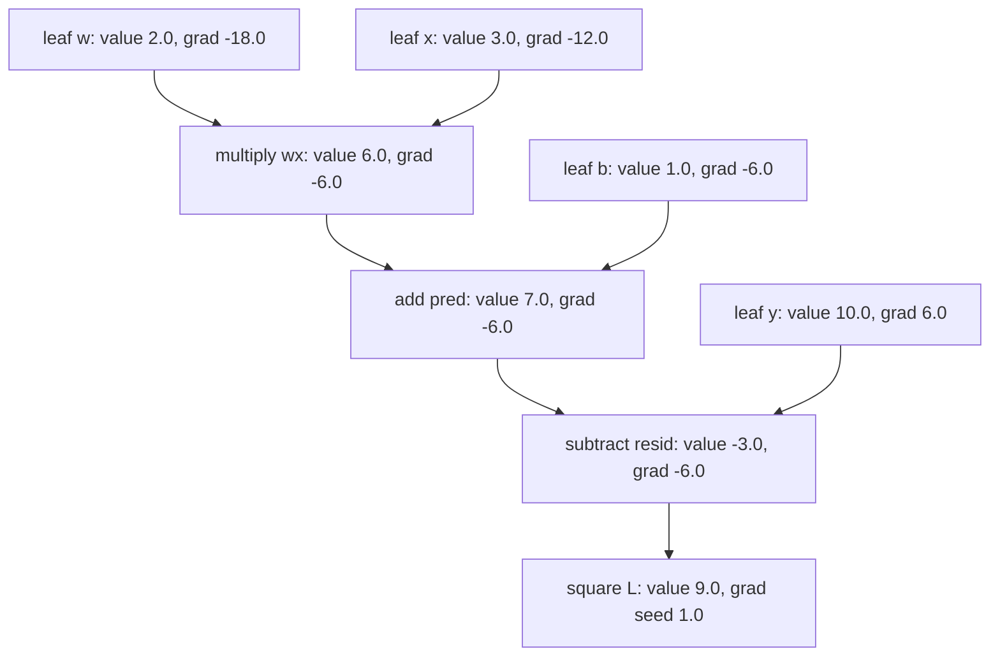
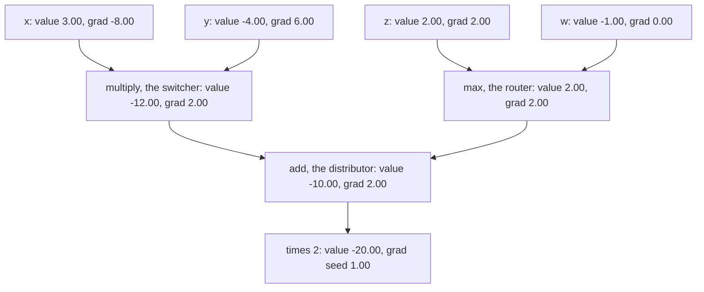
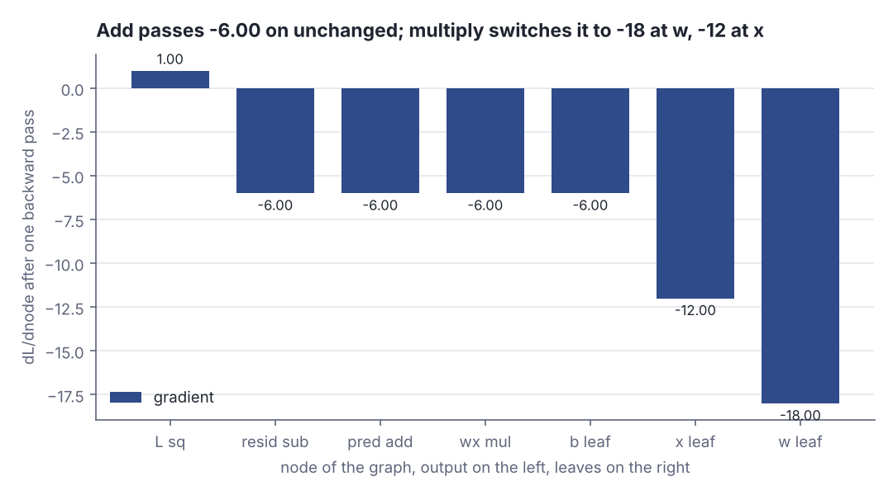
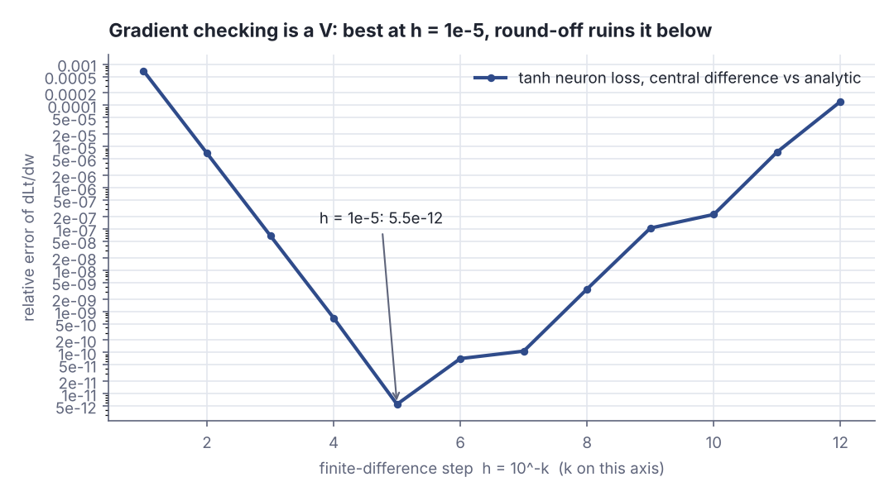

# Backpropagation step by step

> AI / ML foundations · Beginner · ~30 min · rung 13 of 38 · needs: From perceptron to multilayer network (ai-ml-12)

## Why this matters
Every training loop you will read for the rest of this track — candle in Rust on the next rung, PyTorch at work — is this one algorithm underneath, and until you have run it by hand "the optimiser updates the weights" stays a box you cannot debug.
A wrong gradient is the quietest bug in machine learning: the loss still goes down, just worse, so the only honest defence is an independent oracle, and that oracle is a finite difference you can write in six lines.
It is also a sizing fact you will need as a Product Owner: one backward pass costs about one extra forward pass no matter how many parameters there are, which is the whole reason training a model with billions of weights is possible at all.

## The idea

### Nodes, not formulas

Write a loss as a chain of one- and two-input operations and you get a **computation graph**: a directed acyclic graph (a graph whose edges all point one way, with no cycles) in which each node is a single arithmetic operation and each edge carries a number. Take the smallest supervised-learning object there is: one weight `w`, one input `x`, one bias `b`, one target `y`, a prediction `pred = w·x + b`, and the squared error `L = (pred − y)²` — four leaves and four operations (multiply, add, subtract, square).

Every node holds two numbers: its **value**, computed on the way in from leaves to loss (the **forward pass**), and its **gradient** `dL/dnode` — how much `L` moves per unit move of that node — computed on the way back (the **backward pass**). Backpropagation is that second walk, nothing more.



*Figure 1: the graph of `L = (w·x + b − y)²` at `w=2, x=3, b=1, y=10`. Values flow down the arrows; gradients flow back up them. Source: this lesson's lab output (Step 1 and Step 2).*

### The chain rule is local gradient × upstream gradient

Each operation knows one thing only: how its own output moves when each of its own inputs moves. That number is the **local gradient**, and it depends on nothing outside the node. The chain rule says the gradient on an input is the local gradient multiplied by the gradient that has already arrived from above — the **upstream gradient**. The Stanford course notes make that the whole algorithm: the chain rule tells us that the correct way to chain these gradient expressions together is through multiplication, and in practice it is simply a multiplication of the two numbers that hold the two gradients (CS231n, "Compound expressions with chain rule").

```scala
// file: Chain.scala
@main def chain(): Unit =
  val (x, y, z) = (-2.0, 5.0, -4.0)
  val q = x + y                      // forward: add gate
  val f = q * z                      // forward: multiply gate
  val df = 1.0                       // seed: df/df = 1
  val dq = z * df                    // multiply gate: local grad is the other input
  val dz = q * df
  val dx = 1.0 * dq                  // add gate: local grad is 1
  val dy = 1.0 * dq
  println(f"forward   q=$q%5.1f  f=$f%6.1f")
  println(f"backward  dq=$dq%5.1f  dz=$dz%5.1f  dx=$dx%5.1f  dy=$dy%5.1f")
```

```text
forward   q=  3.0  f= -12.0
backward  dq= -4.0  dz=  3.0  dx= -4.0  dy= -4.0
```

`f = (x + y)·z` is CS231n's own worked circuit. `dq = −4` because the multiply gate's local gradient for `q` is the *other* input `z = −4`; `dx` and `dy` are both `−4` because the add gate's local gradient is 1, so the upstream `−4` passes through untouched. No global formula for `f` was ever needed — four local rules and four multiplications.

### Three local rules carry most of a network

- **add** (`u + v`): local gradient 1 for each input, so the upstream gradient is copied to both inputs unchanged.
- **multiply** (`u · v`): local gradient `v` for `u` and `u` for `v` — the inputs swap places.
- **subtract** (`u − v`): `+1` for `u`, `−1` for `v`.
- **square** (`u²`): local gradient `2u`.
- **tanh** (`tanh(z)`, the S-shaped squash that maps any real number into `(−1, 1)`): local gradient `1 − tanh(z)²`. The node already computed `tanh(z)` going forward, so the backward pass reuses that number and needs no new transcendental call.

CS231n names the first two by what they do to a gradient:

> "The **add gate** always takes the gradient on its output and distributes it equally to all of its inputs, regardless of what their values were during the forward pass. This follows from the fact that the local gradient for the add operation is simply +1.0, so the gradients on all inputs will exactly equal the gradients on the output because it will be multiplied by x1.0 (and remain unchanged)."
>
> — Stanford CS231n course notes, *Backpropagation, Intuitions*, "Patterns in backward flow", https://cs231n.github.io/optimization-2/

> "The **multiply gate** is a little less easy to interpret. Its local gradients are the input values (except switched), and this is multiplied by the gradient on its output during the chain rule. In the example above, the gradient on **x** is -8.00, which is -4.00 x 2.00."
>
> — Stanford CS231n course notes, *Backpropagation, Intuitions*, "Patterns in backward flow", https://cs231n.github.io/optimization-2/



*Figure 2: the same circuit CS231n uses to name the patterns — add distributes its gradient unchanged, max routes it to the winner only (`w` gets 0.00), multiply switches the inputs (`x` gets `−4.00 × 2.00 = −8.00`). Adapted from CS231n, "Patterns in backward flow", https://cs231n.github.io/optimization-2/*

Those patterns are visible as a shape once you plot the gradients of our own four-operation graph.



*Figure 3: every node's `dL/dnode` after one backward pass. Four nodes sit at exactly `−6.00` because add and subtract hand the gradient on unchanged; `w` and `x` differ because the multiply gate gave each the other's value. Generated with `python3 dojo/engine/chart.py dojo/lessons/assets/2026-11-27-1-chart-2.json` from the Step 4a lab output.*

### A value used twice must accumulate, not overwrite

If a node feeds more than one consumer, `L` depends on it along more than one route, and the total derivative is the **sum** over routes. So a backward pass writes `node.grad += local × upstream`, never `=`. Overwriting is the classic micrograd bug: the last route to run wins and every earlier contribution vanishes.

```scala
// file: Accumulate.scala
@main def accumulate(): Unit =
  val a = 3.0
  val d = a * a + a                  // a feeds three edges, not one
  var grad = 0.0
  grad += a                          // left factor of a*a
  grad += a                          // right factor of a*a
  grad += 1.0                        // the lone + a branch
  def f(v: Double) = v * v + v
  val h = 1e-6
  val numeric = (f(a + h) - f(a - h)) / (2 * h)
  println(f"d=$d%.1f  accumulated grad=$grad%.6f  central difference=$numeric%.6f")
```

```text
d=12.0  accumulated grad=7.000000  central difference=7.000000
```

`d = a² + a` at `a = 3` gives `dd/da = 2a + 1 = 7`, and the three `+=` contributions are `3 + 3 + 1`. Assign instead of accumulate and you would ship `1.0` — a gradient that is wrong by a factor of seven, with a loss curve that still looks plausible.

### Reverse mode is the cheap direction, and it costs memory

Forward mode propagates the derivative with respect to **one input** forward, so N parameters need N passes. Reverse mode propagates the derivative of **one output** backward, so a scalar loss needs one pass whatever N is. Training has one loss and very many parameters, which is why every framework ships reverse mode.

```scala
// file: Cost.scala
@main def cost(): Unit =
  var evals = 0
  def loss(p: Vector[Double]): Double =
    evals += 1
    p.map(v => v * v).sum
  for n <- Vector(1, 10, 1000) do
    evals = 0
    val p = Vector.fill(n)(2.0)
    for i <- 0 until n; s <- Vector(1e-5, -1e-5) do
      loss(p.updated(i, 2.0 + s))
    println(f"n=$n%-5d numeric: $evals forward passes; backprop: 1 forward + 1 backward")
```

```text
n=1     numeric: 2 forward passes; backprop: 1 forward + 1 backward
n=10    numeric: 20 forward passes; backprop: 1 forward + 1 backward
n=1000  numeric: 2000 forward passes; backprop: 1 forward + 1 backward
```

The numeric column is `2n` and grows without bound; the backprop column is flat. The trade-off is memory, not time: every intermediate value must stay alive until its node's closure runs, so a deep graph holds all its activations in RAM — the reason training a model needs several times the memory of running it.

### Finite differences are the test oracle

Nobody can eyeball a gradient, so you check it against the definition of a derivative: `(L(w + h) − L(w − h)) / 2h`, the **central difference**. It is slow, but it shares no code with the analytic path, so a disagreement means the analytic path is wrong. Choosing `h` is the catch: too large and you measure the curve instead of the slope (truncation error, falling as `h²`); too small and the two losses agree in their leading digits and the subtraction throws those digits away (round-off, growing like `1/h` against a double's 16 significant digits).



*Figure 4: relative error of the central difference for `dLt/dw` on a tanh neuron, swept over twelve step sizes. The floor is `5.5e-12` at `h = 1e-5`; by `h = 1e-12` the error is back up at `1.2e-4`. Generated with `python3 dojo/engine/chart.py dojo/lessons/assets/2026-11-27-1-chart-1.json` from the Step 3 lab output.*

## Lab
Does a graph-walking autograd engine written from scratch reproduce, to the last digit, the gradients you derive by hand — and does an independent numerical oracle agree with both?

Andrej Karpathy's **micrograd** is the reference build for this. It is written in Python; everything below is Scala 3 with no dependencies, but the design is his:

> "A tiny Autograd engine (with a bite! :)). Implements backpropagation (reverse-mode autodiff) over a dynamically built DAG and a small neural networks library on top of it with a PyTorch-like API. Both are tiny, with about 100 and 50 lines of code respectively."
>
> — Andrej Karpathy, *micrograd — README*, https://github.com/karpathy/micrograd

Run everything with `python3 dojo/engine/run_lab.py 2026-11-27-1`, or locally with `scala HandPass.scala` and `scala Lab.scala`.

### Step 1 — the forward pass, by hand

One program covers Steps 1 to 3; here it is in full, with its output shown a section at a time.

```scala
// file: HandPass.scala
@main def handPass(): Unit =
  val (w, x, b, y) = (2.0, 3.0, 1.0, 10.0)

  // ---- Step 1: forward pass, one node at a time -------------------------
  val wx    = w * x
  val pred  = wx + b
  val resid = pred - y
  val L     = resid * resid
  println("Step 1 - forward pass")
  println(f"  wx    = w * x      = $w%.1f * $x%.1f      = $wx%8.3f")
  println(f"  pred  = wx + b     = $wx%.1f + $b%.1f      = $pred%8.3f")
  println(f"  resid = pred - y   = $pred%.1f - $y%.1f     = $resid%8.3f")
  println(f"  L     = resid^2    = ($resid%.1f)^2       = $L%8.3f")

  // ---- Step 2: backward pass, local grad x upstream grad ----------------
  val dL     = 1.0
  val dresid = 2.0 * resid * dL
  val dpred  = 1.0 * dresid
  val dy     = -1.0 * dresid
  val dwx    = 1.0 * dpred
  val db     = 1.0 * dpred
  val dw     = x * dwx
  val dx     = w * dwx
  println()
  println("Step 2 - backward pass")
  println("  node   value      grad      local rule x upstream")
  println(f"  L      $L%8.3f  $dL%8.3f   seed dL/dL = 1")
  println(f"  resid  $resid%8.3f  $dresid%8.3f   2*resid * 1 = 2*($resid%.1f) * $dL%.1f")
  println(f"  pred   $pred%8.3f  $dpred%8.3f   +1 * ($dresid%.1f)")
  println(f"  y      $y%8.3f  $dy%8.3f   -1 * ($dresid%.1f)")
  println(f"  wx     $wx%8.3f  $dwx%8.3f   +1 * ($dpred%.1f)")
  println(f"  b      $b%8.3f  $db%8.3f   +1 * ($dpred%.1f)")
  println(f"  w      $w%8.3f  $dw%8.3f   x * upstream = $x%.1f * ($dwx%.1f)")
  println(f"  x      $x%8.3f  $dx%8.3f   w * upstream = $w%.1f * ($dwx%.1f)")

  // ---- Step 3: central finite differences as the oracle -----------------
  def quad(ww: Double, xx: Double, bb: Double) =
    val p = ww * xx + bb
    (p - y) * (p - y)
  def cd(f: Double => Double, at: Double, h: Double) = (f(at + h) - f(at - h)) / (2 * h)
  val h0 = 1e-5
  println()
  println("Step 3 - central finite differences, h = 1e-5")
  println("  param  analytic   numeric    abs error")
  val checks = Vector(
    ("w", dw, cd(v => quad(v, x, b), w, h0)),
    ("b", db, cd(v => quad(w, x, v), b, h0)),
    ("x", dx, cd(v => quad(w, v, b), x, h0)))
  for (name, a, n) <- checks do
    println(f"  $name%-5s  $a%9.5f  $n%9.5f  ${math.abs(a - n)}%.3e")

  // ---- Step 3b: how the error depends on h ------------------------------
  // tanh neuron: p = tanh(wt*xt + bt), Lt = (p - yt)^2
  val (wt, xt, bt, yt) = (0.4, 0.5, 0.1, 0.8)
  def tanhLoss(ww: Double) =
    val p = math.tanh(ww * xt + bt)
    (p - yt) * (p - yt)
  val t = math.tanh(wt * xt + bt)
  val dwtAnalytic = 2.0 * (t - yt) * (1.0 - t * t) * xt
  println()
  println(f"  tanh neuron: z = $wt%.1f*$xt%.1f + $bt%.1f, tanh(z) = $t%.6f, Lt = ${tanhLoss(wt)}%.6f")
  println(f"  analytic dLt/dw = 2*(tanh(z)-y)*(1-tanh(z)^2)*x = $dwtAnalytic%.6f")
  println()
  println("  h          quad numeric   quad rel.err   tanh numeric   tanh rel.err")
  for k <- 1 to 12 do
    val h = math.pow(10.0, -k)
    val nq = cd(v => quad(v, x, b), w, h)
    val nt = cd(tanhLoss, wt, h)
    val eq = math.abs(nq - dw) / math.abs(dw)
    val et = math.abs(nt - dwtAnalytic) / math.abs(dwtAnalytic)
    println(f"  1e-$k%-2d      $nq%12.6f   $eq%.3e      $nt%12.6f   $et%.3e")
```

```text
Step 1 - forward pass
  wx    = w * x      = 2.0 * 3.0      =    6.000
  pred  = wx + b     = 6.0 + 1.0      =    7.000
  resid = pred - y   = 7.0 - 10.0     =   -3.000
  L     = resid^2    = (-3.0)^2       =    9.000
```

**Verdict:** the forward pass is plain arithmetic — prediction 7.000 against a target of 10.000, residual −3.000, loss 9.000. Nothing is differentiated yet; the graph is only being filled in.

### Step 2 — the backward pass, by hand

```text
Step 2 - backward pass
  node   value      grad      local rule x upstream
  L         9.000     1.000   seed dL/dL = 1
  resid    -3.000    -6.000   2*resid * 1 = 2*(-3.0) * 1.0
  pred      7.000    -6.000   +1 * (-6.0)
  y        10.000     6.000   -1 * (-6.0)
  wx        6.000    -6.000   +1 * (-6.0)
  b         1.000    -6.000   +1 * (-6.0)
  w         2.000   -18.000   x * upstream = 3.0 * (-6.0)
  x         3.000   -12.000   w * upstream = 2.0 * (-6.0)
```

**Verdict:** eight nodes, eight multiplications, no formula for `dL/dw` ever written down — the `−18.000` falls out of the walk.

### Step 3 — finite differences as the oracle

```text
Step 3 - central finite differences, h = 1e-5
  param  analytic   numeric    abs error
  w      -18.00000  -18.00000  3.844e-10
  b       -6.00000   -6.00000  2.271e-10
  x      -12.00000  -12.00000  7.861e-11

  tanh neuron: z = 0.4*0.5 + 0.1, tanh(z) = 0.291313, Lt = 0.258763
  analytic dLt/dw = 2*(tanh(z)-y)*(1-tanh(z)^2)*x = -0.465519

  h          quad numeric   quad rel.err   tanh numeric   tanh rel.err
  1e-1         -18.000000   1.974e-15         -0.465838   6.866e-04
  1e-2         -18.000000   6.513e-15         -0.465522   6.890e-06
  1e-3         -18.000000   3.790e-14         -0.465519   6.890e-08
  1e-4         -18.000000   2.110e-12         -0.465519   6.876e-10
  1e-5         -18.000000   2.135e-11         -0.465519   5.526e-12
  1e-6         -18.000000   8.252e-12         -0.465519   7.111e-11
  1e-7         -18.000000   1.563e-10         -0.465519   1.078e-10
  1e-8         -18.000000   6.077e-09         -0.465519   3.470e-09
  1e-9         -18.000001   8.274e-08         -0.465519   1.048e-07
  1e-10        -18.000001   8.274e-08         -0.465519   2.241e-07
  1e-11        -18.000001   8.274e-08         -0.465522   7.379e-06
  1e-12        -18.001600   8.890e-05         -0.465461   1.238e-04
```

**Verdict:** the hand-derived gradients survive an independent check to ten decimal places, and the sweep shows `h = 1e-5` is the sweet spot for the curved loss — the number Figure 4 plots.

### Step 4 — the same answers from a generic engine

Now the payoff: a `Value` class holding a mutable `grad` and a `backward` closure, a topological sort, and a seed of 1.0 — micrograd's design, in Scala.

```scala
// file: Lab.scala
import scala.collection.mutable

/** A scalar node in a computation graph: a value, a gradient slot, and the
  * closure that pushes its gradient one step back to its inputs. */
class Value(var data: Double, var label: String, val prev: List[Value], val op: String):
  var grad: Double = 0.0
  var back: () => Unit = () => ()
  def as(n: String): Value = { label = n; this }

  def +(o: Value): Value =
    val out = Value(data + o.data, "+", List(this, o), "+")
    out.back = () =>
      this.grad += 1.0 * out.grad          // add gate: local grad 1 to each input
      o.grad    += 1.0 * out.grad
    out

  def -(o: Value): Value =
    val out = Value(data - o.data, "-", List(this, o), "-")
    out.back = () =>
      this.grad += 1.0 * out.grad
      o.grad    += -1.0 * out.grad
    out

  def *(o: Value): Value =
    val out = Value(data * o.data, "*", List(this, o), "*")
    out.back = () =>
      this.grad += o.data * out.grad       // multiply gate: the OTHER input
      o.grad    += this.data * out.grad
    out

  def sq: Value =
    val out = Value(data * data, "sq", List(this), "sq")
    out.back = () => this.grad += 2.0 * this.data * out.grad
    out

  def tanh: Value =
    val t = math.tanh(data)
    val out = Value(t, "tanh", List(this), "tanh")
    out.back = () => this.grad += (1.0 - t * t) * out.grad
    out

object Value:
  def leaf(d: Double, l: String): Value = Value(d, l, Nil, "leaf")

/** Reverse-mode autodiff: topologically order the graph, seed the root with 1,
  * then run every node's closure once, from the root backwards. */
def backward(root: Value): List[Value] =
  val order = mutable.ArrayBuffer[Value]()
  val seen = mutable.HashSet[Value]()
  def visit(v: Value): Unit =
    if !seen.contains(v) then
      seen += v
      v.prev.foreach(visit)
      order += v
  visit(root)
  for v <- order do v.grad = 0.0
  root.grad = 1.0
  val rev = order.reverse.toList
  for v <- rev do v.back()
  rev

@main def lab(): Unit =
  // ---- Step 4a: the generic engine on L = (w*x + b - y)^2 ---------------
  val w = Value.leaf(2.0, "w")
  val x = Value.leaf(3.0, "x")
  val b = Value.leaf(1.0, "b")
  val y = Value.leaf(10.0, "y")
  val wx = (w * x).as("wx")
  val pred = (wx + b).as("pred")
  val resid = (pred - y).as("resid")
  val loss = resid.sq.as("L")
  val order = backward(loss)
  println("Step 4a - generic engine, every node of L = (w*x + b - y)^2")
  println("  node    op      value      grad")
  for v <- order do
    println(f"  ${v.label}%-7s ${v.op}%-6s ${v.data}%9.4f ${v.grad}%9.4f")
  println(f"  hand-derived: dL/dw = -18, dL/db = -6, dL/dx = -12")
  println(f"  engine:       dL/dw = ${w.grad}%.0f, dL/db = ${b.grad}%.0f, dL/dx = ${x.grad}%.0f")
  println(f"  match: ${w.grad == -18.0 && b.grad == -6.0 && x.grad == -12.0}")

  // ---- Step 4b: a value used twice, so gradients must accumulate --------
  val a = Value.leaf(3.0, "a")
  val d = ((a * a).as("a*a") + a).as("d")
  backward(d)
  val hAcc = 1e-6
  def fAcc(v: Double) = v * v + v
  val numAcc = (fAcc(3.0 + hAcc) - fAcc(3.0 - hAcc)) / (2 * hAcc)
  println()
  println("Step 4b - one node feeding three edges: d = a*a + a")
  println(f"  d = ${d.data}%.1f   engine da = ${a.grad}%.6f   central difference = $numAcc%.6f")

  // ---- Step 4c: the tanh neuron through the same engine -----------------
  val wt = Value.leaf(0.4, "wt")
  val xt = Value.leaf(0.5, "xt")
  val bt = Value.leaf(0.1, "bt")
  val yt = Value.leaf(0.8, "yt")
  val z = ((wt * xt).as("wt*xt") + bt).as("z")
  val p = z.tanh.as("tanh(z)")
  val rt = (p - yt).as("resid")
  val lt = rt.sq.as("Lt")
  val ordT = backward(lt)
  println()
  println("Step 4c - tanh neuron: Lt = (tanh(wt*xt + bt) - yt)^2")
  println("  node    op      value      grad")
  for v <- ordT do
    println(f"  ${v.label}%-7s ${v.op}%-6s ${v.data}%9.6f ${v.grad}%9.6f")
  def tanhLoss(v: Double) =
    val q = math.tanh(v * 0.5 + 0.1)
    (q - 0.8) * (q - 0.8)
  val hT = 1e-5
  val numT = (tanhLoss(0.4 + hT) - tanhLoss(0.4 - hT)) / (2 * hT)
  println(f"  engine dLt/dwt = ${wt.grad}%.6f   central difference (h=1e-5) = $numT%.6f")
  println(f"  relative error = ${math.abs(wt.grad - numT) / math.abs(wt.grad)}%.3e")
```

```text
Step 4a - generic engine, every node of L = (w*x + b - y)^2
  node    op      value      grad
  L       sq        9.0000    1.0000
  resid   -        -3.0000   -6.0000
  y       leaf     10.0000    6.0000
  pred    +         7.0000   -6.0000
  b       leaf      1.0000   -6.0000
  wx      *         6.0000   -6.0000
  x       leaf      3.0000  -12.0000
  w       leaf      2.0000  -18.0000
  hand-derived: dL/dw = -18, dL/db = -6, dL/dx = -12
  engine:       dL/dw = -18, dL/db = -6, dL/dx = -12
  match: true

Step 4b - one node feeding three edges: d = a*a + a
  d = 12.0   engine da = 7.000000   central difference = 7.000000

Step 4c - tanh neuron: Lt = (tanh(wt*xt + bt) - yt)^2
  node    op      value      grad
  Lt      sq      0.258763  1.000000
  resid   -      -0.508687 -1.017375
  yt      leaf    0.800000  1.017375
  tanh(z) tanh    0.291313 -1.017375
  z       +       0.300000 -0.931037
  bt      leaf    0.100000 -0.931037
  wt*xt   *       0.200000 -0.931037
  xt      leaf    0.500000 -0.372415
  wt      leaf    0.400000 -0.465519
  engine dLt/dwt = -0.465519   central difference (h=1e-5) = -0.465519
  relative error = 5.526e-12
```

**Verdict:** one hundred lines of general-purpose machinery reproduce the hand-derived `−18 / −6 / −12` exactly, handle the shared node in 4b without any special case, and differentiate a `tanh` neuron it was never told about — to a relative error of `5.5e-12`.

### Reading the output

| Column | Meaning | Which direction is better |
|---|---|---|
| `value` | the node's number from the forward pass | neither; it is the data |
| `grad` | `dL/dnode`: how much the loss moves per unit move of this node | large magnitude = this node matters; sign says which way to step |
| `analytic` | the gradient from the backward pass | this is the one training uses |
| `numeric` | the central difference `(L(v+h) − L(v−h)) / 2h` | agreement with `analytic` is the only thing that matters |
| `rel.err` | `abs(numeric − analytic) / abs(analytic)` | smaller; below `1e-7` is a pass, above `1e-3` is a bug |

Trace one gradient with digits. `L = (pred − y)²` with `pred = w·x + b`, so by the chain rule `dL/dw = dL/dresid · dresid/dpred · dpred/dwx · dwx/dw`. Node by node: `dL/dresid = 2·resid = 2·(−3) = −6`; the subtract gate's local gradient for `pred` is `+1`, so `dL/dpred = 1 · (−6) = −6`; the add gate's local gradient for `wx` is `+1`, so `dL/dwx = 1 · (−6) = −6`; the multiply gate's local gradient for `w` is the other input `x = 3`, so `dL/dw = 3 · (−6) = −18`. Closed form: `dL/dw = 2·(pred − y)·x = 2·(−3)·3 = −18`. The same `−18.000` appears in the Step 2 table, in Step 3's numeric check, and in Step 4a's engine output.

**Verdict:** three independent routes — hand chain rule, closed form, numerical difference — land on the same number, which is what "the gradient is correct" actually means in practice.

### Cause → consequence

1. **Cause** — you express the loss as a graph of primitive operations instead of one formula.
2. **Mechanism** — every primitive knows only its own local derivative, so the gradient of any composition is a product of local derivatives accumulated along the edges; a topological order plus `grad +=` makes that a single backward sweep.
3. **Consequence** — one forward pass plus one backward pass yields `dL/dp` for *every* parameter at once, where the numerical method would need `2n` forward passes (`2000` at `n = 1000` in the Cost example), at the price of keeping every intermediate value in memory until the sweep reaches it.
4. **What it means for your work** — when a training job OOMs, the first lever is the stored activations, not the weights (gradient checkpointing trades recompute for memory on exactly this). And when you or an agent writes a custom layer, the only test worth having is a central-difference check at `h = 1e-5` on a couple of random inputs; it costs six lines and catches the one class of bug that never shows up as a crash.

## Self-check
1. A node `u` is consumed by two different downstream operations, and both branches end at the loss. What must the backward pass do with the two gradients that arrive at `u`, and what goes wrong if it does something else? <details><summary>Answer</summary>It must add them: `u.grad += local × upstream` for each branch, because `L` depends on `u` along two routes and the total derivative is the sum over routes. If the code assigns instead of accumulating, the branch that happens to run last overwrites the other, and the reported gradient is simply too small — training still converges, just to the wrong place at the wrong speed, with no error message. In the lab, `d = a·a + a` at `a = 3` accumulates `3 + 3 + 1 = 7`; assignment would report `1.0`.</details>
2. In the graph for `L = (w·x + b − y)²` with `w = 2, x = 3, b = 1, y = 10`, both `w` and `x` sit under the same multiply node, and the gradient arriving at that node is `−6`. Why is `dL/dw = −18` while `dL/dx = −12`? <details><summary>Answer</summary>The multiply gate's local gradient for one input is the *value of the other input* — CS231n calls it the gradient switcher. So `dL/dw = x × upstream = 3 × (−6) = −18` and `dL/dx = w × upstream = 2 × (−6) = −12`. The add and subtract gates above them passed the `−6` down unchanged, which is why four nodes in Figure 3 share exactly `−6.00`.</details>
3. You have a model with one scalar loss and 1,000,000 parameters. Roughly what does a full gradient cost by reverse-mode backpropagation, and what does it cost by central finite differences? Why would you still write the finite-difference code? <details><summary>Answer</summary>Backpropagation: one forward pass plus one backward pass, roughly two forward passes' worth of arithmetic, independent of the parameter count. Central differences: `2 × 1,000,000 = 2,000,000` forward passes — the `2n` scaling the Cost example shows at `n = 1, 10, 1000`. You write it anyway because it is derived from the definition of a derivative and therefore cannot share a bug with your analytic code: run it on a tiny graph with `h = 1e-5` as a unit test, where the relative error should land near `1e-10` or below, not in production.</details>

## Sources
- [Andrej Karpathy — The spelled-out intro to neural networks and backpropagation: building micrograd](https://www.youtube.com/watch?v=VMj-3S1tku0) — the lesson's shape: derivative intuition, the `Value` class with a mutable `grad` and a `backward` closure, and manual backpropagation through a neuron; locator: first hour (chapters are listed in the video description). The video codes it in Python; this lesson's engine is a Scala 3 port of the same design. Accessed 2026-11-27.
- [Andrej Karpathy — micrograd (README)](https://github.com/karpathy/micrograd) — the quoted description of the engine, its size (about 100 and 50 lines) and its scalar-DAG design; read as [raw README.md](https://raw.githubusercontent.com/karpathy/micrograd/master/README.md). MIT licensed. Accessed 2026-11-27.
- [Stanford CS231n notes — Backpropagation, Intuitions](https://cs231n.github.io/optimization-2/) — the chain rule as multiplication of local and upstream gradients ("Simple expressions and interpretation of the gradient", "Compound expressions with chain rule") and both quoted gate patterns plus the circuit replicated in Figure 2 ("Patterns in backward flow"); the page itself was unreachable from this run's network, so the text was read from the notes' own repository at [raw optimization-2.md](https://raw.githubusercontent.com/cs231n/cs231n.github.io/master/optimization-2.md). Accessed 2026-11-27.
- [3Blue1Brown — Neural Networks](https://www.3blue1brown.com/topics/neural-networks) — the visual intuition for gradients flowing backwards through layers and the explicit chain-rule derivation; locator: ch. 3 "Backpropagation, intuitively" and ch. 4 "Backpropagation calculus". Accessed 2026-11-27.

## Next on this track
Next on AI / ML foundations: **Tensors and autograd with candle: a training loop in Rust** (rung 14 of 38, Beginner).
