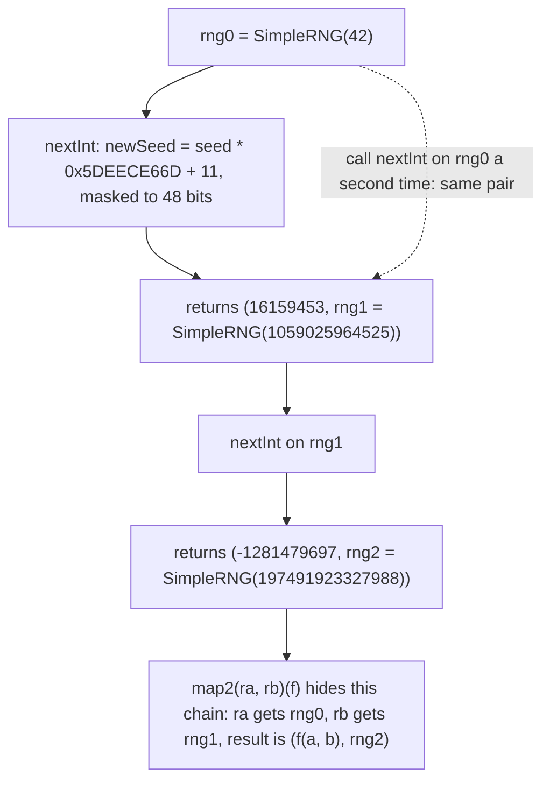
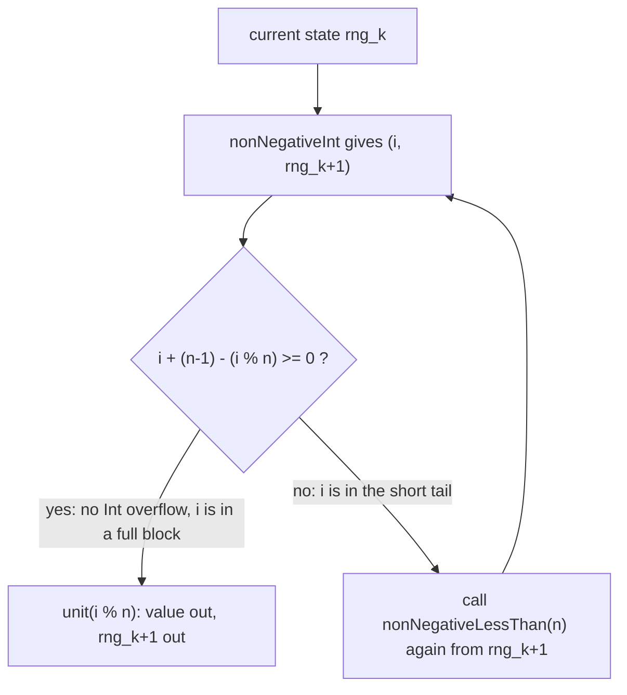
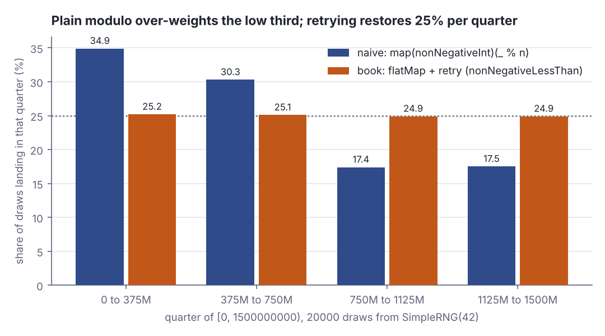
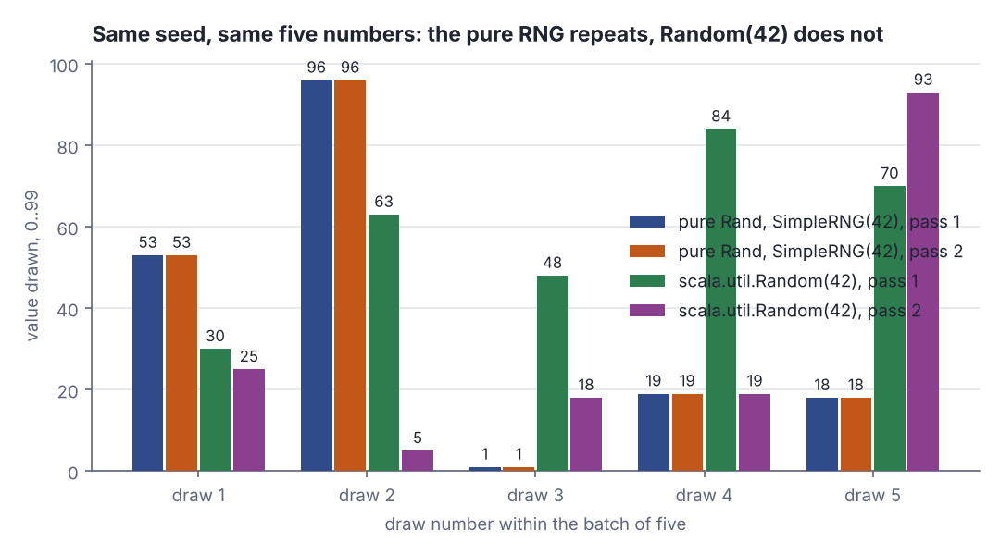

# Purely functional state: a pure random number generator

> Functional Programming in Scala (red book) · Beginner · ~20 min · rung 8 of 26 · needs: Infinite lazy lists and corecursion: unfold (fp-scala-07)

## Why this matters
Every flaky test you have ever chased came from state that a function read or wrote without saying so in its signature, and a random number generator is the smallest honest example of one. This rung shows the move that fixes it: stop hiding the state, return it alongside the value, then build combinators so you never have to pass it by hand.
That move is the whole of `State`, `StateT`, Akka's `Behavior` and every event-sourced aggregate you have written — this is the rung where you see it derived from nothing, on a type small enough to hold in your head.
It also buys reproducibility: the same seed gives the same run, which is what makes property-based testing (ch. 8) and any debuggable simulation possible at all.

## The idea

> Chapter map: Functional Programming in Scala, 2nd ed., ch. 6 — §6.1 Generating random numbers using side effects, §6.2 Purely functional random number generation, §6.3 Making stateful APIs pure, §6.4 A better API for state actions (§6.4.1 Combining state actions, §6.4.2 Nesting state actions).

### §6.1 Generating random numbers using side effects

The chapter opens on `scala.util.Random`, which looks pure and is not. A `Random` object holds a `Long` seed in a mutable field; every `nextInt` updates it in place. The signature `def nextInt(n: Int): Int` promises a function of `n`, but the result also depends on how many times anybody has called the object before.

```scala
val rnd = scala.util.Random(42)
val firstFive = List.fill(5)(rnd.nextInt(100))
val nextFive = List.fill(5)(rnd.nextInt(100))
println(firstFive)
println(nextFive)
```

```text
List(30, 63, 48, 84, 70)
List(25, 5, 18, 19, 93)
```

The same expression, same object, two answers: not referentially transparent, so you cannot substitute the value for the call. Fixing the seed does not rescue you — to reproduce the second list a test must first replay the first five calls in order, recreating the generator's whole history.

The book's casualty is a six-sided die with an off-by-one bug (FP in Scala, 2nd ed., ch. 6, §6.1): `rollDie` returns `nonNegativeLessThan(6)`, which yields 0 to 5, not 1 to 6. With hidden state it fails about one run in six and cannot be replayed; with the pure version the trigger is a value you can write down — the book's `SimpleRNG(5)`, which Step 1b reproduces on demand.

### §6.2 Purely functional random number generation

The fix is mechanical: make the state an output. `nextInt` returns both the number and the generator that should be used next, and it never mutates anything.

```scala
trait RNG:
  def nextInt: (Int, RNG)

case class SimpleRNG(seed: Long) extends RNG:
  def nextInt: (Int, RNG) =
    val newSeed = (seed * 0x5DEECE66DL + 0xBL) & ((1L << 48) - 1)
    val n = (newSeed >>> 16).toInt
    (n, SimpleRNG(newSeed))

println(SimpleRNG(42).nextInt)
println(SimpleRNG(42).nextInt._1 == SimpleRNG(42).nextInt._1)
```

```text
(16159453,SimpleRNG(1059025964525))
true
```

`SimpleRNG` is a **linear congruential generator**: multiply the seed by a constant, add another, keep the low 48 bits (java.util.Random's constants, which is why the numbers look familiar); the top 32 of those become the `Int`. Because `SimpleRNG` is a case class holding only a `Long`, `rng0` is still `rng0` after a hundred calls — the caller decides which state to use next, and the same question twice gets the same answer.



*Figure 1: the RNG state chain — each call consumes one immutable state and produces the next, so re-running from rng0 replays the same values, and `map2` is the lane that threads rng0 to rng1 to rng2 for you. Numbers from Step 2 of the lab. Source: Chiusano, Bjarnason & Pilquist, Functional Programming in Scala, 2nd ed., ch. 6 §6.2 and §6.4.1.*

### §6.3 Making stateful APIs pure

§6.3 generalises the trick: any `def f(a: A): B` that mutates hidden state of type `S` becomes `def f(a: A, s: S): (B, S)`.

Exercise 6.1 is where this first bites. `nonNegativeInt` must return a value in `0 .. Int.MaxValue`, and the obvious `math.abs` is wrong, because the two's-complement `Int` range is asymmetric.

```scala
println(math.abs(Int.MinValue))
println(-(Int.MinValue + 1))
```

```text
-2147483648
2147483647
```

`math.abs(Int.MinValue)` overflows back to `Int.MinValue`: negating −2 147 483 648 needs +2 147 483 648, which no `Int` can hold. The companion repository's comment states the fix:

> "We need to be quite careful not to skew the generator. Since `Int.Minvalue` is 1 smaller than `-(Int.MaxValue)`, it suffices to increment the negative numbers by 1 and make them positive. This maps Int.MinValue to Int.MaxValue and -1 to 0."
> — fpinscala companion repository, *State.scala*, second-edition branch, accessed 2026-11-28, https://raw.githubusercontent.com/fpinscala/fpinscala/second-edition/src/main/scala/fpinscala/answers/state/State.scala

So `if i < 0 then -(i + 1) else i`. Exercises 6.2 to 6.4 pile on — `double`, `intDouble`, `doubleInt`, `double3`, `ints(count)` — all written the same way, naming `r1`, `r2`, `r3` and passing each into the next call. One misplaced `r1` where `r2` belonged and the generator silently repeats itself. That boilerplate is what §6.4 attacks.

### §6.4 A better API for state actions

Every one of those functions has the shape `RNG => (A, RNG)`. Name it.

```scala
type Rand[+A] = RNG => (A, RNG)
val int: Rand[Int] = _.nextInt
def unit[A](a: A): Rand[A] = rng => (a, rng)
def map[A, B](s: Rand[A])(f: A => B): Rand[B] =
  rng =>
    val (a, rng2) = s(rng)
    (f(a), rng2)
val doubleViaMap: Rand[Double] =
  map(nonNegativeInt)(_ / (Int.MaxValue.toDouble + 1))
println(doubleViaMap(SimpleRNG(42))._1)
```

```text
0.007524831686168909
```

A `Rand[A]` is a **state action**: a description of a program that, given a generator, produces an `A` and the generator to use next. `unit` returns a constant and leaves the state alone; `map` (Exercise 6.5) transforms the value and passes the state through. `doubleViaMap` never mentions `rng`, and agrees to the last bit with the hand-threaded `double`.

#### §6.4.1 Combining state actions

`map` handles one action. Exercise 6.6 asks for `map2`, which combines two — and buries the threading for good.

```scala
def map2[A, B, C](ra: Rand[A], rb: Rand[B])(f: (A, B) => C): Rand[C] =
  rng0 =>
    val (a, rng1) = ra(rng0)
    val (b, rng2) = rb(rng1)
    (f(a, b), rng2)
def both[A, B](ra: Rand[A], rb: Rand[B]): Rand[(A, B)] = map2(ra, rb)((_, _))
val randIntDouble: Rand[(Int, Double)] = both(int, doubleViaMap)
println(randIntDouble(SimpleRNG(42))._1)
```

```text
(16159453,0.5967354848980904)
```

The order is a deliberate choice; the companion repository spells it out:

> "This implementation of map2 passes the initial RNG to the first argument and the resulting RNG to the second argument. It's not necessarily wrong to do this the other way around, since the results are random anyway."
> — fpinscala companion repository, *State.scala*, second-edition branch, accessed 2026-11-28, https://raw.githubusercontent.com/fpinscala/fpinscala/second-edition/src/main/scala/fpinscala/answers/state/State.scala

Pass `rng0` to both and you get two of the same number. Exercise 6.7 folds a `List[Rand[A]]` into a `Rand[List[A]]` with `sequence`, and `ints(count)` collapses to `sequence(List.fill(count)(int))`.

#### §6.4.2 Nesting state actions

`map2` cannot express a decision: it runs both actions regardless. When the *second* action depends on the first one's *value*, you need `flatMap` (Exercise 6.8), and `nonNegativeLessThan` is the motivating case. The tempting `map(nonNegativeInt)(_ % n)` is biased, because `Int.MaxValue + 1` is generally not a multiple of `n`, so the low residues get an extra preimage each.



*Figure 2: `flatMap` lets the retry decision depend on the value just drawn — something `map2` cannot do, because it fixes both actions in advance. Adapted from Functional Programming in Scala, 2nd ed., ch. 6 §6.4.2, https://www.manning.com/books/functional-programming-in-scala-second-edition*

The retry needs `flatMap` structurally: the continuation is `nonNegativeLessThan(n)` itself, a *new* `Rand[Int]` chosen after seeing `i`, and it restarts from `rng_k+1` — restarting from `rng_k` would loop forever. Exercise 6.9 then rewrites `map` as `flatMap(r)(a => unit(f(a)))` and `map2` as `flatMap(ra)(a => map(rb)(b => f(a, b)))`: `unit` and `flatMap` are the primitives, the rest is derived. (That pair is a monad, which ch. 11 names.)



*Figure 3: 20 000 draws of each from `SimpleRNG(42)`, n = 1 500 000 000. Naive modulo puts 34.9% in the first quarter and 17.4% in the third; retrying stays within 0.2 points of 25%. Generated from Step 6 of the lab output.*

### Reproducibility, and what it costs

A `Rand[A]` is a pure function of its starting `RNG`, so running it twice from `SimpleRNG(42)` gives identical results — the property ch. 8 builds property-based testing on, where a failing case is reported as a seed. (Today's second lesson is the same principle one layer down: reproducible LLM inference, where the hidden state is floating-point reduction order in the kernels rather than a seed field.)



*Figure 4: the blue and orange bars match at every draw; the green and purple ones do not. Generated from Step 7 of the lab output.*

**The trade-off.** You pay in plumbing and allocation: every draw allocates a new `SimpleRNG` and a tuple, and every function that wants randomness carries an `RNG` in and out of its signature, so a change deep in a call tree propagates up. The combinators buy back the readability, not the allocation. In exchange: referential transparency, thread-safety for free, and replay from a seed. For a Monte Carlo inner loop you would still take a thread-local mutable generator; for test data, simulations and anything you must debug afterwards, the pure version wins.

## Lab

Does making the state explicit actually buy reproducibility and an unbiased bounded draw — and do `map2`/`sequence` produce exactly the same numbers as threading the state by hand?

The program builds the chapter from scratch: `RNG`, `SimpleRNG` with the book's LCG constants, Exercises 6.1 to 6.4 threaded by hand, then `Rand[A]` with `unit`, `map`, `map2`, `both`, `sequence`, `flatMap` and `nonNegativeLessThan`. A counter ticks once per retry inside `nonNegativeLessThan`, so the rejection rate is measured, not assumed.

### Step 1 — the side-effecting baseline (§6.1)

The same `List.fill(5)(rnd.nextInt(100))` expression twice on one `scala.util.Random(42)`.

### Step 1b — the rollDie off-by-one, and the seed that reproduces it (§6.1)

Seeds 0 to 6 through the buggy `rollDieBuggy` and the fixed `rollDie`, then the book's `SimpleRNG(5)` twice.

### Step 2 — the explicit state chain (§6.2)

`rng0.nextInt`, `rng1.nextInt`, `rng2.nextInt`, then `rng0.nextInt` again, with the seed arithmetic printed.

### Step 3 — Exercise 6.1 `nonNegativeInt`, including `Int.MinValue`

`math.abs` against `-(i + 1)`, on a stub RNG that always returns `Int.MinValue`, and on the first real seed that produces a negative `Int`.

### Step 4 — Exercises 6.2 to 6.4 threaded by hand

`double`, `intDouble`, `doubleInt`, `double3`, `ints(5)` — count the `r1`, `r2`, `r3` in the source.

### Step 5 — Exercises 6.5 to 6.7 through `map`, `map2`, `both`, `sequence`

The same five results, with no `rng` named, compared for equality against Step 4.

### Step 6 — Exercise 6.8 `flatMap`, and why `nonNegativeLessThan` retries

20 000 draws with n = 1 500 000 000, naive modulo against the retrying version, bucketed into quarters, with the retry count.

### Step 7 — reproducibility

Five draws of `nonNegativeLessThan(100)` from `SimpleRNG(42)`, twice; the same from a shared `scala.util.Random(42)`.

```scala
// file: Lab.scala
import scala.annotation.tailrec

/** 6.2: the whole interface. nextInt hands back the value AND the next state. */
trait RNG:
  def nextInt: (Int, RNG)

/** 6.2: the book's linear congruential generator, same constants as java.util.Random. */
case class SimpleRNG(seed: Long) extends RNG:
  def nextInt: (Int, RNG) =
    val newSeed = (seed * 0x5DEECE66DL + 0xBL) & ((1L << 48) - 1)
    val nextRNG = SimpleRNG(newSeed)
    val n = (newSeed >>> 16).toInt
    (n, nextRNG)

/** A stub generator, so the Int.MinValue edge of Exercise 6.1 can be tested directly. */
case class ConstRNG(value: Int) extends RNG:
  def nextInt: (Int, RNG) = (value, this)

object RNG:
  type Rand[+A] = RNG => (A, RNG)

  val int: Rand[Int] = _.nextInt

  /** Exercise 6.1: 0 <= result <= Int.MaxValue, without skew and without overflow. */
  def nonNegativeInt(rng: RNG): (Int, RNG) =
    val (i, r) = rng.nextInt
    (if i < 0 then -(i + 1) else i, r)

  /** Exercise 6.2: 0.0 <= result < 1.0. */
  def double(rng: RNG): (Double, RNG) =
    val (i, r) = nonNegativeInt(rng)
    (i / (Int.MaxValue.toDouble + 1), r)

  /** Exercise 6.3, threaded by hand - this is the noise the rest of the chapter removes. */
  def intDouble(rng: RNG): ((Int, Double), RNG) =
    val (i, r1) = rng.nextInt
    val (d, r2) = double(r1)
    ((i, d), r2)

  def doubleInt(rng: RNG): ((Double, Int), RNG) =
    val (d, r1) = double(rng)
    val (i, r2) = r1.nextInt
    ((d, i), r2)

  def double3(rng: RNG): ((Double, Double, Double), RNG) =
    val (d1, r1) = double(rng)
    val (d2, r2) = double(r1)
    val (d3, r3) = double(r2)
    ((d1, d2, d3), r3)

  /** Exercise 6.4, also threaded by hand. */
  def ints(count: Int)(rng: RNG): (List[Int], RNG) =
    if count <= 0 then (Nil, rng)
    else
      val (x, r1) = rng.nextInt
      val (xs, r2) = ints(count - 1)(r1)
      (x :: xs, r2)

  // ---- 6.4 A better API for state actions ----

  def unit[A](a: A): Rand[A] = rng => (a, rng)

  def map[A, B](s: Rand[A])(f: A => B): Rand[B] =
    rng =>
      val (a, rng2) = s(rng)
      (f(a), rng2)

  /** Exercise 6.5: double again, with no visible state. */
  val doubleViaMap: Rand[Double] =
    map(nonNegativeInt)(_ / (Int.MaxValue.toDouble + 1))

  /** Exercise 6.6: map2 threads rng0 -> rng1 -> rng2 once, for everybody. */
  def map2[A, B, C](ra: Rand[A], rb: Rand[B])(f: (A, B) => C): Rand[C] =
    rng0 =>
      val (a, rng1) = ra(rng0)
      val (b, rng2) = rb(rng1)
      (f(a, b), rng2)

  def both[A, B](ra: Rand[A], rb: Rand[B]): Rand[(A, B)] = map2(ra, rb)((_, _))

  val randIntDouble: Rand[(Int, Double)] = both(int, doubleViaMap)
  val randDoubleInt: Rand[(Double, Int)] = both(doubleViaMap, int)

  /** Exercise 6.7: a whole list of actions, folded with map2. */
  def sequence[A](rs: List[Rand[A]]): Rand[List[A]] =
    rs.foldRight(unit(Nil: List[A]))((r, acc) => map2(r, acc)(_ :: _))

  def intsViaSequence(count: Int): Rand[List[Int]] = sequence(List.fill(count)(int))

  // ---- 6.4.2 Nesting state actions ----

  /** Exercise 6.8: flatMap. The second action is chosen by the first action's value. */
  def flatMap[A, B](r: Rand[A])(f: A => Rand[B]): Rand[B] =
    rng0 =>
      val (a, rng1) = r(rng0)
      f(a)(rng1)

  /** The book's retrying version: discards the biased tail of the Int range. */
  def nonNegativeLessThan(n: Int): Rand[Int] =
    flatMap(nonNegativeInt): i =>
      val mod = i % n
      if i + (n - 1) - mod >= 0 then unit(mod) else nonNegativeLessThan(n)

  /** The tempting one-liner the book rejects: modulo skews the distribution. */
  def naiveLessThan(n: Int): Rand[Int] = map(nonNegativeInt)(_ % n)

  /** Exercise 6.9: map and map2 fall out of flatMap. */
  def mapViaFlatMap[A, B](r: Rand[A])(f: A => B): Rand[B] =
    flatMap(r)(a => unit(f(a)))

  def map2ViaFlatMap[A, B, C](ra: Rand[A], rb: Rand[B])(f: (A, B) => C): Rand[C] =
    flatMap(ra)(a => map(rb)(b => f(a, b)))

  /** 6.1's bug: a die that can roll 0. Pure, so the failing seed is findable. */
  def rollDieBuggy: Rand[Int] = nonNegativeLessThan(6)
  def rollDie: Rand[Int] = map(nonNegativeLessThan(6))(_ + 1)

import RNG.*

// instrumented copy of nonNegativeLessThan, to count how often it retries
var retries = 0
def countedLessThan(n: Int): Rand[Int] =
  flatMap(nonNegativeInt): i =>
    val mod = i % n
    if i + (n - 1) - mod >= 0 then unit(mod)
    else
      retries += 1
      countedLessThan(n)

def drawMany(n: Int, draws: Int, action: Int => Rand[Int], seed: Long): List[Int] =
  @tailrec
  def go(left: Int, rng: RNG, acc: List[Int]): List[Int] =
    if left == 0 then acc.reverse
    else
      val (v, r) = action(n)(rng)
      go(left - 1, r, v :: acc)
  go(draws, SimpleRNG(seed), Nil)

def bucket4(v: Int, n: Int): Int = ((v.toLong * 4) / n).toInt.min(3)

@main def lab(): Unit =
  println("== Step 1: 6.1 a side-effecting Random is not referentially transparent ==")
  val rnd = scala.util.Random(42)
  val firstFive = List.fill(5)(rnd.nextInt(100))
  val nextFive = List.fill(5)(rnd.nextInt(100))
  println(s"  List.fill(5)(rnd.nextInt(100))  first  = $firstFive")
  println(s"  List.fill(5)(rnd.nextInt(100))  again  = $nextFive")
  println(s"  same expression, same object, same answer? ${firstFive == nextFive}")
  println("  to replay the second list you must first replay the first five calls, in order")

  println()
  println("== Step 1b: 6.1 the rollDie off-by-one, and the seed that reproduces it ==")
  println("  seed   nextInt      rollDieBuggy = nonNegativeLessThan(6)   rollDie = that + 1")
  for s <- 0L to 6L do
    val raw = SimpleRNG(s).nextInt._1
    println(f"$s%6d$raw%10d${rollDieBuggy(SimpleRNG(s))._1}%36d${rollDie(SimpleRNG(s))._1}%21d")
  println(s"  the book's failing seed, SimpleRNG(5): rollDieBuggy = ${rollDieBuggy(SimpleRNG(5))._1}")
  println(s"  same call a second time:               rollDieBuggy = ${rollDieBuggy(SimpleRNG(5))._1}")
  println(s"  seeds in 0..999 that roll a 0: ${(0L until 1000L).count(s => rollDieBuggy(SimpleRNG(s))._1 == 0)}")

  println()
  println("== Step 2: 6.2 the state chain is explicit and immutable ==")
  val rng0 = SimpleRNG(42)
  val (i1, rng1) = rng0.nextInt
  val (i2, rng2) = rng1.nextInt
  val (i3, _) = rng2.nextInt
  println(s"  rng0 = $rng0")
  println(s"  rng0.nextInt = ($i1, $rng1)")
  println(s"  rng1.nextInt = ($i2, $rng2)")
  println(s"  rng2.nextInt = ($i3, ...)")
  println(s"  rng0.nextInt._1 again = ${rng0.nextInt._1}  -> equal to i1? ${rng0.nextInt._1 == i1}")
  println(f"  newSeed = (42 * 0x5DEECE66D + 11) & (2^48 - 1) = ${(42L * 0x5DEECE66DL + 0xBL) & ((1L << 48) - 1)}%d")
  println(f"  n = (newSeed >>> 16).toInt                     = ${(((42L * 0x5DEECE66DL + 0xBL) & ((1L << 48) - 1)) >>> 16).toInt}%d")

  println()
  println("== Step 3: Exercise 6.1 nonNegativeInt, including the Int.MinValue edge ==")
  println(s"  Int.MinValue              = ${Int.MinValue}")
  println(s"  math.abs(Int.MinValue)    = ${math.abs(Int.MinValue)}   <- still negative: overflow")
  println(s"  -(Int.MinValue + 1)       = ${-(Int.MinValue + 1)}    <- the book's fix")
  println(s"  nonNegativeInt(ConstRNG(Int.MinValue)) = ${nonNegativeInt(ConstRNG(Int.MinValue))._1}")
  println(s"  nonNegativeInt(ConstRNG(-1))           = ${nonNegativeInt(ConstRNG(-1))._1}")
  println(s"  nonNegativeInt(SimpleRNG(42))          = ${nonNegativeInt(SimpleRNG(42))._1}")
  val negSeed = (0L to 100000L).find(s => SimpleRNG(s).nextInt._1 < 0)
  negSeed.foreach: s =>
    println(s"  first seed in 0..100000 with a negative nextInt: $s -> ${SimpleRNG(s).nextInt._1}")
    println(s"  nonNegativeInt(SimpleRNG($s)) = ${nonNegativeInt(SimpleRNG(s))._1}")

  println()
  println("== Step 4: Exercises 6.2-6.4 threaded by hand (count the r1, r2, r3) ==")
  println(s"  double(SimpleRNG(42))      = ${double(SimpleRNG(42))._1}")
  println(s"  intDouble(SimpleRNG(42))   = ${intDouble(SimpleRNG(42))._1}")
  println(s"  doubleInt(SimpleRNG(42))   = ${doubleInt(SimpleRNG(42))._1}")
  println(s"  double3(SimpleRNG(42))     = ${double3(SimpleRNG(42))._1}")
  println(s"  ints(5)(SimpleRNG(42))     = ${ints(5)(SimpleRNG(42))._1}")

  println()
  println("== Step 5: Exercises 6.5-6.7 map, map2, both, sequence -- the threading disappears ==")
  println(s"  doubleViaMap(SimpleRNG(42))  = ${doubleViaMap(SimpleRNG(42))._1}")
  println(s"  same as hand-written double?      ${doubleViaMap(SimpleRNG(42))._1 == double(SimpleRNG(42))._1}")
  println(s"  randIntDouble(SimpleRNG(42)) = ${randIntDouble(SimpleRNG(42))._1}")
  println(s"  same as hand-written intDouble?   ${randIntDouble(SimpleRNG(42))._1 == intDouble(SimpleRNG(42))._1}")
  println(s"  randDoubleInt(SimpleRNG(42)) = ${randDoubleInt(SimpleRNG(42))._1}")
  println(s"  same as hand-written doubleInt?   ${randDoubleInt(SimpleRNG(42))._1 == doubleInt(SimpleRNG(42))._1}")
  println(s"  intsViaSequence(5)(SimpleRNG(42)) = ${intsViaSequence(5)(SimpleRNG(42))._1}")
  println(s"  same as hand-written ints(5)?     ${intsViaSequence(5)(SimpleRNG(42))._1 == ints(5)(SimpleRNG(42))._1}")
  println(s"  map2ViaFlatMap gives the same pair as map2? ${map2ViaFlatMap(int, doubleViaMap)((_, _))(SimpleRNG(42))._1 == randIntDouble(SimpleRNG(42))._1}")

  println()
  println("== Step 6: 6.4.2 flatMap, nonNegativeLessThan, and why it has to retry ==")
  val n = 1500000000
  retries = 0
  val good = drawMany(n, 20000, countedLessThan, 42L)
  val goodRetries = retries
  val naive = drawMany(n, 20000, i => naiveLessThan(i), 42L)
  println(s"  n = $n, draws = 20000")
  println(s"  smallest rejected nonNegativeInt: ${(Int.MaxValue / n) * n}  (of ${Int.MaxValue} possible)")
  println(f"  rejection rate implied by that: ${(2147483648L - (Int.MaxValue / n).toLong * n) * 100.0 / 2147483648L}%.2f%%")
  println(s"  retries actually taken inside nonNegativeLessThan: $goodRetries")
  println(f"  observed rejection rate: ${goodRetries * 100.0 / (goodRetries + 20000)}%.2f%%")
  println(s"  first 5 draws, nonNegativeLessThan = ${good.take(5)}")
  println(s"  first 5 draws, naive (i % n)       = ${naive.take(5)}")
  println(f"${"bucket of [0, n)"}%28s${"naive"}%9s${"naive pct"}%11s${"retrying"}%10s${"retrying pct"}%14s")
  val rows = for b <- 0 to 3 yield
    val nv = naive.count(v => bucket4(v, n) == b)
    val gv = good.count(v => bucket4(v, n) == b)
    val label = s"$b: ${b * (n / 4)}..${(b + 1) * (n / 4) - 1}"
    println(f"$label%28s$nv%9d${nv * 100.0 / naive.size}%10.1f%%$gv%10d${gv * 100.0 / good.size}%13.1f%%")
    (b, nv, gv)
  println(s"  naive counts    = ${rows.map(_._2).mkString(", ")}")
  println(s"  retrying counts = ${rows.map(_._3).mkString(", ")}")

  println()
  println("== Step 7: reproducibility -- same seed, same results ==")
  val fiveDraws = sequence(List.fill(5)(nonNegativeLessThan(100)))
  val pass1 = fiveDraws(SimpleRNG(42))._1
  val pass2 = fiveDraws(SimpleRNG(42))._1
  println(s"  pure Rand, SimpleRNG(42), pass 1 = $pass1")
  println(s"  pure Rand, SimpleRNG(42), pass 2 = $pass2")
  println(s"  identical? ${pass1 == pass2}")
  val shared = scala.util.Random(42)
  val sPass1 = List.fill(5)(shared.nextInt(100))
  val sPass2 = List.fill(5)(shared.nextInt(100))
  println(s"  scala.util.Random(42), pass 1 = $sPass1")
  println(s"  scala.util.Random(42), pass 2 = $sPass2")
  println(s"  identical? ${sPass1 == sPass2}")
```

Run it with `python3 dojo/engine/run_lab.py 2026-11-28-1`:

```text
== Step 1: 6.1 a side-effecting Random is not referentially transparent ==
  List.fill(5)(rnd.nextInt(100))  first  = List(30, 63, 48, 84, 70)
  List.fill(5)(rnd.nextInt(100))  again  = List(25, 5, 18, 19, 93)
  same expression, same object, same answer? false
  to replay the second list you must first replay the first five calls, in order

== Step 1b: 6.1 the rollDie off-by-one, and the seed that reproduces it ==
  seed   nextInt      rollDieBuggy = nonNegativeLessThan(6)   rollDie = that + 1
     0         0                                   0                    1
     1    384748                                   4                    5
     2    769497                                   3                    4
     3   1154246                                   2                    3
     4   1538995                                   1                    2
     5   1923744                                   0                    1
     6   2308493                                   5                    6
  the book's failing seed, SimpleRNG(5): rollDieBuggy = 0
  same call a second time:               rollDieBuggy = 0
  seeds in 0..999 that roll a 0: 167

== Step 2: 6.2 the state chain is explicit and immutable ==
  rng0 = SimpleRNG(42)
  rng0.nextInt = (16159453, SimpleRNG(1059025964525))
  rng1.nextInt = (-1281479697, SimpleRNG(197491923327988))
  rng2.nextInt = (-340305902, ...)
  rng0.nextInt._1 again = 16159453  -> equal to i1? true
  newSeed = (42 * 0x5DEECE66D + 11) & (2^48 - 1) = 1059025964525
  n = (newSeed >>> 16).toInt                     = 16159453

== Step 3: Exercise 6.1 nonNegativeInt, including the Int.MinValue edge ==
  Int.MinValue              = -2147483648
  math.abs(Int.MinValue)    = -2147483648   <- still negative: overflow
  -(Int.MinValue + 1)       = 2147483647    <- the book's fix
  nonNegativeInt(ConstRNG(Int.MinValue)) = 2147483647
  nonNegativeInt(ConstRNG(-1))           = 0
  nonNegativeInt(SimpleRNG(42))          = 16159453
  first seed in 0..100000 with a negative nextInt: 5582 -> -2147298936
  nonNegativeInt(SimpleRNG(5582)) = 2147298935

== Step 4: Exercises 6.2-6.4 threaded by hand (count the r1, r2, r3) ==
  double(SimpleRNG(42))      = 0.007524831686168909
  intDouble(SimpleRNG(42))   = (16159453,0.5967354848980904)
  doubleInt(SimpleRNG(42))   = (0.007524831686168909,-1281479697)
  double3(SimpleRNG(42))     = (0.007524831686168909,0.5967354848980904,0.15846728393808007)
  ints(5)(SimpleRNG(42))     = List(16159453, -1281479697, -340305902, -2015756020, 1770001318)

== Step 5: Exercises 6.5-6.7 map, map2, both, sequence -- the threading disappears ==
  doubleViaMap(SimpleRNG(42))  = 0.007524831686168909
  same as hand-written double?      true
  randIntDouble(SimpleRNG(42)) = (16159453,0.5967354848980904)
  same as hand-written intDouble?   true
  randDoubleInt(SimpleRNG(42)) = (0.007524831686168909,-1281479697)
  same as hand-written doubleInt?   true
  intsViaSequence(5)(SimpleRNG(42)) = List(16159453, -1281479697, -340305902, -2015756020, 1770001318)
  same as hand-written ints(5)?     true
  map2ViaFlatMap gives the same pair as map2? true

== Step 6: 6.4.2 flatMap, nonNegativeLessThan, and why it has to retry ==
  n = 1500000000, draws = 20000
  smallest rejected nonNegativeInt: 1500000000  (of 2147483647 possible)
  rejection rate implied by that: 30.15%
  retries actually taken inside nonNegativeLessThan: 8566
  observed rejection rate: 29.99%
  first 5 draws, nonNegativeLessThan = List(16159453, 1281479696, 340305901, 1015914512, 1163632440)
  first 5 draws, naive (i % n)       = List(16159453, 1281479696, 340305901, 515756019, 270001318)
            bucket of [0, n)    naive  naive pct  retrying  retrying pct
             0: 0..374999999     6977      34.9%      5038         25.2%
     1: 375000000..749999999     6061      30.3%      5012         25.1%
    2: 750000000..1124999999     3471      17.4%      4979         24.9%
   3: 1125000000..1499999999     3491      17.5%      4971         24.9%
  naive counts    = 6977, 6061, 3471, 3491
  retrying counts = 5038, 5012, 4979, 4971

== Step 7: reproducibility -- same seed, same results ==
  pure Rand, SimpleRNG(42), pass 1 = List(53, 96, 1, 19, 18)
  pure Rand, SimpleRNG(42), pass 2 = List(53, 96, 1, 19, 18)
  identical? true
  scala.util.Random(42), pass 1 = List(30, 63, 48, 84, 70)
  scala.util.Random(42), pass 2 = List(25, 5, 18, 19, 93)
  identical? false
```

### Reading the output

**Steps 1 and 1b — the baseline.** `scala.util.Random(42)` gave `List(30, 63, 48, 84, 70)` and then `List(25, 5, 18, 19, 93)` from the identical expression, because the object's seed field advanced between the two. Step 1b's table has four columns: the seed, the raw `nextInt` it produces, what the buggy die returns (`nonNegativeLessThan(6)`, 0 to 5) and what the fixed die returns (`+ 1`, 1 to 6). Seeds 0 and 5 both roll a 0 from the buggy die; 167 of the first 1000 seeds do, which is the 1-in-6 you would expect. The point is not the rate but that `SimpleRNG(5)` rolls 0 *every time you ask*, so that seed is a regression test.

**Verdict:** hidden state turns a deterministic bug into an intermittent one. Explicit state turns it back into a value you can write down in a test.

**Step 2 — the arithmetic, traced.** Seed 42: 42 × 0x5DEECE66D = 42 × 25 214 903 917 = 1 059 025 964 514, plus 11 = 1 059 025 964 525. That is already below 2⁴⁸ = 281 474 976 710 656, so the mask changes nothing, and `SimpleRNG(1059025964525)` is `rng1` in the output. Then 1 059 025 964 525 >>> 16 = 16 159 453 (shifting right 16 bits divides by 65 536: 1 059 025 964 525 / 65 536 = 16 159 453.07…, truncated), and `.toInt` keeps it. That is `i1`. Calling `rng0.nextInt` again recomputed the same two numbers from the same `Long`, so the comparison printed `true`.

**Verdict:** `nextInt` is an ordinary pure function of the seed. The "next state" is just another immutable value, so nothing can advance behind your back.

**Step 3 — the `Int.MinValue` edge.**

| expression | result | why |
|---|---|---|
| `math.abs(Int.MinValue)` | −2147483648 | negating −2³¹ needs +2³¹, which overflows back to −2³¹ |
| `-(Int.MinValue + 1)` | 2147483647 | add 1 first, so the negation lands on `Int.MaxValue` |
| `nonNegativeInt(ConstRNG(-1))` | 0 | −1 maps to 0, so the whole negative half maps onto 0 … 2147483647 |
| `nonNegativeInt(SimpleRNG(5582))` | 2147298935 | from −2147298936, the first negative draw in seeds 0 … 100000 |

The mapping is a bijection from the 2 147 483 648 negative `Int`s onto 0 … 2 147 483 647, so no value gets a double chance.

**Verdict:** `math.abs` would both crash the postcondition and skew the generator. The `-(i + 1)` form is one character longer and correct.

**Steps 4 and 5 — same numbers, less plumbing.** Every comparison printed `true`: `doubleViaMap` equals the hand-written `double` (0.007524831686168909), `randIntDouble` equals `intDouble` ((16159453, 0.5967354848980904)), `randDoubleInt` equals `doubleInt`, `intsViaSequence(5)` equals `ints(5)`, and `map2ViaFlatMap` equals `map2`. Trace the pair: `both(int, doubleViaMap)` runs `int` on `rng0` giving 16 159 453 and `rng1`, then runs `doubleViaMap` on `rng1`, whose `nextInt` is −1 281 479 697; `nonNegativeInt` maps that to 1 281 479 696 and dividing by 2³¹ = 2 147 483 648 gives 0.5967354848980904.

**Verdict:** `map2` is not an abstraction over the threading, it *is* the threading, written once. The outputs are bit-identical, so the combinators are a refactoring, not a new semantics.

**Step 6 — the bias, measured.** `n = 1 500 000 000` and `nonNegativeInt` ranges over 0 … 2 147 483 647, so exactly one full block of `n` fits. Everything from 1 500 000 000 up is the short tail: 2 147 483 648 − 1 500 000 000 = 647 483 648 values, or 30.15% of the range. The lab retried 8 566 times for 20 000 accepted draws — 8566 / 28566 = 29.99%, which matches the prediction to two decimal places.

| quarter of [0, n) | naive count | naive % | retrying count | retrying % |
|---|---|---|---|---|
| 0 … 374 999 999 | 6977 | 34.9% | 5038 | 25.2% |
| 375 000 000 … 749 999 999 | 6061 | 30.3% | 5012 | 25.1% |
| 750 000 000 … 1 124 999 999 | 3471 | 17.4% | 4979 | 24.9% |
| 1 125 000 000 … 1 499 999 999 | 3491 | 17.5% | 4971 | 24.9% |

Closer to 25% is better. The naive column is nearly 2:1 between the first and third quarters, exactly as the arithmetic says it must be: residues 0 … 647 483 647 have two preimages under `i % n` (once from `i` itself, once from `i − n`), the rest have one. The retrying column is flat.

**Verdict:** `map` cannot fix this, because the correction depends on the drawn value. `flatMap` can, at a cost of 1.43 draws per result on this `n`.

**Step 7 — reproducibility.** `sequence(List.fill(5)(nonNegativeLessThan(100)))` from `SimpleRNG(42)` gave `List(53, 96, 1, 19, 18)` on both passes; the shared `scala.util.Random(42)` gave two different lists. Note that these draws are *not* the first five raw `nextInt`s modulo 100 — `nonNegativeLessThan` consumed extra states on its retries, which is visible in `1 % 100` not matching anything obvious in Step 4's list.

**Verdict:** the pure action is a function of its starting state and nothing else, so "re-run it" is a complete instruction. That is the precondition for ch. 8's property-based testing, where a counterexample is reported as a seed.

The chain, in four steps:

1. **Cause.** `scala.util.Random` keeps its seed in a mutable field, so the result of a call depends on the object's call history, which is not in the signature.
2. **Mechanism.** Returning `(A, RNG)` moves that history into the type. Every `Rand[A]` is then a pure function `RNG => (A, RNG)`, and `unit`/`map`/`map2`/`flatMap`/`sequence` are the only places the state is ever threaded — one implementation, checked once.
3. **Consequence.** The same seed replays byte-for-byte (Step 7), a failing die roll becomes the value `SimpleRNG(5)` (Step 1b), and a correctness fix that needs the drawn value — rejection sampling — is expressible at all (Step 6, 34.9% → 25.2% in the first quarter).
4. **In practice.** When something in your service needs randomness, a clock or an id, pass the generator in and return the next one rather than reaching for a global. Your test then names a seed instead of a mock, and the same run reproduces on CI. The cost is the allocation and the signature churn, which is why you keep the pure generator for simulation, test-data and replayable logic, and leave the hot Monte Carlo loop to a thread-local mutable one.

## Self-check
1. `nonNegativeLessThan` could be written as `map(nonNegativeInt)(_ % n)`. Why does the book use `flatMap` instead, and what exactly goes wrong with the `map` version? <details><summary>Answer</summary>`map` can only transform the value an action produced; it cannot choose a *different* action based on it. The retry is exactly such a choice: having seen `i`, the program must decide between `unit(i % n)` and running `nonNegativeLessThan(n)` again, and only `flatMap` has the type `Rand[A] => (A => Rand[B]) => Rand[B]` that permits it. The `map` version is not just inelegant, it is biased: `nonNegativeInt` ranges over 2 147 483 648 values, and when `n` does not divide that count the low residues get one extra preimage each. In the lab, with n = 1 500 000 000, the first quarter of the range took 34.9% of 20 000 draws against the correct 25%, while the retrying version took 25.2%. The retry must also continue from the *next* state, not the one it started with, or it would reject the same value forever.</details>
2. Why is `math.abs` the wrong way to implement Exercise 6.1, and what does the book use instead? <details><summary>Answer</summary>Two's-complement `Int` is asymmetric: there are 2 147 483 648 negative values but only 2 147 483 647 positive ones, so `-Int.MinValue` has no representation and `math.abs(Int.MinValue)` silently returns `Int.MinValue` — the lab prints −2147483648. The book writes `if i < 0 then -(i + 1) else i`: incrementing before negating maps `Int.MinValue` to `Int.MaxValue` and −1 to 0, a bijection from the negative half onto 0 … `Int.MaxValue` that neither overflows nor gives any result a double chance. (`math.abs` would also skew the distribution by mapping both 0 and −0's neighbourhood unevenly.)</details>
3. In `map2(ra, rb)(f)`, why must `rb` be given the state that `ra` returned rather than the original state — and what does that imply about `map2(int, int)(_ - _)`? <details><summary>Answer</summary>Passing `rng0` to both would run two actions from the same state, so `ra` and `rb` would see the same draw. `map2(int, int)(_ - _)` would then always return 0, which is a correct function of its inputs but useless as a generator. Threading `rng0` into `ra`, taking the returned `rng1` into `rb`, and returning `rng2` to the caller is what makes the two draws independent and what lets the result be composed further. The companion repository's comment on `map2` makes the same point: passing the initial RNG to both "might have unexpected results… if both arguments are `RNG.int` then we would always get two of the same `Int`".</details>

## Sources
- [Functional Programming in Scala, 2nd ed. (Chiusano, Bjarnason, Pilquist)](https://www.manning.com/books/functional-programming-in-scala-second-edition) — ch. 6 "Purely functional state": §6.1 supplied the side-effecting `Random` argument and the `rollDie` off-by-one; §6.2 the `RNG` trait and `SimpleRNG`'s linear congruential generator with the `0x5DEECE66D` / `0xB` / 48-bit-mask constants; §6.3 the "return the new state with the value" rule and Exercises 6.1–6.4; §6.4 "A better API for state actions" the `Rand[A]` type with `unit` and `map` (Ex. 6.5), §6.4.1 "Combining state actions" `map2`, `both`, `randIntDouble` and `sequence` (Ex. 6.6–6.7), §6.4.2 "Nesting state actions" `flatMap`, `nonNegativeLessThan` and `map`/`map2` via `flatMap` (Ex. 6.8–6.9); accessed 2026-11-28.
- [fpinscala companion repository](https://github.com/fpinscala/fpinscala) — the `second-edition` branch file [`src/main/scala/fpinscala/answers/state/State.scala`](https://raw.githubusercontent.com/fpinscala/fpinscala/second-edition/src/main/scala/fpinscala/answers/state/State.scala) supplied the exact shape of `nonNegativeInt`, `double`, `intDouble`, `ints`, `unit`, `map`, `map2`, `both`, `sequence`, `flatMap` and `nonNegativeLessThan` used in the lab, and the two quoted comments on the `Int.MinValue` edge and on `map2`'s argument order; the repository's README maps chapter 6 to the `state` package; MIT licence, Manning Publications, Co.; accessed 2026-11-28.
- [Manning livebook: Functional Programming in Scala, 2nd ed., chapter 6](https://livebook.manning.com/book/functional-programming-in-scala-second-edition/chapter-6) — used to verify the section numbering and the exact section titles quoted in the chapter map; accessed 2026-11-28.

## Next on this track
Next on Functional Programming in Scala (red book): **Purely functional state: the general State data type** (rung 9 of 26, Beginner).
