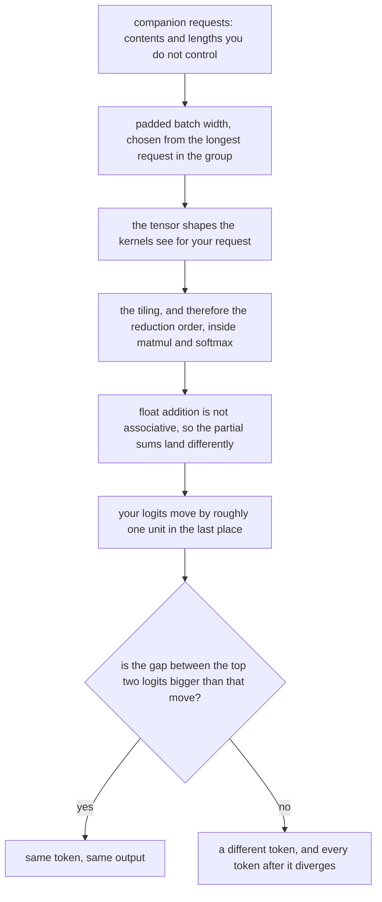
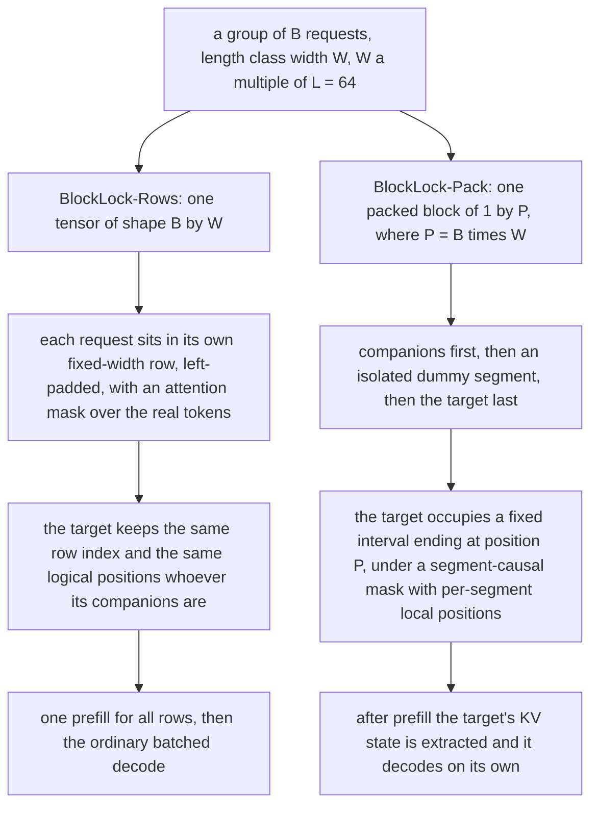
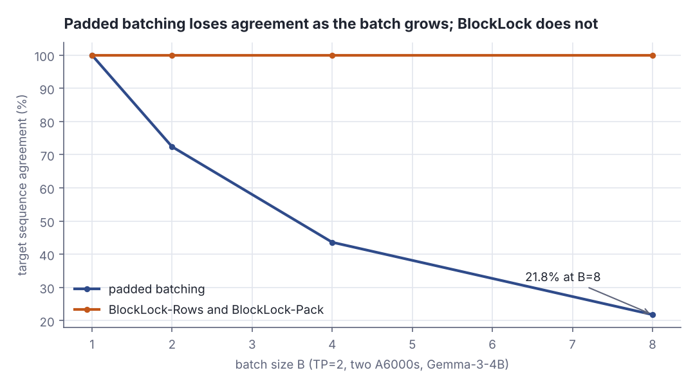
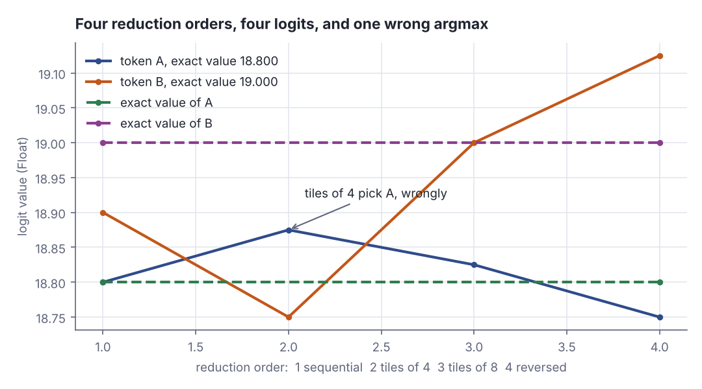

# Same prompt, different answer: how your batchmates change the output

> Fresh · AI / ML foundations · Intermediate · ~25 min · from today's feeds

## Why this matters

You send the same prompt twice, to the same weights, with greedy decoding and temperature zero,
and you get two different answers — not because anything sampled, but because a stranger's request
happened to share your batch. That is a reproducibility bug in a system you are expected to debug,
and it quietly poisons evaluation runs, A/B comparisons and reinforcement-learning rewards. A paper
on arXiv this month by Xiuyuan Qi, Pedro Reviriego, Javier Conde and Shanshan Liu names the cause —
tensor geometry, not just kernels — and fixes it for one protected request at a time, with no new
GPU kernels (*BlockLock: Reproducible LLM Inference with Fixed Batch Geometry*, arXiv 2611.06977,
November 2026, https://arxiv.org/abs/2611.06977). It belongs next to today's core lesson: a pure RNG
is reproducible because its state is in the signature, and an LLM's output is reproducible only when
the shape of its batch cannot reach into the arithmetic behind the caller's back.

## Primer

Five things, enough to read the rest.

**Prefill and decode.** An autoregressive model generates one token at a time. First it runs
*prefill*: one forward pass over the whole prompt at once, producing the model's internal state for
every prompt position. Then it *decodes*: one forward pass per generated token, each pass seeing all
previous positions. Prefill is one wide pass over many positions at once; decode is a long sequence of
narrow ones (Qi et al., arXiv 2611.06977, §3).

**Logits and greedy argmax.** The last thing the model computes at each step is a vector of real
numbers, one per vocabulary entry — the **logits**. Greedy decoding picks the index of the largest,
the **argmax**, and emits that token. Nothing is random; the only question is which number came out
biggest. When the top two logits are close, a change far smaller than the numbers themselves can
reverse the order, and because each token is fed back in, one reversal changes everything after it.

**The KV cache.** Attention lets position *n* look back at every earlier position. Rather than
recompute those earlier keys and values each step, the server stores them: that store is the **KV
cache**. Prefill fills it; decode appends one entry per step and reads the whole thing. A request's
KV cache is its identity inside the server.

**Batching, padding, masks.** Requests are cheaper together, so the server stacks several into one
tensor. They have different lengths, so short ones are padded — commonly **left padding**, zeros
prepended so every row ends at the same column — and an **attention mask** tells the kernel which
positions are real and must be attended to, and which are padding and must be ignored. The mask
keeps the *semantics* correct. It does not keep the *arithmetic* identical, and that is the whole
subject of this lesson.

You already know the last ingredient: floating-point addition is not associative, and a reduction's
result depends on the order in which partial sums are combined — the same fact that makes a
distributed `sum` non-deterministic when the partition changes.

## The idea

### The symptom, and why it is not sampling

The paper states the requirement in one sentence:

> "Reproducible LLM inference requires that a request produces the same output regardless of the other requests in the batch."
> — Xiuyuan Qi, Pedro Reviriego, Javier Conde and Shanshan Liu, *BlockLock: Reproducible LLM Inference with Fixed Batch Geometry*, arXiv 2611.06977, November 2026, https://arxiv.org/abs/2611.06977

Today's servers do not meet it. Across five dense models (Qwen3-8B, Qwen3-14B,
Llama-3.1-8B-Instruct, Gemma-3-4B-IT and Gemma-3-12B-it) in BF16 with greedy decoding, over
"60,120 pairwise comparisons across all 1,336 evaluated conditions" (Qi et al., arXiv 2611.06977,
§4.1), padded batching on a single GPU reproduced the target's generated sequence in only 52.59% of
comparisons and its Top-20 logits in 35.93% (Qi et al., arXiv 2611.06977, §4.2):

> "Padded batching agrees only 52.59% across companion changes, and the default backend path can vary even at B=1."
> — Qi, Reviriego, Conde and Liu, *BlockLock*, arXiv 2611.06977, November 2026, https://arxiv.org/html/2611.06977

The mechanism is the one you already know from distributed aggregation. A logit is a reduction over
many products. Change the order in which those products are summed and you change the last bits of
the answer:

```scala
val row = Vector(2.0e6f, 1.3f, 2.7f, 0.9f, -2.0e6f, 1.1f, 0.6f, 2.2f)
def seqSum(v: Vector[Float]): Float = v.foldLeft(0.0f)(_ + _)
def tileSum(v: Vector[Float], w: Int): Float =
  v.grouped(w).map(_.foldLeft(0.0f)(_ + _)).foldLeft(0.0f)(_ + _)
println(f"exact      = ${row.map(_.toDouble).sum}%.6f")
println(f"sequential = ${seqSum(row)}%.6f")
println(f"tiles of 4 = ${tileSum(row, 4)}%.6f")
println(f"tiles of 2 = ${tileSum(row, 2)}%.6f")
```

```text
exact      = 8.800000
sequential = 8.775000
tiles of 4 = 8.875000
tiles of 2 = 8.800000
```

Same eight numbers, three answers, spread over 0.1. The large opposite-signed values force rounding
at a step size of 0.125 — `ulp(2.0e6f)` — and where it lands depends on which partial sums meet
first. This is the same size of wobble the paper observes on a real GPU: on an
H100 with Qwen3-8B at batch size one over 320 decoding steps, the default cuDNN attention backend
produced divergent sequences because at step 280 "a logit value changed from 24.625 to 24.5",
reversing the ranking of two competing tokens (Qi et al., arXiv 2611.06977, §2.3).

### Geometry is the variable you can actually hold still

Why would your companions change your reduction order? Because the kernel's tiling is chosen from
the *shape* of the tensor it is handed, and that shape comes from the batch: the padded width is set
by the longest request in the group, and the split of work — and so the order in which partial sums
meet — follows from that width. Your companions' lengths are an input to your arithmetic.



*Figure 1: how a request you never see changes the answer you get. Source: mechanism as described in
Qi et al., "BlockLock: Reproducible LLM Inference with Fixed Batch Geometry", arXiv 2611.06977,
§2, https://arxiv.org/html/2611.06977.*

The existing fix is batch-invariant kernels: constrain the reduction order of every operator for
every request, which costs per-operator, per-GPU kernel work and throughput. BlockLock takes the
other road, and the whole paper hangs on one sentence:

> "The main idea is that the numbers of a request stay fixed if the shape that the kernels see for that request stays fixed."
> — Qi, Reviriego, Conde and Liu, *BlockLock*, arXiv 2611.06977, November 2026, https://arxiv.org/html/2611.06977

So: keep batching, keep stock kernels, and pin the geometry — shape, positions, reduction order —
that *one protected request* sees. A group has batch size B and a length-class width W that is a
multiple of a block size L (L = 64 in their standard evaluation), reserving P = B·W prompt positions
(Qi et al., arXiv 2611.06977, §3). That multiple-of-L rule is not decoration. Pad a row to a width
that is not a multiple of the tile size and the tiles slide across your real tokens:

```scala
def tileSum(v: Vector[Float], w: Int): Float =
  v.grouped(w).map(_.foldLeft(0.0f)(_ + _)).foldLeft(0.0f)(_ + _)
def leftPad(v: Vector[Float], w: Int): Vector[Float] =
  Vector.fill(w - v.length)(0.0f) ++ v
val row = Vector(2.0e6f, 1.3f, 2.7f, 0.9f, -2.0e6f, 1.1f, 0.6f, 2.2f)
for w <- List(8, 12, 16, 10, 14) do
  val t = tileSum(leftPad(row, w), 4)
  println(f"W = $w%2d  W mod 4 = ${w % 4}  logit = $t%.6f")
```

```text
W =  8  W mod 4 = 0  logit = 8.875000
W = 12  W mod 4 = 0  logit = 8.875000
W = 16  W mod 4 = 0  logit = 8.875000
W = 10  W mod 4 = 2  logit = 8.800000
W = 14  W mod 4 = 2  logit = 8.800000
```

Three different reserved widths, one identical logit: as long as W is a multiple of the tile size,
the zeros fill whole tiles and the real tokens keep the same grouping. Break that alignment and the
answer moves. That is why W is defined as a multiple of L.

### Two ways to pin it



*Figure 2: the two BlockLock layouts. Adapted from Qi et al., "BlockLock: Reproducible LLM Inference
with Fixed Batch Geometry", arXiv 2611.06977, §3, https://arxiv.org/html/2611.06977.*

Neither needs a new kernel; both need a backend policy that excludes components which are not
repeat-stable — in their experiments cuDNN SDPA and TF32 (Qi et al., arXiv 2611.06977, §2.3,
§4.1). With that in place both modes reached 100% target-sequence and Top-20 logit agreement where
padded batching reached 52.59% and 35.93% (Qi et al., arXiv 2611.06977, §4.2). The gap widens with
the batch: on two A6000s with tensor parallelism and Gemma-3-4B, padded batching fell from 100% at
B=1 to 72.4%, 43.6% and 21.8% at B=2, 4 and 8, while both BlockLock schemes held 100% across 20
conditions each (Qi et al., arXiv 2611.06977, §4.2).



*Figure 3: the TP=2 Gemma-3-4B agreement figures of §4.2, replicated. Printed by the lab below,
Step 5. Adapted from Qi et al., "BlockLock: Reproducible LLM Inference with Fixed Batch Geometry",
arXiv 2611.06977, https://arxiv.org/abs/2611.06977.*

### What it costs, and what it does not promise

Cheap, mostly:

> "In native PyTorch, Torch Rows adds merely 0.5%–0.8% overhead over Torch Padded."
> — Qi, Reviriego, Conde and Liu, *BlockLock*, arXiv 2611.06977, November 2026, https://arxiv.org/html/2611.06977

Against serialising the protected request (their CoRun baseline) on an A6000 at B=4, BlockLock-Rows
ran Qwen3-8B in 1312.71 ms against CoRun's 4305.75 ms, a 3.280× speedup, next to plain padded
batching at 1280.58 ms (Qi et al., arXiv 2611.06977, Table 1). Against vLLM's batch-invariant
kernels it cut latency by 53.5–55.0% and raised throughput by 115.2–122.2% at equal delivered work;
on Qwen3-8B/MMLU that is 902.68 ms against 2032.84 ms (Qi et al., arXiv 2611.06977, §4.3, Table 2).
The honest counterweight is long context: Rows beats CoRun in only four of six long-context groups,
and at W=4096 with 2048 output tokens it took 141.141 s against CoRun's 135.103 s (Qi et al.,
arXiv 2611.06977, Table 3). Padding waste also grows when the companions are much shorter than the
reserved width (Qi et al., arXiv 2611.06977, §3.5). Pack has its own bill, because "protecting
several prompts needs one pack per protected prompt, which costs extra prefill" (Qi et al.,
arXiv 2611.06977, §3.3). And the guarantee has a boundary: BlockLock holds the answer fixed while
companion contents and lengths change inside a fixed canonical plan, but it "does not guarantee
equality across different batch sizes" (Qi et al., arXiv 2611.06977, §2.4) — raise B and you have a
new baseline. Nor is it a latency SLO:

> "Our fixed-group timings do not measure queueing or tail latency."
> — Qi, Reviriego, Conde and Liu, *BlockLock*, arXiv 2611.06977, November 2026, https://arxiv.org/html/2611.06977

## Lab

The question this lab answers: **can the companions in my batch change my answer, and does fixing
the geometry really stop it — down to the bit?** You cannot run a GPU batch here, but you can run
the actual cause: a Float reduction whose order is chosen by the batch's shape.

### Step 1 — the data

Sixteen `Float` values stand in for one attention row's products for candidate token A, and sixteen
more for candidate token B. They deliberately mix magnitudes around 2·10⁶ with magnitudes around 1,
because `ulp(2.0e6f)` is 0.125: adding 1.3 to 2000000.0 cannot be done exactly, and the error that
survives is of the same size as the paper's 24.625 → 24.5.

### Step 2 — four reduction orders over the same sixteen numbers

Sum row A left to right; in tiles of 4 (the tile order a GPU kernel uses); in tiles of 8; and in
reverse. Print every tile's partial sum and every running total, then the four totals with their raw
bit patterns from `java.lang.Float.floatToIntBits`.

### Step 3 — the argmax flip

Do the same for row B, whose exact sum is genuinely larger, and print which token each reduction
order would emit.

### Step 4 — dynamic geometry against fixed geometry

Model the server twice. In (a) the padded batch width follows the longest companion and the tile
width follows the batch width, so the companions choose your reduction order. In (b) a width
W = 32, a multiple of L = 4, is reserved, the target is left-padded into it, and the reduction is
always tiled at L — BlockLock in miniature. In (c) W is deliberately set to a non-multiple of L.

### Step 5 — pairwise agreement

Count, exactly as the paper's protocol does, how many pairs of runs produced bitwise identical
results under each regime, and print the paper's TP=2 figures beside them for scale.

```scala
// file: Lab.scala
def bits(x: Float): String = "0x%08X".format(java.lang.Float.floatToIntBits(x))

def exactSum(v: Vector[Float]): Double = v.map(_.toDouble).sum

/** Left-to-right accumulation: one running total, one element at a time. */
def seqSum(v: Vector[Float], trace: Boolean = false): Float =
  var s = 0.0f
  for (x, i) <- v.zipWithIndex do
    s += x
    if trace && i % 4 == 3 then println(f"      after position $i%2d  running total = $s%13.6f")
  s

/** Tiled accumulation: sum each tile of w elements on its own, then add the tile results. */
def tileSum(v: Vector[Float], w: Int, trace: Boolean = false): Float =
  var s = 0.0f
  for (tile, t) <- v.grouped(w).zipWithIndex do
    var p = 0.0f
    for x <- tile do p += x
    s += p
    if trace then println(f"      tile $t%d of width $w%2d  partial = $p%14.6f   total = $s%13.6f")
  s

def allOrders(v: Vector[Float]): List[(String, Float)] =
  List("sequential" -> seqSum(v), "tiles of 4" -> tileSum(v, 4),
       "tiles of 8" -> tileSum(v, 8), "reversed" -> seqSum(v.reverse))

/** The padded batch width the scheduler would choose for the widest request in the group. */
def batchWidth(longest: Int): Int = List(16, 32, 64).find(_ >= longest).getOrElse(64)

@main def lab(): Unit =
  // One attention row's products for candidate token A, and the same for candidate token B.
  val rowA = Vector(2.0e6f, 1.3f, 2.7f, 0.9f, -2.0e6f, 1.1f, 0.6f, 2.2f,
                    1.6e6f, 1.7f, 0.4f, 3.1f, -1.6e6f, 0.8f, 2.4f, 1.6f)
  val rowB = Vector(1.8e6f, 2.1f, 1.4f, 0.7f, -1.8e6f, 2.9f, 1.2f, 0.5f,
                    2.4e6f, 0.3f, 2.6f, 1.9f, -2.4e6f, 1.5f, 0.8f, 3.1f)

  println("== Step 1: the data (16 Float values per row, one row per candidate token) ==")
  println("   i          rowA           rowB")
  for i <- rowA.indices do
    println(f"  $i%2d  ${rowA(i)}%13.1f  ${rowB(i)}%13.1f")
  println(f"  exact sum in Double: rowA = ${exactSum(rowA)}%.10f   rowB = ${exactSum(rowB)}%.10f")
  println(f"  ulp(2.0e6f) = ${math.ulp(2.0e6f)}%.6f   ulp(18.8f) = ${math.ulp(18.8f)}%.9f")

  println()
  println("== Step 2: four reduction orders over the SAME 16 numbers of rowA ==")
  println("  sequential, running total printed every 4th element:")
  seqSum(rowA, trace = true)
  println("  tiles of 4, one partial per tile:")
  tileSum(rowA, 4, trace = true)
  println("  tiles of 8, one partial per tile:")
  tileSum(rowA, 8, trace = true)
  println("  reversed, running total printed every 4th element:")
  seqSum(rowA.reverse, trace = true)
  println("  %-12s %-14s %-12s %s".format("order", "total", "bits", "error vs exact"))
  for (name, t) <- allOrders(rowA) do
    println(f"  $name%-12s $t%-14.6f ${bits(t)}%-12s ${t.toDouble - exactSum(rowA)}%+.6f")
  println(s"  distinct bit patterns: ${allOrders(rowA).map((_, t) => bits(t)).distinct.size} of 4")

  println()
  println("== Step 3: the reduction order decides which token wins ==")
  println(f"  truth in Double: rowA = ${exactSum(rowA)}%.6f, rowB = ${exactSum(rowB)}%.6f -> argmax = B")
  println("  %-12s %-13s %-13s %-8s %s".format("order", "logit A", "logit B", "argmax", "right?"))
  for ((name, ta), (_, tb)) <- allOrders(rowA).zip(allOrders(rowB)) do
    val pick = if ta > tb then "A" else if tb > ta then "B" else "tie"
    println(f"  $name%-12s $ta%-13.6f $tb%-13.6f $pick%-8s ${if pick == "B" then "yes" else "NO"}")

  println()
  println("== Step 4: dynamic geometry vs fixed geometry ==")
  val L = 4
  val companions = List(5, 20, 40, 64)
  println("  (a) dynamic: the padded batch width follows the longest companion, the tile width follows it")
  val dyn = for c <- companions yield
    val bw = batchWidth(math.max(rowA.length, c))
    val w = bw / L
    val t = tileSum(rowA, w)
    println(f"      companion $c%2d tokens -> batch width $bw%2d -> tile width $w%2d -> target logit $t%.6f  ${bits(t)}")
    t
  println("  (b) fixed: reserve W = 32 positions (a multiple of L = 4), left-pad the target, always tile at L")
  val fixed = for c <- companions yield
    val padded = Vector.fill(32 - rowA.length)(0.0f) ++ rowA
    val companion = Vector.tabulate(c)(i => (i + 1) * 137.0f)
    val t = tileSum(padded, L)
    println(f"      companion $c%2d tokens (sum ${companion.sum}%9.1f, outside the target's row) -> target logit $t%.6f  ${bits(t)}")
    t
  println(f"  (c) W must be a multiple of L, or the tiles slide off the target's tokens:")
  for w <- List(30, 31, 32) do
    val padded = Vector.fill(w - rowA.length)(0.0f) ++ rowA
    val t = tileSum(padded, L)
    println(f"      W = $w%2d (W mod L = ${w % L}%d) -> target logit $t%.6f  ${bits(t)}")

  println()
  println("== Step 5: pairwise agreement across companion changes ==")
  def pairwise(xs: List[Float]): (Int, Int) =
    val pairs = for i <- xs.indices; j <- i + 1 until xs.length yield bits(xs(i)) == bits(xs(j))
    (pairs.count(identity), pairs.length)
  for (name, xs) <- List("dynamic geometry" -> dyn, "fixed geometry" -> fixed) do
    val (agree, total) = pairwise(xs.toList)
    println(f"  $name%-18s ${agree}%2d of $total%2d pairwise comparisons bitwise identical = ${100.0 * agree / total}%5.1f%%")
  println("  for reference, the paper's TP=2 Gemma-3-4B sequence agreement (section 4.2):")
  val paper = List(1 -> 100.0, 2 -> 72.4, 4 -> 43.6, 8 -> 21.8)
  for (b, pct) <- paper do
    println(f"      B = $b%d  padded batching ${pct}%5.1f%%   BlockLock-Rows 100.0%%   BlockLock-Pack 100.0%%")
```

Run it with `python3 dojo/engine/run_lab.py 2026-11-28-2`. The real output:

```text
== Step 1: the data (16 Float values per row, one row per candidate token) ==
   i          rowA           rowB
   0      2000000.0      1800000.0
   1            1.3            2.1
   2            2.7            1.4
   3            0.9            0.7
   4     -2000000.0     -1800000.0
   5            1.1            2.9
   6            0.6            1.2
   7            2.2            0.5
   8      1600000.0      2400000.0
   9            1.7            0.3
  10            0.4            2.6
  11            3.1            1.9
  12     -1600000.0     -2400000.0
  13            0.8            1.5
  14            2.4            0.8
  15            1.6            3.1
  exact sum in Double: rowA = 18.8000001609   rowB = 18.9999998212
  ulp(2.0e6f) = 0.125000   ulp(18.8f) = 0.000001907

== Step 2: four reduction orders over the SAME 16 numbers of rowA ==
  sequential, running total printed every 4th element:
      after position  3  running total = 2000004.875000
      after position  7  running total =      8.775000
      after position 11  running total = 1600014.000000
      after position 15  running total =     18.800001
  tiles of 4, one partial per tile:
      tile 0 of width  4  partial = 2000004.875000   total = 2000004.875000
      tile 1 of width  4  partial = -1999996.000000   total =      8.875000
      tile 2 of width  4  partial = 1600005.250000   total = 1600014.125000
      tile 3 of width  4  partial = -1599995.250000   total =     18.875000
  tiles of 8, one partial per tile:
      tile 0 of width  8  partial =       8.775000   total =      8.775000
      tile 1 of width  8  partial =      10.050001   total =     18.825001
  reversed, running total printed every 4th element:
      after position  3  running total = -1599995.250000
      after position  7  running total =     10.000000
      after position 11  running total = -1999986.125000
      after position 15  running total =     18.750000
  order        total          bits         error vs exact
  sequential   18.800001      0x41966667   +0.000001
  tiles of 4   18.875000      0x41970000   +0.075000
  tiles of 8   18.825001      0x4196999A   +0.025001
  reversed     18.750000      0x41960000   -0.050000
  distinct bit patterns: 4 of 4

== Step 3: the reduction order decides which token wins ==
  truth in Double: rowA = 18.800000, rowB = 19.000000 -> argmax = B
  order        logit A       logit B       argmax   right?
  sequential   18.800001     18.900000     B        yes
  tiles of 4   18.875000     18.750000     A        NO
  tiles of 8   18.825001     19.000000     B        yes
  reversed     18.750000     19.125000     B        yes

== Step 4: dynamic geometry vs fixed geometry ==
  (a) dynamic: the padded batch width follows the longest companion, the tile width follows it
      companion  5 tokens -> batch width 16 -> tile width  4 -> target logit 18.875000  0x41970000
      companion 20 tokens -> batch width 32 -> tile width  8 -> target logit 18.825001  0x4196999A
      companion 40 tokens -> batch width 64 -> tile width 16 -> target logit 18.800001  0x41966667
      companion 64 tokens -> batch width 64 -> tile width 16 -> target logit 18.800001  0x41966667
  (b) fixed: reserve W = 32 positions (a multiple of L = 4), left-pad the target, always tile at L
      companion  5 tokens (sum    2055.0, outside the target's row) -> target logit 18.875000  0x41970000
      companion 20 tokens (sum   28770.0, outside the target's row) -> target logit 18.875000  0x41970000
      companion 40 tokens (sum  112340.0, outside the target's row) -> target logit 18.875000  0x41970000
      companion 64 tokens (sum  284960.0, outside the target's row) -> target logit 18.875000  0x41970000
  (c) W must be a multiple of L, or the tiles slide off the target's tokens:
      W = 30 (W mod L = 2) -> target logit 18.750000  0x41960000
      W = 31 (W mod L = 3) -> target logit 18.799999  0x41966666
      W = 32 (W mod L = 0) -> target logit 18.875000  0x41970000

== Step 5: pairwise agreement across companion changes ==
  dynamic geometry    1 of  6 pairwise comparisons bitwise identical =  16.7%
  fixed geometry      6 of  6 pairwise comparisons bitwise identical = 100.0%
  for reference, the paper's TP=2 Gemma-3-4B sequence agreement (section 4.2):
      B = 1  padded batching 100.0%   BlockLock-Rows 100.0%   BlockLock-Pack 100.0%
      B = 2  padded batching  72.4%   BlockLock-Rows 100.0%   BlockLock-Pack 100.0%
      B = 4  padded batching  43.6%   BlockLock-Rows 100.0%   BlockLock-Pack 100.0%
      B = 8  padded batching  21.8%   BlockLock-Rows 100.0%   BlockLock-Pack 100.0%
```

### Reading the output

**Step 1.** The two columns are the sixteen products of one attention row for token A and for
token B. The last two lines are the reference truth: summed in `Double`, row A is 18.8000001609 and
row B is 18.9999998212, so token B genuinely wins by 0.2. `ulp(2.0e6f) = 0.125000` is the distance
between neighbouring `Float` values near two million — the granularity at which every addition
involving those big entries is rounded. `ulp(18.8f)` is 0.0000019, eight thousand times finer, so
all of the error we are about to see is manufactured at the big end and carried down to the small
end.

**Verdict:** the exact answer is unambiguous; everything that follows is rounding, not disagreement
about the data.

**Step 2.** Each traced line is one partial: for the tiled orders, the sum inside a tile and the
running total of tiles; for the sequential orders, the running total every fourth element. The
summary table gives the final total, its raw IEEE-754 bit pattern and its signed error against the
exact value — zero error is better, identical bits across orders is what reproducibility means.

| order | total | bits | error vs exact |
| --- | --- | --- | --- |
| sequential | 18.800001 | 0x41966667 | +0.000001 |
| tiles of 4 | 18.875000 | 0x41970000 | +0.075000 |
| tiles of 8 | 18.825001 | 0x4196999A | +0.025001 |
| reversed | 18.750000 | 0x41960000 | −0.050000 |

Trace the tiles-of-4 case by hand. Tile 0 is 2000000.0 + 1.3 + 2.7 + 0.9. In `Float` near two
million the representable values are spaced 0.125 apart, so 2000000.0 + 1.3 rounds to 2000001.25;
+2.7 gives 2000003.95, which rounds to 2000004.0; +0.9 gives 2000004.9, which rounds to 2000004.875
— the printed partial. Tile 1 is −2000000.0 + 1.1 + 0.6 + 2.2 = −1999996.1, rounded to −1999996.0.
Adding the two tiles: 2000004.875 − 1999996.0 = 8.875, against the 8.775 the sequential order
reaches at the same point. One tenth of the answer has already been invented by the grouping, and
it survives to the final 18.875 versus 18.800001. Four orders, four distinct bit patterns.

**Verdict:** nothing changed but the order of additions, and the result moved by 0.125 — one ulp of
the largest term. This is the entire cause of batch-dependent output.

**Step 3.** Each row is one reduction order; the columns are the two candidates' logits under that
order, the argmax it produces, and whether that matches the truth from Step 1.

| order | logit A | logit B | argmax | right? |
| --- | --- | --- | --- | --- |
| sequential | 18.800001 | 18.900000 | B | yes |
| tiles of 4 | 18.875000 | 18.750000 | A | NO |
| tiles of 8 | 18.825001 | 19.000000 | B | yes |
| reversed | 18.750000 | 19.125000 | B | yes |

Under tiles of 4, A is pushed up by +0.075 and B is pushed down by −0.25, which is more than enough
to cover the true 0.2 gap: 18.875 > 18.750, so greedy decoding emits A. The model did not change its
mind; the reduction order did.



*Figure 4: the eight logits of the Step 3 table, with each token's exact value as a dashed line. The
lines cross at "tiles of 4", which is the argmax flip. Generated from the lab output, Step 3.*

**Verdict:** a reduction-order change worth one ulp is enough to swap the top two tokens, and in an
autoregressive loop one swapped token rewrites the rest of the answer.

**Step 4.** In (a) the companion's length picks the padded batch width, which picks the tile width,
which picks the logit: three companion lengths, three different bit patterns, and only the 40- and
64-token companions happen to land in the same width class. In (b) the target always sits
left-padded inside W = 32 and is always reduced at L = 4, so the companion's length and its content
— the printed sums run from 2055.0 to 284960.0 — are irrelevant: `0x41970000` every time. In (c)
the same padding with W = 30 or 31 gives 18.750000 and 18.799999, because the tile boundaries no
longer line up with the target's first real token.

**Verdict:** the companions are not the problem; the *shape they imply* is. Pin the shape, and the
bits stop moving — provided the reserved width is a multiple of the block size.

**Step 5.** The agreement count follows the paper's protocol: compare every pair of runs and count
how many are bitwise identical. Dynamic geometry agreed on 1 of 6 pairs (16.7%); fixed geometry
agreed on 6 of 6 (100.0%). The paper's TP=2 Gemma-3-4B figures printed underneath show the same
shape at real scale: 100% at B=1 falling to 21.8% at B=8 for padded batching, 100% throughout for
both BlockLock modes (Qi et al., arXiv 2611.06977, §4.2).

**Verdict:** "sometimes reproducible" is the realistic description of a padded batch, and pinning
geometry is what turns it into "always".

### Cause → consequence

1. **Cause.** Floating-point addition is not associative, and the reduction order inside attention
   and matmul kernels is chosen from the tensor shapes the kernels are handed.
2. **Mechanism.** Those shapes come from the batch: the padded width follows the longest request in
   the group, so other people's prompt lengths select your reduction order and move your logits by
   about one ulp.
3. **Consequence.** When the top two logits are closer than that movement, greedy decoding picks a
   different token, and because every token is fed back into the next step, the whole continuation
   diverges — 52.59% sequence agreement on a single GPU, 21.8% at B=8 under TP=2 (Qi et al.,
   arXiv 2611.06977, §4.2).
4. **What it means in practice.** If you are comparing two prompts, grading an eval set or
   collecting RL rewards from a shared endpoint, "same prompt, same answer" is an assumption you
   have to buy, not one you have. You buy it by pinning the geometry — a fixed reserved width that
   is a multiple of the block size, a fixed row or offset for the protected request, and a backend
   policy that bans the components that are not repeat-stable — and the published price for that on
   PyTorch is 0.5–0.8% latency (Qi et al., arXiv 2611.06977, §4.3). This is the same move as today's
   core lesson: a pure RNG gives the same value for the same seed because its state is a visible
   argument instead of a hidden one, and an LLM gives the same answer for the same prompt only when
   the batch's shape stops being a hidden argument.

## Self-check

1. Greedy decoding at temperature 0 is deterministic given the logits. Why does the paper still
   report only 52.59% sequence agreement for padded batching? <details><summary>Answer</summary>Because the logits themselves are not fixed. A logit is a reduction over many products, floating-point addition is not associative, and the reduction order follows the tensor shapes the kernels see — which follow the padded batch width, which follows the other requests in the batch. Change the companions and the logits move by about one ulp; when the top two are closer than that, the argmax flips and the rest of the generation follows it. The paper measures 52.59% generated-sequence agreement and 35.93% Top-20 logit agreement on a single GPU (Qi et al., arXiv 2611.06977, §4.2).</details>
2. BlockLock defines the length-class width W as a multiple of the block size L. What breaks if W is
   not a multiple of L? <details><summary>Answer</summary>The tile boundaries stop lining up with the request's real tokens. Padding fills whole tiles only when the pad length is a multiple of the tile size; otherwise a tile straddles the padding/token boundary and the grouping of the real values changes with the reserved width. Step 4(c) of the lab shows it: W = 32 gives 18.875000, W = 30 gives 18.750000 and W = 31 gives 18.799999, from the same sixteen numbers.</details>
3. You protect a request with BlockLock-Rows at B = 4 and get bitwise-identical output all week.
   Your platform team then raises the group size to B = 8. What can you still rely on, and what did
   you lose? <details><summary>Answer</summary>You can still rely on the output being independent of *which* companions share the group and how long they are, since that is what the fixed canonical plan pins. You cannot rely on it matching last week's: the authors state that BlockLock "does not guarantee equality across different batch sizes" (Qi et al., arXiv 2611.06977, §2.4). The batch size is part of the plan, so changing it is a new baseline — and the same section notes the timings "do not measure queueing or tail latency", so the scheduler change has costs the paper's numbers do not cover.</details>

## Sources

- [BlockLock: Reproducible LLM Inference with Fixed Batch Geometry (abstract page)](https://arxiv.org/abs/2611.06977) — Xiuyuan Qi (UESTC), Pedro Reviriego (UPM), Javier Conde (UPM) and Shanshan Liu (UESTC, corresponding), arXiv 2611.06977, November 2026 — the paper's identity, authors and affiliations, and the abstract sentence quoted in "The idea" (accessed 2026-11-28).
- [BlockLock, full HTML text](https://arxiv.org/html/2611.06977) — same authors, November 2026 — every quoted passage and every number in this lesson: §2.3 the cuDNN backend experiment and the 24.625 → 24.5 logit change; §2.4 the batch-size and queueing caveats; §3.1–§3.3 the B, W, L and P = B·W geometry and the Rows and Pack layouts; §4.1 the models, BF16 greedy setup and the 60,120 pairwise comparisons across 1,336 conditions; §4.2 the 52.59% / 35.93% agreement figures and the TP=2 Gemma-3-4B curve; §4.3 and Tables 1–3 the latency, throughput and long-context numbers (accessed 2026-11-28). The page carries no Creative Commons licence line, so its figures are described and replicated here rather than reproduced.

## Next on this track
Fresh lessons sit outside the ladder; next on AI / ML foundations: **Tensors and autograd with candle: a training loop in Rust** (rung 14 of 38, Beginner).
